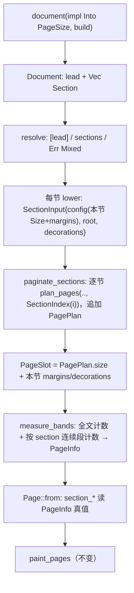

# 刀 10 候选 C1：Document 持有 `Vec<Section>`，分页按节顺序走

基线：`feat/section` @ `a12b610`。权威：提案书 §2.10 / §2.11 / §2.12 / §7 + 确认总表 > AGENTS.md > 设计稿技术核实。

组织思想：**Document 持有若干 `Section`；每个 Section 自带纸张覆盖、边距、四个装饰钩子、正文流。分页对每节单独跑一次现有 `plan_pages`，把产出的 `PagePlan` 按节序追加并打上节下标；分页全部结束后再一次性填两套页码、测带、画页。**

---

## Problem

今天一份 `document(Size, …)` 就是一个隐式 section：一份 `Size`、一份 `Margins`、一套装饰闭包、一条正文流。分页只认一份 `PaginateConfig`，`PageInfo` 只有全文页码，公共 `Page.section_*` 是 `Page::from` 里抄出来的别名。

刀 10 要做到：

1. 对外叫 `section`；一份文档可以有多个 section；新 section 一定从新物理页开始，上一节末页没排满也一样。
2. `document` 带默认纸张，section 可以覆盖。纸张是「常用规格枚举 + 方向」或 `Custom`，Custom 不带方向。
3. margin / header / footer / behind / front 属于 section；单节文档里 `doc.header` 等写法不变。
4. 装饰闭包能读到两套页码（全文、节内），都从 1 起，分页后填入。
5. 刀 8 的页眉左右槽按左右边距内缩保持不变；依赖方向不变；krilla 不外泄。

---

## Usage（调用方视角）

### 1. 单节文档：今天的代码一行不改

```rust
let pdf = document(A4, |doc| {            // A4 仍是 geom::Size；Size: Into<PageSize>
    doc.font(font_bytes)?;
    doc.margins(Margins::uniform(NonNegative::pt(36.0)?));
    doc.header(|h| {
        let p = h.page();
        h.left("ACME");
        h.right(format!("{} / {}", p.number, p.count));
    });
    doc.paragraph(|p| p.text("正文"));
    doc.front(|page| {
        if page.is_last() {
            page.image_at(&seal, rect);
        }
    });
    Ok(())
})?;
```

`doc.paragraph` / `doc.header` / `doc.margins` 写进**隐式首节**。单节时 `section_number == number`、`section_count == count`。这一点现在由真实计数得出，不再靠别名。

### 2. 用枚举指定默认纸张

```rust
document(Paper::A4, |doc| { … })                                           // 竖向
document(PageSize::Paper(Paper::A3, Orientation::Landscape), |doc| { … })  // 横向
document(PageSize::Custom(Size::try_mm(100.0, 150.0)?), |doc| { … })       // 最终尺寸，不带方向
```

### 3. 多节：合订两篇公文，第二篇横向、页眉不同

```rust
let pdf = document(Paper::A4, |doc| {
    doc.font(font_bytes)?;
    let seal = doc.load_image(seal_png, ImageFormat::Png)?;   // 图片与字体仍挂在 document 上

    doc.section(|s| {                                          // 用文档默认纸张 A4 竖向
        s.margins(Margins::uniform(NonNegative::pt(72.0)?));
        s.footer(|f| {
            let p = f.page();
            f.left(format!("总第 {} 页", p.number));
            f.right(format!("本篇 {} / {}", p.section_number, p.section_count));
        });
        s.paragraph(|p| p.text("第一篇……"));
    });

    doc.section(|s| {                                          // 强制新物理页
        s.page_size(PageSize::Paper(Paper::A4, Orientation::Landscape));
        s.margins(Margins::uniform(NonNegative::pt(36.0)?));
        s.header(|h| h.left("附表"));
        s.table(|t| { … });
        s.front(move |page| {
            let p = page.page();
            if p.section_number == p.section_count {           // 本节末页盖章
                page.image_at(&seal, rect);
            }
        });
    });
    Ok(())
})?;
```

### 4. 混写会报错

```rust
document(Paper::A4, |doc| {
    doc.paragraph(|p| p.text("前言"));      // 写进隐式首节
    doc.section(|s| { … });                 // 又有显式节
    Ok(())
})
// => Err(Error::SectionMixedWithDocumentContent)，任何页都还没画
```

规则只有一句：**一份文档要么全部用 `doc.*` 写成单节，要么全部用 `doc.section(..)` 写。** `doc.font` / `doc.load_image` 是文档级设置，两种写法都能用。

### 5. 节内语义（继承今天的单节行为）

| 写法 | 结果 |
| --- | --- |
| 空 section | 占 1 页空白（今天空文档也是 1 页），装饰照画 |
| 节首 `page_break` | 不起作用 |
| 节末单个 `page_break` | 丢掉，不多出空白页（和今天 EOF 一样） |
| 节内 `page_break; page_break` | 本节内多一页空白，计入两套页码 |
| 节内正文超高（keep_together 等） | `UnsplittableTallerThanFrame`，用的是**该节**的正文框 |
| 节边距吃光该节纸张 | `InvalidGeometry`，在画任何页之前报 |

做不出来的写法（类型层面就不存在）：

- `Custom` 带方向：`PageSize::Custom(Size)` 没有方向字段。
- section 套 section：`Section` 没有 `section` 方法。
- 在 section 闭包里登记字体或图片：`Section` 不借 `Document`。

---

## Shape

### 数据形状

| 名字 | 位置 / 可见性 | 形状 | 不变量 |
| --- | --- | --- | --- |
| `Paper` | `geom`，`pub`，`#[non_exhaustive]` | `A0 A1 A2 A3 A4 A5 A6 Letter Legal` | 每个值的竖向尺寸是编译期常量 |
| `Orientation` | `geom`，`pub` | `Portrait \| Landscape` | 只出现在 `PageSize::Paper` 里 |
| `PageSize` | `geom`，`pub` | `Paper(Paper, Orientation) \| Custom(Size)` | Custom 不可能带方向；解析结果永远是正的 `Size` |
| `Section<'a>` | `document`，`pub` | `{ page_size: Option<PageSize>, margins: Option<Margins>, header, footer: Option<BandHook>, behind, front: Option<LayerHook>, body: Flow }`；`Deref<Target = Flow>` | `None` 表示「沿用文档默认 / 四边 0」；`margins` 用 `Option` 是为了判断首节有没有被写过 |
| `Document<'a>` | `document`，`pub` | `{ page_size: PageSize, doc, fonts, images, lead: Section<'a>, sections: Vec<Section<'a>> }`；`Deref` 到 `lead.body` | 交给分页时：`sections` 为空就用 `[lead]`；非空且 `lead` 没写过就用 `sections`；否则报错 |
| `Page` | `document`，`pub`，`#[non_exhaustive]`（已有） | 字段不变：`number count section_number section_count size margins` | `section_*` 是真实节内计数 |
| `SectionInput<'a>` | `layout::paginate`，`pub(crate)` | `{ config: PaginateConfig, root: FlowNode, decorations: Decorations<'a> }` | 一节 lower 之后的样子；纸张已解析成 `Size` |
| `SectionIndex` | `layout::decorate`，`pub(crate)` | `struct SectionIndex(u32)` | 只由 `paginate_sections` 对节列表 `enumerate` 时生成，所以一定在界内 |
| `PagePlan` | `layout::paginate`，私有（扩展） | `{ size: Size, section: SectionIndex, placed }` | 同一节的页连续；每节至少 1 页 |
| `PageInfo` | `layout::decorate`，`pub(crate)`（扩展） | `{ number, count, section_number: PageNumber, section_count: PageCount, size, margins }` | `section_number ≤ section_count`；`number ≤ count` |
| `PageSlot<'d, 'a>` | `layout::decorate`，`pub(crate)` | `{ section: SectionIndex, size: Size, margins: Margins, decorations: &'d Decorations<'a> }` | 测带用的临时视图，不是新的页模型；按 `section` 连续段算节内计数 |

`PaginateConfig`、`Decorations`、`PageBands`、`paint_pages`、`Band::lower`、`Layer`、canvas、backend：**都不改**。

### 公共签名

```rust
// src/geom.rs
#[derive(Debug, Clone, Copy, PartialEq, Eq)]
#[non_exhaustive]
pub enum Paper { A0, A1, A2, A3, A4, A5, A6, Letter, Legal }

#[derive(Debug, Clone, Copy, PartialEq, Eq)]
pub enum Orientation { Portrait, Landscape }

#[derive(Debug, Clone, Copy, PartialEq, Eq)]
pub enum PageSize {
    /// A standard sheet turned to `Orientation`.
    Paper(Paper, Orientation),
    /// A final size. Orientation does not apply.
    Custom(Size),
}

impl PageSize {
    pub(crate) const fn resolve(self) -> Size { todo!() }   // Landscape 只是交换宽高
}
impl From<Paper> for PageSize { /* Paper(p, Portrait) */ }
impl From<Size>  for PageSize { /* Custom(s) */ }
```

各规格的竖向尺寸（`from_trusted_pt`，mm 经 `MM_TO_PT`；Letter/Legal 直接用 pt）：

| `Paper` | 竖向 |
| --- | --- |
| `A0` | 841 × 1189 mm |
| `A1` | 594 × 841 mm |
| `A2` | 420 × 594 mm |
| `A3` | 297 × 420 mm |
| `A4` | 210 × 297 mm（解析结果与现有 `geom::A4` 逐位相等） |
| `A5` | 148 × 210 mm |
| `A6` | 105 × 148 mm |
| `Letter` | 612 × 792 pt（与 `geom::LETTER` 逐位相等） |
| `Legal` | 612 × 1008 pt |

```rust
// src/document.rs
pub fn document<'a>(
    page_size: impl Into<PageSize>,
    build: impl FnOnce(&mut Document<'a>) -> Result<()>,
) -> Result<Rendered>;

impl<'a> Document<'a> {
    // 已有，改为写进隐式首节；签名不变
    pub fn margins(&mut self, margins: Margins);
    pub fn header(&mut self, f: impl Fn(&mut Band) + 'a);
    pub fn footer(&mut self, f: impl Fn(&mut Band) + 'a);
    pub fn behind(&mut self, f: impl Fn(&mut Layer) + 'a);
    pub fn front(&mut self, f: impl Fn(&mut Layer) + 'a);

    /// Appends a section. It starts on a new page.
    pub fn section(&mut self, f: impl FnOnce(&mut Section<'a>));
}

pub struct Section<'a> { /* 私有字段，见上表 */ }

impl<'a> Section<'a> {
    /// Overrides the document's page size for this section.
    pub fn page_size(&mut self, page_size: impl Into<PageSize>);
    pub fn margins(&mut self, margins: Margins);
    pub fn header(&mut self, f: impl Fn(&mut Band) + 'a);
    pub fn footer(&mut self, f: impl Fn(&mut Band) + 'a);
    pub fn behind(&mut self, f: impl Fn(&mut Layer) + 'a);
    pub fn front(&mut self, f: impl Fn(&mut Layer) + 'a);
}
impl Deref for Section<'_> { type Target = Flow; }
impl DerefMut for Section<'_> {}

// src/error.rs（Error 已是 #[non_exhaustive]）
/// The document wrote content or section settings directly on `doc` and also added sections.
SectionMixedWithDocumentContent,

// src/lib.rs 新增重导出
pub use geom::{Orientation, PageSize, Paper};
pub use document::Section;
```

`Document` 上的五个糖方法转调 `self.lead` 上同名方法，不复制逻辑。

### 内部签名（layout）

```rust
// src/layout/paginate.rs
pub(crate) struct SectionInput<'a> {
    pub(crate) config: PaginateConfig,
    pub(crate) root: FlowNode,
    pub(crate) decorations: Decorations<'a>,
}

/// Plans every section, then numbers and measures all pages, then paints.
/// Nothing reaches `canvas` unless every section plans and measures.
pub(crate) fn paginate_sections(
    sections: Vec<SectionInput<'_>>,
    ctx: &mut LayoutCtx<'_>,
    canvas: &mut dyn Canvas,
) -> Result<()>;

/// One-section wrapper; existing layout tests keep calling it.
pub(crate) fn paginate_root(
    root: FlowNode,
    ctx: &mut LayoutCtx<'_>,
    config: PaginateConfig,
    decorations: &Decorations<'_>,   // 见风险 4：借用改为按值或用 SectionInput 内部借用
    canvas: &mut dyn Canvas,
) -> Result<()>;

fn plan_pages(
    root: FlowNode,
    ctx: &mut LayoutCtx<'_>,
    config: PaginateConfig,
    section: SectionIndex,           // 新增：只用来给新开的 PagePlan 打标签
) -> Result<Vec<PagePlan>>;

// src/layout/decorate.rs
pub(crate) struct SectionIndex(u32);

pub(crate) struct PageSlot<'d, 'a> {
    pub(crate) section: SectionIndex,
    pub(crate) size: Size,
    pub(crate) margins: Margins,
    pub(crate) decorations: &'d Decorations<'a>,
}

/// Numbers pages across the document and within each run of equal `section`,
/// then runs each page's own section hooks. Failure leaves the canvas untouched.
pub(crate) fn measure_bands(
    pages: &[PageSlot<'_, '_>],
    ctx: &mut LayoutCtx<'_>,
) -> Result<Vec<PageBands>>;
```

### 管线



`paginate_sections` 的主体：

```rust
let mut plans = Vec::new();
for (i, s) in sections.iter_mut().enumerate() {
    let idx = SectionIndex::new(i)?;                       // u32 溢出报 InvalidGeometry
    plans.extend(plan_pages(take(&mut s.root), ctx, s.config, idx)?);
}
let slots: Vec<PageSlot> = plans.iter().map(|p| {
    let s = &sections[p.section.get()];
    PageSlot { section: p.section, size: p.size, margins: s.config.margins, decorations: &s.decorations }
}).collect();
let bands = measure_bands(&slots, ctx)?;
paint_pages(&plans, &bands, canvas)
```

强制新页不需要新流节点：每节各跑一次 `plan_pages`，游标从 `Fresh` 起，页从空开始。节末的 `PendingBlank` 由该节自己的 `finalize_eof` 丢掉，和今天文档结尾一样。每节至少产出 1 页，所以 `section_count` 一定能放进 `NonZeroU32`。

`measure_bands` 计数：`count = pages.len()`；节内计数用 `pages.chunk_by(|a, b| a.section == b.section)`（MSRV 1.92 可用），每段长度就是 `section_count`，段内下标 +1 是 `section_number`。

### 模块图

```text
document.rs  ── Document{lead, sections}, Section, Page::from 读真值
   │             lower: Section → SectionInput（PageSize::resolve 在这里）
   ▼
layout/paginate.rs ── SectionInput, paginate_sections, paginate_root(包装), PagePlan+section
   │
   ▼
layout/decorate.rs ── SectionIndex, PageSlot, PageInfo+section_*, measure_bands(按页选钩子)
   │
   ▼
canvas.rs ── 不变（start_page(Size) 已按页）
backend/  ── 不变（emit_page 已按页 from_wh）

geom.rs ── Paper, Orientation, PageSize（纯几何，不依赖 layout）
```

依赖方向没有变：document → layout → (fonts, text, canvas)；backend → canvas + krilla。`PageSize` 放在 `geom`，因为它要用私有的 `from_trusted_pt` 写编译期常量，而且 layout 只需要解析后的 `Size`。

---

## Tradeoffs accepted

1. **入口改成 `impl Into<PageSize>`，`Size` 当作 `Custom`。** 现有 24 处 `document(A4, …)` 不用改；提案示例 `document(PageSize::…)` 也能写。代价是 `A4`（`Size`）和 `Paper::A4`（枚举）两种写法并存。`A4` / `LETTER` 常量保留，因为它们已公开、测试也在用，而且 `Paper::A4` 解析结果和 `A4` 逐位相等，两种写法画出的页没有差别。
2. **`Custom(Size)` 而不是 `Custom(Length<Positive>, Length<Positive>)`。** `Size` 本来就是两个 `Length<Positive>`，已有 `try_pt` / `try_mm` / `new`，再写一遍会多一套校验；同时 `From<Size>` 才能让旧调用继续编译。
3. **首节与显式节混写是运行时错误（延迟到 `document` 返回前），不是类型错误。** `Deref<Target = Flow>` 必须一直有一条流可写，所以 `doc.paragraph` 在类型上没法禁止。这和现有「builder 错误延迟报」一致，报错时画布为空。代价是错误到组装结束才出现，不在出错那一行。
4. **section 不继承文档级 margin / header。** 文档级只剩默认纸张、字体、图片。好处是语义只有一种（钩子只属于一节），也不需要「本节关掉页眉」的开关（那是搁置项）。代价是多节文档要在每节重复写页脚闭包；调用方可以把闭包抽成函数。
5. **`is_last` 仍指全文末页，不加 `is_section_last`。** 提案没有定义节末谓词。`section_number == section_count` 已能表达，公共面不加东西。
6. **`plan_pages` 多一个 `section` 参数并传到三个辅助函数。** 换来 `PagePlan` 自带节归属，满足「扩展 `PagePlan` 而不是另起页模型」。`PageSlot` 只是给 `measure_bands` 的借用视图，测完就扔。
7. **`Paper` 标 `#[non_exhaustive]`。** 将来加 B 系列不算破坏性改动；代价是调用方 `match Paper` 要写通配分支（调用方很少 match 纸张）。

---

## Alternatives considered

| 方案 | 为什么不选 |
| --- | --- |
| `FlowNode::SectionBreak` 放进一条长流，流里带配置 | 断行框、边距、钩子要在流中途切换，`plan_pages` 要大改；`PageBreak` 的 `PendingBlank` 语义也会混进来。逐节调用现有 `plan_pages` 的改动更小 |
| 文档级 `doc.margins` / `doc.header` 当所有节的默认值 | 语义变成两层叠加，还要加「本节不要页眉」的开关（搁置项）。提案说这些挂在 section 上，糖只服务单节 |
| 隐式首节 + 显式节都排（首节内容排在最前） | `doc.paragraph` 写在 `doc.section` 后面时，输出顺序和代码顺序不一致，容易误用 |
| 两个入口：`document` 只能单节，`document_sections` 只能多节 | 混写变成类型错误，但公共面多一个入口函数和一个 builder 类型，而且多节文档就不能用 `Document` 上的字体、图片方法，要复制一份 |
| `PageSize::A4` 等关联常量 | 每个规格多一个公共名字。`From<Paper>` 加 `Paper::A4` 已经够短 |
| `PageSize { paper, orientation: Option<Orientation> }` 或 `Custom` 也带方向 | 可以写出 Custom+方向，违反 §2.11 |
| `measure_bands` 接 `&[PageInfo]` + `&[Decorations]` 按下标取 | 多一处下标查找；`PageSlot` 直接带引用，`measure_bands` 内不需要下标 |
| `PageInfo` 改成嵌套 `{ document: PagePosition, section: PagePosition }` | 更整齐，但现有 decorate 测试里的 `page.number.get()` 要跟着改。平铺加两个字段 diff 最小 |

---

## Open questions and risks

1. **`is_last` 的节语义。** 本设计保持「全文末页」。如果裁决要求节末，`Page` 是 `#[non_exhaustive]`，以后加 `is_section_last()` 不破坏兼容。
2. **页眉槽内缩随节边距变化。** `Band::lower` 读 `page.margins`，每页拿到的是所属节的边距，所以内缩按节生效，代码不用改。与 §2.10「横跨全宽、调用方自己缩」的字面差异沿用刀 8 的处理，本刀不动。
3. **首节「写过」的判断。** 判断条件：`lead.body` 有节点或有错误、任一钩子已设、`margins` 是 `Some`。显式写 `doc.margins(Margins::default())` 再加 section 也会报错，这是有意的：写了就算写过。
4. **`paginate_root` 的借用。** 今天它接 `&Decorations`，而 `SectionInput` 按值持有 `Decorations`。包装函数可以让 `SectionInput` 持有 `&'d Decorations<'a>`，或者把测试辅助改成按值传。实现时选 diff 小的一种；不影响公共面。
5. **大量节导致 `SectionIndex(u32)` 溢出。** 节数受页数上限约束（每节 ≥ 1 页），走现有 `limits` 的页数检查即可；`SectionIndex::new` 溢出时报 `InvalidGeometry`。
6. **A 系列名单。** 本稿列 A0–A6、Letter、Legal。总表写「实现前可再钉」，若裁决增删，只改 `Paper` 和常量表，其他代码不动。
7. **错误变体名。** `SectionMixedWithDocumentContent` 是新的公共变体名，提案未指定，可在合成时改名。
8. **section 闭包里不能 `load_image`。** 图片要在 `doc.section` 外先登记再 `move` 进闭包。§1 示例的写法本来就是这样，但需要在 `Section` 文档里写明。

---

## Next implementation step

按层推进，每步 `cargo fmt` / `clippy -D warnings` / `test` 通过：

1. **geom**：加 `Paper` / `Orientation` / `PageSize`、`resolve`、两个 `From`。测试：`Paper::A4` 竖向等于 `A4`（逐位）；`Letter` 等于 `LETTER`；`Landscape` 交换宽高；A 系列每项与 mm 公式误差 `< 1e-3`。
2. **decorate**：`SectionIndex`、`PageSlot`、`PageInfo` 加 `section_number` / `section_count`，`measure_bands` 改签名并按连续段计数。现有 decorate 测试经 `paginate_root` 包装继续通过。
3. **paginate**：`PagePlan.section`、`plan_pages(.., section)`、`SectionInput`、`paginate_sections`；`paginate_root` 改成单节包装。新增 layout 测试：两节，第一节只有一行字（末页未满），第二节横向 → 2 页，`RecordedPage::size` 依次是竖、横；第二节正文原点用第二节边距。
4. **document**：`Section`、`Document { lead, sections }`、糖方法转调、混写检查、`Page::from` 读真值、`document(impl Into<PageSize>)`、新错误变体、`lib.rs` 重导出。集成测试（`tests/document.rs`）：
   - 现有 `footer_sees_section_counters_equal_to_document_totals` 不改仍通过；
   - 两节分别 2 页、1 页：页脚依次 `1/3·1/2`、`2/3·2/2`、`3/3·1/1`；
   - 第二节换边距：页眉左槽 x 等于第二节左边距（刀 8 内缩按节生效）；
   - 混写 → `SectionMixedWithDocumentContent`，`pages()` 为空；
   - 空 section → 1 页且装饰照画；节末单个 `page_break` 不多出页。
5. **backend 冒烟**（`--features backend-krilla`）：两节不同纸张 `to_pdf` 以 `%PDF` 开头。只断言这一项，不断言内容流。

---

## Synthesis decision

（由 arena 合成阶段填写。）
