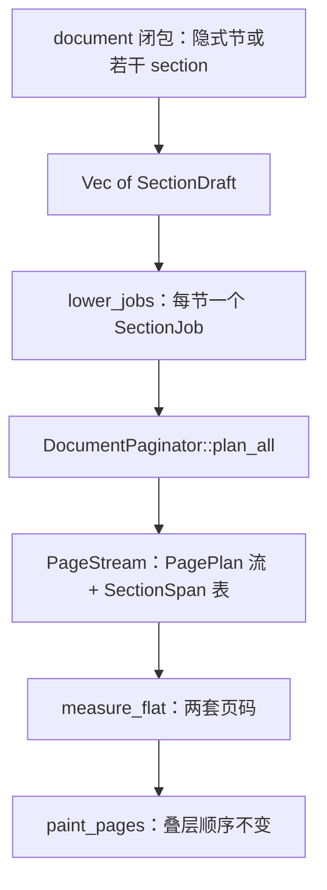

# Knife 10 candidate 2 — 两段式 `DocumentPaginator`

Baseline `a12b610`。权威：提案书 §2.10 / §2.11 / §2.12 / §7 与确认总表 > `AGENTS.md` > 设计稿里已核对的技术事实。

组织方式选 **B**。组装期把每一节 lower 成独立的 `(PaginateConfig, Decorations, FlowNode)`。`DocumentPaginator` 对每节各调用一次现有 `plan_pages`，把结果拼成一条页流。节的范围、边距、装饰和两套页码都落在与页流平行的 `SectionSpan` 表上。`PagePlan` 保持 `{ size, placed }`。

## Problem

今天 `document(Size, …)` 是一个隐式 section：一份 `PaginateConfig`、一份 `Decorations`、一个正文 `Stack`。`plan_pages` 用这一份正文框排完全文；`PagePlan.size` 每页都写成同一个 `config.page_size`；`measure_bands` 按页读尺寸，边距和四条钩子仍是全文一份。公共 `Page` 已有 `section_number` / `section_count`，`From<&PageInfo>` 把它们抄成全文 `number` / `count`。

刀 10 要的是版式段，不是另一种 `PageBreak`。新节必须另起物理页，即使上一节末页还有剩余高度。节可以盖过文档默认纸张。边距、页眉、页脚、`behind`、`front` 跟着节走。两套页码都从 1 起，并且要等**全部节都排完**才填得进闭包。单节文档继续用 `doc.margins` / `doc.header` / `doc.footer` / `doc.behind` / `doc.front`。

现有 `PageCursor` 不能承担段界：开头的 `PageBreak` 被吃掉，内容后再来一个 `PageBreak` 会在 EOF 丢掉 `PendingBlank`。段界若插进同一条游标，会和「一个 break 不留空页」缠在一起。换纸若只改 `PagePlan.size`、不换那一节的 `body_width` / `body_height` / `body_origin`，页脚位置会对，正文框仍是第一节的。

## Usage (caller's view)

入口只收 `PageSize`。竖向常用规格用关联常量；横向只写在 `StandardSize` 上；自定义尺寸用已经是最终宽高的 `Size`。`document(A4)` 里的 `A4` 仍是今天的 `Size` 常量，调用处改成 `PageSize::A4`。录到的页尺寸仍然等于 `A4`。

```rust
use quire::{
    document, Band, Layer, Margins, NonNegative, PageSize, StandardSize, A4, LETTER,
};

let rendered = document(PageSize::A4, |doc| {
    let margin = Margins::uniform(NonNegative::pt(36.0)?);
    doc.margins(margin);
    doc.header(|band: &mut Band| {
        let page = band.page();
        band.left(format!("总 {}/{}", page.number, page.count));
        band.right(format!("节 {}/{}", page.section_number, page.section_count));
    });
    doc.paragraph("第一节，A4 竖向。不满页也会在下一节之前结束。");

    doc.section(|sec| {
        sec.paper(StandardSize::A4.landscape());
        sec.margins(margin);
        sec.footer(|band: &mut Band| {
            let page = band.page();
            band.left(format!("本节 {}/{}", page.section_number, page.section_count));
        });
        sec.paragraph("第二节，A4 横向，从新的物理页开始。");
        sec.page_break();
        sec.paragraph("仍在第二节。");
        Ok(())
    })?;

    doc.section(|sec| {
        sec.paper(PageSize::custom(LETTER));
        sec.paragraph("第三节，Letter 的最终宽高，没有方向可再套。");
        Ok(())
    })?;
    Ok(())
})?;
```

调用方看到的规则：

1. 不调用 `section` 时，整份闭包就是唯一一节。纸张是 `document` 的参数。`doc.margins` / `header` / `footer` / `behind` / `front` 和正文都写在这一节上。节内页码与全文页码相同，因为整份页流只有一个 `SectionSpan`。
2. `section` 闭包是后面的一节。它从新的物理页开始。纸张不写就用文档默认；`paper` 写了就盖过默认。边距默认四边 0。四条钩子默认没有，不从前面的节抄过来。
3. `doc` 上的正文或页面钩子只属于隐式第一节。一旦出现 `section`，再写 `doc.paragraph` 或 `doc.header` 会得到 `Error::ContentOutsideSection`，画布保持空白。字体和图片仍在文档上登记：`doc.font` / `doc.load_image` 在节与节之间可以继续调用。`Image` 是 `Copy`，移进节闭包。`Section` 上没有 `font` / `load_image` / `section`。
4. 只调用 `section`、闭包开头什么正文和钩子都没写时，不会多出一页空白前言。`doc.font` 不算「写过第一节」。
5. 在 `doc` 上设过边距、钩子或正文之后再 `section`，那些设置留在第 0 节。第 0 节即使没有正文也占一页。边距和页眉要进哪一节，就写在哪一节里。
6. 空的 `section(|_| Ok(()))` 仍占一页。节内 `page_break` 沿用今天的游标：节末单独一个 break 不另加空白页；连续两个 break 才在**该节内部**插入空白页，并计入该节页数和全文页数。下一节仍然自己起页。
7. 闭包在分页全部完成后才跑。`number` / `count` 是全文物理页，从 1 起，空白页算进去。`section_number` / `section_count` 是该节从自己第一页起算的序号和节内总页数。`is_last` 仍是全文末页。节的最后一页用 `section_number == section_count` 判断。
8. 页眉槽仍按**这一页**的左右 margin 内缩（刀 8）。带高仍是这一节的上下 margin。装不下就报错，不改框、不回流。叠层顺序不变：`behind` → `header` → 正文 → `footer` → `front`。

纸张怎么写：

| 调用 | 含义 |
| --- | --- |
| `document(PageSize::A4, …)` | A4 竖向。`PageSize::A0`…`A6`、`PageSize::LETTER`、`PageSize::LEGAL` 同理，都是竖向 |
| `document(StandardSize::A4.landscape(), …)` | A4 横向，宽高由竖向规格对调 |
| `document(PageSize::custom(size), …)` | `size` 已是最终页框。没有方向参数 |
| `sec.paper(PageSize::LETTER)` | 这一节改用 Letter 竖向 |
| `sec.paper(StandardSize::Legal.landscape())` | 这一节改用 Legal 横向 |

`PageSize` 没有 `landscape` 方法。`Custom` 变体也没有方向字段。横向纸只有 `StandardSize::portrait` / `landscape` 两条构造。

为什么入口是 `PageSize` 而不是继续收 `Size`：§2.11 的文档默认纸张带方向。`Size` 只是排完的页框，装不下「A4 + 横向」。Rust 没有重载；再加一个 `document_with_size` 会变成两个入口。`impl Into<PageSize>` 会把今天的 `document(A4)` 悄悄收成 `Custom`，和 `PageSize::A4` 变成两个变体、同一套点值，以后一旦要区分规格名就会分叉。所以入口只收 `PageSize`。已有测试把第一个参数改成 `PageSize::A4`；对 `RecordedPage` 尺寸的断言仍拿 `geom::A4` 比较。

## Shape

### 数据

页流和节表是两份数据。页上没有节号。

| 名字 | 可见性 | 字段 | 不变量 |
| --- | --- | --- | --- |
| `StandardSize` | 公共 | `A0` `A1` `A2` `A3` `A4` `A5` `A6` `Letter` `Legal` | 闭集。没有 `Default` |
| `Orientation` | 公共 | `Portrait` `Landscape` | 只出现在 `PageSize::Standard` |
| `PageSize` | 公共 | `Standard { size: StandardSize, orientation: Orientation }` 或 `Custom(Size)` | `Size` 两维都是 `Length<Positive>`。`Custom` 上写不出方向 |
| `Section` | 公共 | 构建期借到一节草稿 | 没有 `section` 方法，节里不能再开节 |
| `SectionDraft<'a>` | 私有 | `paper: Option<PageSize>`，`margins: Margins`，四条 `Option` 钩子，`body: Flow` | `paper == None` 表示用文档默认。钩子后一次替换前一次 |
| `BodyCursor<'a>` | 私有 | `Implicit(SectionDraft)` 或 `Explicit { sections: Vec<SectionDraft>, sink: Flow }` | 文档从 `Implicit` 起步。`Explicit.sections` 非空 |
| `SectionJob<'a>` | `pub(crate)` | `config: PaginateConfig`，`decorations: Decorations<'a>`，`root: FlowNode` | 一节一个根。根是该节节点的 `Stack` |
| `SectionSpan<'a>` | `pub(crate)` | `start: u32`，`len: NonZeroU32`，`margins: Margins`，`decorations: Decorations<'a>` | `len ≥ 1`。装饰挂在区间上，不挂在每一页上 |
| `PageStream<'a>` | `pub(crate)` | `pages: Vec<PagePlan>`，`spans: Vec<SectionSpan<'a>>` | 区间首尾相接，盖住 `pages`，没有空隙。只有分页器能造 |
| `PagePlan` | 私有，已有 | `size: Size`，`placed: Vec<PlacedFragment>` | 本刀不加字段 |
| `PageInfo` | `pub(crate)` | 现有 `number` `count` `size` `margins`，加上 `section_number: PageNumber`，`section_count: PageCount` | 两个计数都是 `NonZeroU32`，在 `plan_all` 返回之后填写 |
| `DocumentPaginator<'a>` | `pub(crate)` | `jobs: Vec<SectionJob<'a>>` | `jobs` 非空。按顺序排，不并行 |

`Page` 的公共字段不变，仍是 `number`、`count`、`section_number`、`section_count`、`size`、`margins`。`From<&PageInfo>` 改成抄 `PageInfo` 上的节计数，删掉「节计数等于全文」那条特殊赋值。单节时两边相等，是因为唯一的 span 盖住全部页，不是因为还有一条别名分支。

竖向规格（横向把宽高对调，用同一对 `Length`，不再乘一次毫米）：

| `StandardSize` | 竖向 | 单位 |
| --- | --- | --- |
| `A0` | 841 × 1189 | mm，`MM_TO_PT` |
| `A1` | 594 × 841 | mm |
| `A2` | 420 × 594 | mm |
| `A3` | 297 × 420 | mm |
| `A4` | 210 × 297 | mm，与现有 `A4` 同一公式 |
| `A5` | 148 × 210 | mm |
| `A6` | 105 × 148 | mm |
| `Letter` | 612 × 792 | pt，与现有 `LETTER` 同一对整数 |
| `Legal` | 612 × 1008 | pt（8.5 in × 14 in） |

A 系列走 `Size::from_trusted_pt(mm * MM_TO_PT, …)`。Letter / Legal 不经毫米舍入。`geom::A4` 与 `geom::LETTER` 保留，并改成从这张表生成，点值的 `to_bits` 与今天一致。新增 `Size` 常量 `A0` `A1` `A2` `A3` `A5` `A6` `LEGAL`，都是竖向页框，给断言用。

### 签名

```rust
pub enum StandardSize {
    A0, A1, A2, A3, A4, A5, A6, Letter, Legal,
}

pub enum Orientation {
    Portrait,
    Landscape,
}

pub enum PageSize {
    Standard { size: StandardSize, orientation: Orientation },
    Custom(Size),
}

impl StandardSize {
    pub const fn portrait(self) -> PageSize;
    pub const fn landscape(self) -> PageSize;
    pub(crate) const fn portrait_size(self) -> Size;
}

impl PageSize {
    pub const A0: Self = StandardSize::A0.portrait();
    pub const A1: Self = StandardSize::A1.portrait();
    pub const A2: Self = StandardSize::A2.portrait();
    pub const A3: Self = StandardSize::A3.portrait();
    pub const A4: Self = StandardSize::A4.portrait();
    pub const A5: Self = StandardSize::A5.portrait();
    pub const A6: Self = StandardSize::A6.portrait();
    pub const LETTER: Self = StandardSize::Letter.portrait();
    pub const LEGAL: Self = StandardSize::Legal.portrait();

    pub const fn custom(size: Size) -> Self;
    pub const fn resolve(self) -> Size;
}

pub fn document<'a>(
    page_size: PageSize,
    build: impl FnOnce(&mut Document<'a>) -> Result<()>,
) -> Result<Rendered>;

impl<'a> Document<'a> {
    pub fn section(
        &mut self,
        build: impl FnOnce(&mut Section<'_, 'a>) -> Result<()>,
    ) -> Result<()>;
    // margins / header / footer / behind / front 签名不变，写进隐式节
    // font / load_image 仍是文档级
}

impl<'doc, 'a> Section<'doc, 'a> {
    pub fn paper(&mut self, page_size: PageSize);
    pub fn margins(&mut self, margins: Margins);
    pub fn header(&mut self, f: impl Fn(&mut Band) + 'a);
    pub fn footer(&mut self, f: impl Fn(&mut Band) + 'a);
    pub fn behind(&mut self, f: impl Fn(&mut Layer) + 'a);
    pub fn front(&mut self, f: impl Fn(&mut Layer) + 'a);
}
// Section: Deref / DerefMut，Target = Flow
```

`PageSize::resolve`：

```rust
match self {
    PageSize::Standard { size, orientation: Orientation::Portrait } => size.portrait_size(),
    PageSize::Standard { size, orientation: Orientation::Landscape } => {
        let portrait = size.portrait_size();
        Size::new(portrait.height(), portrait.width())
    }
    PageSize::Custom(size) => size,
}
```

`document` 存 `default_paper: PageSize`，lower 时才 `resolve`。节的纸张是 `draft.paper.unwrap_or(default_paper).resolve()`，得到的 `Size` 写进那一节的 `PaginateConfig`。layout 之后只看见 `Size`。

游标：

- 起步是 `Implicit`，草稿的边距为 0，钩子为空，`paper` 为 `None`。
- `section` 若看到 `Implicit` 且草稿 pristine（正文空、无 Flow 错误、边距仍是默认、四条钩子都空），丢掉这份草稿。
- 草稿只要写过正文、边距或任一钩子，就先封进 `Explicit.sections`，再接收闭包里的新节。
- 封口之后 `Document` 的 `Deref` 目标换成 `sink`。`sink` 的 `push` 把第一个错误记成 `ContentOutsideSection`，节点不入流。`Document::margins` 和四条钩子在 `Explicit` 上走同一条错误，不改已封口的节。
- `section` 发现文档上已经有错误（含 sink 上的、或上一节 Flow 里的）就直接返回，不再跑闭包。
- `finish`：`Implicit` 收成单元素 `Vec`（空文档仍是一节，排成一页空白，与今天相同）；`Explicit` 交出 `sections`。

lower 在 `document::paint` 里做，发生在任何 `start_page` 之前：

```rust
fn lower_jobs(&mut self) -> Result<Vec<SectionJob<'_>>> {
    // 每份草稿：
    //   size = paper.unwrap_or(default_paper).resolve()
    //   config = PaginateConfig { page_size: size, margins }
    //   decorations = 四条钩子包成 Decorations（样式克隆方式与今天 paint 相同）
    //   root = FlowNode::Stack(body.into_nodes()?)
}
```

`FlowNode` 不增加节界变体。`check_content` 的拒绝表不动。节内顶层 `PageBreak` 仍只在该节 `Stack` 的直接子节点上生效。

分页器：

```rust
impl<'a> DocumentPaginator<'a> {
    pub(crate) fn paginate(
        self,
        ctx: &mut LayoutCtx<'_>,
        canvas: &mut dyn Canvas,
    ) -> Result<()>;
}

fn plan_all(self, ctx: &mut LayoutCtx<'_>) -> Result<PageStream<'a>> {
    let mut pages = Vec::new();
    let mut spans = Vec::new();
    for job in self.jobs {
        let planned = plan_pages(job.root, ctx, job.config)?;
        let len = NonZeroU32::new(planned.len() as u32).ok_or(Error::InvalidGeometry)?;
        spans.push(SectionSpan {
            start: pages.len() as u32,
            len,
            margins: job.config.margins,
            decorations: job.decorations,
        });
        pages.extend(planned);
    }
    PageStream::new(pages, spans)
}
```

`PageStream::new` 检查区间首尾相接且盖满 `pages`，否则 `InvalidGeometry`。`plan_pages` 今天对空根也会在 EOF 留下一页，所以正常路径 `len ≥ 1`。零页只作为内部不变量失败，不做成调用方能稳定触发的分支。

节与节之间不插入 `PageBreak`。上一节的 `PageCursor` 在 `plan_pages` 返回时已经结束；下一节的正文框、原点、`PagePlan.size` 来自它自己的 `PaginateConfig`。上一节末页没满，也不会变成下一节的第一页。

计数在 `plan_all` 之后、钩子运行之时填写。`measure_flat` 按 span 顺序走，第 `offset` 页（0 起）对应：

| 字段 | 值 |
| --- | --- |
| `number` | `span.start + offset + 1` |
| `count` | `pages.len()` |
| `section_number` | `offset + 1` |
| `section_count` | `span.len` |
| `size` | `pages[i].size` |
| `margins` | `span.margins` |

钩子用这一页的 `span.decorations`。带高、页脚 `y`、正文框都用这一页的 `size` 和这一节的 `margins`。`measure_band` / `measure_layer` 的判定保持刀 8：带框宽是整页宽，左右内缩仍在 `Band::lower`。

现有 `measure_bands(&[Size], Margins, &Decorations)` 改成先组一个单 span 的 `PageStream` 再调用 `measure_flat`。装饰单测仍从一个入口进来，公式只有这一处。

`paint_pages` 仍按页 `zip` `PagePlan` 与 `PageBands`：`start_page(page.size)`，然后 `behind` → `header` → 正文 → `footer` → `front`。它不读 span。某一节 `validate` 失败、正文排不下、或装饰超带，都在 `paint_pages` 之前返回，画布不 `start_page`。

`paginate_root` 收成一节 `SectionJob`，交给 `DocumentPaginator`。layout 单测继续走这个入口时，行为与单节文档相同。

新错误只有一个，给调用方能触发的情况：

```rust
/// 隐式节已经封口之后，又往 Document 上写了正文或页面钩子。
ContentOutsideSection,
```

边距把纸吃掉、零页、span 对不齐，继续用无字段的 `InvalidGeometry`。

### 模块

依赖仍是 `document → layout → (fonts, text, canvas)`。`PageSize::resolve` 在 `document` lower 时做完。`layout` 不新增纸张枚举分支。`backend` 仍只看见 `Canvas::start_page(Size)`。

| 模块 | 本刀落点 |
| --- | --- |
| `src/geom.rs` | `StandardSize`、`Orientation`、`PageSize`、`resolve`、竖向 `Size` 常量。`A4` / `LETTER` 从同一张表生成 |
| `src/document.rs` | `document(PageSize, …)`、`BodyCursor`、`Section` / `SectionDraft`、`lower_jobs`、`Page::from` 抄节计数。`Band::lower` 不改 |
| `src/layout/paginate.rs` | `SectionJob`、`SectionSpan`、`PageStream`、`DocumentPaginator`。`plan_pages` 与 `PagePlan` 的字段不改。`paginate_root` 转调分页器 |
| `src/layout/decorate.rs` | `PageInfo` 增加两套节计数。`measure_flat` 是唯一填计数的地方。`measure_bands` 变成单 span 适配 |
| `src/error.rs` | `ContentOutsideSection` |
| `src/lib.rs` | 重导出 `PageSize`、`StandardSize`、`Orientation`、`Section`、新的 `Size` 常量。不导出 `DocumentPaginator`、`SectionSpan`、`FlowNode` |
| `src/canvas.rs`、`src/backend/` | 不改。混合页尺寸已经能 `start_page` |



公共入口是 `document`、`PageSize` / `StandardSize` / `Orientation`、`Document::section`、`Section` 上的 `paper` 与四条钩子。纸张换算、pristine 判定、按节调用 `plan_pages`、span 覆盖检查、计数公式都在这些入口后面。调用方不看到 `FlowNode`、`PaginateConfig`、`PageStream`。

## Tradeoffs accepted

- 接受 `document` 的第一个参数从 `Size` 改成 `PageSize`，现有 `document(A4, …)` 要写成 `document(PageSize::A4, …)`。换来的是默认纸张和节覆盖用同一种类型，`Size` 只表示已经 resolve 的页框。
- 接受新节不继承前一节的边距和钩子。换来的是没有「清除页眉」这种第二套 API；单节糖仍然是 `doc.header` 那些方法本身。
- 接受在 `doc` 上写过边距或钩子再调用 `section` 时，那些设置占住第 0 节，即使第 0 节没有正文也会出一页。换来的是调用方写过的钩子不会被静默丢掉，也不会偷偷搬进下一节。
- 接受节封口之后的 `doc.paragraph` 是运行期 `ContentOutsideSection`，而不是另一套 `Document` 类型状态。换来的是 `document(|doc| …)` 仍是一个闭包、一个类型；`Deref` 到 `Flow` 的单节写法保持不变。
- 接受 `Flow` 上一个私有的拒收开关，只给封口后的 sink 使用。换来的是不必把每个正文方法在 `Document` 上再包一层。
- 接受每一节至少一页，因此 `section_count` 能放进已有的 `PageCount`（`NonZeroU32`）。空节也出空白页，并计入全文 `count`。
- 接受节末单独一个 `page_break` 仍不追加空白页。强制新页来自下一节自己的 `plan_pages`，不来自在段界多塞一个 break。
- 接受 `is_last` 继续表示全文末页。节末由已经存在的 `section_number == section_count` 表达，本刀不加谓词。
- 接受页眉左右槽继续按该页 margin 内缩。本刀不动 `Band::lower`。
- 接受预置边距枚举、奇偶换页、按页关闭页眉、path 原语、具名图片、fit/cover 继续留在刀 10 外面。

## Alternatives considered

- **每页 `PagePlan` 带上 `section_id` 和节内序号。** 节计数在该节排完之前还不知道总页数，页标签写早了也要再扫一遍。标签和 span 会变成两份节身份。本设计让 `PagePlan` 只回答「这一页的框和正文」，节的范围只放在 `SectionSpan`。
- **A：根上的 `SectionBreak` 流节点，另加按 id 索引的纸张/边距/钩子表。** 节界会进入 `FlowNode`，栏、单元格、列表里都能构造出来，再靠 `check_content` 拒绝。id 表和 break 的出现次数可以对不齐。规划器得在同一条 `PageCursor` 里区分 `SectionBreak` 和 `PageBreak`，而 EOF 会丢掉单个 `PendingBlank`。本设计把节挡在 `Flow` 外面，每节一个根，`plan_pages` 仍是「一份 config、一棵树」。
- **span 只存下标，装饰放到另一张按 `SectionId` 索引的表。** 两张表的长度可以分叉。本设计把 `margins` 和 `decorations` 放进 `SectionSpan` 本身，页流里没有指向节表的 id。
- **在两节之间插入合成的 `PageBreak`。** 会重新撞上「单个 break 不留页」。段界是 job 列表的拼接，不是流里的节点。
- **`document` 继续收 `Size`，或 `impl Into<PageSize>` 把 `Size` 收成 `Custom`。** 方向没有落点，或者 `document(A4)` 和 `document(PageSize::A4)` 表面都能编过、变体却不同。入口只保留 `PageSize`。
- **在 `PageSize` 上提供会在 `Custom` 上报错的 `landscape()`。** 非法组合变成运行期分支。方向只存在于 `StandardSize` 的两个 const 构造。
- **后一节继承前一节的钩子，直到被替换。** 需要清除操作，也让 `doc.header` 的糖和「钩子属于这一节」叠成两套规则。新节从空钩子和零边距起步，纸张才继承文档默认。
- **用类型状态把「已调用 section」编码进 `Document` 的类型参数。** 封口后的正文调用可以变成编不过。代价是闭包不再是单一的 `&mut Document`，单节糖和多节分成两种文档类型。本设计把这道检查留在 sink 的第一个错误上。

## Open questions and risks

- `is_last` 在多节函件里只在全文件最后一页为真。电子章若要盖在每一节末页，调用方比较 `section_number` 与 `section_count`。提案 §2.12 点了 `is_last`，没有点节末谓词。本刀不加方法；若产品要 `is_section_last`，它是 `Page` 上的一行，不改分页器。
- pristine 把「改过边距或钩子」算作第 0 节已占用。只想要多节、却把 `doc.margins` 写在闭包顶上的人，会多出一页带边距的空白。这条若改成「只有正文节点算占用」，顶上的钩子就要么丢弃、要么搬进第一节，两样都和现在的糖冲突。
- 节内空白页计入 `section_count`。这是为了让单节时 `footer_sees_section_counters_equal_to_document_totals` 仍成立。提案对节内空白页没有单独一句，这里把它说成与全文 `count` 同一口径。
- `measure_flat` 与 `paint_pages` 的条数必须相等。对不齐返回 `InvalidGeometry`，不用 `zip` 静默截断。
- 某一节纸高不同时，装饰超高错误里的 `height` 会是那一页的页高（现有 `measure_band` 在整页装不下时上报页高）。断言要按该节的 `Size` 写，不能沿用单一的 A4 页高。
- A 系列毫米表按 ISO 216 列到 A0–A6。确认总表把完整名单留在「实现前可再钉」。本刀把这张表当作实现期的钉，不把 B7 以上或 Tabloid 加进枚举。

## Next implementation step

先在 `geom` 落地 `StandardSize`、`Orientation`、`PageSize::resolve` 和竖向常量，并用 `to_bits` 钉住三件事：`PageSize::A4.resolve()` 与现有 `A4` 相同，`PageSize::LETTER.resolve()` 与 `LETTER` 相同，`StandardSize::A4.landscape().resolve()` 等于 `Size::new(A4.height(), A4.width())`。`document` 和分页先不动。几何测试通过之后，再把 `PageInfo` 的节计数字段和 `PageStream` 接上，让单节 `paginate_root` 走同一条 span 公式。

## Synthesis decision

由 arena synthesis 填写。
