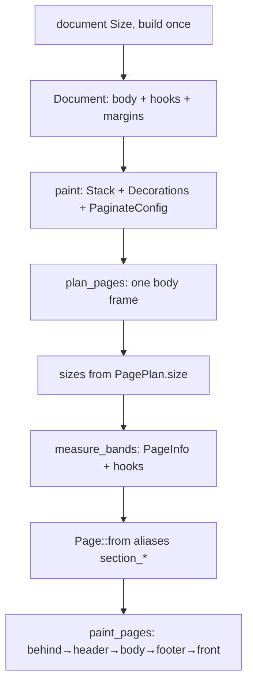

# 刀 10 入门：单隐式 section 的组装管线，以及多 section 要接的缝

基线：`a12b610`（`feat/image`）。权威：提案书 §2.10 / §2.11 / §2.12 / §7 > AGENTS.md > 设计稿技术核实。

来源：`how/explorer-document.md`、`how/explorer-layout.md`、`how/explorer-docs.md`（父会话核对合成）。

---

### Overview

今天一份 `document(Size, …)` 就是**一个隐式 section**：一个纸张 `Size`、一份 `Margins`、一套 header/footer/behind/front 闭包、一个正文 `Flow` 栈。组装闭包跑一次；分页只排正文；装饰闭包在 `measure_bands` 里按物理页再跑，失败则画布仍空。

公共 `Page` 已有 `section_number` / `section_count`，但 `From<&PageInfo>` 把它们**抄成**全文 `number` / `count`。纸张没有枚举或方向；调用方传入算好的 `Size`（`A4` / `LETTER` 是常量）。Canvas / krilla 已能按页开不同尺寸，layout 从不产出不同尺寸。

刀 10 要把「版式段」做成一等公民：多 section、遇新 section 强制新物理页、节级纸张/边距/装饰、双页码在分页后填真值。单节时保留 `doc.header` 等糖。

---

### Key Concepts

| 概念 | 现状 |
| --- | --- |
| `Document` | 一份 `page_size`、`margins`、四个钩子、`body: Flow`；`Deref` 到 `Flow` |
| `PaginateConfig` | `{ page_size, margins }`，整份文档一份；算 body 框 |
| `PagePlan` | `{ size, placed }`；size 字段按页存，生产者始终写 `config.page_size` |
| `PageInfo` | `{ number, count, size, margins }`；无 section 字段 |
| `Decorations` | 文档级四套 `Option` 闭包 |
| `Page`（公共） | 含 `section_*`；别名等于全文；`is_last` = 全文末页 |
| `Band::lower` | 刀 8 选择：左右槽用 Fixed 空栏按 side margin 内缩（测试钉死） |
| 纸张 | 仅 `Size` + `A4`/`LETTER`；无 `PageSize` / `Orientation` |

提案已定（§2.11 / §7）：对外名 `section`；新 section 强制新物理页；文档默认纸张 + section 可覆盖；尺寸枚举（至少 A 系列，名单实现时列）+ `Custom`；方向只配尺寸枚举；Custom 不再套方向；margin/装饰随 section；两套页码从 1 起、分页后填入；单节糖。

---

### How It Works

1. **组装。** 闭包写正文节点与四个页面钩子。钩子此时不跑。无 `doc.section`。
2. **`plan_pages`。** 用一份 body 宽高原点。`PageBreak` 游标：开头 break 空操作；内容后一个 break 不留空页；两个 break 才推空白页。空白页计入 `sizes.len()`，后面照样编号与装饰。
3. **`measure_bands`。** `count = sizes.len()`。每页同一份 `margins`、同一组装饰闭包。`PageInfo.size` 来自该页 `sizes[i]`（今天全相同）。
4. **`Page::from`。** `section_*` ← 全文计数（唯一赋值点）。
5. **`paint_pages`。** 每页 `start_page(page.size)`，叠层顺序固定。

后端 `emit_page` 已用该页宽高；`two_pages_with_different_sizes` 冒烟存在，但不是从 `document()` 来的。

---

### Where Things Live

| 路径 | 角色 |
| --- | --- |
| `src/document.rs` | DSL、`Page`、`Band`/`Layer`、糖与别名 |
| `src/layout/paginate.rs` | `PaginateConfig`、`plan_pages`、`paint_pages` |
| `src/layout/decorate.rs` | `PageInfo`、`measure_bands`、带高/带宽检查 |
| `src/geom.rs` | `Size`、`Margins`、`A4`、`LETTER` |
| `src/canvas.rs` / `backend/` | 按页 `Size` 已通 |
| `tests/document.rs` | 槽内缩、`section_*`==全文、叠层顺序 |

---

### Gotchas

- **双页码是别名，不是计算。** 改 DSL 不够；`PageInfo`（或等价物）必须在 measure 前带上节内计数。
- **`measure_bands` 已按页读 size，margin 仍是一份参数。** 换节边距要改签名或旁路向量。
- **换纸必须同时改断行框与 `PagePlan.size`。** 只改 size 会页脚对、正文框错。
- **新 section ≠ `PageBreak`。** 末页未满也要开新物理页；游标在 EOF 会丢掉单个 `PendingBlank`，段界不能只靠现有 break 语义。
- **页眉槽内缩是刀 8 实现选择**，与 §2.10「横可全宽、调用方自行缩进」字面略有取舍；刀 10 不要无故推翻（集成测试钉死）。
- **`is_last` 是全文末页。** 多节时节末是否另给谓词，提案未钉。
- A 系列完整名单与预置边距枚举在总表「实现前可再钉」；刀 10 实现时列全 A 系列即可。

---

### Knife 10 seams

1. **域模型。** Document 从「单 body + 单 config」变为「默认纸张 + 若干 section（各含 paper?/margins/hooks/flow）」；单节时 `doc.*` 糖到隐式唯一 section。
2. **纸张类型。** `PageSize`（或等价名）枚举 + `Orientation`；`Custom` 无方向；解析为最终 `Size` 发生在边界。
3. **分页。** 按 section 顺序各跑一段 `plan_pages`（或等价），节与节之间强制提交/开新页；每页记录 section 归属与该节 `PaginateConfig`；`PagePlan` 写出真实 size。
4. **装饰。** 每页选用所属 section 的 `Decorations` 与 margins；`PageInfo` 填全文与节内两套计数（分页完成后已知）。
5. **兼容。** 无显式 `section` 时行为与今日单隐式 section 一致（含 `section_*`==全文）。
6. **不做。** 某页关 header、奇偶 break、具名 images、fit/cover、流内 canvas、qr/svg/toc、header 全宽大翻修、path 层（除非被迫）。
