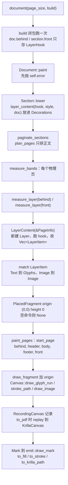

# behind / front 层今天怎么工作，刀 11 要接哪些缝

Tip：`feat/layer-path` @ `9eda8da`。行号以该提交为准。
产品依据：`docs/提案书.md` §2.12（527-543 行）。§2.14 流内 canvas 延后，不是本刀。

## Overview

behind / front 是**页面坐标逃逸层**。它不进正文流，不占正文高度，不换行。

调用方注册一个闭包。闭包不在注册时跑，也不在 `paint_pages` 里跑。它在分页之后的 `measure_bands` 里，每个物理页跑一次。所以它能看到最终页码。

闭包往 `Layer` 里推 `LayerItem`。`measure_layer` 把 item 翻成 `FragmentCommand`，装进一个原点 `(0, 0)`、高度 0 的 `PlacedFragment`。`paint_pages` 按固定叠层把它交给 `draw_fragment`，再到 `Canvas`。

今天 `Layer` 只有 `text_at` 和 `image_at`。§2.12 要求的 `line` / `rect` / `ellipse`、stroke/fill、旋转、半透明，DSL 一个都没有。

下层情况不一样：
- `Canvas::fill_path` / `stroke_path` 已经存在，一路通到 krilla。
- `Color` 的 alpha 已经在后端变成 krilla 的 fill/stroke opacity。
- 布局层的 `FragmentCommand` 有 `Stroke`，**没有 `Fill`**。
- 曲线和旋转在 geom、Canvas、backend 三层都不存在。

## Key Concepts

**`LayerHook<'a> = Box<dyn Fn(&mut Layer) + 'a>`**（`src/document.rs:56`）。是 `Fn`，每页调用一次。每个 section 一个槽。后一次 `behind()` 覆盖前一次，不叠加。

**`Section` 才是存储者。** `Section.behind` / `Section.front: Option<LayerHook>`（`src/document.rs:68-77`）。`Document::behind` / `front`（`267-283`）只是隐式 section 的糖。已经调过 `section()` 后再调，会经 `fail_outside`（`323-327`）记下 `Error::ContentOutsideSection`，到 `Document::paint` 开头才返回。

**`Layer`**（`src/document.rs:1013-1061`）。公共类型，字段全私有：`page`、`style`、`doc: DocToken`、`items: Vec<LayerItem>`、`error: Option<Error>`。方法：`page()`、`is_last()`、`text_at(s, Point)`、`image_at(&Image, Rect)`。不 deref 到 `Flow`。

**错误约定。** `Layer` 方法返回 `()`。资源错误（外文 `Image`）写进 `Layer.error`，只留第一个。`layer_content` 跑完 hook 后若有 `error`，返回 `Err` 并丢掉所有 item。这是「方法不返回 `Result`，但仍在开画前失败」的先例。

**`LayerItem`**（`src/layout/decorate.rs:57-66`，`pub(crate)`）。两臂：`Text(LayerText)`、`Image { image, rect }`。Vec 顺序就是同层内的绘制顺序。

**`LayerContent<'a> = Box<dyn Fn(&PageInfo) -> Result<Vec<LayerItem>> + 'a>`**（`decorate.rs:68`）。由 `layer_content`（`document.rs:1063-1078`）包出来，放进 `Decorations.behind/front`（`decorate.rs:70-76`）。

**`PageInfo` / `Page`**。`PageInfo`（`decorate.rs:36-45`）在 `measure_bands` 里填。公共 `Page`（`document.rs:892-932`）是它的拷贝：全文 `number`/`count`，section 内 `section_number`/`section_count`，`size`，`margins`。`is_last()` 是**全文**最后一页。

**`FragmentCommand`**（`src/layout/flow.rs:77-89`，`pub(crate)`）。三臂：`Glyphs(GlyphRun)`、`Stroke { path, paint, stroke }`、`Image { image, rect }`。唯一的 `Stroke` 生产者是表格边框（`table.rs:263`）。

**geom 原语**（`src/geom.rs`，全部经 `src/lib.rs:12-15` 公开）：
- `PathVerb`：`MoveTo(Point)`、`LineTo(Point)`、`Close`。没有曲线。
- `Path::begin` / `Path::line` / `PathBuilder::{move_to, line_to, finish, close}`。没有 `Path::rect`、`Path::ellipse`。`Path::translated` 是 `pub(crate)`，只平移，经 `try_pt` 可失败。
- `Color { r, g, b, a: u8 }`：`rgb` 定 alpha 255，`rgba` 任意 alpha。这是唯一的不透明度载体。
- `Paint`：只有一个 `Color`，`Paint::solid`。
- `Stroke`：只有 `width: Length<Positive>`。零宽造不出来。没有 cap/join/dash。

**`Style`**（`src/layout/style.rs:16-25`，`pub(crate)`）。没有公共 setter。层文字永远是 `default_style()`：字体 id 0，12pt，黑色不透明。

## How It Works

### 1. 注册（build 阶段）

`document()`（`document.rs:39-53`）跑一次 build 闭包。`behind` / `front` 只做 `Some(Box::new(f))`。`text_at` / `image_at` 此时不执行。

`Section::written`（`92-99`）把 behind/front 槽算作「已写」。所以隐式 section 挂了 behind 之后再调 `section()`，会立即返回 `ContentOutsideSection`。

### 2. 下沉（`Document::paint`）

`Document::paint`（`329-369`）对每个 section 调 `Section::lower`（`139-166`）。它产出 `(PaginateConfig, FlowNode::Stack, Decorations)`。behind/front 经 `layer_content(hook, style.clone(), doc)` 包装。style 在这里 clone，不在注册时。

### 3. 测量（每页跑闭包）

`paginate_sections`（`paginate.rs:93-118`）先 `plan_pages` 排正文，再 `measure_bands`，两者都成功才 `paint_pages`。

`measure_bands`（`decorate.rs:96-161`）逐页构造 `PageInfo`，对 header/footer 走 `measure_band`（流式，限高为 margin），对 behind/front 走 `measure_layer`。

`measure_layer`（`decorate.rs:180-219`）：
- 槽为 `None`：闭包不跑，返回 `Ok(None)`。
- `content(page)?`：跑 hook。`Layer.error` 在这里变成 `Err`。
- `LayerItem::Text`：强制 `align = Start`，`single_line_run(fonts, text, style, f32::INFINITY)`，再把 `at` 加到 run 原点。画出的基线是 `(at.x, at.y + baseline)`。缺字在这里失败。
- `LayerItem::Image`：原样变 `FragmentCommand::Image`。
- 命令为空：`Ok(None)`。
- 否则一个 `PlacedFragment { origin: (0,0), fragment: { height: 0, spacing_after: 0, commands } }`。

所有页的 `PageBands` 收齐后才进入绘制。第 5 页的层失败，第 1 页也不会 `start_page`。

### 4. 绘制

`paint_pages`（`paginate.rs:266-280`）每页 `start_page`，然后链式迭代 `behind → header → page.placed → footer → front`，逐个 `draw_fragment`。这正是 §2.12 的叠层。

`draw_fragment`（`flow.rs:338-364`）把 `origin` 加到每条命令上。层的 origin 是 `(0, 0)`，所以层命令里的页坐标原样落到画布。正文片段的 origin 在 margin 内，表格描边会被平移。

### 5. 后端

`RecordingCanvas` 记 `CanvasCommand::FillPath` / `StrokePath`（`canvas.rs:145-160`、`322-337`）。`to_pdf` 经 `replay`（`canvas.rs:361-380`）进 `KrillaCanvas`，变成 `Mark::Fill` / `Mark::Stroke`（`krilla_canvas.rs:57-73`、`252-268`）。

`emit::draw_mark`（`emit.rs:115-184`）：
- `Fill`：`set_fill(Some(to_fill))`、`set_stroke(None)`、`draw_path`。
- `Stroke`：反过来。
- `Glyphs`：`set_fill(to_fill(Paint::solid(color)))`，字形 alpha 走同一管线。
- `Image`：唯一一处 `push_transform`，只做 `from_translate`，紧接 `pop`。

`convert.rs:52-73`：`to_fill` / `to_stroke` 把 `a / 255` 作为 opacity。`FillRule::NonZero` 写死。`to_krilla_path`（`36-49`）只转 `MoveTo` / `LineTo` / `Close`，`finish()` 为 `None`（例如只有一个 `MoveTo`）时返回 `InvalidGeometry`。

## Where Things Live

| 关注点 | 位置 |
| --- | --- |
| hook 类型、`Section` 槽 | `src/document.rs:55-77`，`128-137` |
| `Document::behind/front` 糖与 `fail_outside` | `src/document.rs:267-283`，`323-327` |
| `Section::lower` 生成 `Decorations` | `src/document.rs:139-166` |
| 公共 `Page` | `src/document.rs:892-932` |
| 公共 `Layer` 与方法 | `src/document.rs:1013-1061` |
| `layer_content` | `src/document.rs:1063-1078` |
| `PageInfo`、`LayerText`、`LayerItem`、`LayerContent`、`Decorations`、`PageBands` | `src/layout/decorate.rs:36-90` |
| `measure_bands` / `measure_layer` | `src/layout/decorate.rs:96-161`，`180-219` |
| 叠层顺序 | `src/layout/paginate.rs:266-280` |
| `FragmentCommand`、`with_offset`、`draw_fragment` | `src/layout/flow.rs:62-89`，`338-364` |
| 列表对 `FragmentCommand` 的穷尽 match | `src/layout/list.rs:258-262` |
| 表格描边与私有 `rect_path` | `src/layout/table.rs:236-266`，`393-399` |
| 测试辅助 `strokes`（只认 `StrokePath`） | `src/layout/test_util.rs:91-99` |
| `Path` / `PathVerb` / `Color` / `Paint` / `Stroke` | `src/geom.rs:473-627` |
| `Canvas` trait、`CanvasCommand`、`RecordingCanvas::pages`、`replay` | `src/canvas.rs:145-197`，`261-296`，`322-337`，`361-380` |
| `Mark` 与 krilla 画布 | `src/backend/krilla_canvas.rs:57-73`，`252-268` |
| alpha 到 opacity、路径转换 | `src/backend/convert.rs:36-73` |
| `draw_mark`、唯一 `push_transform` | `src/backend/emit.rs:115-184` |
| 层测试 | `decorate.rs:565-590`（叠层），`594-618`（忽略对齐与页界），`622-641`（缺字先于开页）；`tests/document.rs:155-218`、`498-531`；`document.rs:1158-1173` |

## Gotchas

**「每页绘制时执行」在代码里是测量阶段。** hook 跑在 `measure_bands`，`paint_pages` 只重放命令。几何错误必须在 `measure_layer` 或更早暴露，才能保住「失败则画布为空」。`draw_fragment` 里的 `try_pt` / `Path::translated` 在 `start_page` 之后执行。层 origin 是 `(0,0)` 时那是恒等平移，但别把校验推迟到那里。

**一个层是一个片段。** 同一 hook 里所有 item 进同一个 `commands`，按 push 顺序画。behind 和 front 是两个片段，互不交错。空 item 列表变成 `None`，但闭包已经跑过。

**`FragmentCommand` 没有 `Fill`。** 加 `Fill { path, paint }` 会让这些穷尽 match 编不过，必须一起改：`Fragment::with_offset`（`flow.rs:64-71`）、`draw_fragment`（`flow.rs:346-361`，调 `canvas.fill_path`）、`list::first_baseline`（`list.rs:260-261`）。`test_util::strokes` 不会报错，但看不到填充，需要配套断言。`dump.rs` 是 1 行占位，不受影响。

**`Canvas` 以下的 fill 已经通了。** `CanvasCommand::FillPath`、`Mark::Fill`、`to_fill` 都在。加 `Fill` 只需改布局层，不碰 `canvas.rs` 和 `backend/`。

**半透明不需要新管线。** `Color::rgba` 的 alpha 已经进 `to_fill` / `to_stroke`。没有测试断言这个 opacity。`a == 0` 照样 `draw_path`。krilla 另有 `Surface::push_opacity`，它和 `Fill.opacity` 叠乘，今天没用。层文字目前无法设色，所以「半透明文字水印」需要 `text_at` 也能拿到颜色，这超出纯 path 原语。

**直线和矩形落在现有动词上。** `Path::line` 已有。矩形照 `table.rs` 的 `rect_path` 拼（`MoveTo` + 三条 `LineTo` + `Close`），那个函数是私有的，层要自己的或提一个共享 helper。椭圆不行：`PathVerb` 没有曲线，`to_krilla_path` 也没有。两条路：给 `PathVerb` 加 cubic 并扩 `to_krilla_path`（krilla `PathBuilder` 有 `cubic_to`），或在测量时折成折线。

**旋转是本刀最大的分叉。** 公共 `Canvas` 没有变换，`CanvasCommand` / `Mark` 也没有变换字段。
- 只旋转路径：把旋转烘焙进顶点，`Canvas` 不动。纯 `LineTo` 折线旋转后仍正确。cubic 控制点做仿射变换也正确。
- 要旋转文字或图片（经典斜 `DRAFT` 水印就是文字）：烘焙救不了。必须在 `Canvas`、`CanvasCommand`、`RecordingCanvas::pages`（穷尽 match，`canvas.rs:281-285`）、`replay`、`KrillaCanvas`、`Mark` 上加变换，并在 `draw_mark` 里成对 `push_transform` / `pop`。`emit.rs:174-175` 注释：中间不能有可失败调用，不平衡会在 krilla 里 panic。krilla 的 `Transform::from_rotate` 角度单位是度。
- §2.12 写「支持旋转」，没说只限 path。这需要先定范围。

**坐标别多加一次。** 层用页坐标，不缩 margin，不加 baseline。`text_at` 的 `at` 是行框左上，那是文字专属。路径命令如果误放进正文片段，会被 body origin 再平移一次。

**退化几何的落点不统一。** `Stroke` 在构造时拒绝零宽。`Path::line` 不拒绝重合两点。单独 `MoveTo` 能进 `RecordingCanvas`，到 `to_krilla_path` 才失败：记录测试是绿的，PDF 失败。层上的路径应在测量时拒绝这种路径，否则违反「开画前失败」。

**`Rect` 已拒绝零面积**（宽高是 `Positive`）。`rect` / `ellipse` 若接受 `Rect`，可以白拿这个校验。

**不要接的地方。** `measure_band`、`check_content` / `Container`（`lower.rs:11-16`）、`plan_pages`、header 限高。层 item 不是 `FlowNode`。`layout/` 不能 `use krilla`，变换落 krilla 只能在 `backend/emit.rs`。

**测试没覆盖的路径。** `section.behind` / `section.front`、hook 覆盖、外文 `image_at`、`section()` 之后的 `doc.behind` 都没有测试。新增原语时顺手钉住 `Layer.error` 的行为最便宜。

**AGENTS.md 约束。** §2.12 只定了原语名单，没定签名。stroke/fill 是分开的方法还是一个 builder、旋转是每个 item 还是层级变换、旋转中心是谁，都还未定。按规约，公共签名要等这些定下来再写。
