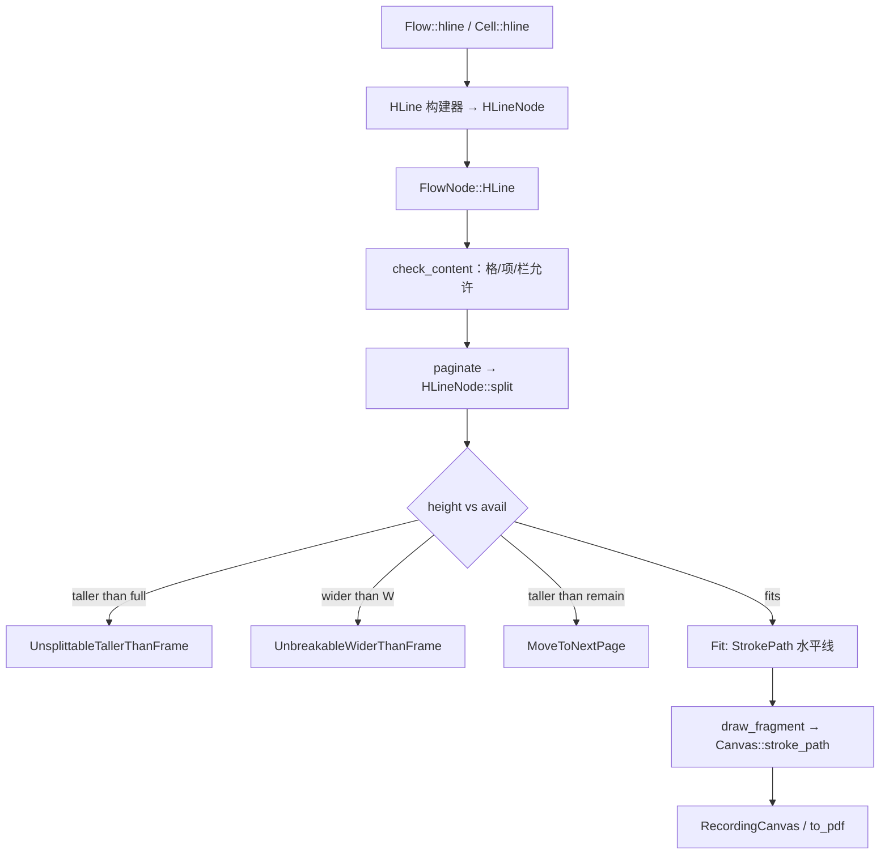

# 刀 12 入门：流内分隔线要接的缝

Tip：`feat/hline` @ `7cb1654`（自 `feat/layer-path`）。
产品依据：`docs/提案书.md` §2.3（270-285）、§2.0 长度/颜色、§2.2 填空边界、§2.6 格内、§2.8 项内、§2.12 逃逸、§2.14 延后 canvas。
父会话在 how explorers 未及时落盘时按 simple path 直接合成；行号以 tip 为准。

## Overview

今天正文流能画水平 `Stroke`（表边框、behind/front path），但**没有块级流节点**表示「当前框内一条分隔线」。

刀 12 要加的是 §2.3 的独立流块：吃当前框 `W`（可定长短并对齐），高度 `space_before + thickness + space_after`，整块不可拆，Fragment 里一条水平 `Stroke`。它不是行内填空（§2.2）、不是 `Layer::line`（§2.12）、不是流内 canvas（§2.14）。

最像的先例是 `ImageNode`：同一套 `Fit` / `MoveToNextPage` / `UnsplittableTallerThanFrame` / `UnbreakableWiderThanFrame`，以及 `TextAlign` 放置。

## Key Concepts

| 概念 | 现状 |
| --- | --- |
| `FlowNode` | `flow.rs:139-150`：无分隔线变体。`split` match 在 `:152-167` |
| `FragmentCommand::Stroke` | 已有（`:86-90`）。表边框与 layer path 已生产 |
| `ImageNode::split` | `image.rs:29-59`：宽超框报错；高超 `full_height` 报错；高超剩余则整块下页；对齐算 x |
| `SpacerNode` | 可拆（对比用）。高度用 `NonNegative` |
| `check_content` | `lower.rs:30-65`：`Spacer`/`Paragraph`/`Text` 各容器皆可；`Image` 仅 Column+TableCell；ListItem 拒 image/table/columns/pageBreak |
| 公共 `Flow` | `document.rs`：`spacer` / `image` / `paragraph` 等。列表项嵌套 `Flow`；单元格 `CellContent` 只有 `Text` / `Image` |
| `Layer` | behind/front；已有 `line`/`rect`/`ellipse`。**不**挂流内分隔线 |
| `Stroke` / `Pen` / `Color` / `Positive` / `NonNegative` | geom 已齐；线粗走 `Positive`，空白走 `NonNegative` |

## How It Works（插入点）

1. 组装：`document` 闭包里 `flow.hline(|h| …)` 推入 `nodes`。列表项经 `List::item` 的嵌套 `Flow` 自然到达。单元格今天没有通用 stack，需 `Cell::hline`（或等价）才能从公共 DSL 进格。
2. 合法性：`CellBody` / `ItemBody` / column stacks 走 `check_content`。新变体应像 `Spacer` 一样在 Column / TableCell / ListItem 合法；Band 公共 API 放不进分隔线，内部可与 Spacer 同允许以免多一支特殊。
3. 分页：`HLineNode::split(avail)` 镜像 `ImageNode`（不需 `LayoutCtx`/字体）。失败发生在 `plan_pages` / `measure_bands`，早于 `start_page`。
4. 绘制：相对 fragment 原点，`y = space_before + thickness/2`（与表边框「线画在几何中线」一致），`x` 由对齐与线宽算出，`Path::line` + `FragmentCommand::Stroke`。
5. 断言：`layout::test_util::strokes` 已能取 `StrokePath` 点列；backend-krilla 冒烟只看 `%PDF`。

## Where Things Live

| 区域 | 文件 |
| --- | --- |
| 节点 + split | 新建 `src/layout/hline.rs`（或并入 flow；arena 再定） |
| 枚举接线 | `src/layout/flow.rs`、`lower.rs`、`mod.rs` |
| DSL | `src/document.rs`（`Flow::hline`、`HLine` builder、`Cell` 路径） |
| 重导出 | `src/lib.rs`（若暴露 `HLine`） |
| 单测 | `hline.rs` + 既有 list/table reject 测扩展允许线 |
| 集成 | `tests/document.rs` |

## Gotchas

- §2.3 未写「高于整页正文框」字面，但同刀交接与 image/keep_together 先例钉死用 `UnsplittableTallerThanFrame`。
- §2.3 默认对齐 **Center**（定长短于 W 时）；image 默认是 Start。不要抄错。
- 默认线粗提案未钉；实现默认 **1 pt**、色黑、`space_*=0`、宽=框宽（合理默认，写进合成）。
- DSL 名提案允许 `hline` / `rule`；分支与交接倾向 **`hline`**，避开与 `Layer::line` 混淆。
- 单元格 DSL 仍无 spacer；本刀为线开 `Cell::hline`，不顺手做通用 cell stack。
- 虚线/双线/竖线、流内 canvas、填空下划线：明确不做。
