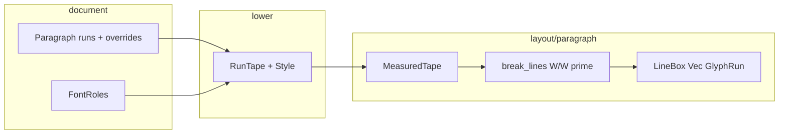

# Knife 13 — Candidate 1: RunTape + ParagraphStyle

## Usage（调用方视角）

### Quickstart

```rust
use quire::{document, Length, NonNegative, PageSize};

let pdf = document(PageSize::A4, |doc| {
    doc.font(regular_ttf)?;          // FontId(0)，正文默认
    doc.bold_font(bold_ttf)?;        // 绑定粗体为 FontId(1)；未调用则 p.bold 在排版期失败

    doc.paragraph(|p| {
        p.first_line_indent(NonNegative::pt(24.0)?); // 可选；默认 0，不自动「二字」
        p.text("合同编号 ");
        p.bold(&contract.id);
    });

    doc.paragraph(|p| p.text("按乙方案执行。"));
})?;
```

导入面：`document`、`PageSize`、`Length` / `NonNegative`（首行缩进）、`Result`/`Error`。不暴露内部 `Style`、`FontId`（除非将来 `font` 返回 id 的扩展；本刀以 `bold_font` 为主路径）。

### 调用点 1 — 提案书 §1 模板

```rust
doc.paragraph(|p| {
    p.text("合同编号 ");
    p.bold(&contract.id);
});
```

同一段、一次断行、一个段后距；粗体是第二套 face，不是绘制标志。

### 调用点 2 — 公文首行缩进

```rust
doc.paragraph(|p| {
    p.first_line_indent(two_em(doc)?); // 调用方自己算 N×字号；库不提供 §2.0 语法糖也可
    p.text("兹证明下列银行询证项……");
});
```

首行在局部框宽 `W` 上用 `W' = W − indent` 断行；第一行 glyph 从 `x = indent`（Start 对齐）起画；续行满宽 `W`。

### 调用点 3 — 混排 + 硬换行

```rust
doc.paragraph(|p| {
    p.text("甲方：");
    p.bold("Acme\n");
    p.text("乙方：Beta");
});
```

`\n` 产生后续**视觉行**，不再施加首行缩进；分页 tail 切片不重算 indent（已烘焙进 `LineBox`）。

### 本刀不提供的用法（刻意拒绝）

- `doc.style("heading", …)` / `defaultStyle` 具名样式表
- `p.italics`、下划线 decoration、§2.2 填空下划线
- Band / Layer / Cell 内的 `p.bold`（仍用 `Style.font` 单 face；见 [Deferred](#deferred)）

---

## Shape

### 核心域模型（与「Style 上加 bool/Option」正交）

三类状态，各管一层：

| 概念 | 职责 | 生命周期 |
| --- | --- | --- |
| **ParagraphStyle** | 段级已解析样式：默认正文字体、字号、行高、颜色、对齐、段后距、**首行缩进** | DSL lower → 随 `TextNode` 冻结 |
| **RunTape** | 段内有序 ink 段：每段 UTF-8 子串 + **已解析 `FontId`** | lower 时把 `Bold`/`Regular` 解析成 id，layout 不再查 Document |
| **FontRoles** | 文档级：`regular` 必为 0；`bold: Option<FontId>` | `Document` 持有；仅 lower 读一次 |

**RunTape** 不是「带样式的字符串」，而是 **single source of truth**  for 混排：

- 拼接 `full_text` 供 `ClusteredText::new`（与 today 相同 normalization / BK 规则）。
- 并行 `spans: Vec<RunSpan>`，`RunSpan { byte_range, font: FontId }`，相邻同 font 在 lower 时 **coalesce**（减少 layout 分支）。
- 断行、测量、绘制都只读 tape；**不在 `Style` 上放 bold 位**。

`ParagraphStyle` 在实现上仍是 `layout/style.rs` 的 `Style` **加上** `first_line_indent: Length<NonNegative>`（默认 `ZERO`），但语义上只描述「段框」与默认 run 继承项；run 级字体只出现在 tape。

### 公共 API 签名

```rust
// document.rs — Document builder
impl Document<'_> {
    /// 注册正文字体；第一个注册为 FontId(0)。保留返回值供将来扩展；本刀测试可忽略。
    pub fn font(&mut self, bytes: Vec<u8>) -> Result<FontId>;

    /// 注册粗体 face 并绑定为文档 bold 角色（约定为第二个注册 id，通常为 FontId(1)）。
    /// 重复调用：替换 bold 绑定（idempotent 绑定更新，不重复泄漏 store 语义由实现定，但必须可预测）。
    pub fn bold_font(&mut self, bytes: Vec<u8>) -> Result<()>;
}

// document.rs — 段落 builder（knife 13 唯一公共「样式 builder」面）
pub struct Paragraph { /* private */ }

impl Paragraph {
    pub fn text(&mut self, s: impl AsRef<str>);
    pub fn bold(&mut self, s: impl AsRef<str>);
    pub fn first_line_indent(&mut self, indent: Length<NonNegative>);
}
```

非法长度：`Length<NonNegative>` 在构造期拒绝负值；`first_line_indent` 不接受 `Option`——未调用即 0。

### 内部类型（crate-private）

```rust
// layout/style.rs
pub(crate) struct Style {
    pub(crate) font: FontId,              // 段默认 / 行高 metrics 基准
    pub(crate) font_size: Length<Positive>,
    pub(crate) line_height_factor: f32,
    pub(crate) color: Color,
    pub(crate) paragraph_spacing: Length<NonNegative>,
    pub(crate) align: TextAlign,
    pub(crate) first_line_indent: Length<NonNegative>, // NEW, default ZERO
}

// layout/paragraph.rs (或 text/run_tape.rs)
pub(crate) struct RunTape {
    full_text: String,
    spans: Vec<RunSpan>,
}
pub(crate) struct RunSpan {
    byte_range: Range<usize>,
    font: FontId,
}

pub(crate) struct TextNode {
    tape: RunTape,
    style: Style,
}

pub(crate) struct LineBox {
    runs: Vec<GlyphRun>, // 同 baseline；顺序即 x 累加
}

// document.rs
struct FontRoles {
    bold: Option<FontId>,
}
```

`Paragraph` DSL 期缓冲：

```rust
enum PendingRun {
    Regular(String),
    Bold(String),
}
struct Paragraph {
    runs: Vec<PendingRun>,
    overrides: ParagraphOverrides, // 仅 first_line_indent，避免泛化 StyleOverride
}
struct ParagraphOverrides {
    first_line_indent: Length<NonNegative>, // 默认 ZERO
}
```

### Lowering 流程

```text
Flow::paragraph(|p| …)
  1. 执行闭包 → Paragraph { runs, overrides }
  2. merge overrides.first_line_indent → Flow.style.clone() + patch indent
  3. 对每个 PendingRun::Bold → 查 FontRoles.bold
       None → Err(UnknownFont { id: 1 }) 或专用 Error::BoldFontUnconfigured（二选一，倾向 UnknownFont 与测试一致）
  4. build RunTape(full_text, coalesced spans with FontId)
  5. push FlowNode::Text(TextNode { tape, style })
```

`p.text` / `p.bold` **append** run，不 flatten 成两个 `FlowNode::Text`。

### Layout / measure / break / draw

**入口** `TextNode::split` → `ParagraphNode::layout(fonts, &tape, &style, W)`。

1. **几何预检**  
   `indent_pt = style.first_line_indent.as_pt()`  
   若 `W - indent_pt <= 0` → `InvalidGeometry`（在 `start_page` 前）。

2. **按 span 测量并合成 MeasuredTape**  
   - 对 `RunTape` 每个 span：在 `full_text[byte_range]` 上 `measure_text(fonts, span.font, …)`。  
   - 合并为 `MeasuredTape`：统一 `glyph_text` 坐标系，每个 glyph 带 `(font, glyph_id, advance_norm, byte_range)`。  
   - 缺字：`MissingGlyph { font: bold_id, scalar }` 即使 regular 有字也失败（§4）。

3. **变宽断行** — `text/line_break.rs`  
   扩展 `pack_lines` 的 avail 来源：

   ```rust
   fn line_avail(records_emitted: usize, w: f32, first_line_indent: f32) -> f32 {
       if records_emitted == 0 {
           w - first_line_indent
       } else {
           w
       }
   }
   ```

   首条 `LineRecord` 用 `W'`；`UnbreakableWiderThanFrame.avail` 在首行路径上必须是 `W'`。  
   `break_lines` 签名改为接受 `base_avail: f32, first_line_indent: f32`（或 closure），**单一实现**，避免复制 `pack_lines`。

4. **行高**  
   行盒高度用 **段默认 `style.font`** 的 `line_metrics`（autonomy：`regular-metrics`；reverse：`max-run-metrics`）。混排 run 共用同一条 baseline；RecordingCanvas 测试用同 fixture 双注册验证 FontId，不依赖视觉粗细。

5. **行内 glyph runs**  
   对每个 `BrokenLine`：  
   - 按 tape span / font 边界切分 glyph 子序列（run 边界落在 grapheme 中间时，整簇属后 run 或前 run：**整簇不可拆**，与 today 的 atom 一致；实现按 byte 边界对齐到 cluster 边界）。  
   - 每个 homogeneous 段 → `GlyphRun { font, font_size, color from style, … }`。  
   - **首段** x 原点：`x0 = indent + align_x(content_width, line_width, align)`，其中 `content_width = W' ` 当且仅当该行是段的首个 `LineRecord`；否则 `W`。  
   - 后续 run：`origin.x += Σ advance`。

6. **ParagraphNode**  
   `width` 仍存 full `W`（非 `W'`）；跨页 `split` 只切片 `LineBox`，不重跑 break。

### 数据流（总览）



### Module map

| 模块 | 变更 |
| --- | --- |
| `src/document.rs` | `FontRoles`；`font` 保留 `FontId`；`bold_font`；`Paragraph` run 缓冲 + `first_line_indent`；`Flow::paragraph` lower 到 `TextNode { tape, style }` |
| `src/layout/style.rs` | `Style.first_line_indent`，`Style::new` / `default_style` 默认 0 |
| `src/layout/paragraph.rs` | `TextNode` 持 `RunTape`；`LineBox.runs`；`ParagraphNode::layout` 多 font 测量与多 `GlyphRun`；首行 x/avail |
| `src/text/line_break.rs` | 首行 `W'`，后续 `W`；错误 avail 区分 |
| `src/text/measure.rs` | 可选：`MeasuredTape` 构建 helper（纯函数，输入 spans + FontStore） |
| `src/text/run_tape.rs` **（新，可选）** | `RunTape::from_pending(runs, style.font, bold_id)` + coalesce；若保持文件数，可内联 `paragraph.rs` |
| `src/canvas.rs` | 无 API 变更 |
| `src/layout/paginate.rs` | 无行为变更；错误仍先于 `start_page` |
| `tests/` | RecordingCanvas：`FontId` 与首行 `origin.x`；fixture 双注册同 face；`bold_font` 缺失 / `I >= W` / bold 缺字 |

### Deferred

- **Band / Layer / Cell**：继续 `single_line_run` + 单 `Style.font`；`first_line_indent` 字段存在于 `Style` 但默认值 0，**不在** band/layer API 暴露 setter，避免 layer 文本意外缩进。
- **Flow 级** `doc.font_size(...)` 等全局样式 builder：out of knife；段落 inherit `Flow.style` 仍通过 clone-at-lower。
- **具名 styles map**：不需要即可实现 `p.bold`。

### 测试策略

- 排版：`RecordingCanvas` 断言同一视觉行上连续 `GlyphRun` 的 `font` 与 `origin.x` 累加关系；首行 indent 固定 x 偏移。
- PDF：`backend-krilla` 冒烟 `%PDF` only。
- 不断言 krilla 内容流数字。

### Red-flag 自检

- **Deep module**：调用方只学 `Paragraph` 三个方法 + `bold_font`，混排与 `W'` 全在 layout（per boundary-discipline）。
- **No split ownership**：`FontId` 在 lower 写入 tape；layout 不读 `FontRoles`。
- **One way to bold**：仅 `p.bold` + `bold_font`，无 `Style.bold`。
- **No pass-through**：`measure_text` 仍单 font；`MeasuredTape` 拥有合并策略，不是多次 `ParagraphNode::layout` 拼接。

---

## 实现顺序（给 Phase D）

先 `RunTape` lower + 单 font 回归不变，再 `line_break` 变 avail，再多 `GlyphRun` 与 `bold_font` 错误路径，最后 `first_line_indent` 与 RecordingCanvas 夹具。
