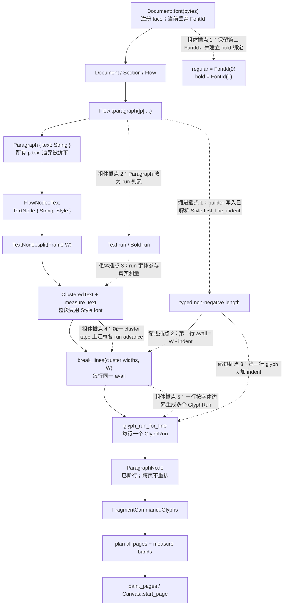

# Overview

在 `feat/style-builders @ f208329`，段落样式尚未接入公共 DSL。当前模型是：

- 一个 `Paragraph` 只累积一个 `String`（`src/document.rs:753-763`）。
- `Flow::paragraph` 在闭包结束后，把该字符串和 `Flow.style.clone()` 降成一个 `FlowNode::Text`（`src/document.rs:646-664`）。
- 一个 `TextNode` 只有一份 `Style`；一段只用一个 `FontId`、一个字号和一种颜色（`src/layout/paragraph.rs:23-39`）。
- 第一次拿到实际框宽 `W` 时，文本才会测量和断行；之后保存为已断好的 `ParagraphNode`，跨页时不再断行（`src/layout/paragraph.rs:44-137`）。
- 每个视觉行当前只生成一个 `GlyphRun`，因此整行只能用一个字体（`src/layout/paragraph.rs:16-19, 227-257`）。

因此 knife 13 不是在现有样式系统上补两个 setter。它需要同时补齐两个正交维度：

1. **段内 run**：`p.text(...)` 与 `p.bold(...)` 必须保留边界，但仍作为同一个段落统一测量、断行和分页。
2. **段落级样式**：`Style.first_line_indent` 要在得到实际框宽以后，同时影响第一行的断行宽度和第一行 glyph 的 x 原点。

粗体不是绘制标志，也不能合成。它必须选用第二个已注册字体，即另一个 `FontId`。当前 `Document::font` 虽然会注册 `FontId(0)`, `FontId(1)`……，却用 `.map(drop)` 丢弃返回值，且 DSL 没有任何选择第二个 id 的路径（`src/document.rs:233-241`）。

# Key Concepts

## 当前所谓“样式”是已解析值的快照

内部 `Style` 是 crate-private 的已解析样式，字段只有 `font`、`font_size`、`line_height_factor`、`color`、`paragraph_spacing`、`align`（`src/layout/style.rs:16-25`）。`default_style()` 固定为字体 0、12 pt、1.2 行高、黑色、段后距 0、Start 对齐（`src/document.rs:573-581`）。

这不是具名样式或层叠系统。样式通过 clone-by-value 传播：

```text
default_style
  → Section.flow.style
    → Flow::text 时克隆到 TextNode
    → Flow::child 时克隆到列、列表项、keep_together
    → Section::lower 时克隆给 header/footer/behind/front
```

目前没有公共 setter，也没有 `StyleOverride`、样式 map 或 `UnknownStyle`。设计稿里的这些类型尚未被提案书确认，不能当成现状。

knife 13 的段落 builder 应在 `Flow::paragraph` 降低节点时，把 builder 上的段落属性应用到 `self.style.clone()`，形成该段自己的已解析 `Style`。`first_line_indent` 属于这份段落样式；`bold` 则是 run 级字体选择，不能把整段 `Style.font` 改成粗体。

## 段落 run 与块节点不同

提案书 §1 的：

```rust
p.text("合同编号 ");
p.bold(&contract.id);
```

表示同一段中的两个 run。不能把它降低为两个 `FlowNode::Text`：那会成为两个块，各自断行、分页和应用 `paragraph_spacing`。正确边界是“一份段落内容，内部有多个 run”。

当前 `Paragraph::text` 直接 `push_str`，调用边界立即丢失。knife 13 必须让 `Paragraph` 累积 run（至少 regular text 与 bold text），并让 `TextNode` 保留这些 run 到布局阶段。

## `W` 只在布局时才知道

DSL 组装期不知道段落最终宽度。`TextNode::split` 从当前 `Frame` 取得 `avail.width`（`src/layout/paragraph.rs:36-39`）：

- 正文：页宽减左右 margin；
- 栏内：该列宽；
- 单元格：span 宽减 padding / border；
- 列表项：外框宽再减列表悬挂缩进。

首行缩进是在这些局部 `W` 之内进一步处理第一行，不是页面级偏移，也不是列表缩进。

## 测量结果就是绘制输入

`measure_text` 用 skrifa 的 charmap 和 advance 生成 glyph id 与归一化 advance（`src/text/measure.rs:41-98`）。`GlyphRun` 把同一批 glyph、`FontId`、字号、颜色和 baseline 原点交给 Canvas（`src/canvas.rs:99-132`）。后端不重新测量，也没有 synthetic bold。

所以粗体 run 必须从测量开始就使用粗体 `FontId`。只在 draw 阶段换字体会让断行宽度、对齐位置和实际绘制不一致。

# How It Works

## 当前管线与 knife 13 插入点



## DSL → lowering

`Document::new` 创建空 `FontStore` 和带 `default_style()` 的隐式 section（`src/document.rs:198-209`）。正文方法通过 `DerefMut` 落到 `Flow`。嵌套栏、列表项和 keep-together 使用 `Flow::child()` 克隆当前样式（`src/document.rs:615-617`）。

当前 `Flow::paragraph` 的关键问题是：

```text
Paragraph::default
→ 执行用户闭包
→ 只取 paragraph.text
→ self.text(...) 克隆 Flow.style
→ push 一个 TextNode
```

knife 13 在这里应保留两个层次：

- 段落 builder 的属性合并进一份段落级 `Style`，包括 `first_line_indent`。
- `p.text` / `p.bold` 形成有序 run 列表；最终仍只 push 一个段落节点。

不要为了实现 `p.bold` 引入具名样式 map。这里只需要段落级已解析样式和 run 级字体选择。

## Bold run → measure → break → draw

字体存储层已经支持多 face。`FontStore::register` 按注册顺序分配 0、1、2……，每个 face 有独立 metrics 和 advance cache（`src/fonts.rs:76-148`）。缺口在公共注册和段落表示：

1. **注册/绑定**：knife 13 必须让第二个注册结果可被保留并绑定为 bold。可以是专门的 `bold_font` API，或让注册返回 `FontId` 后再显式绑定；仅继续调用当前 `Document::font` 不够，因为 id 被丢弃，`Flow` 也不知道哪个 id 是 bold。
2. **run 表示**：`Paragraph` 和 `TextNode` 必须保存 regular/bold run 边界。粗体是 `FontId(1)` 对应的 face，不是 `bool` 传到 Canvas，更不是描边伪粗体。
3. **测量**：当前 `ParagraphNode::layout` 对整段只调用一次 `measure_text(fonts, style.font, ...)`（`src/layout/paragraph.rs:62-69`）。混排后，每个 scalar/glyph 必须由所属 run 的字体测量；断行器收到的 cluster 宽度必须是该 cluster 内各 glyph 按各自字体和字号算出的真实 pt 宽度。
4. **统一断行**：`break_lines` 本身不关心字体，只消费 `width_of(cluster)`。因此不应按 run 分别断行；应在拼接后的统一 `ClusteredText` 上断行，run 信息只负责给 cluster 定价和后续切 glyph。
5. **绘制**：当前 `LineBox` 只有一个 `run`。混排行要变成多个同 baseline 的 `GlyphRun`。第一个 run 从该行对齐后的 x 开始；后续 run 的 `origin.x` 是前面 run advance 的累计值。每个 run 都有自己的 `font`，并各自保证 `GlyphPlacement.byte_range` 索引自己的 `GlyphRun.text`。

`FragmentCommand::Glyphs` 已经能承载多个命令，`draw_fragment` 也会顺序绘制，因此 Canvas 和 krilla 适配器不需要“粗体”新指令；需要变化的是段落 layout 如何生成一行中的多个 homogeneous glyph runs。

## First-line indent → break width + x origin

`Style` 需要新增 `first_line_indent`，使用 §2.0 的非负长度类型；进入 layout 前转为 pt。其默认值按 knife 的保守行为应为 0，不能擅自自动设成“二字”，因为提案书明确说具体默认值以后再定。

实现必须同时修改两个位置：

1. **第一行断行宽度**：设完整框宽为 `W`，缩进为 `I`。`break_lines` / `pack_lines` 不能再对所有行使用一个 `avail`。仅当还没有产出任何 `LineRecord` 时使用 `W' = W - I`；第一次因溢出或 hard break 产出行以后，后续行恢复 `W`。fit 判断和 `UnbreakableWiderThanFrame.avail` 都要使用当前行的宽度。
2. **第一行 glyph x**：只收窄断行宽度不会产生左缩进，因为 `TextAlign::Start` 当前恒返回 x=0（`src/layout/paragraph.rs:260-266`）。第一行应在缩进后的对齐框中定位：

   ```text
   line 0: x = I + align_x(W - I, line_width, align)
   line n: x =     align_x(W,     line_width, align), n > 0
   ```

   这样 Start 左移到 `I`，End 仍贴齐原框右边，Center 在 `[I, W]` 内居中。提案书只钉死了 `W'`，Center/End 的解释仍应由测试明确固定。

`ParagraphNode.width` 必须继续保存完整 `W`，而不是 `W'`（`src/layout/paragraph.rs:86-91, 94-98`）。它用于阻止已按 `W` 断好的后续行被塞进更窄框。跨页 tail 复制已生成的 `LineBox`，不能把“新页面上的第一条剩余行”再次当作段落首行。

首行缩进不应进入 `single_line_run`。列表 marker 和 `behind` / `front` 的页面坐标文字走该路径，不属于 §2.1 的流式首行断行。列表已有的悬挂缩进会缩窄并平移整个 item body，和只影响段落第一视觉行的缩进是两层独立几何。

## Failure timing

`document()` 先执行 builder，再调用 `Document::paint` 写入 `RecordingCanvas`（`src/document.rs:42-55`）。分页分两阶段：

1. `paginate_sections` 先对全部 section 执行 `plan_pages`，随后测量 header/footer/layer；
2. 只有全部成功后才进入 `paint_pages` 并调用 `canvas.start_page`（`src/layout/paginate.rs:93-117, 265-278`）。

因此 knife 13 新增的布局错误必须沿现有 `Result` 链返回：

- 未注册粗体 face：`UnknownFont { id: 1 }`；
- 粗体 face 缺某字符：`MissingGlyph { font: FontId(1), scalar }`；
- `W - indent <= 0`：几何错误；
- 第一行不可断内容宽于 `W'`：`UnbreakableWiderThanFrame`，其中 `avail` 应是 `W'`。

这些都发生在 `TextNode::split` / measure / break 阶段，早于任何 `start_page`。§4 的“缺字整份失败、无 `.notdef`、无字体回退”同样适用于粗体 face；regular face 有该字并不能挽救 bold run。

# Where Things Live

| 位置 | 当前职责 | knife 13 插入点 |
| --- | --- | --- |
| `src/document.rs:233-241` | 注册字体但丢弃 `FontId` | 暴露或保存第二 face，并建立 bold 绑定 |
| `src/document.rs:573-581` | 构造默认已解析样式 | 给 `first_line_indent` 明确零默认 |
| `src/document.rs:646-664, 753-763` | `Paragraph` 拼字符串；降低为单个 `TextNode` | 段落属性 + regular/bold run 列表；仍只生成一个块节点 |
| `src/layout/style.rs:16-47` | crate-private resolved `Style` | 新增 typed `first_line_indent`；不引入平行样式系统 |
| `src/layout/paragraph.rs:23-91` | 一段一字体地测量、断行 | 消费 run、按 run 字体测量、传第一行宽 |
| `src/text/measure.rs:41-98` | 单个 `FontId` 的 cmap/advance | 可复用每-run 测量；结果需保留 glyph 所属 run/font |
| `src/text/line_break.rs:42-160` | 所有行共用一个 `avail` | line 0 用 `W'`，其余用 `W` |
| `src/layout/paragraph.rs:16-19, 197-257` | 每行一个 `GlyphRun` | 每行多个 run；首行对齐原点加缩进 |
| `src/canvas.rs:99-132` | homogeneous `GlyphRun` | 无需加 bold 标志；每个粗体 run 直接携带第二 `FontId` |
| `src/layout/paginate.rs:93-117, 265-278` | 先规划/测量，后开页绘制 | 保持所有新测量/断行错误在 `start_page` 前返回 |

# Gotchas

- **不要把 bold run 降成相邻段落。** 否则两部分不会共同断行，段后距和跨页语义也会重复。
- **不要只在绘制时换粗体字体。** 粗体 face 的 advance 可能不同，必须参与 cluster 宽度、断行和对齐计算。
- **不要实现 synthetic bold。** 当前 skrifa→glyph→Canvas→krilla 管线没有也不应新增伪粗体；第二 face 才是权威 glyph 来源。
- **run 边界可能落在同一字素簇内。** 断行仍必须把该 grapheme 当成一个 atom；样式到 glyph 的映射还要处理 CRLF 归一化和 hard break 不占 glyph 索引的事实。
- **混合 face 的行高尚无既定规则。** 当前整段只取 `style.font` 的 metrics（`src/layout/paragraph.rs:68-70`）。如果第二 face 的 ascent/descent 更大，knife 13 必须明确是沿用段落基准 metrics，还是按参与 run 取可容纳全部 glyph 的 line box；不能默默假设两字体 metrics 相同。
- **首行是整段的第一视觉行，不是每个分页 fragment 的第一行。** `ParagraphNode` 已把 x 烘焙进 line box；分页只能切片，不能重施缩进。段内 `\n` 后也属于后续行。
- **`I >= W` 需要确定错误语义。** 它必须在规划期失败；最贴近现有宽度校验的是 `InvalidGeometry`。不要把负/零宽传到 draw。
- **Cell、Band、Layer 没有共用 `Paragraph` builder。** Cell 是单个 `String`，Band 是左右两个字符串，Layer `text_at` 是不换行单行。除非 knife 明确扩展这些公共 API，否则 `p.bold` 与首行缩进只接正文段落；尤其不要让共享 `Style` 字段意外移动 layer text。
- **具名样式 map、`StyleOverride`、italics、§2.2 填空下划线、流内 canvas 均不属于本 knife。** 它们不是实现 `p.bold` 或 `first_line_indent` 的前置条件。设计稿中的 `StyleOverride` 也不是已确认 API。
- **测试字体目前只有 ExtraLight fixture。** 重复注册它可以验证 `FontId(1)` 的管线和 RecordingCanvas 记录，但不能验证视觉粗细；真实粗体外观需要独立 bold fixture。
