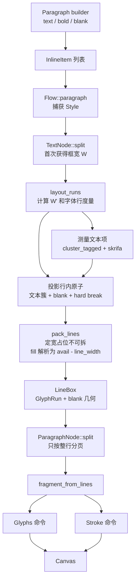

### Overview

当前段落管线分成两个阶段。`Flow::paragraph` 在组装期收集 `TextRun`。`TextNode::split` 第一次拿到实际框宽后，才完成字体测量、断行和水平定位。结果变成 `ParagraphNode`。后续分页只按整行切片，不再断行。

§2.2 的填空下划线应进入同一条行内管线。它是 `text` 和 `bold` 的同级行内项，不是 `FlowNode::HLine`，也不是下划线字符。它需要参与水平占宽和断行，但不进入 skrifa 字形测量。绘制端可以直接复用现有 `FragmentCommand::Stroke` 管线。

当前最关键的结构限制是，段落中只有连续的字形 tape。`BrokenLine` 也只保留一个连续 `glyph_range`。这不足以表示“文字、空白、文字”，因为空白不在 glyph tape 中，而空白后面的文字仍需向右平移。Knife 14 不只是增加一个 builder。它还要让断行结果保留非字形行内项的位置。

### Key Concepts

#### 组装态与布局态

`Paragraph` 当前保存 `Vec<TextRun>`。`Paragraph::text` 和 `Paragraph::bold` 会忽略空字符串，并合并相邻的相同 `Face`。`Flow::paragraph` 在闭包结束后复制当前 `Style`，写入 `first_line_indent`，再生成 `FlowNode::Text(TextNode::from_runs(...))`。

此时还不知道段落会落在正文、列或列表项中，所以也不知道实际宽度。吃到行尾的 blank 不能在组装期解析成 pt。它必须以 `ToEndOfLine` 形态保留到 `layout_runs`。

#### 框宽、首行宽与剩余宽

`ParagraphNode::layout_runs` 收到当前框宽 `W`。首行缩进产生 `W' = W - indent`。断行器收到 `LineBudget { first: W', rest: W }`。

`W_remain` 是当前视觉行预算减去已经接纳的行宽。它只有在 `pack_lines` 正在构造具体行时才可计算。对 fill blank，正确的动态宽度是 `avail - line_width`。该宽度也必须计入最终 `LineRecord.width`，否则 Center 或 End 对齐会把文字与横线错开。

#### 字形 tape 与行内项 tape

`measure_inline` 当前把所有 `TextRun` 交给 `cluster_tagged`。结果包含规范化后的 `ClusteredText`、逐字形的 `Face` 标签和 `InlineGlyph`。换行器再把每个字素簇投影成一个 `Atom::Ink` 或 `Atom::Hard`。

blank 没有 Unicode scalar、`FontId`、glyph id 或 advance。它不能伪装为空字符串、空格、全角空格或新的 `Face`。

建议的数据边界是一个判别联合。

```text
InlineItem =
  Text(TextRun)
  Blank {
    width: Fixed(length) | ToEndOfLine,
    thickness,
    color,
    baseline_offset,
  }
```

文本仍可按现有规则合并。blank 必须打断两侧文本的合并。汉字数语法糖最终得到 `N * 当前字号`。若要适应未来的字号样式，最好在能看到 `Style.font_size` 的位置解析。

#### 行内 blank 与块级 HLine

两者最终都画一个 `FragmentCommand::Stroke`，但布局语义不同。

| 项目 | 行内 blank | `HLineNode` |
| --- | --- | --- |
| 所在结构 | 段落行内项 | 独立 `FlowNode` |
| 起点 | 当前行笔位置 | 框内 Start、Center 或 End |
| 宽度 | 定宽或当前行剩余宽 | 定宽或整个框宽 |
| 高度 | 不增加行高 | `space_before + thickness + space_after` |
| 分页 | 随所在行移动 | 整个节点移动 |
| 颜色 | 当前文字色或黑 | 自有颜色，默认黑 |
| 纵坐标 | 基线下方偏移 | 独立盒内的线中心 |

可复用的是 `Path::line`、`Paint::solid`、`Stroke::new`、`FragmentCommand::Stroke`、`Fragment::with_offset`、`Canvas::stroke_path` 和 backend 的 stroke 翻译。不能复用 `HLineNode::split` 或它的高度公式。

### How It Works



#### 1. 当前组装流程

`Paragraph::append` 只处理文本。空文本被丢弃。相邻同 face 文本被拼接。`Flow::paragraph` 总是创建未换行的 `TextNode`。列和列表项通过嵌套 `Flow` 走同一路径，因此 blank 在这些容器中的实际 `W` 会自然变窄。

fill blank 后禁止再有 run，适合在 `Paragraph` 组装时记录。当前 builder 方法返回 `()`，而 `Flow` 已有保存首个错误的机制。实现可以让 `Paragraph` 持有组装错误，再由 `Flow::paragraph` 通过 `push(Err(...))` 接入现有错误通道。空 `text("")` 目前不产生 run，不应被算作 fill 后的非法 run。另一个 blank 是实际行内项，应被拒绝。

#### 2. 当前测量流程

`ParagraphNode::layout_runs` 先验证 `W` 和 `W'`，再调用 `measure_inline`。`measure_inline` 只为真实文本调用 skrifa。Body 使用 `style.font`。只有存在非空 Bold 文本时才查询 `fonts.bold()`。所有 face 使用同一个 `style.font_size`。

行高和基线只来自 Body 字体的 `line_metrics`。`line_height` 是字体自然行高与 `font_size * line_height_factor` 的较大值。bold 字体度量和行内 stroke 都不会增高行盒。

Knife 14 应继续保持这条边界。blank 不应触发 cmap、缺字检查或 bold 字体查找。blank-only 段落仍应使用 Body 字体度量取得基线和行高。

#### 3. 当前断行流程

`break_lines` 先把每个 cluster 投影为一个 atom。硬换行是 `Atom::Hard`。其余是带 `PairClass` 和固定宽度的 `Atom::Ink`。`pack_lines` 贪心接纳 atom。溢出时，它依据相邻 `PairClass` 向前寻找最近断点。找不到断点就返回 `Error::UnbreakableWiderThanFrame`。

行首 `PairClass::Sp` 会被删除。普通空格因此不能承担 blank 语义。当前 atom 与 cluster 是一一对应的。`eof_cursor` 的 Hard 分支还直接把 atom 下标当成 cluster 下标。插入非 cluster blank 后，这个隐含不变量必须移除。

定宽 blank 应作为一个不可拆 atom。它内部不能断开。它是否允许在前后换行，需要显式策略。现有 `PairClass` 没有一个类别同时满足“不会被行首删除、不是字形、可按 blank 规则换行”。不能直接借用 `Sp`。

fill blank 的宽度不能在 `project_atoms` 中预先算出。`width_of` 此时只看单个 cluster，不知道该 atom 最终位于首行还是后续行，也不知道本行已使用多少宽度。fill 必须在 `pack_lines` 接纳该 atom时解析为 `avail - line_width`。因为组装期已保证它是最后一个 run，所以接纳后该行必然结束于右边界。

#### 4. 当前水平定位流程

断行完成后，`layout_runs` 对每一行计算 `frame_width`、`frame_x` 和 `line_x`。首行使用 `W'` 和 `indent`。后续行使用 `W` 和零偏移。`align_x` 根据 `BrokenLine::width` 对整行执行 Start、Center 或 End 对齐。

`glyph_runs_for_line` 当前只按字体变化切分 `GlyphRun`，并连续累加字形 advance。它看不到 glyph tape 中间的 blank。即使断行器把 blank 宽度计入 `LineRecord.width`，blank 后的 glyph 仍会紧贴前面的 glyph。

因此断行结果必须保留行内片段，或保留足以回放 atom 范围的 side tape。布局行时应按顺序推进 x 游标。

1. 文本片段生成一个或多个 `GlyphRun`。
2. 定宽 blank 让 x 增加固定宽度，并记录 stroke 的起止 x。
3. fill blank 让 x 增加本行剩余宽度，并记录相同范围的 stroke。
4. 后续固定 blank 之后的文本从更新后的 x 开始。

只有 `glyph_range`、总宽和一个连续字符串不足以恢复这些位置。`BrokenLine` 或段落侧的断行结果需要携带 segment 范围。

#### 5. stroke 与行盒

`LineBox` 当前只有 `Vec<GlyphRun>`。它需要同时保存 blank 的行局部几何。可以保存专用 blank segment，也可以保存尚未加行号 y 偏移的 stroke 描述。

stroke 的 y 应为 `baseline + baseline_offset`。坐标系 y 向下，所以正 offset 位于基线下方。`fragment_from_lines` 再加上 `line_index * line_height`，与 glyph 的分页内位移一致。

不要把 thickness 或 offset 加入 `line_height`、`Fragment.height` 或 `spacing_after`。这正是“不增加行高”的含义。当前 fragment 没有裁剪。如果 offset 太大，线可能进入下一行的视觉区域，但布局高度仍不变。

#### 6. 分页与绘制

第一次 `TextNode::split` 已经完成断行并烘焙 x 几何。`ParagraphNode::split` 之后只切分 `Vec<LineBox>`。尾部仍是 `FlowNode::Paragraph`，不会重新计算 `W_remain`，也不会重新应用首行缩进。

这正好满足“跨页随所在行走”。blank stroke 与 glyph 必须一起存入 `LineBox`。`Fragment::with_offset` 已会平移 stroke path。`draw_fragment` 已会调用 `Canvas::stroke_path`。krilla backend 不需要新的文字或测量逻辑。

### Where Things Live

| 位置 | 当前职责 | Knife 14 接入点 |
| --- | --- | --- |
| `src/document.rs` `Paragraph` | 收集 `text`、`bold` 和首行缩进 | 增加 blank builder、行内联合类型、fill 终止校验 |
| `src/document.rs` `Flow::paragraph` | 捕获 `Style` 并创建 `TextNode` | 传递组装错误，必要时提供当前字号 |
| `src/layout/paragraph.rs` `TextRun`、`TextNode` | 保存未换行文本 run | 将 run 列表扩成文本或 blank 的有序列表 |
| `src/layout/paragraph.rs` `measure_inline` | 对真实文本做 cluster 和 skrifa 测量 | 跳过 blank，同时保留其在行内顺序中的位置 |
| `src/text/line_break.rs` `Atom`、`pack_lines` | 按 cluster 宽度和 pair table 断行 | 接纳非 cluster blank atom，动态解析 fill，输出可回放的行片段 |
| `src/layout/paragraph.rs` `LineBox` | 保存一行的 `GlyphRun` | 同时保存 blank stroke 几何 |
| `src/layout/paragraph.rs` `fragment_from_lines` | 生成 `FragmentCommand::Glyphs` | 额外生成 `FragmentCommand::Stroke` |
| `src/layout/flow.rs` | 平移和绘制 fragment 命令 | 已支持 stroke，无需新命令 |
| `src/layout/hline.rs` | 块级分隔线 | 仅作为 stroke 构造与测试先例 |
| `src/geom.rs` | `Length`、`Color`、`Path`、`Stroke` | 复用受约束长度与绘图类型 |
| `src/canvas.rs` 与 `src/backend/` | 记录并输出 stroke | 现有管线可直接复用 |

当前可调用 `Paragraph` 的位置包括正文、section、column、`keep_together` 和列表项。列表正文宽度已扣除 marker 列，stroke 最终会随正文 fragment 一起右移。

当前 table cell 只接受字符串、图片或 `HLine`。字符串会走 `TextNode::new`，但调用方无法在 cell 中构造 `Paragraph`，所以新增 `Paragraph::blank` 本身不会让单元格立即支持填空。Band 也只接受字符串。Layer 使用 `single_line_run`，不走本管线。

### Gotchas

1. `Vec<TextRun>` 不能只机械改成带空字符串的 run。空字符串会被 builder 和 `cluster_tagged` 丢弃。空格会进入 cmap，并继承错误的断行行为。

2. `BrokenLine::glyph_range` 是连续区间。中间 blank 会让两侧 glyph 在 tape 中相邻。必须保存 blank 的位置，不能只保存总行宽。

3. atom 下标目前等于 cluster 下标。新增 blank atom 后，`eof_cursor` 等代码不能继续依赖这个等式。Hard atom 应携带显式 cursor 或 cluster 信息。

4. fill 必须计入 `LineRecord.width`。这样一行宽度等于其 frame width，Start、Center 和 End 的整体偏移都会是零。若只在绘制时补线，非 Start 对齐会错位。

5. `W` 与 `W'` 需要明确。§2.1 规定首行实际预算为 `W'`。现有断行器在首行 atom 超过 `W'` 时直接报错，即使该 atom 能放进后续行的 `W`。§2.2 写“宽于当前行 `W`”。实现前应确认这里指原始框宽，还是 atom 所在视觉行的实际预算。现有文本错误语义使用实际预算。

6. blank 两侧的 `PairClass` 规则尚未确定。需要回答固定 blank 在当前剩余宽不足时，是否总可整体移到下一行，以及它与开口括号、闭口标点和西文词相邻时是否允许断开。`PairClass::Sp` 明确不合适。

7. 默认 thickness 和 baseline offset 尚未确定。`HLine` 的默认 1 pt 不是 §2.2 的既定默认。offset 也不能照搬 `HLine` 的 `thickness / 2`，因为它的原点不是文字基线。

8. 线色规则仍有一处产品选择。“当前文字色或黑”在当前默认样式下结果相同。最自然的实现是 `style.color`，但提案没有明确有无覆盖参数，也没有明确何时退回黑色。

9. 固定 span 是否允许 0 仍未确定。§2.0 对“不能为负”的量允许 `Length<NonNegative>`，但 `Stroke` thickness 必须是 `Length<Positive>`。span 与 thickness 是两个不同约束。

10. fill 遇到 `W_remain == 0` 时的行为尚未确定。`Path::line` 接受相同起终点，Layer 的直线 builder 则拒绝零长度。需要决定是省略 stroke、记录退化 stroke，还是报错。

11. 汉字数语法糖中的 `N` 类型和 `N == 0` 仍未确定。若在布局期乘 `style.font_size`，它会自然跟随未来的字号样式。若在 builder 期解析，`Paragraph` 需要先拿到当前字号。

12. blank-only 段落不能退化成空 run 列表。当前空段落仍产生一行、一个空 `GlyphRun` 和正常行高。blank-only 段落也需要正常基线、行高和 stroke。

13. fill 前若文本以硬换行结束，fill 会落在下一视觉行。第一行记录已经被硬换行提交，所以该 fill 使用后续行预算 `W`。这符合当前 line budget 状态机，但提案没有单独说明。

14. RecordingCanvas 中 blank 是 `CanvasCommand::StrokePath`，不是 `DrawGlyphRun`。只检查 glyph 的测试无法证明 blank 已绘制。应分别锁定断行、glyph x、stroke 端点、行高和跨页行为。

15. backend 继续使用 krilla 的默认 line cap。若默认不是 butt cap，实际墨迹可能越过几何端点约半个 thickness。布局目前只知道 path 端点，不知道 cap 外扩。
