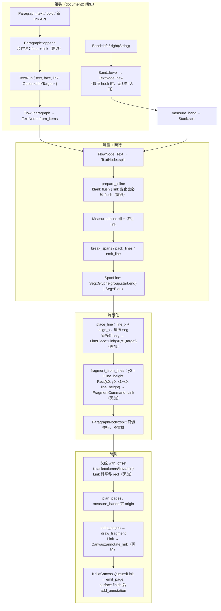

# Knife 15 — 段落文字怎么组装，§8 外链该挂在哪

基线：`feat/inline-blank` @ `a232ce1`（已核对 HEAD）。权威：`docs/提案书.md` §8（612–619 行，标题写明「已定」）。

### Overview

现在没有任何代码路径能把 URI 从调用方送到 `Canvas::annotate_link`。管线的两端都已就绪，中间是空的：

- **下游已完成。** `LinkTarget::uri` 拒绝空串（`Error::EmptyLink`），`Canvas::annotate_link(Rect, LinkTarget)` 已在 trait、`RecordingCanvas`、`KrillaCanvas` 上实现，backend 在 `surface.finish()` 之后写 `LinkAnnotation` + `LinkAction`，坐标恒等映射、不预翻转。这些满足 §8 的「只写 URI、不访问、不校验 scheme、空串在构造期拒绝」。
- **上游缺失。** `Paragraph` 没有 link 方法，`TextRun` 只有 `text` + `face`，`FragmentCommand` 没有 link 分支，`layout/` 里没有任何地方调用 `annotate_link`。

URI 必须在组装期挂在 `TextRun` 上，并且一路活到 `place_line`。办法是 `Paragraph::append` 和 `prepare_inline` 两层合并都把 link 当作边界。然后在 `place_line` 里按视觉行记录每段的 x 范围，在 `fragment_from_lines` 里叠加行的 y，作为新的 `FragmentCommand` 变体发出，由 `with_offset` 平移，最后由 `draw_fragment` 调用 `annotate_link`。页眉页脚从 `TextNode::split` 往下和正文走同一条路，所以 layout 这半边会自动覆盖它们。DSL 这半边不会：`Band` 只接受纯字符串。

### Key Concepts

| 名字 | 位置 | 对本刀的意义 |
| --- | --- | --- |
| `Paragraph`（公共构建器） | `src/document.rs` 778–873 | 唯一的富文本组装器。方法：`text`、`bold`、`blank*`、`first_line_indent`。 |
| `TextRun { text, face }` | `src/layout/paragraph.rs` 22–34 | 组装期唯一表示「这一段文字」的载体。URI 字段应加在这里。 |
| `InlineItem` | `paragraph.rs` 37–40 | `Text(TextRun)` 或 `Blank(InlineBlank)`。link 是一种属性，不是新的 item 种类。 |
| `TextNode` | `paragraph.rs` 91–118 | `Vec<InlineItem>` 加一份整段 `Style`。正文（`from_items`）、表格单元格和页眉页脚槽位（`new`）最终都变成它。 |
| `MeasuredInline` / `Span::Group(i)` | `paragraph.rs` 345–410、`src/text/line_break.rs` 18–21 | 一个测量组 = 两个 blank 之间的一段连续文字。 |
| `Seg::Glyphs { group, start, end }` | `line_break.rs` 24–34 | 断行输出。**不带 payload**：URI 无处可放，只能靠所属的组来识别。 |
| `LineBox` / `LinePiece` | `paragraph.rs` 70–87 | 每个视觉行的 `Glyphs` 和 `Stroke`；x 已定，y 是相对行内的（基线）。 |
| `FragmentCommand` | `src/layout/flow.rs` 81–96 | `Glyphs`、`Fill`、`Stroke`、`Image`。`with_offset`、`draw_fragment`、`list.rs::first_baseline` 都对它做穷尽 match。 |
| `LinkTarget` | `src/canvas.rs` 30–51 | 现成的非空 URI newtype（§2.0）。`Clone`，**不是 `Copy`**。 |

`FlowNode::Paragraph` / `ParagraphNode` 是**断行之后**的行列表，不是公共的 `Paragraph`。公共构建器在断行前降级为 `FlowNode::Text(TextNode)`。

### How It Works

#### 1. 组装（`document()` 闭包内执行一次）

`Flow::paragraph`（`document.rs` 678–690）先建 `Paragraph::default()`，运行调用方闭包，然后执行 `TextNode::from_items(items, style)`，`style` 克隆自 `default_style()`，只改写 `first_line_indent`。

`Paragraph::append`（828–843）是唯一创建 `TextRun` 的地方：

1. 空串直接返回，这一步在封口检查之前。
2. 若上一个 item 是 `blank_to_end`，则报 `RunAfterFillBlank`。
3. 若上一个 item 是 `Text` 且 **`face` 相同**，就把文本 `push_str` 拼上去。**这就是 URI 会被抹掉的第一处合并**：合并键里必须加上 link。
4. 否则 push 一个新的 `TextRun`。

任何 blank 都会打断合并（测试 `blank_breaks_text_coalescing`）。

#### 2. 测量组（`prepare_inline`，`paragraph.rs` 371–410）

连续的 `Text` item，**不管 face 是否混合**，都被缓冲进 `pending`，作为**一个** `measure_inline` 组 flush 出去；只有 `Blank` 会触发 flush。组内只按标量保留 `Face` 标签（`cluster_tagged<T: Copy>`），之后用来选 `FontId`，选完即丢弃。**这是第二处合并**：就算 `TextRun` 带着 URI，到这里也会丢。

**必须做的修改：** link 发生变化时要像 blank 一样 flush `pending`，并把这个组的 `Option<LinkTarget>` 存在 `MeasuredInline` 旁边（或存进一个并行的 `Vec`）。另一种做法是给 `cluster_tagged` 加一个 `Copy` 的标签索引，但那样会让 `place_line` 在 `glyph_runs_for_line` 只按 `FontId` 切分之后，再去重建 link 的 x 范围。按 link flush 和现有的 blank 机制一致，而且保证每个 `Seg::Glyphs` 要么整段带链接，要么整段不带。

#### 3. 断行（`break_spans` → `pack_lines` → `emit_line`，`line_break.rs`）

断行不碰 URI。`emit_line` 在换行处切开一个组，所以一个换行的链接组会在**每个视觉行上各产生一个 `Seg::Glyphs`**，引用同一个 `group`。这正是 §8「每行一个矩形」所需要的。组是断行的边界吗？不是：断点由 pair 表和固定宽 blank 决定，而不是组边界，所以增加组不会改变断点位置（`pack_lines` 只在同一组内合并 ink，跨组会关闭当前 seg）。

#### 4. 放置（`place_line`，`paragraph.rs` 426–478）——x 在这里确定

`line_x = frame_x + align_x(frame_width, line.width, align)`，然后按顺序遍历 seg 并推进 `x`。对 `Seg::Glyphs`，`advance = cluster_width_pt(整个范围)`；`glyph_runs_for_line` 可能在 bold/body 变化处把它切成多个 `GlyphRun`，但 `x` 按**整个 seg** 推进。

**链接的 x 范围就在这里记录：** 如果 `groups[group]` 带链接且 `advance > 0`，就推一个类似 `LinePiece::Link { x0: x, x1: x + advance, target }` 的 piece。不要事后从 `GlyphRun.origin` 反推：按字体切开的段不等于链接段。

#### 5. 叠加行（`fragment_from_lines`，`paragraph.rs` 308–343）——y 在这里确定

`y0 = index * line_height`。glyph 的 origin y 是 `y0 + baseline`，其中 `baseline = ascent`，所以**行盒顶边是 `y0`，不是 glyph origin**。命中矩形取 `Rect(x0, y0, x1 - x0, line_height)`，处于片段局部坐标。宽度为 0 时直接省略：`Rect` 要求宽高严格为正（`geom.rs` 365–385）。

#### 6. 平移与绘制

- `Fragment::with_offset`（`flow.rs` 63–77）：必须像 `Image { rect }` 一样平移新变体的矩形。stack 的 `dy`、columns 的 `dx`（页眉左右槽就走这里）、list 的缩进、表格内边距都经过这一步。
- `draw_fragment`（`flow.rs` 347–376）：加上 `PlacedFragment.origin`，然后调用 `canvas.annotate_link(rect, target.clone())`。
- `paint_pages`（`paginate.rs` 266–279）：behind → header → body → footer → front 全部经过 `draw_fragment`，所以不需要改。
- `KrillaCanvas` 把调用排进 `QueuedLink` 队列；`emit_page` 在内容流写完之后才 `add_annotation`。z 序与链接无关。

### Where Things Live

| 改动点 | 文件 / 符号 | 今天的状态 |
| --- | --- | --- |
| 公共 link API | `src/document.rs` `Paragraph`（778–873） | 不存在；方法形状未定（见 Gotchas） |
| run 上的 URI | `src/layout/paragraph.rs` `TextRun` | 只有 `text`、`face` |
| 组装期合并键 | `document.rs` `Paragraph::append` 836–839 | 只比较 `face` |
| 测量组边界 | `paragraph.rs` `prepare_inline` / `flush_text` 371–410 | 只在 blank 处 flush |
| 组的 link 存放 | `paragraph.rs` `MeasuredInline` 345–349 | 只有 `text`、`glyphs` |
| 每行 x 范围 | `paragraph.rs` `place_line` 426–478、`LinePiece` 75–78 | 只有 `Glyphs`、`Stroke` |
| 每行矩形 | `paragraph.rs` `fragment_from_lines` 308–343 | 只发 `Glyphs`、`Stroke` |
| 命令变体 | `src/layout/flow.rs` `FragmentCommand` 81–96 | 没有 link 分支 |
| 平移 / 绘制 | `flow.rs` `with_offset` 63–77、`draw_fragment` 347–376 | 不调用 `annotate_link` |
| 其它穷尽 match | `src/layout/list.rs` `first_baseline` 258–265 | 新变体应返回 `None` |
| 页眉页脚入口 | `document.rs` `Band` 1184–1260 | `left`/`right: Option<String>` |
| 已完成的下游 | `src/canvas.rs` 30–51、173–210；`src/backend/krilla_canvas.rs` 88–93、306–310；`src/backend/emit.rs` 89–112、199–207；`src/error.rs` 31–32 | 不需要改 |

### Gotchas

- **两层合并都会抹掉 URI。** `append` 的合并键只有 `face`，`prepare_inline` 还会把不同 face 并成一个组。只改其中一层不够。
- **`prepare_inline` 必须在 link 边界 flush**，包括 `Some(a) → Some(b)`、`Some → None`、`None → Some` 三种情况。在链接内部的 bold/body 切换**不应**拆开矩形：只要同组，`place_line` 的 seg advance 就自动跨过字体切分。
- **`LinkTarget` 不是 `Copy`。** 它放不进 `cluster_tagged<T: Copy>` 的标签，也放不进 `Span<T: Copy>` 的 payload。把 URI 放在组旁边，就能绕开这两个约束。
- **Band 只接受字符串，正文用的是 `Paragraph`。** 从 `TextNode::split` 往下，页眉页脚和正文同一管线（§8「若同管线」在 layout 层成立），但 DSL 层不同：`Band::lower` 调用写死 `Face::Body` 的 `TextNode::new`，没有地方放 URI。只给 `Paragraph` 加 link，页眉调用方是用不上的。需要产品决定：data-shape 草稿默认用整槽的 `Band::{left,right}_link(uri, text)`，另一个选择是让槽位接受 `Paragraph` 式的 inline。由于 hook 每页运行，URI 必须在 `Band` 上保存到 `lower` 被调用为止。
- **不在这条管线上的文字**：`Layer::text_at`（behind/front）和列表 marker 都走 `single_line_run`，不会自动带上链接，而且 §8 也没覆盖它们。表格单元格走 `Flow::text` → `TextNode::new`，同样绕开 `Paragraph`；§8「正文」是否包含单元格没有写明。
- **矩形的 y 取行盒顶边，不是 glyph origin。** origin = `y0 + ascent`；用它做顶边会丢掉 ascent 那部分。高度只用正文 face 的 `line_height`，bold 不影响。
- **首行缩进和对齐在 `place_line` 里已经处理好。** 首行 `frame_x = indent`、宽度为 `W'`；End 对齐时缩进会抵消。含 fill blank 的行宽等于预算，所以 `align_x = 0`。在 `place_line` 里记录 x 就能自动拿到这些结果。
- **跨页不重排。** tail 的 `fragment_from_lines` 从 `index = 0` 重新计算 y。矩形必须是片段局部坐标；在 `place_line` 里写死页坐标会和 `with_offset`、页 origin 叠加两次。
- **`with_offset` 漏掉新分支是静默 bug。** 穷尽 match 会强制你写这个分支，但如果写成原样返回，双槽页眉或有左右 margin 的页眉里的链接会停留在栏局部坐标。
- **零宽情况**：行首被丢弃的 ASCII 空格不进 seg；空字形范围已经被 `continue` 跳过；空串会被 `append` 丢弃。这些情况都不能构造 `Rect`，应该省略而不是报错（data-shape 默认 `skip-empty`）。按 explorer 的阅读，行尾空格**会**留在 seg 内，所以换行前的链接矩形可能包含行尾空格的宽度。
- **链接内部有 blank**：blank 总会结束一个组，所以链接会被切成两个矩形，中间夹一条下划线。草稿默认 `blank-no-link`，即 blank 不带链接，也不跨 blank 合并矩形。
- **两种 canvas 的生命周期不一致。** `RecordingCanvas` 允许在没有打开页面时调用 `annotate_link`，`KrillaCanvas` 会报 `InvalidCanvasState`。走 `paint_pages` 时页面总是打开的，所以实际不会触发。
- **文档之间的冲突**：版式断行那份记录说「提案书没有敲定 link」，这是错的。§8（612 行）标为「已定」。设计稿里的 `Span::Link`、`FragmentCommand::Link`、图片 `link` 字段都**不在代码里**，只能当作命名参考。文内跳转和「仅图可点」不在本刀范围内；`LinkTarget` / `emit` 也只支持 `Target::Action(LinkAction)`。
- **还没决定的事项**：公共方法形状（草稿默认闭包 `p.link(uri, |inner| …)`，另一种是链式 `chain-last`）；空文本配合有效 URI 时算成功还是报错；`front` 层盖住页眉时，页眉链接是否仍可点击。
