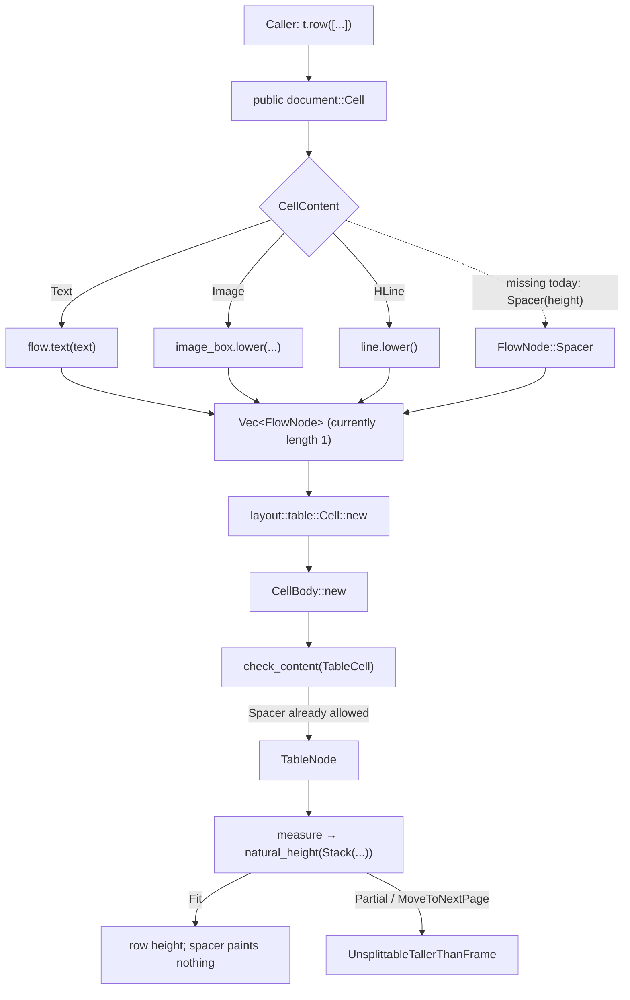

# Public table cells and spacer content

## Overview

Public table cells do not receive a nested `Flow`. A caller gives `Table::header` or `Table::row` values convertible to the public `document::Cell`; that cell stores exactly one private `CellContent` variant. During `Table::lower`, the variant becomes a one-element `Vec<FlowNode>` and is handed to the internal `layout::table::Cell` (`src/document.rs:962-1027`, `src/document.rs:1030-1111`).

Today the public variants are text, image, and horizontal line. There is no spacer variant or constructor, so callers cannot reach the spacer support that already exists below the DSL boundary:

- `FlowNode::Spacer` and `SpacerNode` already implement vertical blank space (`src/layout/flow.rs:127-149`, `src/layout/flow.rs:179-208`).
- The table-cell allowlist already accepts `FlowNode::Spacer` (`src/layout/lower.rs:30-39`).
- `CellBody` already stores a `Vec<FlowNode>` and lowers it to a stack (`src/layout/lower.rs:85-97`).

Knife 16 therefore needs a public `Cell` factory/storage arm and the matching `Table::lower` arm. It does not need a new layout node or allowlist rule.

There is one important pagination limit: table cells are measured through `natural_height`, which accepts only `Split::Fit`. A spacer taller than the cell's inner full-height frame returns `Partial`, but `natural_height` converts that to `Error::UnsplittableTallerThanFrame` (`src/layout/flow.rs:341-350`). It therefore does **not** split across pages inside a cell, unlike the same spacer in body flow.

## Key Concepts

### Two unrelated `Cell` types

| Layer | Type | Role |
| --- | --- | --- |
| Public DSL | `document::Cell`, re-exported as `quire::Cell` | Owns one caller-selected payload plus row/column spans (`src/document.rs:1030-1092`, `src/lib.rs:21-24`) |
| Layout | `layout::table::Cell` | Owns a validated `CellBody` containing `Vec<FlowNode>` (`src/layout/table.rs:50-73`) |

`src/document.rs` imports the layout module as `table`, so `table::Cell::new(...)` in `Table::lower` means the internal type, not the public one.

### Public cells are single-payload cells

`CellContent` currently has three arms (`src/document.rs:1039-1044`):

| Public construction | Stored payload | Lowered node |
| --- | --- | --- |
| `Cell::new(text)` and `From<&str/String/&String>` | `Text(String)` | `FlowNode::Text` using the enclosing flow's style |
| `Cell::image(&image, configure)` | `Image(Image, ImageBox)` | `FlowNode::Image`; validates the document image token |
| `Cell::hline(configure)` | `HLine(HLine)` | `FlowNode::HLine` |

`Table::header` and `Table::row` only collect `Into<Cell>` (`src/document.rs:969-987`). Unlike `Columns::col` and `List::item`, they never pass a nested `Flow` to the caller. Consequently `Flow::spacer` at `src/document.rs:725-728` cannot be called from a cell.

Every arm in `Table::lower` creates `vec![one_node]` (`src/document.rs:1002-1018`). The layout representation can hold several nodes, but the public representation cannot express a spacer between text and another child. A `Cell::spacer(height)` change supplies a spacer-only cell; a general multi-child cell DSL is a separate design/API change.

### Spacer is already a layout primitive

`SpacerNode` stores `Length<NonNegative>`, the same branded height accepted by `Flow::spacer` (`src/layout/flow.rs:127-130`, `src/document.rs:725-728`). Zero is valid and negative values are rejected when constructing the branded length (`src/geom.rs:101-112`).

Its split behavior is:

- height `0`: `Fit` with height zero;
- height within the available frame: `Fit` with that height;
- excess height: `Partial`, with the remainder represented as a shorter `SpacerNode`;
- all fragments contain no drawing commands.

See `SpacerNode::split` at `src/layout/flow.rs:179-208`. Thus a fitting spacer changes geometry without painting glyphs, strokes, or fills.

### Proposal and table semantics

Proposal §2.6 explicitly permits spacer as a cell child and makes a whole physical row the table split unit (`docs/提案书.md:338-384`). Proposal §2.13 defines spacer as non-negative, invisible, splittable flow content and explicitly allows it in a cell (`docs/提案书.md:545-554`).

The current layout reconciles those rules in favor of atomic table rows: body spacers split, while cell bodies must fit a full cell frame before the row is paginated as a unit. That behavior is implemented but not explicitly covered by a cell-spacer test.

## How It Works



### 1. Assembly in the public DSL

`Flow::table` creates an empty public `Table`, runs the caller closure, calls `Table::lower(self)`, then pushes the resulting `FlowNode::Table` (`src/document.rs:704-715`). Rows are inert `Vec<Cell>` values until this lowering step.

Text cells acquire the parent flow's style at lower time through private `Flow::text` (`src/document.rs:665-667`). Image cells lower with `flow.doc`; horizontal lines need neither style nor document token. A spacer likewise needs only its stored `Length<NonNegative>`.

### 2. Public-to-layout bridge

`Table::lower` determines the column count from the first header row, or the first body row if there is no header. It then exhaustively matches `CellContent`, constructs a node vector, calls `table::Cell::new(content)`, and copies `col_span`/`row_span` (`src/document.rs:994-1027`).

This exhaustive match is the missing bridge for spacer. The minimal knife 16 shape is:

1. Add `CellContent::Spacer(Length<NonNegative>)`.
2. Add `Cell::spacer(height: Length<NonNegative>) -> Self`, initialized as a one-by-one cell like `Cell::hline`.
3. Add a `Table::lower` match arm producing `vec![FlowNode::Spacer(SpacerNode { height })]`.

`SpacerNode` is already imported into `src/document.rs` for `Flow::spacer` (`src/document.rs:22`, `src/document.rs:725-728`). `Length<NonNegative>` implements `Eq`, so the existing `Cell`/`CellContent` derives remain valid (`src/geom.rs:17-38`).

No `From<Length<NonNegative>> for Cell` is implied: image and horizontal-line cells also require named constructors, and the existing `From` implementations are text-only (`src/document.rs:1095-1111`).

### 3. Container validation

Internal `table::Cell::new` calls `CellBody::new`, which runs the shared content matrix for `Container::TableCell` (`src/layout/table.rs:57-64`, `src/layout/lower.rs:85-97`).

The matrix already allows text, paragraph, spacer, and horizontal line unconditionally. It also allows image and list in a table cell, while rejecting columns, page break, keep-together, and nested table (`src/layout/lower.rs:30-59`). Stacks are checked recursively.

Therefore knife 16 should not modify `check_content`. A new rule there would duplicate an existing allowance.

### 4. Measurement and pagination

`CellBody::into_node` wraps its vector in `FlowNode::Stack`, even for one child (`src/layout/lower.rs:94-97`). Table measurement computes:

```text
inset      = border_width / 2 + padding
inner_full = page_body_full_height - 2 * inset
cell frame = { width: inner_width, height: inner_full, full_height: inner_full }
```

It then calls `natural_height(Stack(cell_children), frame)` (`src/layout/table.rs:190-223`).

For a spacer-only cell:

| Spacer height | Result |
| --- | --- |
| `0` | Fits at height 0 and paints nothing |
| `0 < h <= inner_full` | Fits; contributes `h` to cell/row height and paints nothing |
| `h > inner_full` | `SpacerNode::split` returns `Partial`; `natural_height` rejects it as `UnsplittableTallerThanFrame` |

After successful measurement, row height is the maximum cell height in that row (`src/layout/table.rs:223-230`). Row-span shortfall is assigned to the final row in the span (`src/layout/table.rs:297-314`). Cell fragments are offset into the row, and an empty spacer fragment contributes no commands (`src/layout/table.rs:246-267`).

Only then does `split_measured` paginate prebuilt row-group fragments (`src/layout/table.rs:340-390`). It moves a row or rowspan-connected group whole when it does not fit the remaining page space. It never re-enters the cell's `SpacerNode::split`.

Body flow differs: the paginator preserves `Split::Partial`, so an 80 pt spacer on a 50 pt page leaves a 30 pt spacer at the start of page two. This is tested by `spacer_remainder_leads_next_page` (`src/layout/paginate.rs:525-553`). The same dimensions inside a cell would fail during `natural_height`.

## Where Things Live

| Concern | Location |
| --- | --- |
| Public `Flow::table` and `Flow::spacer` | `src/document.rs:704-728` |
| Public `Table`, lowering bridge, public `Cell` and `CellContent` | `src/document.rs:962-1111` |
| Public `Cell` re-export | `src/lib.rs:21-24` |
| Cell content allowlist and `CellBody` | `src/layout/lower.rs:10-97` |
| `SpacerNode`, split behavior, `natural_height` | `src/layout/flow.rs:127-208`, `src/layout/flow.rs:341-350` |
| Internal table cell, measurement, row pagination | `src/layout/table.rs:50-73`, `src/layout/table.rs:190-390` |
| Proposal authority | `docs/提案书.md:338-384`, `docs/提案书.md:545-554` |
| Existing public hline-cell precedent | `tests/document.rs:1192-1231` |
| Existing layout allowlist tests | `src/layout/table.rs:625-670` |
| Existing body-spacer split test | `src/layout/paginate.rs:525-553` |

## Gotchas

- **Knife 16 is a DSL/lower change, not a layout feature.** Add the public `CellContent` arm, `Cell::spacer`, and the `Table::lower` arm. Keep the existing `FlowNode::Spacer`, `CellBody`, and allowlist unchanged.
- **A spacer-only cell is not a general cell body API.** The public cell still owns one payload and lower still emits one node. Callers still cannot combine paragraph + spacer + rule in one cell. The layout can represent that, but exposing it requires a separately chosen DSL shape; §2.6 explicitly says its signatures are not pinned.
- **Cell spacers do not inherit body-spacer pagination.** `natural_height` discards `Partial` and `MoveToNextPage` outcomes by turning them into `UnsplittableTallerThanFrame`. A spacer taller than `inner_full`, or a middle spacer that exceeds the space left after earlier children, fails instead of continuing on another page.
- **A fitting cell spacer can still move the row.** Once measured, the row remains atomic. If it fits a fresh body but not the current remainder, `split_measured` moves the whole row/group to the next page.
- **The spacer has no paint operation.** Tests should observe row geometry through the y-coordinate/page of following text or another visible neighbor, not look for a spacer canvas command.
- **Current tests leave two gaps.** There is no layout test that constructs `table::Cell::new(vec![FlowNode::Spacer(...)])`, and no public test for a spacer cell. The nearest precedents are `cell_allows_hline` (`src/layout/table.rs:659-670`) and `hline_in_list_item_and_cell` (`tests/document.rs:1192-1231`). Knife 16 should add an allow/lowering assertion and a geometry assertion; it should not reuse the body split expectation for an oversized cell spacer.
- **Zero height remains legal.** `NonNegative::ZERO` fits with no geometry or ink. Negative values fail while constructing `Length<NonNegative>`, before `Cell::spacer` is called.
- **Public tables currently have zero padding and zero border.** `Table::lower` inherits those defaults from `TableSpec::new` (`src/document.rs:1020-1025`, `src/layout/table.rs:34-47`), so today `inner_full` equals the table's page-body full height. Future public padding/border support will shrink the frame in which the spacer must fit.
