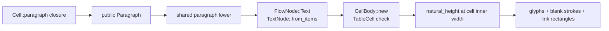

# Rich paragraphs and lists in public table cells

## Overview

The layout layer already has the required capability. A layout table cell owns a `CellBody(Vec<FlowNode>)`, and its content matrix accepts `Text`, `Paragraph`, `List`, `Spacer`, `HLine`, and `Image`. The missing seam is entirely in the public document DSL: public `Cell` currently stores exactly one of plain text, image, horizontal line, or spacer, and `Table::lower` therefore never emits a rich text node or list node for a cell.

The two additions are not equally difficult:

- A rich paragraph is a direct reuse of the existing public `Paragraph` builder. A `Cell::paragraph`-style factory can run the closure immediately, retain the paragraph data and errors, then use the same lowering path as `Flow::paragraph`: parent style plus `first_line_indent`, followed by `TextNode::from_items`. Bold, blanks, and links then ride the existing inline pipeline for free.
- A list cannot be constructed by a context-free `Cell::ul` in the same way. `List::item` needs a live parent `Flow` today because each item closure immediately calls `Flow::nested`. The arena decision is therefore where that `Flow` comes from: defer the list closure until `Table::lower`, give `Table` a child `Flow`, or introduce another context-bearing/declarative cell builder.

No new layout node or new table-cell allowlist is needed.

## Key Concepts

### Public cell versus layout cell

`document::Cell` is the public value accepted by `Table::row` and `Table::header`. Its private `CellContent` currently represents one payload and `Table::lower` turns that payload into a one-element `Vec<FlowNode>`.

`layout::table::Cell` is internal. It receives that vector through `CellBody::new`, where `check_content(Container::TableCell, ...)` enforces the nesting rules. The internal vector can already hold more than one node, but the current public API does not expose that ability. Adding one paragraph arm and one list arm does not by itself define mixed content such as “paragraph + spacer + list” in one cell.

### A public paragraph lowers to `Text`, not `Paragraph`

`Flow::paragraph` creates a public `Paragraph`, runs the caller closure, applies its first-line indent to a clone of the parent style, and emits:

```rust
FlowNode::Text(TextNode::from_items(paragraph.items, style))
```

That distinction matters. `TextNode` is still unwrapped and wraps only when layout knows the cell's inner width. `FlowNode::Paragraph` is the later, already-wrapped line representation and must not be produced by the cell DSL.

The existing inline items already carry:

- `text` and `bold` face selection;
- fixed, em, and fill-to-end blanks plus stroke configuration;
- URI link targets on text runs.

Consequently, a cell-specific bold, blank, or link implementation would be duplication. The cell factory only needs to preserve the complete `Paragraph` result, including `EmptyLink` and `RunAfterFillBlank`, and invoke the same private lowering helper as body paragraphs.

### A list item is built with a child `Flow`

`List` contains `parent: Flow`. `List::item` and `item_marked` immediately call `parent.nested(f)`, producing item `FlowNode`s and validating them through `ListItem::new`. This is why body `Flow::ul` and `Flow::ol` work: they can initialize the list with `self.child()`.

A free associated function such as `Cell::ul(|list| ...)` has no document `Flow`, style, or `DocToken`. Although style happens to be effectively default today, manufacturing an unrelated `Flow::new(default_style(), ...)` would create the wrong ownership/context boundary and would diverge as soon as inherited style changes. It is not a sound shortcut.

## How It Works

### Rich paragraph path

The directional API can follow the existing one-payload factory pattern:

```rust
Cell::paragraph(|p| {
    p.text("Amount: ");
    p.bold("100");
    p.blank_em(2);
    p.link("https://example.test", |p| p.text("details"));
})
```

The signature is illustrative; §2.6 deliberately does not pin it. Internally the path should be:

1. Create `Paragraph::default()` and run the closure immediately.
2. Store the paragraph payload or an equivalent owned snapshot, including its first error.
3. At `Table::lower`, use the enclosing `Flow`'s style.
4. Apply `first_line_indent` and call `TextNode::from_items`, exactly as `Flow::paragraph` does.
5. Pass the resulting `FlowNode::Text` to `table::Cell::new`.
6. During table measurement, wrap it at `inner_w`, the spanned cell width minus border and padding.

Extracting one private “paragraph builder to text node” helper and calling it from both `Flow::paragraph` and `Table::lower` is the smallest way to prevent semantic drift. `Cell::new("text")` should remain the plain-string shorthand through `TextNode::new`.



### List path: the arena fork

The target behavior can reuse the existing public `List` and item `Flow`:

```rust
// Illustrative ergonomic target, not yet a settled signature.
Cell::ul(|list| {
    list.item(|item| {
        item.paragraph(|p| p.text("first"));
        item.ul(|nested| { /* ... */ });
    });
})
```

The unresolved issue is when and where the `List` receives `flow.child()`.

| Option | Mechanism | Advantages | Costs / risks |
| --- | --- | --- | --- |
| Defer the list closure to `Table::lower` | `CellContent` stores list kind plus a deferred `FnOnce(&mut List)`. Lowering has `&Flow`, creates `List { parent: flow.child(), ... }`, runs the closure, then calls `List::lower`. | Preserves the natural `Cell::ul` / `Cell::ol` spelling; reuses `List`, `Flow::nested`, style, token, and current item validation exactly. | A closure-bearing `Cell` is no longer naturally `Clone`, `Debug`, or `Eq`; borrowed captures introduce lifetimes into `Cell`/`Table`, while requiring `'static` would be restrictive. Errors also surface at lower time. |
| Give `Table` a child `Flow` | `Flow::table` constructs `Table` with `parent: self.child()`. A table-aware cell factory executes the list closure eagerly against that flow. | Correct document context without storing deferred user closures; item errors are collected during table assembly. | A context-free `Cell::ul` still cannot work: list cells must be made through `Table` or a row/cell builder. This changes the public DSL and borrow ergonomics. Storing the resulting `List` or `FlowNode` also weakens current `Cell` derives. |
| Introduce an owned declarative cell/list builder | Record unresolved paragraph, rule, spacer, and nested-list data, then lower it with the table's `Flow`. | Avoids captured closures and can deliberately support several children per cell. A restricted builder can make forbidden nodes unrepresentable. | Largest change; duplicates or refactors `Flow`/`List` assembly and risks a second list-item API with different validation. It also forces the currently open “one payload or a sequence” decision. |

Whichever option wins, it should still end in the existing sequence:

`List::item` → item `Flow` → `ListItem::new`/`ItemBody::new` → `List::lower` → `FlowNode::List` → `CellBody::new`.

That sequence is what preserves nested lists, hanging indentation, custom markers, paragraph blanks/links inside items, and the list-item content restrictions.

### Cell pagination remains whole-row pagination

Table measurement gives every cell its inner width and the full inner page-body height, then calls `natural_height(body.into_node(), ...)`. `natural_height` accepts only `Split::Fit`.

Therefore a paragraph or list that would return `Split::Partial` in normal body flow becomes `Error::UnsplittableTallerThanFrame` in a cell. `MoveToNextPage` becomes the same error. The partial fragment is discarded; a cell never continues onto another page.

This does not prevent table pagination. If the complete row fits the full page body but not the current page remainder, the table moves the whole row or row-span group to the next page. If the cell content cannot fit the full inner frame, the table fails before painting it. This is the existing §2.6 physical-row rule applied to richer content, even though §2.8 allows an ordinary body list item to split.

## Where Things Live

| Location | Responsibility |
| --- | --- |
| `src/document.rs` | Public `Flow`, `Paragraph`, `List`, `Table`, `Cell`, `CellContent`; `Flow::paragraph`; `Flow::ul`/`ol`; `Table::lower`. This is where the public seam and the list-context decision live. |
| `src/layout/lower.rs` | Shared container matrix. `TableCell` already accepts text/paragraph/list; `ListItem` validates list children. No allowlist expansion is required. |
| `src/layout/paragraph.rs` | `TextNode::from_items`, width-dependent wrapping, bold face selection, blanks, and link fragment commands. |
| `src/layout/list.rs` | Item validation, marker generation, hanging indentation, nested-list layout, and body-flow partial splits. |
| `src/layout/table.rs` | Cell inner frame calculation, `natural_height` call, row height, whole-row placement, and cell fragment offsets. |
| `src/layout/flow.rs` | `split_stack` and `natural_height`; the latter converts non-`Fit` cell content into `UnsplittableTallerThanFrame`. |
| `tests/document.rs` | Public recording assertions for fonts, blanks, links, lists, cells, and no-output-on-error behavior. |
| `docs/提案书.md` §2.6 / §2.8 | Authoritative cell-child allowlist, whole-row pagination, list-item contents, and explicit permission for lists in cells. |

## Gotchas

- **Forbidden content stays forbidden:** a cell must not gain `columns`, pageBreak, keep_together, or a nested table. The existing `TableCell` matrix rejects all four. List items reject the same structural escapes through `ItemBody::new`; nested lists remain allowed. A new broad cell builder must not bypass these checks.
- **Do not lower a rich cell to `FlowNode::Paragraph`:** it would wrap before the cell width is known. Use `TextNode::from_items`, so a fill blank ends at the cell edge and links receive the table cell's final offset.
- **Preserve paragraph errors:** retaining only `items` would silently lose errors recorded by `Paragraph::link` and fill-blank ordering. Shared lowering must consume both payload and error.
- **Current derives constrain storage choices:** `Cell` is `Debug + Clone + PartialEq + Eq`; `Paragraph`, `List`, `FlowNode`, and deferred closures do not all satisfy those traits. There is no in-repo equality dependency, but changing derives is still a public API decision, not an incidental implementation detail.
- **One payload is still one payload:** adding `Paragraph` and `List` enum arms allows either as the whole public cell. It does not expose the internal `Vec<FlowNode>` or settle mixed cell sequences.
- **A narrow cell can fail geometrically:** the public marker column is 18 pt. If the cell's inner width is not wider than it, list layout returns `InvalidGeometry`, independently of the nesting allowlist.
- **Test the rendered public path:** positive coverage should check bold font IDs, blank stroke endpoints at the cell edge, link rectangles after cell offset, and marker/item x positions (`cell_x` and `cell_x + 18`). Over-height coverage should assert `UnsplittableTallerThanFrame` and no output, not a successful second-page continuation.

## Arena frame: five takeaways

1. Paragraph cells are the settled half: reuse public `Paragraph` through a `Cell::paragraph`-style factory and share the exact `Flow::paragraph` → `TextNode::from_items` lowering; bold, blank, and link behavior follows automatically.
2. List cells are blocked by context, not layout: `List::item` requires a parent `Flow` at closure-execution time, while a standalone `Cell` has none.
3. The arena choice is explicit: deferred closure preserves `Cell::ul` ergonomics but adds lifetime/trait costs; a `Table`-held child `Flow` preserves eager construction but changes the DSL; a declarative builder is cleaner-owned but substantially larger.
4. Do not change the pagination contract: any cell child that would be `Partial` or `MoveToNextPage` in body flow must become `UnsplittableTallerThanFrame`; only complete rows move between pages.
5. Keep the hard boundary: columns, pageBreak, keep_together, and nested table remain forbidden, and every chosen list path must continue through existing `ListItem`/`CellBody` validation.
