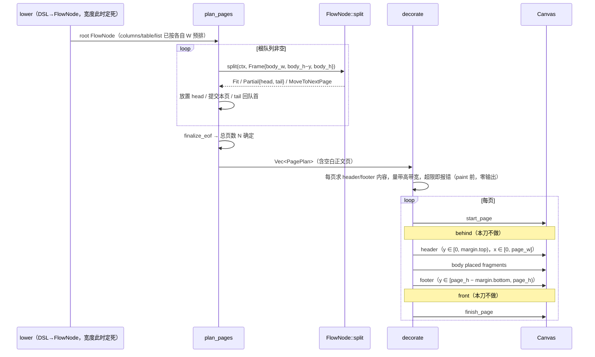

# 刀 7 入门：quire 内部 flow 协议与 table / columns / list / decorate 扩展点

基线：`feat/flow-paginate @ a6ff61e`（feat(layout): paginate paragraphs with PageCursor and keep_together）。
权威：`docs/提案书.md` > `AGENTS.md` > `docs/quire-design.md` 未确认部分。设计稿与提案书冲突处一律按提案书，设计稿只保留不冲突的技术细节。

来源：三份探索报告（`how/explorer-flow.md`（含 flow 探索完整返回）、`how/explorer-paginate.md`、`how/explorer-docs.md`），并逐条对照 `src/layout/` 现码核实。

---

## Overview

排版内核是一个 **crate 内部**的"消费式切分"协议：每个 `FlowNode` 按值交给 `split(ctx, Frame)`，返回三种结果之一——整块放下（`Fit`）、放下一部分并把剩余作为新节点交回（`Partial`）、本页一点也放不下（`MoveToNextPage`）。分页器 `plan_pages` 在根队列上循环调用 `split`，把得到的 `Fragment`（相对坐标的绘制指令）钉到页面坐标，形成 `Vec<PagePlan>`；之后 `paint_pages` 按页把指令放到 `Canvas` 上。

今天只有段落、spacer、pageBreak、keep_together、stack 五种节点，绘制指令只有字形（`Glyphs`）。`decorate.rs`、`table.rs`、`lower.rs`、`dump.rs` 都还只有一行模块注释。刀 7 要做的四件事都挂在这条协议上：

- **columns / table / list** 是新的 `FlowNode` 变体，靠 `Partial.tail` 跨页续排。
- **decorate**（页眉页脚）**不是** `FlowNode`。它在 plan 结束、总页数已知之后，在 paint 阶段画进上下 margin 带，不改动正文。

`Flowable` / `FlowNode` 永远不对调用方暴露（AGENTS.md、提案书 §1）。

---

## Key Concepts

| 概念 | 位置 | 含义 |
| --- | --- | --- |
| `Frame { width, height, full_height }` | `flow.rs:20` | 剩余区域。`height` 可为 0；`width`、`full_height` 必须 > 0（`validate` 每次 `split` 都调） |
| `Fragment { height, spacing_after, commands }` | `flow.rs:43` | 已放好的一块，坐标相对 fragment 左上 |
| `FragmentCommand` | `flow.rs:72` | 目前只有 `Glyphs(GlyphRun)` |
| `Split` | `flow.rs:78` | `Fit{height,fragment}` / `Partial{head_height,head,tail}` / `MoveToNextPage(node)` |
| `FlowNode` | `flow.rs:111` | `Paragraph` / `Spacer` / `PageBreak` / `KeepTogether(Open\|Prepared)` / `Stack` |
| `natural_height` | `flow.rs:295` | 在整页框上 split，只接受 `Fit`，其余一律 `UnsplittableTallerThanFrame` |
| `PaginateConfig { page_size, margins }` | `paginate.rs:12` | 正文框 = 页 − 四边 margin；没有页眉页脚字段 |
| `PageCursor` | `paginate.rs:41` | `Fresh` / `HasBody` / `PendingBlank`，只服务 pageBreak 三态 |
| `PagePlan { size, placed }` | `paginate.rs:54` | 每页只有尺寸和 `PlacedFragment{origin, fragment}` 列表 |

坐标约定：左上原点，y 向下，单位 pt。fragment 内部坐标相对自身左上；分页器把它平移到 `body_origin + (0, y)`。

---

## How It Works

### 1. 节点各自的 `split` 语义（`flow.rs`、`paragraph.rs`）

**Paragraph**（`paragraph.rs:71`）
- 宽度在 `ParagraphNode::layout(fonts, text, style, width)` 时就**定死**了：断行和 `align_x` 都用这个 `width`。`split` **不看** `avail.width`。
- `line_height > full_height` 直接报 `UnsplittableTallerThanFrame`；剩余高度放不下一行就返回 `MoveToNextPage(self)`；能放下 n 行就返回 `Partial`，tail 是剩下的行，`spacing_after` 只挂在最后一个片段上（head 的为 0）。
- 段落永远不会返回零高度的 `Partial`。

**Spacer**（`flow.rs:132`）
- 高度为 0 时返回 `Fit` 加空 fragment。否则先占 `min(h, avail.height)`，剩余部分变成 tail spacer（`Partial`）。
- `avail.height == 0` 时会返回 **head 高度为 0 的 `Partial`**。这是合法的，因为分页器拿到 `Partial` 就提交本页；整页框上 spacer 至少占掉 `full_height` 中的一部分，所以不会死循环。

**PageBreak**
- `split` 直接返回 `Err(InvalidGeometry)`。只有分页器在**根队列**上特判它（`paginate.rs:93`）。也就是说，嵌在非根 Stack 里的 pageBreak 今天会报一个泛化的几何错误。提案书 §2.9 要求单元格和列表项里出现 pageBreak 时报 `InvalidCellContent`，这一步应在 lower / 构造阶段拦下，不要依赖 split 的这个兜底。

**KeepTogether**（`flow.rs:165`）
- `Open(kids)`：在**整页框**（`height = full_height`）上对 `Stack(kids)` 求 `natural_height`，结果缓存为 `Prepared`，`spacing_after` 单独存放。
- 放得下返回 `Fit`；当前剩余高度放不下但整页放得下，返回 `MoveToNextPage(Prepared)`，下一页不再重新测量；整页也放不下就报 `UnsplittableTallerThanFrame`。

**Stack**（`flow.rs:205`）
- 依次 split 子节点，用 `with_offset(y)` 把子 fragment 的命令下移到累积高度，拼成一个 fragment。
- 子节点之间的 `spacing_after` 只在剩余高度够时才加，否则丢弃；最后一个子节点的 spacing 作为整个 Stack 的 `spacing_after` 向上冒。
- 子节点返回 `Partial`：head 拼进来，tail 和剩余兄弟组成 `Stack(rest)`，作为整体的 tail，head 的 `spacing_after` 强制为 0。
- 子节点返回 `MoveToNextPage`：如果还没放过任何内容，整体返回 `MoveToNextPage(Stack(rest))`；如果已经放过内容，则把已放部分包装成 `Partial`（head = 已放部分）。
- 所以 **Stack 能组合任何遵守协议的子节点**，新变体加进 match 后自动能被 stack 包裹。

### 2. 分页 `plan_pages`（`paginate.rs:70`）

- 只**摊平根 Stack** 的直接子节点进队列；`Partial` 的 tail（往往是 `Stack(rest)`）会原样插回队首，不再摊平。
- 每个节点拿到的 `Frame` 是 `{ body_w, body_h − y, body_h }`。
- `Fit`：放到 `(margin.left, margin.top + y)`；`y += height`，spacing 放得下才加。
- `Partial`：head 放到本页，**提交本页**，tail 插回队首，`y = 0`。注意这里**忽略 `head_height`**（`head_height: _`）：反正本页已经结束。
- `MoveToNextPage`：`y == 0`（本页还是空的）时报 `UnsplittableTallerThanFrame`，否则提交本页，节点留到下一页重试。
- pageBreak 三态（`apply_page_break`）：`Fresh` 时忽略；`HasBody` 时提交本页并进入 `PendingBlank`；在 `PendingBlank` 时再遇到 pageBreak 就推入一张空白正文页。`finalize_eof` 时如果停在 `PendingBlank`，那一页丢弃；如果文档为空，补一张空页。按提案书 §2.9，空白正文页仍要画页眉页脚并计入页数，因此 decorate 必须遍历 `pages` 的**全部**元素，包括 `placed` 为空的页。
- plan 结束时页数已经确定，这正是 decorate 需要的时间点。

### 3. 绘制 `paint_pages`（`paginate.rs:216`）

对每页依次调用 `start_page(size)`、对每个 placed 调用 `draw_fragment(fragment, canvas, origin)`、`finish_page()`。`draw_fragment` 目前只处理 `Glyphs`。`Canvas` 本身已经有 `fill_path` / `stroke_path`（`canvas.rs:178/181`），`RecordingCanvas` 也会记录 `StrokePath`，缺的只是 `FragmentCommand` 这一层。

### 4. 刀 7 目标流水线

---

## 刀 7 扩展点

### A. 协议层公共改动（先做，其余都依赖它）

1. **`FragmentCommand` 加矢量指令**：至少要有 `Stroke`（表格边框、列表之外的分隔线），建议同时加 `Fill`（单元格底色、填充矩形），对应 `Canvas::stroke_path` / `fill_path`。三个地方必须同步改：`with_offset`、`draw_fragment`，以及以后的 `dump`。
2. **`with_offset` 改成二维**：今天 `with_offset(dy)`（`flow.rs:58`）只平移 y，而且是私有函数。columns 的第 k 列、表格单元格、列表正文列都需要 **x 偏移**。建议改为 `with_offset(dx, dy)`，并设为 `pub(crate)`，Stack 调用时传 `dx = 0`。Path 的每个点都要平移。
3. **`error.rs` 加错误**（名字沿用设计稿，属于技术细节）：`ColumnWidths`、`InvalidCellContent`、`DecorationTallerThanMargin`、`DecorationWiderThanFrame`。现有 `UnsplittableTallerThanFrame`、`UnbreakableWiderThanFrame`、`InvalidGeometry` 继续使用。

### B. Columns（提案书 §2.4 / §2.5）

- 新变体 `FlowNode::Columns`，存 `Vec<FlowNode>`（每列一个已按列宽预排的 stack）和列 x 偏移。
- 列宽：Fixed / Ratio / 至多一个 Auto；gap 默认 12pt；**先扣 gap 再解列宽**（沿用设计稿的 `resolve_column_widths`）。总宽超出或解不出时报 `ColumnWidths`。
- **宽度必须在 lower 阶段解出并传给 `ParagraphNode::layout`**，因为 split 不看 `avail.width`。提案书 §2.1 规定列内的 W 就是该列列宽。
- **可以跨页（提案书 §2.5，推翻设计稿的"不可拆"）**：每列用同一个 `Frame{col_w, avail.height, full_height}` 各自 split，顶对齐。
  - 全部 `Fit`：返回 `Fit`，高度取各列最大值。
  - 任一列 `Partial` 或有列 `MoveToNextPage`：返回 `Partial`。head 包含所有列本页放下的部分，`head_height` = 各列 head 高度的最大值；tail 是新的 `Columns`，列数不变，已经排完的列变成空 stack。
  - 所有列都 `MoveToNextPage` 并且本次没有放下任何内容：返回 `MoveToNextPage(self)`。
- 可以与 stack 反复互相嵌套（提案书 §2.4）；列内可放 keep_together。
- 列内 keep_together 用的 `full_height` 仍然是整页正文高，所以单列放不下整组时会报 `UnsplittableTallerThanFrame`，这一点正确。

### C. Table（提案书 §2.6）

- 新变体 `FlowNode::Table`：存列宽（与 columns 共用解宽算法）、表头行组、剩余行、`repeat_header`（**默认开，重复全部表头行**，不只是第 0 行）。
- **行是原子单位**：单行在整页正文框上求 `natural_height`，放不下就整行移到下一页；比整页还高就报错。
- **colSpan / rowSpan 要做**（提案书 §2.6 推翻设计稿 Non-Goal）。跨页缝不能落在一个尚未结束的 rowSpan 中间：把被 rowSpan 绑在一起的若干行作为一个原子块；整块放不下就一起移到下一页；块高于整页正文框则报错。
- 边框：线居中在格线上，内容区每侧扣 `border_width / 2`，合计扣一个 `border_width`（设计稿技术细节保留），通过 `FragmentCommand::Stroke` 输出。
- **重复表头放在 tail 上**：生成 `Partial` 时，tail 的行队列前面带上表头；下一次 split 先排表头再排数据行。上一页的 head 里不追加任何东西。如果在整页框上表头加第一行数据都放不下，报 `UnsplittableTallerThanFrame`，否则会死循环。
- 单元格内容（提案书 §2.6 表）：允许段落、分隔线、spacer，列表随列表 PR 放开；禁止 `columns`、pageBreak、keep_together、嵌套 table，出现即报 `InvalidCellContent`，在 lower 阶段检查。
- 表宽默认占满当前框 W；可以放在 columns 的某一列里。

### D. List（提案书 §2.8）

- 新变体 `FlowNode::List`：存剩余项和"当前项是否已画过标记"。
- 标记：ul 默认 `•`；ol 支持 decimal / 大写字母 / 小写字母 / 大写罗马 / 小写罗马；也可以**逐项传入自定义字符串**（本刀不做回调）。自定义串同样参与 `marker_width` 测量，advance 超出 `marker_width` 就报错，不裁剪。
- 悬挂缩进：标记单独占一列；正文列左缘 = 外框左缘 + 本层缩进。正文用 `W − indent` 预排，并通过 `with_offset(dx = indent, ·)` 右移。
- **项可以跨页**：标记只出现在该项首个片段上。tail 里的续项保持同样缩进，但**不再生成标记命令**。
- 嵌套：每深一层增加一级 `nest_indent`，**默认等于 `marker_width`**，可配置。
- 项内允许段落、分隔线、spacer、嵌套列表；禁止 table / columns（第一版）；出现 pageBreak 报 `InvalidCellContent`。

### E. Decorate（提案书 §2.10 / §2.11 / §5）

- **不是 `FlowNode`，也不改动正文**：正文框始终是页面减四边 margin，decorate 不能回过头改 `body_h`、`y` 或 placed origin。
- 带：页眉带 `y ∈ [0, margin.top)`，页脚带 `y ∈ [page_h − margin.bottom, page_h)`；**横向占满页宽** `x = 0 … page_w`，不受左右 margin 缩进（提案书 §2.10 推翻设计稿的正文宽）。要对齐正文时，由闭包拿到的 margin 自己缩进。
- 内容可以多行；行盒总高超过带高时报 `DecorationTallerThanMargin`，超过页宽时报 `DecorationWiderThanFrame`。不裁切、不加高、不回流。默认 margin 为 0（已在代码中），这时只要有装饰内容就会报带高错误。
- 时机：`plan_pages` 之后、paint 之前，先对每一页（包括空白正文页）求装饰内容并量好；全部检查通过后再进入 paint，保证出错时 `RecordingCanvas` 为空（与 `keep_together_taller_than_frame_errors` 的"出错零输出"一致）。
- 页码：本刀 `PageNumber` / `PageCount` 都用**全文总页数**；section 内的第二套页码以及公开闭包留到刀 8。
- 实现形态建议：内部做成 paint 阶段的旁路（`paint_pages` 接收已量好的 `Vec<PageDecoration>`），`PagePlan` 不新增正文相关字段。装饰内容同样以 `Fragment` 表达，复用 `draw_fragment`。

---

## Where Things Live

| 文件 | 现状 | 刀 7 改动 |
| --- | --- | --- |
| `src/layout/flow.rs` | 协议与 5 种节点、`natural_height`、`draw_fragment` | 加变体与 match 分支；`FragmentCommand::Stroke/Fill`；`with_offset(dx, dy)` |
| `src/layout/paragraph.rs` | layout 时定宽，split 只按行切 | 不改协议；调用方传入列宽或单元格宽 |
| `src/layout/paginate.rs` | `plan_pages` / `paint_pages` / `PageCursor` | 在 paint 前接入 decorate；paint 顺序 header → body → footer |
| `src/layout/table.rs` | 一行模块注释 | 解列宽（与 columns 共用）、行或 rowSpan 块原子切分、表头放在 tail 上 |
| `src/layout/decorate.rs` | 一行模块注释 | 带几何、量带高带宽、全文页码 |
| `src/layout/lower.rs` | 一行模块注释 | 解宽度、预排段落、检查 `InvalidCellContent` |
| `src/layout/dump.rs` | 一行模块注释 | 新指令的调试输出（可选） |
| `src/error.rs` | 无 Decoration / ColumnWidths / InvalidCellContent | 加 4 个错误变体 |
| `src/canvas.rs` | 已有 `stroke_path` / `fill_path` / `StrokePath` 记录 | 不需要改 |
| `src/document.rs` | 公共 DSL | 本刀只做内部 Node；公开签名随提案书对应条落地 |

---

## Gotchas

1. **宽度在 lower 时定死。** `ParagraphNode::split` 完全不看 `avail.width`；columns / table / list 传进来的较窄 Frame 不会让段落重新断行。必须在 lower 阶段用列宽、格宽或缩进后的宽度调用 `layout`，否则文字会溢出到列外，而且不会报错。
2. **`with_offset` 只平移 y。** 直接复用会把所有列叠在 x = 0 上。
3. **零高度 `Partial` 可能死循环。** Spacer 在 `height == 0` 时返回零高 head 是安全的，因为分页器会换页，到了整页框上必然有进展。新节点必须保证在**整页框**（`height == full_height`）上要么有进展，要么报错。表格"表头 + 首行"、columns"所有列都没进展"都是高发点。
4. **`MoveToNextPage` 在 `y == 0` 时报错**，`y` 是根层的。复合节点在整页框上若返回 `MoveToNextPage`，会直接得到 `UnsplittableTallerThanFrame`，这正是预期行为，不要把它吞掉改成 `Partial`。
5. **只有根 Stack 被摊平**，所以 pageBreak 只在根队列上生效。嵌套位置的 pageBreak 在 split 里报的是泛化的 `InvalidGeometry`，单元格和列表项里的情况要在 lower 阶段先报 `InvalidCellContent`。
6. **spacing_after 规则**：放不下就丢弃，`Partial` head 的 spacing 为 0，Stack 只把最后一个子节点的 spacing 冒出去。columns 的 head 和 tail 要按同样规则处理；整体的 `spacing_after` 取各列中的哪一个需要明确定一个规则（建议取各列最后一个子节点 spacing 的最大值，并写测试固定下来）。
7. **KeepTogether 在整页框上测量**；放在列里时 width 是列宽，但 `full_height` 仍是整页正文高。
8. **空白正文页也要装饰，也计入页数**（提案书 §2.9）。`PendingBlank` 推入的空页 `placed` 为空，decorate 不能跳过。
9. **绘制顺序按提案书**：behind → header → body → footer → front。设计稿时序图里是"先 body 后装饰"，以提案书为准。`RecordingCanvas` 的断言顺序要据此编写。
10. **出错零输出**：所有装饰的量取和报错都在 paint 之前完成。
11. **测试**：排版断言写在 `RecordingCanvas` 上（坐标用 `to_bits()` 精确比较，与现有测试一致），不要断言 krilla 的字节内容。

---

## 已按提案书决定的刀 7 默认值

| 议题 | 默认 | 依据 |
| --- | --- | --- |
| columns 跨页 | 可拆，返回 `Partial`，各列在本页剩余高度上切分 | 提案书 §2.5（推翻设计稿） |
| decorate 宽度 | 全页宽 `x = 0 … page_w` | 提案书 §2.10 |
| decorate 带高 | 页眉 = `margin.top`，页脚 = `margin.bottom`，不改动正文 | 提案书 §2.10 |
| 绘制顺序 | behind → header → body → footer → front（本刀不做 behind/front，但 header 先于 body） | 提案书 §2.12 |
| 错误名 | `ColumnWidths` / `InvalidCellContent` / `DecorationTallerThanMargin` / `DecorationWiderThanFrame` | 设计稿技术细节，不与提案书冲突 |
| 页码 | 本刀只用全文页码与总页数；section 双页码留到刀 8 | 提案书 §2.11 先做子集 |
| 自定义列表标记 | 仅逐项字符串，不做回调 | 提案书 §2.8 允许的子集 |
| `nest_indent` | 默认等于 `marker_width`，可配置 | 提案书 §2.8 |
| 表头重复 | 默认开，重复全部表头行，表头放在 tail 上 | 提案书 §2.6 |
| 单元格合并 | colSpan / rowSpan 要做，rowSpan 块作为原子单位跨页 | 提案书 §2.6（推翻设计稿 Non-Goal） |
