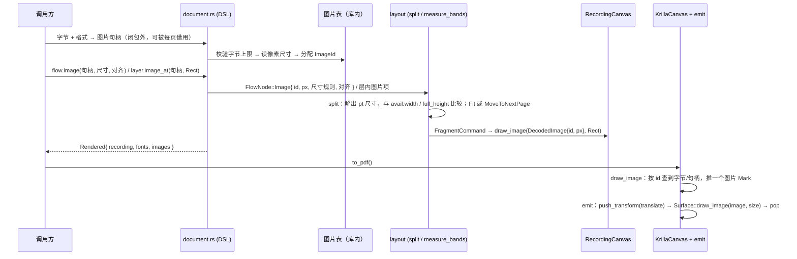

# 刀 9 入门：quire 的图片现状与 `image` / `image_at` 要接的缝

基线：`7cbe823`（feat(document): expose closure DSL over flow layout），工作树只多了未跟踪的 `.audit/`。
权威：`docs/提案书.md` 已确认条 > `AGENTS.md` > `docs/quire-design.md`（设计稿只取技术事实）。

来源：三份探索报告（`how/explorer-docs.md`、`how/explorer-layout.md`、`how/explorer-canvas.md`），逐条对照现码核实；另外直接读了 `~/.cargo/registry/.../krilla-0.8.2/src`，把 explorer 留下的 krilla API 疑问核掉了。

---

## Overview

**一句话：图片只在画布这一层有个空壳，往上（layout、DSL）和往下（解码、krilla 发射）都没接。**

- **画布层有类型、能记录。** `ImageId`、`DecodedImage`、`Canvas::draw_image`、`CanvasCommand::DrawImage` 都在。`RecordingCanvas` 会记录并回放图片命令。
- **后端是毒化桩。** `KrillaCanvas::draw_image` 直接存一个 `UnsupportedCanvasOperation { operation: "draw_image" }`，之后所有调用（包括 `finish`）都返回这个错误。`emit.rs` 没有图片 mark，也没有调用 `Surface::draw_image`。
- **没有解码入口。** 全仓库没有 `ImageFormat`、`decode_image`，也没有调用 `Image::from_*`。`raster-images` feature 已开，png/jpeg/gif/webp 解码库已进 lockfile，但源码里一处都没用上。
- **layout 不知道图片。** `FlowNode` 没有 `Image` 变体，`FragmentCommand` 只有 `Glyphs` / `Stroke`，`src/layout/` 里没有任何地方引用 `DecodedImage` 或 `draw_image`。
- **DSL 没有入口。** `Flow` 上没有 `image`，`Layer` 上只有 `text_at`，没有 `image_at`。刀 8 明确把 `image_at` 推给了"image knife"（`.audit/knife-8/arena/synthesis/design.md:25`）。

所以今天这条生产链走不到图片：`document()` → `paginate_root` → `RecordingCanvas` 里不会出现 `DrawImage`，`Rendered::to_pdf` 也就不会碰到那个桩。刀 9 要从上到下打通四层：**解码 → layout 节点与绘制指令 → DSL → backend 发射**。

---

## Key Concepts

### 已确认的产品规则（提案书，可以直接当需求）

| 规则 | 出处 |
| --- | --- |
| 两条路分开：流内 `image` 是正文节点，`image_at` 是 `behind`/`front` 里的页面坐标逃逸。两者**共享解码与绘制**，API 和分页行为不同 | §2.7 `提案书.md:386-388`；§2.12 `:538` |
| 流内图**整块不可拆**；剩余高度不够就整张移到下一页；**比整页正文框高，或显示宽度大于当前框 `W`，报错，不自动缩小** | §2.5.1 `:332`；§2.7 `:390` |
| 图源主路径：**原始字节 + 格式**（PNG / JPEG / GIF / WebP），GIF 和 WebP 只取第一帧当静止图 | §2.7 `:392-399` |
| 不做 `http(s)` URL、本地路径、Data URI 主路径；Base64 不是排版核心类型 | §2.7 `:396-399` |
| 尺寸三规则：宽高都给就用给定值（**不保持像素比**）；只给一边，另一边按像素宽高比算（需要解码）；两边都不给，`1 px = 1 pt` | §2.7 `:401-407`；§8 `:614` |
| `fit` / `cover` 第一版不做；在框内对齐默认 Start，可选 Center / End | §2.7 `:413-414` |
| 表格单元格里**允许**放图（随图片能力落地） | §2.7 `:415`；§2.6 `:381` |
| 具名 `images` 字典**延后** | §2.7 `:416`；确认总表 `:656` |
| 图上链接随 §8，不阻挡图片元素本身 | §2.7 `:417` |
| **layout 只持有 `ImageId` 和 pt 矩形；解码和 krilla 句柄留在 backend；`interpolate` 固定 `false`** | §2.7 `:419` |
| `image_at` 坐标相对当前物理页左上，y 向下，不因左右 margin 缩进；闭包每页执行一次，可以用 `is_last` 决定画不画 | §2.12 `:527-531` |
| 每页叠层顺序：`behind` → `header` → 正文 → `footer` → `front` | §2.12 `:533-535` |
| qr / svg 不做独立元素，都走 image | §2.16 `:570`；§2.17 `:574` |

§1 模板（`提案书.md:112-116`）写的是 `page.image_at(&seal, Rect::new(430.0, 680.0, 90.0, 90.0))`。§1 文首说过签名要等条目定完再写，所以这**只说明调用形状**：图源（`seal`）是在闭包外造好、每页借用的；目标是一个页面坐标矩形。它不是冻结的签名。

### 只出现在设计稿里的建议（未确认，不能当产品规则）

- 限额数字：编码字节 32 MiB、4000 万像素、单边 8192（设计稿 1093-1131 一带）。`src/limits.rs` 还是占位，确认总表里也没有这几个数。
- 错误名：`Error::Image { message }`、`ImageTooLarge { width, height }`、`LimitKind::{ImageBytes, ImagePixels}`、`BackendRequired`（设计稿 1100-1131）。
- 结构草图：`decode_image` → `DecodedRaster`（1246-1254）、适配器内部的 `ImageId -> krilla::image::Image` 表（397）、`LayoutCtx.images: &ImageTable`（638）、`FragmentCommand::Image`（662）、`draw_image_at`（340-347）、PR 13 测试清单（1640-1645）。
- 静态 `ImageBlock` 形状：这属于已被 §1 作废的静态文档模型，不要沿用。

设计稿第 12 行自己写明它不描述现有源码。草图里用的是裸 `f32` 和 `rect.x`，现码 `Rect` 已经是私有 `origin` + `size`，只有 `origin()` / `size()` 访问器（`src/geom.rs:257-296`）。

### 已核实的 krilla 0.8.2 事实（我读了 registry 源码）

| 事实 | 位置 |
| --- | --- |
| `Image::from_png/from_jpeg/from_gif/from_webp(data: Data, interpolate: bool) -> Result<Image, String>` | `krilla-0.8.2/src/graphics/image.rs:201,214,248,263` |
| `Image::size(&self) -> (u32, u32)`，读的是 `from_*` 时解析好的 metadata | `image.rs:348` |
| `Image` 是 `Arc<ImageRepr>`，`Clone + Hash + Eq`，clone 便宜，创建贵 | `image.rs:195-197` |
| `from_*` 先解析文件头拿 metadata（**头部错误在这里就返回 `Err`**），然后 `Deferred::new(move \|\| decode_*(...))` | `image.rs:202-210` |
| 没开 `rayon` 时，`Deferred::new` 就是 `Self(f())`，**像素解码在 `from_*` 里同步跑完** | `krilla-0.8.2/src/util.rs:193-208` |
| 像素解码的结果（包括失败）存在 `Deferred` 里，序列化时才 `wait()`；失败以 `KrillaError::Image(..)` 的形式报出 | `image.rs:440`；`krilla-0.8.2/src/error.rs:49` |
| `Surface::draw_image(&mut self, image: Image, size: Size)`：没有位置参数，图画在当前变换原点 | `krilla-0.8.2/src/surface.rs:529` |

设计稿说"`draw_image` 之后图的顶边落在当前原点，适配器只 `push_transform(translate(x, y))`、不要再翻一次 y、`push`/`pop` 必须成对，否则 krilla 会 panic"（设计稿 51、340-347、1512）。这和 AGENTS.md"适配器对几何做恒等映射"一致，但还没在本仓库用测试钉过。

---

## How It Works

### 1. 画布层（已有）——`src/canvas.rs`

- `ImageId(pub(crate) u32)`（`:56`），公开 `from_raw(u32)` / `as_u32()`。没有分配器，任何 `u32`（包括 0）都能造出来。
- `DecodedImage { pub id, pub pixel_width: u32, pub pixel_height: u32 }`（`:74`），`Copy`，没有构造器，不拒绝 0 边，不带编码字节或句柄。
- `Canvas::draw_image(&mut self, image: &DecodedImage, rect: Rect) -> Result<()>`（`:184`）。
- `RecordingCanvas::draw_image`（`:323-329`）无条件记一条 `DrawImage` 并返回 `Ok`；`pages()` 在页内保留它（`:267`）；`replay` 原样转发（`:357`）。
- `lib.rs:26-28` 公开重导出了 `ImageId`、`DecodedImage`。

这层形状和 §2.7"layout 只持有 `ImageId` + pt 矩形"是对得上的：命令里只有 id、像素尺寸和目标矩形。

### 2. 后端（桩）——`src/backend/`

```246:251:src/backend/krilla_canvas.rs
    fn draw_image(&mut self, _image: &DecodedImage, _rect: Rect) -> Result<()> {
        self.open_page_mut("draw_image")?;
        self.fail(Error::UnsupportedCanvasOperation {
            operation: "draw_image",
        })
    }
```

- `KrillaCanvas`（`krilla_canvas.rs:94-101`）只持有 `font_store: Arc<FontStore>`，没有图片表。文件头约定这个文件**不 `use krilla`**，krilla 的 `Document`/`Page`/`Surface` 只在 `emit.rs` 里构造。
- `Mark`（`:56-83`）只有 `Fill` / `Stroke` / `Glyphs`。`Glyphs` 自己带着 `Arc<Vec<u8>>` 字体字节，因为 `finish`（`:139-160`）在调用 `emit::render` **之前**就把 `font_store` drop 掉了（`:148-149`）。
- 毒化规则：`fail` 只记第一次错误；`ensure_ok` / `open_page_mut` / `finish_page` / `finish` 都先返回这个错误。没有打开页时，存的是 `InvalidCanvasState`，不是 `UnsupportedCanvasOperation`。
- `emit::render(info, pages, serialization)`（`emit.rs:30`）没有图片参数；`draw_mark`（`:115`）对 `Mark` 做穷尽匹配，没有图片分支。krilla 序列化错误统一映射成 `Error::Backend(error.to_string())`（`:43-44`）。
- 测试 `unsupported_image_poisons_finish`（`emit.rs:478-497`）固定了今天的桩行为。

### 3. layout（无图片）——`src/layout/`

**协议**（`flow.rs`）：
- `LayoutCtx { fonts }`（`:17-19`），没有图片表。
- `Fragment::with_offset(dx, dy)`（`:61-73`）已经是二维平移（刀 7 改过），对 `FragmentCommand` 做穷尽匹配。
- `FragmentCommand`（`:76-83`）只有 `Glyphs(GlyphRun)` 和 `Stroke { path, paint, stroke }`。
- `FlowNode`（`:127-137`）有九个变体：`Paragraph`、`Text`、`Spacer`、`PageBreak`、`KeepTogether`、`Stack`、`Columns`、`Table`、`List`。`split`（`:140-153`）也是穷尽匹配。
- `draw_fragment`（`:330-353`）把相对坐标加上 `PlacedFragment.origin`，再调画布；它从不调用 `draw_image`。

**可以直接照抄的原子块模式**：`split_keep_together`（`flow.rs:189-227`）。高度放得下返回 `Fit`；剩余高度放不下、但整页放得下，返回 `MoveToNextPage`；整页也放不下报 `UnsplittableTallerThanFrame`。它从不返回 `Partial`。这正是 §2.7 要的图片语义。分页器在页顶（`y == 0`）收到 `MoveToNextPage` 时会改报 `UnsplittableTallerThanFrame`（`paginate.rs:137-140`），但图片节点最好自己先比较 `full_height` 并报错，不要依赖这个兜底。

**宽度在 split 时才知道**：`TextNode::split` 用 `avail.width` 现排（`paragraph.rs:37-38`），表格和列表也都从 `avail.width` 推格宽/正文宽（`table.rs:192`、`list.rs:173`）。所以图片节点可以在 `split` 里拿 `avail.width` 当 §2.7 的"当前框 `W`"：既用来做"显示宽 > W 就报错"，也用来算 Center / End 的 x 偏移。

**容器内容矩阵**（`lower.rs:30-64`）：`check_content` 和 `node_name`（`:66-77`）都对 `FlowNode` 做穷尽匹配。现状是：

| 节点 | Column | TableCell | ListItem | Band |
| --- | --- | --- | --- | --- |
| Text / Paragraph / Spacer | ✓ | ✓ | ✓ | ✓ |
| Stack | 递归 | 递归 | 递归 | 递归 |
| KeepTogether | ✓ | ✗ | ✗ | ✗ |
| Columns | ✓ | ✗ | ✗ | 递归检查各列 |
| Table | ✓ | ✗ | ✗ | ✗ |
| List | ✓ | ✓ | ✓ | ✗ |
| PageBreak | ✗ | ✗ | ✗ | ✗ |

加 `Image` 时必须补一行。提案书只明确了 Column（正文流）和 TableCell 允许放图；ListItem 的允许表（§2.8 `:453`）没有提图片；Band 的 DSL 今天只接受 left/right 两段文字（`document.rs:542-602`）。

**页面层（behind/front）不是流**（`decorate.rs`）：
- `LayerText { text, at, style }`（`:49-53`）；`LayerContent = Box<dyn Fn(&PageInfo) -> Vec<LayerText>>`（`:55`），这个闭包**不能失败**，返回值只能是文字。
- `measure_layer`（`:128-160`）把每条文字排成一行 `Glyphs`，平移到 `at`，打包成一个原点为 (0,0)、高度为 0 的 `PlacedFragment`。
- `measure_bands`（`:80-126`）在 plan 之后、paint 之前，对每一页跑 header/footer/behind/front。全部成功才进 `paint_pages`，所以出错时画布是空的。
- `paint_pages`（`paginate.rs:216-230`）按 behind → header → body → footer → front 的顺序调用 `draw_fragment`。

所以 `image_at` 只要能变成 `FragmentCommand`，叠层顺序和"出错零输出"都能直接继承，不需要动 `paint_pages`。

### 4. DSL（无图片）——`src/document.rs`

- `document()`（`:32-41`）跑一次组装闭包，然后**总是先画到 `RecordingCanvas`**，返回 `Rendered { recording, fonts }`。这一步不依赖 `backend-krilla`。
- `Document::font(bytes)`（`:73-80`）注册字体后把 `FontId` 丢掉（`.map(drop)`）；第一款字体隐式成为默认字体。
- `Flow`（`:159-290`）用 `push(Result<FlowNode>)` 推迟错误：构造时出的错存起来，到 `document()` 才返回。`Flow` 没有 `image`。
- 公共 `Cell` 只能装文字（`Cell::new(text)`，`:403`）；layout 层的 `table::Cell::new(content: Vec<FlowNode>)`（`table.rs:58`）本身支持任意节点。
- `Layer { page, texts: Vec<(String, Point)> }`（`:617-639`）只有 `text_at`。`layer_content`（`:641-658`）把它转成 `Vec<LayerText>`。
- `Rendered::to_pdf`（`:676-681`，`cfg(feature = "backend-krilla")`）：`KrillaCanvas::new_with_fonts(Arc::new(self.fonts))` → `replay` → `finish`。**字体是这样从 layout 带到 backend 的；图片今天没有对应的通道。**

### 5. 刀 9 目标流水线



---

## Where Things Live

| 文件 | 现状 | 刀 9 要动什么 |
| --- | --- | --- |
| `src/canvas.rs` | `ImageId`(:56)、`DecodedImage`(:74)、`draw_image`(:184)、录制(:323)、回放(:357) | 协议基本不用动。可以考虑给录制测试补上对 id/矩形的断言（今天只断言了命令种类，`:442`） |
| `src/layout/flow.rs` | `FlowNode`(:127)、`FragmentCommand`(:76)、`with_offset`(:61)、`draw_fragment`(:330)、`LayoutCtx`(:17) | 加 `FlowNode` 图片变体和 `split` 分支；加 `FragmentCommand` 图片变体；同步修改 `with_offset` 和 `draw_fragment` |
| `src/layout/list.rs` | `first_baseline`(:258) 穷尽匹配 `FragmentCommand` | 补图片分支（返回 `None`；如果列表项允许放图，标记基线怎么取要单独定） |
| `src/layout/lower.rs` | `check_content`(:30)、`node_name`(:66) | 补 `Image` 行：Column、TableCell 允许；ListItem、Band 待定 |
| `src/layout/decorate.rs` | `LayerText`(:49)、`LayerContent`(:55)、`measure_layer`(:128) | 层内容从"只有文字"扩成"文字或图片"，`measure_layer` 产出图片 `FragmentCommand` |
| `src/layout/paginate.rs` | `plan_pages` / `paint_pages` | 不需要改（原子语义由节点自己表达） |
| `src/layout/table.rs` | 行原子、`natural_height` 量格高 | 一般不用改；图片作为格内容需要在 `natural_height` 上一次 `Fit` |
| `src/document.rs` | `Flow`、`Layer::text_at`(:636)、`Rendered`(:662)、`to_pdf`(:677) | 新增图源类型和注册入口、`Flow::image`、`Layer::image_at`；`Rendered` 携带图片表；`to_pdf` 把图片表交给 `KrillaCanvas` |
| `src/backend/krilla_canvas.rs` | 桩(:246)、`Mark`(:56)、`finish` 先 drop 字体表(:148) | 换掉桩；加图片 mark；决定句柄放在 mark 里还是作为表传给 `render` |
| `src/backend/emit.rs` | `render`(:30)、`draw_mark`(:115)、桩测试(:478-497) | 加 `Image::from_*`（只能放在 `backend/`）、成对的 transform、图片分支；替换桩测试 |
| `src/error.rs` | 只有 `UnsupportedCanvasOperation`(:41) 跟图片沾边；`Error` 派生 `Clone, PartialEq`，已经含 `String` 字段 | 加解码失败、尺寸超框/超宽、字节超限等错误变体（名字未钉） |
| `src/limits.rs` | `// Placeholder module.` | 字节上限要在 `from_*` 之前生效；可以先照 `fonts.rs:33` 的 `MAX_FONT_BYTES` 做一个 crate 内常量，不急着做公共 `Limits` |
| `Cargo.toml` | `krilla =0.8.2`、`raster-images`、`default = ["backend-krilla"]` | 预计不改。如果决定在没有 backend 的情况下也要读像素尺寸，才需要考虑直接依赖（并精确钉版本） |

---

## Gotchas

1. **解码时机和 feature 打架。** `document()` 在没有 `backend-krilla` 时也能跑排版，并且 layout 在 `split` 时就要知道像素尺寸（只给一边、或两边都不给时）。但 `Image::from_*` 只能出现在 `backend/`，而且只在开了 feature 时存在。可选方案：a) 只在 feature 下提供需要像素尺寸的解码，没开 feature 时报错（设计稿的 `BackendRequired` 思路）；b) 宽高都给时完全不解码，只记录矩形，与现在 `RecordingCanvas` 的行为兼容；c) 另引一个只读文件头的依赖。c 会增加依赖，要按 AGENTS.md 精确钉版本，并且和"第二套解码"之间的一致性要自己保证。默认 feature 是开着的，所以 a+b 对绝大多数调用方没有区别。
2. **字节上限必须放在 `from_*` 之前。** 没开 `rayon` 时，像素解码在 `from_*` 里同步完成（`util.rs:193-208`），调用一旦开始，内存就已经分配了。
3. **"解码成功"不等于像素有效。** `from_*` 只对**文件头**出错时返回 `Err`；像素数据损坏的结果存在 `Deferred` 里，要到序列化时才以 `KrillaError::Image` 冒出来，经 `emit.rs:43-44` 变成 `Error::Backend(String)`。也就是说，一张头部完好、数据损坏的 PNG，`document()` 会成功，`to_pdf()` 才失败。如果想在 `document()` 阶段就报 `Image` 错误，要么接受这个差异并写测试固定，要么另找办法提前验证。
4. **`finish` 会在发射前 drop 旁路状态。** 字体就是这样被丢掉的（`krilla_canvas.rs:148-149`），所以 `Mark::Glyphs` 自带字节。图片要么也把需要的东西放进 mark（krilla `Image` clone 很便宜，但 `krilla_canvas.rs` 约定不 import krilla；按字形的做法就是带编码字节，在 `emit` 里再 `from_*`），要么给 `render` 加一个图片表参数。两条路今天都没有。
5. **同一张图每页都画，不能每页都解码一次。** 电子章、水印都是每页执行一次 `Layer` 闭包。如果在 `emit` 里按 mark 调 `from_*`，会对同一份字节重复做同步解码。应该按 `ImageId` 在 `render` 范围内缓存，或者整份文档只解码一次。
6. **`Rendered` 必须把图片表带到 `to_pdf`。** 今天它只带 `FontStore`（`document.rs:662-681`）。录制里只有 `ImageId`，没有表的话后端什么也查不到。
7. **`FragmentCommand` 加变体会连带影响三个穷尽匹配**：`with_offset`（`flow.rs:61`）、`draw_fragment`（`flow.rs:330`）、`list::first_baseline`（`list.rs:258`）。坐标是两段平移：容器先 `with_offset`，分页器再加 `PlacedFragment.origin`，漏掉任何一段，图片在栏、表、列表里都会错位。
8. **`FlowNode` 加变体会连带影响三个穷尽匹配**：`FlowNode::split`（`flow.rs:140`）、`check_content`（`lower.rs:30`）、`node_name`（`lower.rs:66`）。
9. **不能用 `KeepTogether` 包图片来获得原子语义。** 矩阵在 TableCell / ListItem 里拒绝 `KeepTogether`（`lower.rs:38-43`），而格内图片是提案书明确允许的。图片节点要自己实现"Fit 或 MoveToNextPage，绝不 Partial"。
10. **超宽错误不要被吞掉。** §2.7 要求显示宽 > `W` 时报错、不缩小。现有 `UnbreakableWiderThanFrame { width, avail }`（`error.rs:74`）是给文字用的，`measure_band` 会把它改写成 `DecorationWiderThanFrame`（`decorate.rs:184-186`）。复用它还是新开一个图片专用变体需要定，但无论选哪个都要写测试固定。
11. **零尺寸。** `Rect::try_pt` 要求宽高为正，但 `DecodedImage` 允许 0 像素边。如果"两边都不给"遇到 0 像素的图，会在构造矩形时报泛化的 `InvalidGeometry`。应该在注册/解码阶段就明确拒绝。
12. **`image_at` 没有 `W` 和分页约束。** 它不进正文流、不占高度、不因 margin 缩进（§2.12）。目标矩形就是页面坐标，超出页面要不要报错，提案书没说；文字层今天不检查越界。
13. **层闭包不能失败。** `LayerContent` 返回 `Vec<LayerText>`，不是 `Result`。`image_at` 如果在闭包里做任何可能失败的事（例如解码），就没有地方报错。所以图源必须在闭包外准备好，闭包里只借用句柄、推矩形，这和 §1 的 `&seal` 写法一致。
14. **具名字典延后，但句柄可以有。** "注册字节 → 拿回一个句柄"不等于具名 `images` 字典（字典是"先起名、再按名引用"）。`ImageId` 留在库内，不要给调用方暴露按名查找。
15. **毒化的副作用。** 换掉桩之前，任何 `DrawImage` 都会让整份 PDF 失败，不会产生"缺图的 PDF"。`unsupported_image_poisons_finish`（`emit.rs:478-497`）会随实现失效，需要改成正向测试（1×1 PNG 冒烟只断言 `%PDF`，坐标断言放在 `RecordingCanvas` 上）。
16. **`interpolate` 一律传 `false`**（§2.7 `:419`）。
17. **测试分层**（AGENTS.md）：layout 测试断言 `RecordingCanvas` 里 `DrawImage` 的 id、像素尺寸和矩形（坐标用 `to_bits()` 精确比较）；只有 backend 测试可以看内容流里的数字。

---

## 刀 9 需要定、提案书没定的点

| 问题 | 现状 | 倾向（仅供讨论） |
| --- | --- | --- |
| 具体 DSL 签名（图源类型、注册入口、`image` / `image_at` 参数） | 无 | 按 §1 形状：闭包外造句柄，`Flow::image`、`Layer::image_at(&handle, Rect)` |
| 错误变体名 | 无 | 设计稿名字可以沿用，但需要在实现 PR 里明确写出来 |
| 限额数字 | 设计稿有，未确认 | 至少要有字节上限（防同步解码爆内存），数字单独确认 |
| Center / End 的参照宽度 | §2.7 只说"在框内" | 用 `avail.width`（当前框 `W`） |
| 列表项里能不能放图 | §2.8 允许表没提 | 保守做法是先拒绝，或请产品确认 |
| 图片节点的 `spacing_after` | 无 | 0，以后跟随样式 |
| 没有 backend 时、需要像素尺寸的情况 | 无 | 报错；宽高都给时只记录矩形 |

---

## Implications for knife 9

- **解码缝（backend 内）**：新建一个只在 `backend/` 里、`cfg(feature = "backend-krilla")` 下的解码函数：先查字节上限 → `Image::from_{png,jpeg,gif,webp}(data, false)` → `size()`。把 `Err(String)` 映射成一个新的图片错误变体。在 `limits.rs` 或其他 crate 内位置放字节上限常量。
- **图片表缝（document ↔ backend）**：`Document` 持有一张"`ImageId` → 字节 + 格式 + 像素尺寸"的库内表；`Rendered` 携带它；`to_pdf` 把它交给 `KrillaCanvas`（和 `new_with_fonts` 并列）。
- **layout 节点缝**：`FlowNode::Image`，实现"Fit / MoveToNextPage / 超高或超宽报错，不返回 Partial"；在 `split` 里解析尺寸三规则和对齐；补齐 `check_content` 和 `node_name`。
- **绘制指令缝**：`FragmentCommand::Image { image: DecodedImage, rect }`；同步修改 `with_offset`、`draw_fragment`、`list::first_baseline`；`draw_fragment` 调用 `canvas.draw_image`。
- **层缝**：`LayerContent` 从 `Vec<LayerText>` 扩成"文字或图片"；`measure_layer` 产出图片命令；`Layer::image_at` 只借用句柄、记录页面矩形。
- **后端发射缝**：换掉 `KrillaCanvas::draw_image` 桩；新增图片 `Mark`（句柄或字节 + 按 id 缓存）；`emit::draw_mark` 用 `push_transform(translate(x, y))` → `Surface::draw_image(image, size)` → `pop`，不翻 y；替换 `unsupported_image_poisons_finish`。
- **DSL 缝（最后接）**：图源构造 / 注册入口、`Flow::image`、`Layer::image_at`，可选再加单元格图片。签名在实现 PR 里按提案书 §2.7 / §2.12 的约束写出来；具名字典、`fit` / `cover`、图上链接都不做。
