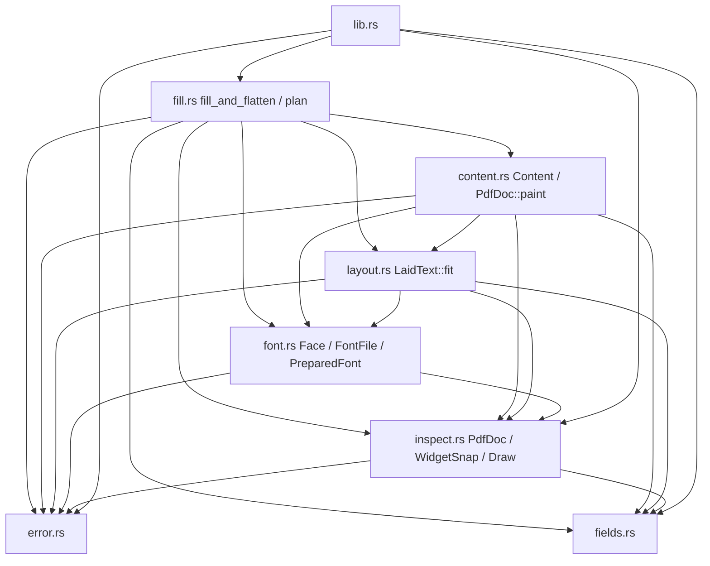
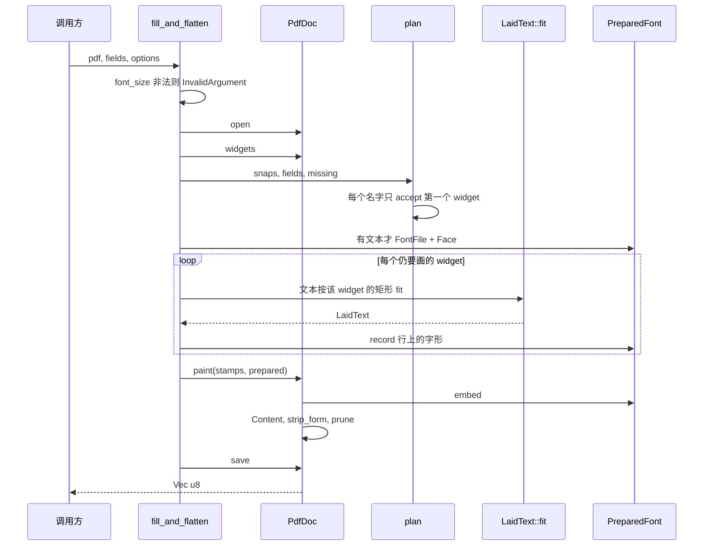

# pdfcraft-forms 所有权与失败类型修复

| 项 | 值 |
| --- | --- |
| 日期 | 2026-10-13 |
| 作者 | 待填 |
| 状态 | **草案，供实现。不是提案书确认条。** |
| 代码 | `crates/pdfcraft-forms` |
| 权威 | [`提案书.md`](提案书.md) §10 已确认的产品行为。本文不改提案书，不改 [`pdfcraft-forms-spec.md`](pdfcraft-forms-spec.md)（该文抬头仍是待确认草案） |

本文是实现工单。修所有权、失败载荷、以及「谁的方法」。不扩产品。

## Overview

`pdfcraft-forms` 从 Python 填表器移植而来。`forbid(unsafe_code)`、clippy pedantic、`Result` 已经在。剩下的问题是：自由函数堆在 `overlay.rs` 里，不变量没有主体；`InvalidArgument` / `FlattenFailed` 的载荷是英文句子；`FontNotConfigured` 有的路径没有 `source`；cmap 走两遍；断掉的间接引用用 `Object::Null` 冒充。

修复后，公共入口仍是 `list_fields` 与 `fill_and_flatten`。`lopdf::Document` 只活在 `PdfDoc` 新类型里。排版只在 `layout.rs`。内容流只在 `Content`。嵌入字体只在 `PreparedFont`。失败种类的**名字**仍是 §10 那一套。变体内部不再用 `message: String`。

## Background & Motivation

现状（已读代码，不是设计稿）：

| 点 | 现在 | 问题 |
| --- | --- | --- |
| 文档 | `inspect::open` 返回 `lopdf::Document`（`inspect.rs`） | 加密、XFA、trailer 不变量不在类型上 |
| 排版 | `overlay::lay_text` 加 `remember` | `lay_at` 在读字符串之前就 `face.glyph(' ')`（`overlay.rs` 约 131 行）。`remember` 再扫一遍 cmap；只要原文有空白（含 `\n`）就登记 U+0020 |
| 字号循环 | `size <= MIN_FONT_SIZE + 0.001`，然后 `size - 0.5`（`overlay.rs` 约 70–80 行） | `0.001` 是浮点补丁。调用方传入的不是 12 时，循环仍应从该值起步 |
| 溢出 | `block > inner_h + 0.05`（`overlay.rs` 约 290–296 行） | 0.05 pt 是无来源的松弛 |
| 宽度 | `em1000` 越界或非有限就返回 `0`，并 `as i16`（`font.rs` 约 188–195 行） | 静默写成 0。`i16` 不是 PDF 宽度 |
| 内容流 | `format!` / `writeln!`，`let _ = writeln!` | 非有限数变成字面量 `0`（`pdf_num`）。错误被丢掉 |
| 修剪 | 只从 trailer 的 `Root` / `Info` / `Encrypt` 走引用（`overlay.rs` 约 599–608 行） | `lopdf` 0.34 把 `self.trailer` 原样写出。`Prev`、`XRefStm` 是旧文件偏移，会进新文件 |
| 解引用 | `deep_deref` 失败时 `Object::Null`（`inspect.rs` 约 184–191 行） | 真 Null 和断引用分不开 |
| 错误 | `InvalidArgument { message }`、`FlattenFailed { message }`、`FontFault(&'static str)` | 字段名埋在句子里。head 修补失败没有 `source`（`stable_font_bytes`） |
| 常量 | `lib.rs` 重导出 `DEFAULT_FONT_SIZE` 等 7 个 | §10 没有这些名字 |

`Document::save_internal`（lopdf 0.34 `src/writer.rs`，`Document` 的实现，不是 `IncrementalDocument`）证实 trailer 行为：

- `save_to` 只调 `save_internal`。
- 经典 xref：`write_trailer` 把 `Size` 设成 `max_id + 1`，然后 `Writer::write_dictionary` 写出**整个** `self.trailer`。
- xref stream：`write_cross_reference_stream` 把 `max_id` 加 1，再写 `Type`=`XRef`、`Size`、`W`=`[1 4 2]`、`Index`、`Length`。过滤器是 `XRefStreamFilter::None`，所以这条路径 **`remove("Filter")`**。其余 trailer 键克隆进流字典。
- 类型名是 `ObjStm`、`XRef`、`Linearized` 的对象不重写（`Dictionary::type_name` 在存在 `Linearized` 键时也报 `Linearized`）。
- 读入侧（`reader.rs` 跟随 `Prev` 的循环）只在循环体内 `trailer.remove(b"XRefStm")`。没有 `Prev` 时 `XRefStm` 留下。`Prev` 本身从不删除。

`pdfcraft-forms` 调的是 `Document::save_to`，整文件重写，不是增量保存。留下 `Prev` / `XRefStm` 就是把旧字节偏移写进新文件。

## Goals & Non-Goals

### 目标

- 模块是名字空间。`impl` 只放「主体就是这个值，并且维护这个值的不变量」的操作。
- §10 已实现的产品行为保持：字节进字节出、空表也 flatten、可填类型、加密与 `/XFA` 失败、缺字整份失败、同名 widget、默认左对齐底对齐、两次成功调用字节相同。
- `ErrorKind` **变体名**与 §10 的表一致。不新增变体。
- 每个可合并 PR 过门禁（见 Rollout Plan）。

### 非目标

不改调用方可见的填写结果语义，除下文「有意变化」表里的项。不重排对象号，不改 `Document::max_id`。稀疏 xref 保持 lopdf 现有写出方式。

### 不做

- 中文填写、OTF、TTC、对齐覆盖、`line_below`、`absolute_lines`。`fills_chinese_text` 保持 `#[ignore]`。
- 字体子集。嵌整份带 `glyf` 的 TrueType。
- 与 `pdfcraft-pdf` 共享测量 crate。本 crate 不依赖 `pdfcraft-pdf`，不用 `krilla`。
- 改 `docs/pdfcraft-forms-spec.md` 或 `docs/提案书.md`。
- 不改勾的几何。不改默认字号 12、步长 0.5、最小字号 7、padding、行高系数这些数值，只改它们的可见性（R5）。字号搜索改为毫点，从调用方的字号起步；四舍五入后的毫点大于 256 pt 则在 `open` 之前拒绝。溢出比较去掉 0.05 pt。这两处循环改动与 0.05 pt 见「有意变化」，不要理解成只许删掉 `0.001`。
- HTTP、写加密、写签名、XFA 运行时。
- 日志框架、指标、feature flag。见 Observability。
- 新依赖、`unsafe`、`thiserror`。`lopdf =0.34.0`、`skrifa =0.48.0`、`publish = false` 不动。
- 不把 UAX #14 引进 `layout.rs`。
- 不把 U+00A0 / U+3000 折成 U+0020 当成 bug 修掉。这是 v1 已接受的规则。

## Proposed Design

### 有意保持

这些不是「顺便改掉」的对象。

| 规则 | 落点 |
| --- | --- |
| 字节进，字节出。API 无路径 | `list_fields`、`fill_and_flatten` 签名不动 |
| 空 `fields` 也剥掉全部 Widget 和 catalog `/AcroForm` | `PdfDoc::strip_form` |
| 可填 Text、CheckBox、ListBox、ComboBox。`fields` 里的 Signature / Radio / Push 用现有 kind 失败。不在 `fields` 里的这些 widget 照样剥掉 | `WidgetSnap::accept` |
| 加密 PDF、以及 AcroForm 上任意 `/XFA` 键（含空数组）失败 | `PdfDoc::open` |
| 缺字整份失败。无回退字体。无子集 | `LaidText::fit` |
| 同名 widget 共用一个 `FieldValue`。类型和 `/Opt` 只看页序里的第一个。每个 widget 按自己的矩形排 | `plan` 一次 `accept`，循环里多次 `fit` |
| 默认左对齐、底对齐 | 绘制 x = `rect.x0 + PAD_X`；基线见 `place` |
| ASCII 先按空白断，超宽词再按字形断。码位 > U+007F 按标量断。显式 `\n` 分段。不是 UAX #14 | 全部在 `layout.rs` |
| `char::is_whitespace` 把 U+00A0、U+3000 折成一个 U+0020 间隙 | `tokenize`。文档与单测锁定，不当缺陷 |
| 两次成功 `fill_and_flatten` 字节相同。head 的 created/modified 清零，`checkSumAdjustment` 重算 | `FontFile` |
| 勾的几何不变 | 见「勾」 |
| 缺 `/FT` 视为 `FieldType::Text` | 枚举上已有文档 |
| 无 `/T` 或无 `/Rect` 的 widget 跳过 | `WidgetSnap::from_annot` → `None` |
| 解析 widget 时断掉的间接引用仍是跳过，不让 `list_fields` 失败 | `Lookup::Missing`，不是 `Err` |
| `fill_and_flatten` 继续泛型于 `BuildHasher` | 不要收成提案书片段里的裸 `HashMap` |
| 字号从调用方的值起步，每次减 0.5 pt，不低于 7 pt，最后一试正好是 7 pt。已低于 7 的正数只试一次 | 毫点整数，见 R2。大于 256 pt 的拒绝见「有意变化」 |
| 选项字符串不等于任一 export 或 display 值，包括 `""`，是 `IllegalChoice`。`""` 若在 `/Opt` 里则不画 | `accept`：先查 `/Opt`，再看空串 |
| `MissingName::Error` 时未知名字按字典序排序，只报告最小的一个 | `plan`。不要改成随 hasher 的任意键 |
| 当前字典上键已经出现，但值是断引用：停止，不沿 `/Parent` 再找 | `inherited`。悬空的 `/T` 仍跳过该 widget，不用父级名字 |
| 字体流 `with_compression(false)` | 避免压缩参数搅字节 |

页序是 `Document::page_iter`，再按该页 `Annots` 数组顺序。`plan` 用 `BTreeMap::entry(...).or_insert` 记下这个顺序里的第一个 `WidgetSnap`。第二个同名 widget 即使类型不同，也不再 `accept`。这是现有行为，保持。

### 有意变化

| 变化 | 类别 | 工作项 |
| --- | --- | --- |
| 7 个调参常量不再从 crate 根导出，改为 `pub(crate)`。默认字号只从 `FillOptions::default().font_size` 读 | **breaking** | R5 |
| `InvalidArgument` / `FlattenFailed` 去掉 `message: String`。字段类失败的 `field_name` 是字段 | **breaking**（变体名不变） | R1 |
| `FontNotConfigured` 每个构造点都有 `source`。kind 仍无字段 | 诊断 | R1 |
| `em1000` 不再因非有限或越界返回 0。整数放宽到 `i32`，不再 `as i16` | bugfix | R1 |
| `pdf_num` 遇到非有限数不再写 `"0"` | bugfix | R1 |
| `zero_head_times` 从 `bool` 改为 `Result`。失败 kind 仍是 `FontNotConfigured` | 诊断 | R1 |
| U+0020 只在真正插入词间隙时解析并登记。`"a\nb"` 不登记空格 | bugfix | R2 |
| 去掉溢出比较的 0.05 pt。500 个 `x` 仍是 `BoxOverflow` | bugfix | R2 |
| 字号搜索改为毫点，去掉 `0.001`。不是只走 12, 11.5, …, 7 | bugfix | R2 |
| 大于 256 pt 的 `font_size`，以及非有限、`<= 0`、毫点非有限或放不进 `i64`，在 `open` 之前 `InvalidArgument`。这是步数上限，不是「`i64::MAX` 本身把步数限住了」 | bugfix | R2 |
| 保存前去掉 trailer 的 `Prev`、`XRefStm`，以及指向将被删除对象的键。修剪根不再包含 `Encrypt` | bugfix | R3 |
| 断引用用 `Lookup::Missing`，不再写成 `Object::Null` | 内部。对外：仅有悬空注释引用的 PDF，`list_fields` 仍成功 | R3 |

R2 不要求与 R1 的输出字节相同。R2 之后，同一输入连调两次仍然相同。

### 模块

文件就这一份布局，不再拆 `pdfdoc.rs` 与 `fields_walk.rs`。

`PdfDoc::widgets`、`inherited`、`lookup` 与 `WidgetSnap::from_annot` 是同一件事。拆开要么循环依赖，要么把 `pub(crate)` 缝甩满两个文件。`inspect.rs` 继续当这个文件的名字：里面是 `PdfDoc`、`PdfRect`、`WidgetSnap`、walker、以及自由函数 `list_fields`。

`PdfDoc::paint` 的 `impl` 放在 `content.rs`，不放在 `inspect.rs`。原因：`paint` 要调 `PreparedFont::embed`，而 `embed` 要调 `PdfDoc::add_object`。两个 `impl` 若落在互相引用的文件里，模块图成环。Rust 允许这种环，本仓库不允许。

| 文件 | 内容 |
| --- | --- |
| `src/lib.rs` | crate 文档、重导出、`pub type Result` |
| `src/error.rs` | `Error`、`ErrorKind`、`ArgumentReason`、`FlattenReason`。`pub(crate) enum FontFault` 也在这里，不从 crate 根导出 |
| `src/fields.rs` | 公共 `FieldInfo`、`FieldType`、`FieldValue`、`FillOptions`、`FontBytes`、`MissingName`。调参常量改为 `pub(crate)` |
| `src/fill.rs` | 自由函数 `fill_and_flatten`、`plan` |
| `src/inspect.rs` | `PdfDoc`、`PdfRect`、`WidgetSnap`、`Draw`、`list_fields` |
| `src/layout.rs` | `LaidText::fit` 与私有 `tokenize` / `wrap` / `hard_break` / `place` / `flush` |
| `src/content.rs` | `Content`、`Stamp`、`Mark`，以及 `impl PdfDoc { fn paint }` |
| `src/font.rs` | `Face`、`PreparedFont`、`FontFile` |

`Draw` 最终放在 `inspect.rs`，因为 `WidgetSnap::accept` 返回它。放在 `fill.rs` 会让 `inspect` ↔ `fill` 成环。R2 里 `classify` 还在 `fill.rs`，`Draw` 可以暂时留在 `fill.rs` 且模块私有。R3 把 `Draw` 和 `accept` 同一提交挪进 `inspect.rs`，并改成 `pub(crate)`。

`Stamp` / `Mark` 放在 `content.rs`。`fill` 构造，`paint` 消费。`layout` 不认识 `Stamp`。字段是 `pub(crate)`，`fill` 才能在另一个模块里写它们：

```rust
pub(crate) enum Mark {
    Text(LaidText),
    Check,
}

pub(crate) struct Stamp {
    pub(crate) page_index: usize,
    pub(crate) rect: PdfRect,
    pub(crate) mark: Mark,
}
```

Rust 的可见性按模块，不按类型。下面签名里，跨模块调用的方法都写成 `pub(crate)`。同文件私有的函数保持裸 `fn`。裸 `fn` 从别的文件调用是 `E0624`，不是风格问题。

修完后的依赖（边只向下）：

```text
error
fields
inspect     → error, fields
font        → error, inspect
layout      → error, fields, inspect, font
content     → error, fields, inspect, font, layout
fill        → error, fields, inspect, font, layout, content
lib         → error, fields, inspect, fill
```

`inspect → fields` 是因为 `WidgetSnap` 持有 `FieldType`，`info()` 返回 `FieldInfo`，`accept` 接收 `&FieldValue`。`fields.rs` 不引用 `inspect`。不要把 `FieldType` 搬出 `fields.rs`，也不要为了迁就旧图再复制一份。

`font` 只通过 `PdfDoc::add_object` 碰文档，不依赖 `layout`。`GlyphUse` 留在 `layout`。`fill` 把 `(id, scalar, units)` 填进 `PreparedFont`，避免 `font` → `layout` 的环。



修完后，生产代码里只有 `inspect.rs` 持有 `lopdf::Document`。`font.rs` 可以构造 `lopdf::Dictionary`、`Stream`、`Object`，再交给 `PdfDoc::add_object`。`content.rs`、`layout.rs`、`fill.rs`、`fields.rs`、`error.rs` 不引用 `lopdf::Document`。

不建 `struct Overlay`。不给 `lopdf::Document` 写扩展 trait。

`u32be`、`ordered`、`utf16_hex`、`flags_of`、`flush` 仍是使用它们的那个模块里的私有自由函数。

### 调用顺序



`font_size` 在 `open` 之前检查。非有限、`<= 0`、毫点放不进 `i64`、以及大于 256 pt，都不必是一份合法 PDF：输入是 `b"not a pdf"` 时也返回 `InvalidArgument`，而不是 `NotAPdf`。亚毫点正数不在这一关拒绝。`plan` 在加载字体之前。签名字段、未知名字不会先去解析字体。

只有 `Draw::Text` 才加载字体。勾、空表、未勾选都不嵌字体。这与现在一致：`needs_font` 为假时忽略 `FillOptions::font`。

### R1. 错误载荷与 source

**改谁。** `error.rs`、`font.rs`、`fill.rs`、`overlay.rs`、`lib.rs` 的重导出、`CHANGELOG.md`。不搬文件。

`Error` 的形状不动：`kind` 公开，`source` 私有，`PartialEq` 只比 `kind`，`Display` 只打印 `kind`，不把 `source` 拼进句子。不引入 `thiserror`。

```rust
pub enum ArgumentReason {
    /// `font_size` 不是有限正数、毫点不是有限值或放不进 `i64`，或大于 256 pt。
    ///
    /// `Display` 不区分这几种。句子故意仍是 `font_size must be finite and greater than 0`。
    FontSize { value: f32 },
    /// 文本 widget 收到了 `FieldValue::CheckBox`。
    CheckboxOnText,
    /// 列表或组合框收到了 `FieldValue::CheckBox`。
    CheckboxOnChoice,
}

pub enum FlattenReason {
    PageOutOfRange { page_index: usize },
    AppendContent,
    UpdateResources,
    ResourcesNotDictionary,
    ReadPage,
    UpdateAnnotations,
    FontNameTaken,
    Write,
    /// 内容流数字不是有限值。建议表里没有这一项；`pdf_num` 不允许再写成 `0`，所以必须有。
    NonFinite,
}

pub enum ErrorKind {
    // NotAPdf, Encrypted, HasXfa, UnknownField, IllegalChoice,
    // InvalidCheckbox, MissingGlyph, BoxOverflow, FontNotConfigured,
    // SignatureNotWritable, WidgetUnsupported：字段与现在相同
    InvalidArgument {
        field_name: Option<String>,
        reason: ArgumentReason,
    },
    FlattenFailed {
        reason: FlattenReason,
    },
}
```

三个枚举都 `#[non_exhaustive]`，并 `Debug + Clone + PartialEq`。`ArgumentReason`、`FlattenReason` 从 crate 根导出，否则 pedantic 的可达性与调用方命名都会尴尬。

`FontSize` 的 `field_name` 是 `None`。`CheckboxOnText` 与 `CheckboxOnChoice` 的 `field_name` 是 `Some(名字)`。

`Display` 句子保持现在的英文，方便对照：

| kind | 句子 |
| --- | --- |
| `FontSize` | `font_size must be finite and greater than 0`。这句**故意**也用于大于 256 pt、以及毫点非有限或放不进 `i64` 的值。那些值在数学上仍可以是有限正数。不要为了让句子更真而改 `Display`，也不要新开 `ErrorKind`。调用方看 `FontSize.value` |
| `CheckboxOnText` / `CheckboxOnChoice` | `{name} does not take a checkbox value` |
| `PageOutOfRange` | `page {page_index} is outside the document` |
| `AppendContent` | `could not append page content` |
| `UpdateResources` | `could not update page resources` |
| `ResourcesNotDictionary` | `page resources are not a dictionary` |
| `ReadPage` | `could not read a page` |
| `UpdateAnnotations` | `could not update page annotations` |
| `FontNameTaken` | `page font resource name is taken` |
| `Write` | `could not write PDF` |
| `NonFinite` | `non-finite number in page content` |
| `FontNotConfigured` | `font is missing or unusable`（与现在相同） |

`ReadPage` 合并两处旧句子：`copied_resources` 的 `"could not read a page"`，以及 `strip_form` 的 `"could not read a page while stripping widgets"`。细节在 `source` 的 lopdf 错误里。

`field_name` 为 `None` 时，checkbox 句子用 `field`，不 panic。构造点不会走出这个分支。

`FontSize { value: NaN }` 的 `PartialEq` 按 `f32` 规则不等于自己。测试用 `matches!` 加 `!value.is_finite()`，不要对 NaN `assert_eq!` 整个 kind。`0.0` 与负数可以 `assert_eq!`。

`pub(crate) enum FontFault` 替换 `FontFault(&'static str)`。放在 `error.rs`。实现 `Display + StdError`。`font.rs` 与 `fill.rs` 要构造它，所以不能是 `error` 模块的私有类型；模块私有类型别的文件看不见。不从 `lib.rs` 重导出，调用方匹配不到它。

| 变体 | 何时 |
| --- | --- |
| `Missing` | 要画文本，但 `FillOptions::font` 是 `None`。另外两处防御分支也用它，见下 |
| `Collection` | 字节以 `ttcf` 开头 |
| `NoGlyf` | 没有 `glyf` 表 |
| `UpemZero` | `units_per_em` 为 0 |
| `NoAdvance` | 没有 advance，或 glyph id 放不进 `u16` |
| `Head` | head 缺失、过短、表目录越界、校验和写不回去 |
| `Width` | `em1000` 非有限，或超出 `i32` |

glyph id 放不进 `u16` 是 `NoAdvance`，不是 `MissingGlyph`。内容流把 gid 写成四位十六进制，Identity-H 的 CID 就是 16 位。`skrifa` 解析失败继续把 skrifa 的错误当 `source`，不包进 `FontFault`。

两处今天是裸的 `ErrorKind::FontNotConfigured`（没有 `source`）。R1 都改成带 `FontFault::Missing`。不要留 `.into()` 或 `ok_or(ErrorKind::FontNotConfigured)`：

| 位置 | 现在 | R1 |
| --- | --- | --- |
| `fill.rs` 约 57 行，`Draw::Text` 分支里的 `face.as_ref().ok_or(...)` | 裸 kind | `FontNotConfigured` + `FontFault::Missing` |
| `overlay.rs` 约 347 行，`font_id.ok_or(...)` | 裸 kind | 同上 |

这两处在 `needs_font` 成立时进不去：有 `Draw::Text` 就加载了 face，页上有字形才要求 `font_id`。它们是防御，不是新的失败种类。R4 若仍留下「页上有字形但没有嵌入字体」的分支，继续用 `FontFault::Missing`，不要改回裸 kind。

`em1000`（现在 `font.rs`）：

```rust
fn em1000(units: f32, upem: f32) -> Result<i64> {
    let rounded = (f64::from(units) * 1000.0 / f64::from(upem)).round();
    if !rounded.is_finite()
        || rounded < f64::from(i32::MIN)
        || rounded > f64::from(i32::MAX)
    {
        return Err(/* FontNotConfigured + FontFault::Width */);
    }
    #[allow(clippy::cast_possible_truncation)] // 已限制在 i32 范围内；Integer 是 i64
    Ok(rounded as i64)
}
```

`as i16` 和它上面的 `cast_possible_truncation` allow 一起删掉。新的 `as i64` 仍会触发 pedantic 的同一条 lint（本 crate 把 pedantic 开成 warn，门禁是 `-D warnings`）。allow 就写在这一行上，一行理由。不要为了消 lint 改舍入。lopdf 0.34 `Object::Integer` 是 `i64`（`object.rs` 的 `Integer(i64)`）。PDF 的 `/W` 与 FontDescriptor 里的宽度是整数，不是 `i16`。32 位有符号是常见阅读器上限（Adobe PDF Reference 1.7 Appendix C / ISO 32000-1 Annex C，整数最大量级 2^31−1）。超出失败，不夹成 0。`FontBBox`、`Ascent`、`Descent`、`CapHeight` 走同一个函数，失败也是 `FontNotConfigured`。

`pdf_num` 改为 `Result<String, Error>`。非有限 → `FlattenFailed { reason: NonFinite }`。有限数的格式不变：乘 1000 后 round，再除 1000，`{:.3}`，去掉尾随 0 和小数点，`"-0"` 写成 `"0"`。

`zero_head_times` 改为 `Result<()>`。失败是 `FontNotConfigured` + `FontFault::Head`（`ttcf` 在这一层若还看得到，则是 `Collection`）。成功时的字节操作与现在相同，见 R4 的 `FontFile`。R1 可以仍写在 `font.rs` 的自由函数里，R4 再搬上 `FontFile`。

R1 单测（不启动 `pdftotext`）：

- `em1000` 对非有限、以及对超出 `i32` 的结果返回 `Err`，不返回 0。
- `pdf_num(NaN)` 是 `Err`；`pdf_num(1.5)` 是 `"1.5"`；负零是 `"0"`。
- 集成：`font_size` 为 `0.0`、负数、`NaN` 时 kind 为 `InvalidArgument { field_name: None, reason: FontSize { .. } }`。
- 集成：`b"ttcf..."` 或明显不是字体的字节，`FontNotConfigured` 且 `source()` 为 `Some`。缺字体（`font: None` 但要画 `"Ada"`）同样有 `source`。

现有按 kind 相等比较的测试（`IllegalChoice`、`InvalidCheckbox`、`MissingGlyph`、`BoxOverflow`、`SignatureNotWritable`、`UnknownField`、`HasXfa`、`NotAPdf`）继续只比 kind。它们不构造 `InvalidArgument` 或 `FlattenFailed`。

### R2. 排版收进 `LaidText::fit`

**改谁。** 新建 `layout.rs`。`lib.rs` 加 `mod layout`。`fill.rs` 的 `Draw` 与 `plan`。`overlay.rs` 改为调用 `LaidText::fit`，删掉 `remember`。内容流仍可以是 `String`，一行仍是一个 `Tj`，R4 再换写法但不改成每字形一个 `Tj`。

字形只映射一次。`LaidText` 自己带上 `/W` 和 ToUnicode 要的记录。没有 `used: &mut` 这个旁路。

```rust
pub(crate) struct GlyphUse {
    pub(crate) id: u16,
    pub(crate) scalar: char,
    pub(crate) units: f32,
}

struct PlacedLine {
    glyphs: Vec<GlyphUse>,
    baseline: f32,
}

pub(crate) struct LaidText {
    size: f32,
    lines: Vec<PlacedLine>,
}

impl LaidText {
    pub(crate) fn fit(
        face: &Face<'_>,
        field_name: &str,
        text: &str,
        rect: PdfRect,
        start_size: f32,
    ) -> Result<Self>;

    pub(crate) fn size(&self) -> f32;

    /// 每一行的基线，以及该行字形（空行的切片为空）。`Content::text` 用这个。
    pub(crate) fn lines(&self) -> impl Iterator<Item = (f32, &[GlyphUse])> + '_;

    /// 展平所有行。只给 `record` 折叠 `used`。不要拿它画 `Tm`。
    pub(crate) fn glyphs(&self) -> impl Iterator<Item = GlyphUse> + '_;
}
```

`size` 和 `lines` 是私有字段。另一个模块的 `Content::text` 读不到字段，只能走这两个访问器。`glyphs()` 丢掉基线和字号，不能用来写 `Tf` / `Tm`。`PlacedLine` 留在 `layout.rs` 里，不导出。

`fill` 在 `fit` 之后：

```rust
for glyph in laid.glyphs() {
    prepared.record(glyph.id, glyph.scalar, glyph.units);
}
```

R2 还没有 `PreparedFont` 时，同样的循环写入今天的 `BTreeMap<u16, (char, f32)>`，再交给 `overlay::paint`。`or_insert`：同一个 gid 第一次出现的标量赢。与现在的 `remember` 相同。

`Draw` 借用调用方的字符串，不再 `clone`：

```rust
enum Draw<'a> {
    Text(&'a str),
    Check,
}
```

```rust
fn plan<'s, 'f, S: BuildHasher>(
    snaps: &'s [WidgetSnap],
    fields: &'f HashMap<String, FieldValue, S>,
    missing: MissingName,
) -> Result<BTreeMap<&'s str, Draw<'f>>>
```

`plan` 在 `MissingName::Error` 时收集未知键，`sort` 成字典序，只返回最小的那一个（现在的 `unknown.first()`）。不要改成「hasher 碰到的第一个」。测试今天只插一个未知名字，改了报告顺序 CI 仍会绿，所以这里写死。

`classify` / `accept` 返回 `None` 的只有：文本 widget 的空字符串，以及 `CheckBox(false)`。ListBox / ComboBox **先**查 `/Opt`：字符串不等于任一 export 或 display 值就是 `IllegalChoice`，包括 `""`。`""` 只有已经在 `/Opt` 里才 `Ok(None)`。这两种 `None` 都不插入。地图里没有 `None` 占位。不要把「不在选项里的空字符串」当成成功。

R2 的 `classify` 仍是 `fill.rs` 的自由函数，`Draw` 仍在 `fill.rs`。R3 把 `Draw` 和 `accept` 一起挪走，行为不变。

空格：

- `tokenize` 不解析 U+0020。
- `wrap` 只在 `space_before && !current.is_empty()` 时调用 `face.glyph(' ')`，并把得到的 `GlyphUse { scalar: ' ', .. }` 推进当前行。查找结果缓存在这一次 `wrap` 里，不按每个间隙再查 cmap。
- 折行之后新行是空的，行首不补空格。与现在的 `wrap` 相同。
- 只有前导或尾随空白、或只有 `\n` 时，不解析空格。字体没有空格字形也可以排 `"a\nb"`。
- 真正画出词间隙但字体没有空格：`MissingGlyph { scalar: ' ' }`。
- 登记进 `used` 的，只是某一行里出现过的 `GlyphUse`。`remember` 删除。

分段仍是 `str::split('\n')`。`\n` 不当成 `is_whitespace` 间隙。段落内部的 `\t`、`\r`、U+00A0、U+3000 以及其它 `char::is_whitespace` 为真的标量，都变成至多一个 U+0020 间隙，不保留原码位。多个连续空白是一个 `space_before`，不是多个空格字形。这是 v1 规则。

字号先在 `fill_and_flatten` 里检查，再 `open`。通过之后 `fit` 才看到字号。旧的 `f32` 循环在 `size - 0.5 == size`（大约 `2^24` pt）时死循环。整数步长修的是这个。`i64::MAX` 毫点仍约 `9.22e15` pt，**不是**步数上限。`font_size = 1_000_000` 若只卡 `i64`，仍会做大约两百万次 `lay_at`。

前置检查，全部在 `open` 之前，失败都是 `InvalidArgument { field_name: None, reason: FontSize { value } }`：

| 顺序 | 条件 | 结果 |
| --- | --- | --- |
| 1 | `!size.is_finite()` 或 `size <= 0` | `FontSize` |
| 2 | `mp = (f64::from(size) * 1000.0).round()` 非有限，或 `mp > i64::MAX as f64` | `FontSize`。这只表示毫点放不进 `i64` |
| 3 | `mp > MAX_START_MP`（`256_000`，即 256 pt） | `FontSize`。这才是步数上限 |
| 4 | `mp < 1`（亚毫点正数） | **不**拒绝。交给 `fit` 用原始 `f32` 试一次 |
| 5 | 其它 | `start_mp = mp as i64`，范围 `1..=256_000` |

`MAX_START_MP` 远小于 `i64::MAX`。第 2 步覆盖不了第 3 步。最坏尝试次数是从 256 pt 减到 7 pt：`(256_000 - 7_000) / 500 + 1 = 499`。256 pt 仍远高于 §10 的默认 12 pt 和地板 7 pt。更大的值在读 PDF 之前失败。

`as i64` 那一行：

```rust
#[allow(clippy::cast_possible_truncation)] // 第 2 步已拒绝放不进 i64 的值
let start_mp = mp as i64;
```

`fit` 内部只处理两种已经通过前置检查的输入。不要在 `fit` 里再解释「`i64::MAX` 等于步数可控」。

```rust
const MIN_MP: i64 = 7_000;
const STEP_MP: i64 = 500;
const MAX_START_MP: i64 = 256_000;

// 亚毫点：lay_at(原始 f32) 一次。TooBig 即 BoxOverflow。不要改成 0 pt，不要再往下减。
// 否则 start_mp 在 1..=MAX_START_MP：
let mut mp = start_mp;
loop {
    #[allow(clippy::cast_precision_loss)] // 上限 256_000，f32 能精确表示；不要改除法来躲 lint
    let size = mp as f32 / 1000.0;
    match lay_at(face, text, rect, size) {
        Ok(laid) => return Ok(laid),
        Err(FitError::TooBig) => {
            if mp <= MIN_MP {
                return Err(/* BoxOverflow */);
            }
            let next = mp - STEP_MP;
            mp = if next < MIN_MP { MIN_MP } else { next };
        }
        Err(FitError::Missing(scalar)) => return Err(/* MissingGlyph */),
        Err(FitError::NoAdvance) => return Err(/* FontNotConfigured + NoAdvance */),
    }
}
```

| 输入 | 行为 |
| --- | --- |
| 12 | 12000, 11500, …, 7000。与现在的 12, 11.5, …, 7 相同 |
| 10.25 | 从 10250 开始，步长 500，必要时最后一试 7000。不要改成从 12 开始 |
| 6 pt（6000，仍是有限正数） | 只试 6。已经 `<= 7000`，失败就是 `BoxOverflow`。不要升到 7。与现在 `size <= 7.001` 只试一次相同 |
| `round` 后 `< 1`（亚毫点正数） | 前置检查放过。`fit` 用原始 `f32` 试一次。失败即 `BoxOverflow`。不要用 0 当字号去除 |
| 大于 256 pt，或毫点非有限 / 放不进 `i64` | `open` 之前 `InvalidArgument` / `FontSize`。`Display` 仍是那句「finite and greater than 0」 |

`laid.size()` 是毫点换回的 `f32`，供 `Tf` 使用。12.0 仍是 12.0。基线与折行仍用 `f32`。本修复不把 `place` 改成整数几何。

`place` 删掉两处 `+ 0.05`。比较是 `block > inner_h` 与 `baseline_first + ascent > rect.y1 - PAD_TOP`。按现在的公式这两式等价，两处都留着，避免以后只改一处又把松弛加回来。不要加 0.05 pt。单次 `f32` ulp 只有在测试证明「本该放下却因 1 ulp 失败」时才允许，默认严格 `>`。

`place` 里 `lines.len()` 超出 `u16` 仍视为 `TooBig`，最终是 `BoxOverflow`。不新开 kind。

内框宽或高 `<= 0`，或 `upem <= 0`，仍是装不下（`TooBig`）。空字符串不进 `plan`，`fit` 不必为它造特殊成功值；若被调用，保持现在的空行结果即可。

底对齐（单行时第一条基线就是最后一条）：

```text
scale = size / upem
baseline_last = rect.y0 + PAD_BOTTOM - descent * scale
baseline_first = baseline_last + (line_count - 1) * size * LINE_HEIGHT_FACTOR
```

`descent` 沿用 skrifa 的符号。DejaVu Sans 的 `USE_TYPO_METRICS` 未置位，skrifa 0.47 用 hhea：upem 2048，ascent 1901，descent -483。测试读 `Face` 的访问器，不要在测试里再写一套度量来源。

R2 单测，放在 `layout.rs` 的 `#[cfg(test)]`。字体只用 `tests/fixtures/DejaVuSans.ttf`。不启动 `pdftotext`，不新增字体文件。

| 测试 | 断言 |
| --- | --- |
| ASCII 折行 | 矩形宽 50 pt、高 80 pt，12 pt 起。`"hello world"` 两行：`hello` 与 `world`。行内标量不含 `' '`。12 pt 下 hello 约 29.0 pt，整句约 65.9 pt，内宽 48 pt，所以会折，且不必缩小字号 |
| 超宽 ASCII 词 | 矩形宽 10 pt（内宽 8 pt，12 pt 下一个 `x` 约 7.10 pt）、高 80 pt。`"xxxx"` 四行，每行一个字形，`size` 仍是 12 |
| 显式换行 | 宽矩形，`"a\nb"` 两行，标量只有 `a` 与 `b`。两行基线差 `12 * LINE_HEIGHT_FACTOR` |
| 缺字 | `"王"` → `MissingGlyph { field_name, scalar: '王' }` |
| 溢出 | 矩形 200×30 pt（与 `employee_name` 的 200×30 相同），`"x".repeat(500)` → `BoxOverflow`。只断言 kind，不要断言行数是 4。7 pt 四行的块高约 33.3 pt，内高 28.5 pt，四行已经放不下。500 个 `x` 更多：DejaVu 的 `x` 是 1212 单位，7 pt 约 4.14 pt，内宽 198 pt 大约每行 47 个，500 个大约 11 行。去掉 0.05 pt 不可能让这个用例通过 |
| 底对齐 | 单行 `"a"`，`y0 = 100` 的高矩形。基线等于上面的 `baseline_last` |
| 不登记空格 | `"a\nb"` 的 `glyphs()` 里没有 `scalar == ' '`，也没有 DejaVu 空格 gid 3 |
| 真间隙仍登记 | 宽矩形 `"a b"` 的某一行含 `scalar == ' '` |
| v1 空白 | `"a\u{00A0}b"` 与 `"a\u{3000}b"` 在宽矩形上插入的是 `' '`，不是 U+00A0 / U+3000 |
| 非 12 起步 | 短字符串、大矩形、`start_size = 10.25` 时 `laid.size()` 是 10.25。装不下时，选中的毫点 `<= 10250`、`>= 7000`，且要么是 7000，要么与 10250 相差 500 的倍数 |
| 亚毫点 | `start_size = 0.0001`。内宽 `<= 0` 的矩形 → 一次 `BoxOverflow`，不要升到 7。宽矩形、短字符串 → `Ok`，`size()` 是这个原始 `f32`，不是 0 也不是 7 |
| 步数上限 | 不在 `layout` 单测里循环。集成：`font_size = 1000.0` 或 `1e20`，PDF 字节是 `b"not a pdf"` → `InvalidArgument` / `FontSize`，不是 `NotAPdf`。`font_size = 256.0` 配同样的坏字节 → `NotAPdf`（过了上限，然后 `open` 失败）。`font_size = 0.0001` 配坏字节 → 也是 `NotAPdf`（亚毫点不在前置检查里拒绝） |

集成测试仍要求 `pdftotext` 看到 `Ada` 与 `Senior`。`two_fills_match_byte_for_byte` 仍在。勾的断言可以留到 R4，R2 不必改内容流字符串。

### R3. `PdfDoc`

**改谁。** `inspect.rs` 收进新类型与方法。`fill.rs` 改调 `PdfDoc`。`overlay.rs` 仍拼内容流字符串，但操作的是 `&mut PdfDoc`。本 PR 不改内容流写法。

```rust
pub(crate) struct PdfDoc(lopdf::Document);

impl PdfDoc {
    pub(crate) fn open(pdf: &[u8]) -> Result<Self>;
    pub(crate) fn widgets(&self) -> Vec<WidgetSnap>;
    pub(crate) fn save(mut self) -> Result<Vec<u8>>;

    pub(crate) fn add_object(&mut self, object: lopdf::Object) -> lopdf::ObjectId;
    pub(crate) fn page_ids(&self) -> Vec<lopdf::ObjectId>;
    pub(crate) fn add_page_contents(&mut self, page: lopdf::ObjectId, bytes: Vec<u8>) -> Result<()>;

    fn page_annots(&self, page_id: lopdf::ObjectId) -> Vec<Object>;
    fn inherited(&self, inline: &Dictionary, key: &[u8]) -> Option<Object>;
    fn lookup(&self, obj: Object) -> Lookup;

    pub(crate) fn attach_font(&mut self, page_id: ObjectId, font_id: ObjectId) -> Result<String>;
    pub(crate) fn strip_form(&mut self) -> Result<()>;
    pub(crate) fn prune(&mut self);
}

enum Lookup {
    Found(Object),
    Missing,
}
```

`open` / `widgets` / `save` 给 `fill`。`attach_font` / `strip_form` / `prune` 给 R4 的 `paint`，所以 R3 就要写成 `pub(crate)`，否则 `content.rs` 在 R4 编不过。`page_annots`、`inherited`、`lookup` 只在 `inspect.rs` 里用，保持模块私有。

R3 **还不**声明 `PdfDoc::paint`。`PreparedFont` 要到 R4 才有。R3 的绘制仍是 `overlay` 里的自由函数，它调用上面这些 `pub(crate)` 方法。R4 才加上：

```rust
impl PdfDoc {
    pub(crate) fn paint(
        &mut self,
        stamps: &[Stamp],
        font: Option<&PreparedFont<'_>>,
    ) -> Result<()>;
}
```

方法体写在 `content.rs`。`fill` 调用它。

R3 允许一个临时 `pub(crate) fn as_lopdf_mut(&mut self) -> &mut lopdf::Document`，只给还没搬走的 `font::embed` 用。R4 必须删掉它。R4 之后生产代码的函数签名里不再出现 `lopdf::Document`。

`open` 的保证：

1. `Document::load_mem` 成功。`lopdf::Error::Decryption` → `Encrypted`，`source` 是该错误。其它加载错误 → `NotAPdf`，带 `source`。
2. `is_encrypted()` 为假才继续。lopdf 0.34 的实现是：trailer 的 `/Encrypt` 必须是指向字典的间接引用（`get_encrypted` / `is_encrypted`，`document.rs`）。这条路径没有 lopdf 错误，不编造 `source`。因此到达 `prune` 的文档没有 lopdf 承认的加密字典。
3. 读 catalog 失败 → `NotAPdf`，带 `source`。
4. `AcroForm` 解引用后是字典且含键 `/XFA` → `HasXfa`。看键在不在，不看值。空数组也失败。`AcroForm` 缺失、断引用、或不是字典 → 不是 XFA，不失败。

`lookup` 替换 `deep_deref`。最多 8 跳（现有上限，提成私有常量）。断掉的引用 → `Missing`。8 跳之后仍是引用 → `Missing`。现在的代码会把第 8 跳剩下的引用原样返回；现有调用方只接受字典或数组，效果同跳过。真 `Object::Null` 是 `Found(Null)`，不再兼当哨兵。

| 调用方 | `Missing` 或非期望类型 |
| --- | --- |
| `from_annot` / `annot` 字典 | `None`，跳过这个注释。`list_fields` 不失败 |
| `page_annots` | 空 `Vec`，这一页没有注释。不失败 |
| `inherited` | 这个键视为没有值，**并且停止**。键已经写在当前字典上时，不要因为 `Missing` 再去读 `/Parent` |
| `has_xfa` | 不是字典 → 无 XFA |
| `keep_annot` | 不是 Widget 字典 → **保留**该注释。与现在 `Null` 不是字典所以保留相同 |

`WidgetSnap::from_annot` 替换 `widget_snap`。非 Widget、无 `/T`、无 `/Rect` → `None`。`/T`、`/FT`、`/Ff`、`/Rect`、`/Opt` 仍沿 `/Parent` 找，最多 32 层（现有上限，提成私有常量）。不拼接点分全名。

「已有键」包括值为悬空引用的键。规则就这一句：当前字典里这个键存在，且 `lookup` 是 `Missing`，则返回「没有值」，**不**走 `/Parent`。与今天 `deep_deref` 得到 `Null` 后立刻返回相同。不要理解成「没有值就继续找父级」。widget 自己的 `/T` 悬空、父级有真 `/T` 时，这个 widget 被跳过，不会改用父级名字。widget 自己的 `/FT` 悬空时，也不要拿父级的 `/FT`；缺 `/FT` 仍是 `FieldType::Text`。

```rust
impl PdfRect {
    fn parse(obj: &Object) -> Option<Self>;
}

impl WidgetSnap {
    fn from_annot(doc: &PdfDoc, page_index: usize, annot: &Object) -> Option<Self>;
    pub(crate) fn accept<'a>(&self, value: &'a FieldValue) -> Result<Option<Draw<'a>>>;
}
```

`from_annot` 和 `parse` 只给 `widgets` 用，留在 `inspect.rs` 里，模块私有。`accept` 给 `fill.rs` 的 `plan`，必须 `pub(crate)`。`Draw` 在这一 PR 改成 `inspect` 里的 `pub(crate)`。

`parse` 替换 `read_rect`。少于 4 个数，或任一非有限 → `None`。`as_float` 仍接受整数。然后 `ordered`，保证 `x0 <= x1`、`y0 <= y1`。`clip` 不是 `PdfRect` 的方法。

`accept` 的失败与现在的 `classify` 相同，只是 checkbox 配到文本或选项上时走 `ArgumentReason`，不再 `format!` 句子。文本 widget 的空字符串与 `CheckBox(false)` 返回 `Ok(None)`。ListBox / ComboBox 先查 `/Opt`：对不上就是 `IllegalChoice`，空字符串也不例外。空字符串在 `/Opt` 里才 `Ok(None)`。对得上的非空字符串画调用方给出的原文，不改写成显示值。

`prune` 在 `strip_form` 之后、`save` 之前。不要用 lopdf 的 `Document::traverse_objects`：它会走过整个 trailer，等于把 `Encrypt` 和自定义键又当成根。

```text
reachable = 从 trailer 的 Root、Info 的间接引用出发的传递闭包
            （id 即使没有对象也记入 seen，与现在的循环相同）
            不从 Encrypt 出发，不从其它键出发

对 trailer 的每个键：
  Prev、XRefStm           → 删除。值是旧偏移，不是对象引用
  Root、Info              → 保留
  其它键（含 Encrypt、ID、Size、自定义键）
                          → 值里面凡是间接引用，有一个不在 reachable 中，就删除该键
                          → 只有直接量（整数、名字、字符串、布尔、Null、
                            以及不含悬空引用的数组）则保留

然后 objects.retain，只留 reachable 里的 id
```

因此：

| 键 | 结果 |
| --- | --- |
| `Root` | 保留。修剪根 |
| `Info` | 保留。没有就不造。修剪根 |
| `ID` | 通常是两个字符串的直接数组，保留。若是指向将被删对象的引用，删除，避免悬空 |
| `Encrypt` | 不是根。`open` 已拒绝「指向字典的间接引用」。若畸形值指向将被删的对象，删除该键 |
| `Prev` | 删除 |
| `XRefStm` | 删除 |
| `Size` | 直接整数则保留。两条写出路径都会覆盖成 `max_id + 1` |
| `Type` / `W` / `Index` / `Length` / `Filter` | 不由我们写入。只在值里有悬空引用时按上一行删除。xref stream 路径会自己覆盖，并删掉 `Filter` |

不重排对象号，不改 `max_id`。

R3 测试，用 lopdf 在测试里造 PDF，不启动 `pdftotext`：

- `Annots` 里有一个不存在的对象引用，加上一个合法 widget。`list_fields` 返回那个合法字段，是 `Ok`。
- widget 自己的 `/T` 是断引用，`/Parent` 上有真的 `/T` 和 `/FT`。`list_fields` 跳过这个 widget，不返回父级名字。
- 空 `fields` 的 `fill_and_flatten` 之后：输出 trailer 没有 `Prev`、没有 `XRefStm`；测试放进 trailer 的、指向孤儿对象的自定义键消失；`Root` 还在；孤儿对象不在。`/Encrypt true`（直接布尔，不是字典引用）这种畸形值不是本测试的必做项。`is_encrypted()` 对它为假，直接量按规则保留。

`list_fields` 的现有夹具（basic、signature、xfa、中文名、父字段、非 PDF）行为不变。

### R4. `Content`、`PreparedFont`、`FontFile`

**改谁。** 新建 `content.rs`。`lib.rs` 加 `mod content`。`font.rs` 收进三个类型。`overlay.rs` 里的字符串拼接、`let _ = writeln!`、以及 `as_lopdf_mut` 删除。勾的集成断言在本 PR 换掉（若 R2 还没换）。

```rust
pub(crate) struct FontFile {
    bytes: Vec<u8>,
}

impl FontFile {
    pub(crate) fn from_source(source: &[u8]) -> Result<Self>;
    pub(crate) fn bytes(&self) -> &[u8];
    pub(crate) fn zero_head_times(&mut self) -> Result<()>;
}

pub(crate) struct PreparedFont<'a> {
    face: Face<'a>,
    bytes: &'a [u8],
    used: BTreeMap<u16, (char, f32)>,
}

impl<'a> PreparedFont<'a> {
    pub(crate) fn load(file: &'a FontFile, index: u32) -> Result<Self>;
    pub(crate) fn record(&mut self, id: u16, scalar: char, units: f32);
    pub(crate) fn embed(&self, doc: &mut PdfDoc) -> Result<lopdf::ObjectId>;
}
```

`from_source`、`bytes`、`load`、`record`、`embed` 都是 `pub(crate)`：`fill` 调用前四个，`content.rs` 的 `paint` 调用 `embed`。`zero_head_times` 若只被 `from_source` 调用，可以是模块私有；写成 `pub(crate)` 也行，不要写成裸 `fn` 再从 `fill.rs` 调。

`from_source` 先复制，再 `zero_head_times`。`ttcf` → `FontFault::Collection`。head 修不好 → `FontFault::Head`。不要在 `embed` 时再打一次时间戳。

`record` 是 `self.used.entry(id).or_insert((scalar, units))`。第一次写入赢，units 也一起留下。后来的同 gid 不覆盖。与 R2 的 `BTreeMap` 相同。覆盖会改 `/W` 和 ToUnicode，basic 夹具的字节就会变。

head 的字节操作保持现在的 `zero_head_times`（`font.rs` 约 206–238 行）：

- 文件短于 12 字节，或表目录越界 → 失败。
- 找到 `head`。长度小于 54，或偏移加长度越界 → 失败。
- `head+20 .. head+36` 清零（created 与 modified，各 8 字节）。
- `head+8 .. head+12` 先清零，再按「该字段视为 0」重算表校验和，写回表目录记录。
- 整文件校验和，`checkSumAdjustment = 0xB1B0AFBA` 减该和，写回 `head+8`。

`Face` 借用 `FontFile` 的字节，不借用调用方的原始切片。度量不读 head 的时间戳，所以打过补丁的字节与原字节量出来的 advance 相同。`PreparedFont` 同时借用这两份视图，由 `fill_and_flatten` 里的局部 `FontFile` 撑住生命周期。不要做成自引用结构。

`Face::load` 仍检查：集合、`FontRef::from_index`、`glyf`、upem 0。非有限的 ascent/descent 在这里失败（`FontFault::Width`），免得 `place` 的 NaN 比较漏过。`index != 0` 的单字体仍是 skrifa 错误当 `source`。

`embed` 的对象顺序保持现在的 `font::embed`，方便对照 basic 夹具：FontFile2 流（不压缩）、FontDescriptor、CIDFontType2、ToUnicode、Type0。`/W` 按 gid 的 `BTreeMap` 序。ToUnicode 用 `push_str` / `format!`，禁止 `let _ = writeln!`。`used` 为空则 `paint` 不调用 `embed`，也不占字体资源名。

```rust
struct Content {
    buf: Vec<u8>,
}

impl Content {
    fn clip(&mut self, rect: PdfRect) -> Result<()>;
    fn check(&mut self, rect: PdfRect) -> Result<()>;
    fn text(&mut self, rect: PdfRect, laid: &LaidText, font_name: &str) -> Result<()>;
    fn into_bytes(self) -> Vec<u8>;
}
```

`clip` / `check` / `text` / `into_bytes` 只被同文件的 `paint` 调用，保持模块私有。不要为了对称改成 `pub(crate)`。草图里这几个方法返回 `()`。这里改成 `Result`，因为非有限数必须是 `FlattenFailed` / `NonFinite`，不能写进 `buf`。`Vec<u8>` 的 `Write` 不会因空间失败；数字失败才是 `Err`。

运算符与现在相同，分隔仍用换行，避免无故改掉 basic 夹具的字节：

- `clip`：`q`，`x y width height re`，`W`，`n`。
- `text`：先 `clip`，再 `0 0 0 rg`，`BT`。然后对 `laid.lines()` 的**每一个非空行**只发一组：`/{font} {size} Tf`，`1 0 0 1 {x} {baseline} Tm`，`<` + 该行 gid 按顺序连成 `{gid:04X}`、中间无分隔 + `> Tj`。一行一个 `Tj`，不是一个字形一个 `Tj`。`size` 用 `laid.size()`，`baseline` 用 `lines()` 的第一元。`x = rect.x0 + PAD_X`。然后 `ET`，`Q`。
- 空行（字形切片为空）什么都不发，包括不发 `Tf`。空行仍占 `place` 里的行距，因为基线在 `fit` 时已经算过。
- `check`：先 `clip`，再描边，不设填充色。

一行一个 `Tj` 才和现在的 `text_block`（`overlay.rs` 约 396–399 行）相同。写成每个字形一个 `Tj` 会改掉 `Ada` / `Senior` 的内容流，R4 就变成行为 PR。

勾的系数提成私有常量。数值与 `overlay.rs` 现在的算式一致，包括审查清单里没点名、但代码里有的 `0.02`：

| 常量 | 值 | 用法 |
| --- | --- | --- |
| `CHECK_SHORT_SIDE` | 0.7 | `mark = min(width, height) * 0.7` |
| `CHECK_LEFT_DX` | 0.32 | `left_x = mid_x - mark * 0.32` |
| `CHECK_JOINT_DX` | 0.05 | `joint_x = mid_x - mark * 0.05` |
| `CHECK_RIGHT_DX` | 0.34 | `right_x = mid_x + mark * 0.34` |
| `CHECK_LEFT_DY` | 0.02 | `left_y = mid_y + mark * 0.02` |
| `CHECK_JOINT_DY` | 0.28 | `joint_y = mid_y - mark * 0.28` |
| `CHECK_RIGHT_DY` | 0.32 | `right_y = mid_y + mark * 0.32` |
| `CHECK_STROKE_RATIO` | 0.14 | `stroke = max(mark * 0.14, 0.8)` |
| `CHECK_STROKE_MIN` | 0.8 | 同上 |

`1 J`（圆端点）与 `1 j`（圆连接）保留。

`basic_form.pdf` 里 `agree` 的 `/Rect` 是 `[100 662 130 692]`（已读夹具）。短边 30，`mark = 21`，中心 `(115, 677)`。按 `f32` 与现在的 `pdf_num` 得到：

```text
q
100 662 30 30 re
W
n
2.94 w
1 J
1 j
108.28 677.42 m
113.95 671.12 l
122.14 683.72 l
S
Q
```

集成断言改成**词法记号序列**，不找子串 `" m\n"`。把内容流按 Unicode 空白切开，要求存在一段连续记号：

```text
q 100 662 30 30 re W n
2.94 w 1 J 1 j
108.28 677.42 m
113.95 671.12 l
122.14 683.72 l
S Q
```

记号之间允许多个空白或换行。记号中间插入别的运算符则失败。不要为这个断言加 regex crate。未勾选和空表断言同一序列**不出现**。`pdftotext` 仍断言 `Ada` 与 `Senior`。

`paint` 的其余失败映射：

| 情况 | `FlattenReason` |
| --- | --- |
| `page_index` 不在 `page_ids()` 里 | `PageOutOfRange` |
| `add_page_contents` 失败 | `AppendContent`，`source` 是 lopdf 错误 |
| 更新页的 Resources 失败 | `UpdateResources`，带 `source` |
| Resources 解引用后不是字典 | `ResourcesNotDictionary` |
| 读页或沿 Parent 找 Resources 失败 | `ReadPage`，带 `source` |
| 更新 Annots 失败 | `UpdateAnnotations`，带 `source` |
| `QuireForms` … `QuireForms64` 都被占用（现有 0..64 循环） | `FontNameTaken` |
| `save_to` 失败 | `Write`，带 `source` |
| 非有限数字 | `NonFinite` |

资源字典：页上没有 `Resources` 就向 `Parent` 找，最多 32 层。找到字典就整份复制。32 层走完仍没有字典：返回空字典，与现在 `copied_resources` 末尾的 `Ok(Dictionary::new())` 相同，然后 `attach_font` 往这份空字典里加 `Font`。不要把「没找到」报成 `ReadPage`。`ReadPage` 只用于读页字典时 lopdf 返回错误。复制是因为页上的 `Resources` 若换成新字典，会挡住继承。字体资源名仍是 `QuireForms`，冲突再 `QuireForms2` 到 `QuireForms64`。

`strip_form`：去掉 catalog `/AcroForm`；每一页的 `Annots` 里删掉 `Subtype` 为 Widget 的项；数组空了就去掉 `Annots` 键；原值不是数组则不动。

### R5. 收口

**改谁。** `lib.rs` 的 `pub use`。`fields.rs` 里 7 个常量改为 `pub(crate)`，并改 `FillOptions::font_size` 的文档。删除 `overlay.rs`。`CHANGELOG.md`。

不再导出：`DEFAULT_FONT_SIZE`、`MIN_FONT_SIZE`、`FONT_SIZE_STEP`、`LINE_HEIGHT_FACTOR`、`PAD_X`、`PAD_BOTTOM`、`PAD_TOP`。数值不变：12、7、0.5、1.2、1、1、0.5。

`FillOptions::font_size` 现在的文档是 “step down to `[MIN_FONT_SIZE]`”。常量变成 `pub(crate)` 之后，这条 intra-doc 链接会让 `rustdoc::private_intra_doc_links` 报警。CI 的 `RUSTDOCFLAGS=-D warnings` 会红。同一 PR 把这句改成 “step down to 7 pt”，不要链接私有常量。搜一遍公共 `///`：这 7 个名字都不要再出现在链接里。目前只有这一处。

crate 根保留：`Error`、`ErrorKind`、`ArgumentReason`、`FlattenReason`、`FieldInfo`、`FieldType`、`FieldValue`、`FillOptions`、`FontBytes`、`MissingName`、`list_fields`、`fill_and_flatten`、`Result`。

`examples/fill_basic.rs` 没有用这些常量，应原样通过。

到此 `overlay` 里不应再有调用方。若 R4 已把 `paint` 放进 `content.rs`，本 PR 只删文件与导出，不再改行为。

## API / Interface Changes

公共签名保持：

```rust
pub fn list_fields(pdf: &[u8]) -> Result<Vec<FieldInfo>>;

pub fn fill_and_flatten<S: std::hash::BuildHasher>(
    pdf: &[u8],
    fields: &HashMap<String, FieldValue, S>,
    options: &FillOptions<'_>,
) -> Result<Vec<u8>>;
```

`FieldInfo`、`FieldValue`、`FillOptions`、`FontBytes`、`MissingName`、`FieldType` 的字段不动。`FillOptions` 仍没有按字段对齐、`line_below`、`absolute_lines`。

破坏性变化只有两类，都记入 `CHANGELOG.md`：

1. R1：`ErrorKind::InvalidArgument` 与 `FlattenFailed` 的载荷。变体名还在。匹配 `message` 的调用方要改成匹配 `reason`。仓库内没有这样的测试。
2. R5：crate 根不再导出 7 个调参常量。

`Error`、`source()`、`PartialEq` 只比 `kind`，这些不变。

内部签名（crate 外看不见）就是 Proposed Design 里的 `PdfDoc`、`LaidText::fit`、`Content`、`PreparedFont`、`FontFile`、`WidgetSnap::accept`。实现时不要另起名字。

## Data Model Changes

没有持久化 schema，也没有迁移。PDF 字节仍是调用方持有的缓冲区。

内存里变的是：

| 原来 | 之后 |
| --- | --- |
| `lopdf::Document` 在多个模块里传 | `PdfDoc` 新类型。只在 `inspect.rs` 解开 |
| `BTreeMap<&str, Option<Draw>>`，`Draw::Text` 拥有 `String` | `BTreeMap<&str, Draw<'_>>`，借用 `FieldValue` 里的字符串。不画的名字不在表里 |
| `PlacedLine` 只存 `Vec<u16>`，另有一张 `used` 表靠再扫字符串填 | `PlacedLine` 存 `GlyphUse`。`used` 从行上折叠 |
| `FontFault(&'static str)` | `pub(crate)` 枚举，只当 `source`。不从 crate 根导出 |
| trailer 键原样进入 `save_to` | `prune` 先删掉过期的 xref 键和悬空引用 |

输出 PDF 的对象图仍是：页面内容流后面追加绘制，删掉 Widget 与 `/AcroForm`，不写 `/V`，不写外观流。字体仍是整份 TrueType（FontFile2）加 Identity-H CID 字体。不子集。

## Alternatives Considered

### 给 `lopdf::Document` 写扩展 trait

`trait FormsDoc { fn prune(&mut self); ... }` 挂在 lopdf 的类型上。

否决。`Document` 的不变量不是我们的：它可以加密，trailer 可以带 `Prev`，`save_internal` 会把这些写出去。扩展 trait 不阻止其它模块继续拿裸 `Document` 调用 `save_to`。方法看起来像 lopdf 的 API，实际只在填表之后成立。审查已否决这条。

### 保持自由函数，或做一个空的 `Overlay` 名字空间

移植过来的 `lay_text`、`paint`、`embed`、`prune`、`clip` 继续是自由函数，参数是 `&mut Document` 再加 `(face, bytes, used)` 三件套。或者 `struct Overlay`；上面的 `impl` 不持有状态。

否决。这就是现在的形状。`remember` 才会把 cmap 走第二遍；`let _ = writeln!` 才会丢掉错误；`em1000` 才会在没有主体的函数里返回 0。空结构体只是把模块改名，不变量仍没有地方放。`PreparedFont` 把一次嵌入用的 face、字节和 `used` 收成一个值，`embed` 不再是三份平行参数。

### 拆 `pdfdoc.rs` 与 `fields_walk.rs`

审查允许二选一。否决拆分。walker 的方法主体就是 `PdfDoc`（解引用、继承、页注释）。拆开之后 `from_annot` 与 `lookup` 只能互相公开一圈 `pub(crate)`，或者形成模块环。一个 `inspect.rs` 更短。

## Risks

| 风险 | 严重度 | 缓解 |
| --- | --- | --- |
| `ErrorKind` 载荷变化让仓库外的 `match` 编不过 | 中。0.x，变体名没变 | R1 的 CHANGELOG。仓库内测试按 kind 比较，不读 `message` |
| 删 `Prev` / `XRefStm` 改变增量 PDF 的输出字节 | 中。这是要修的缺陷 | R3 有直接断言。两次调用仍字节相同。回滚是 revert 该 PR |
| 空格字形与 0.05 松弛改变某些内容流 | 低。`Ada` / `Senior` / 勾不依赖空格登记。500 个 `x` 大约 11 行，远多于内高能放下的行数，0.05 pt 救不了 | R2 单测只断言 `BoxOverflow`，不断言 4 行。不要求与上一 PR 字节相同。`pdftotext` 仍过 |
| 毫点换算让非 0.001 倍数的字号与原始 `f32` 差不到 0.0005 pt | 低 | 12.0 精确。单测锁定 10.25 与步长 |
| `em1000` 放宽到 `i32` 改变超大 advance 的 `/W` | 低。DejaVu 用不到旧的 `i16` 帽 | 越界改为失败，不再写成 0 |
| 模块拆分做成环 | 高，若实现时把 `paint` 放回 `inspect.rs` 又让 `embed` 调用 `PdfDoc` | 本文的 DAG。`paint` 的 `impl` 在 `content.rs`。R4 删除 `as_lopdf_mut` |
| `Lookup::Missing` 与「保留非字典注释」弄反，把断引用当成失败 | 中 | R3 的悬空 `Annots` 测试。`keep_annot` 对 `Missing` 返回保留 |
| 勾的断言仍绑在 `" m\n"` 上，R4 一改空白就红 | 低 | R4 改成记号序列，数字来自夹具矩形与系数 |

## Security & Privacy Considerations

没有新的攻击面。调用方本来就把 PDF 字节和字体字节交给库，库把字体嵌进调用方要的那份 PDF。这是 §10 已有行为，不是新的外泄。

- `#![forbid(unsafe_code)]` 保持。不新增 `unsafe`。
- 不记录 PDF 字节，不记录字体字节，不把字节放进 `Error` 的 `Display`。
- 加密输入仍拒绝。`prune` 不把 `/Encrypt` 当根，避免在已经拒绝的语义上再把加密字典保活。本 crate 不写加密，不调用 `Document::decrypt`。
- 不增加「宽容模式」去嵌入缺表、缺字或修不好 head 的字体。该失败仍整份失败。
- 依赖仍是钉死的 `lopdf =0.34.0` 与 `skrifa =0.48.0`。不引入解析器或网络库。

## Observability

这是库，不是服务。没有日志门面，没有指标，没有 tracing，没有 feature flag。

诊断就是 `Error`：

- `kind` 说是哪一类。字段名、字号、页索引、`FlattenReason` 在 kind 里，不在英文句子里。
- `Display` 是稳定英文句子，不含 `source` 文本。
- `source()` 是 `FontFault`、skrifa 错误或 lopdf 错误。
- `PartialEq` 不比 `source`。

不要为了「能看见」去 `dbg!` PDF 或字体。

## Rollout Plan

0.x。没有 flag。`publish = false` 保持到本 crate 自己的测试门槛通过；本修复不把它改成 `true`。

每个 PR 单独可编译、可合并、可 revert。回滚就是 revert 那个 PR，不保留半套新错误类型配旧模块。

用户可见的变更写入仓库根 `CHANGELOG.md` 的 `Unreleased`：

| PR | CHANGELOG |
| --- | --- |
| R1 | **Breaking。** `InvalidArgument` 与 `FlattenFailed` 的载荷。`FontNotConfigured` 总有 `source`。非有限内容流数字与越界宽度改为失败，不再写成 0 |
| R2 | **Fixed。** 未实际画出的空格不再要求字体有 U+0020。溢出不再放宽 0.05 pt。字号搜索按毫点从调用方字号起步。大于 256 pt 的 `font_size` 在打开 PDF 之前失败 |
| R3 | **Fixed。** 重写后的 trailer 不再带 `Prev` / `XRefStm`，也不再带指向已删对象的键 |
| R4 | 不写，除非 basic 夹具的内容流字节不得不变。实现时应保持现在的换行与运算符，使本 PR 不是行为 PR |
| R5 | **Breaking。** crate 根不再导出 7 个调参常量 |

每个 PR 的门禁：

```bash
cargo fmt --all -- --check
cargo clippy -p pdfcraft-forms --all-targets -- -D warnings
cargo test -p pdfcraft-forms
cargo doc -p pdfcraft-forms --no-deps
```

`cargo test -p pdfcraft-forms` 的集成测试需要本机有 `pdftotext`。CI 另有 `RUSTFLAGS=-D warnings` 与 `RUSTDOCFLAGS=-D warnings`。新的公共枚举要有 `///`，否则文档门禁会红。

## Open Questions

无。审查里列过的决定都已收进 Key Decisions，包括文件不拆成 `pdfdoc.rs` 与 `fields_walk.rs`。没有留到实现期再选的公共类型名字。

## References

- [`docs/提案书.md`](提案书.md) §10（约 644 行起）。产品行为只以这一节为准。
- [`AGENTS.md`](../AGENTS.md)。无 `unsafe`、不新增依赖、`pdfcraft-forms` 不依赖 `pdfcraft-pdf` / `krilla`、版本钉死、一 PR 一事、用户可见变更进 CHANGELOG。
- [`docs/error-diagnosability.md`](error-diagnosability.md)。`kind` 与 `source` 分开、`Display` 不拼 source、不用 `thiserror`。那份文档的 `Location` / `Errors` 属于 `pdfcraft-pdf`，不要搬进本 crate。
- [`docs/element-repair.md`](element-repair.md)。本文的写法参照它：短句、表、工作项。产品范围不参照它。
- [`docs/workspace-crates-spec.md`](workspace-crates-spec.md)。包边界。
- 代码：`crates/pdfcraft-forms/src/{lib,error,fields,fill,inspect,font,overlay}.rs`，`tests/{list_fields,fill_and_flatten}.rs`，`Cargo.toml`。
- lopdf 0.34.0 `src/writer.rs`：`Document::save_internal`、`write_trailer`、`write_cross_reference_stream`。
- lopdf 0.34.0 `src/reader.rs`：`Prev` 循环与 `XRefStm` 的 `remove`。
- lopdf 0.34.0 `src/document.rs`：`is_encrypted` / `get_encrypted`；`traverse_objects` 不要用。
- lopdf 0.34.0 `src/object.rs`：`Object::Integer(i64)`。
- 夹具 `tests/fixtures/basic_form.pdf` 中 `agree` 的 `/Rect [100 662 130 692]`。

## Key Decisions

| 决定 | 理由 |
| --- | --- |
| 模块是名字空间。不为 `Overlay` 建空结构体，不给 `lopdf::Document` 写扩展 trait | 方法必须有主体，并维护该值的不变量。裸 `Document` 没有「已拒绝加密、trailer 已可安全重写」这个不变量 |
| `PdfDoc`、`WidgetSnap`、`PdfRect`、`Draw` 都在 `inspect.rs` | walker 与新类型是同一个主体。拆文件会成环或变成一袋 `pub(crate)` |
| `PdfDoc::paint` 的 `impl` 在 `content.rs` | `embed` 需要 `PdfDoc`，`paint` 需要 `PreparedFont`。分开放才能保持模块 DAG |
| 只有 `inspect.rs` 持有 `lopdf::Document` | 其它模块拿 `ObjectId` 和字节，不能绕过 `prune` / `open` |
| 公共入口仍是自由函数，签名不变，且 `fill_and_flatten` 保持 `BuildHasher` | §10 的调用方式。泛型是现有超集，收窄会破坏自定义 hasher |
| `plan` 不插入 `None`。`Draw::Text` 借用调用方的 `&str` | 不画的名字没有哨兵。字符串在 `fit` 期间活着，`LaidText` 拥有字形，`Stamp` 不借用字符串 |
| `LaidText` 拥有 `GlyphUse`。`remember` 删除。空格只在插入间隙时解析 | cmap 只走 tokenize / 真正的间隙这一遍。`"a\nb"` 不再要求字体有空格 |
| 字号循环是毫点整数。12、0.5、7 是默认值和地板，不是唯一合法序列。上限 256 pt，在 `open` 之前拒绝 | 去掉 `0.001`。10.25 从 10.25 起步。已低于 7 的正数只试一次。`i64::MAX` 不是步数上限；最坏 499 次 |
| 悬空的字段键停止父级查找。空选项串不在 `/Opt` 里是 `IllegalChoice` | 与现在的 `inherited` / `classify` 相同。不要在搬家时改成「接着找父级」或「空串算成功」 |
| `record` 用 `or_insert`，第一次的标量和 units 都赢 | 后写覆盖会改 `/W` 和 ToUnicode |
| 跨模块方法是 `pub(crate)`。`FontFault` 是 `pub(crate)`，不重导出 | 可见性按模块。裸 `fn` 跨文件是 `E0624` |
| 溢出比较去掉 0.05 pt | 松弛没有来源。500 个 `x` 大约 11 行，测试只断言 `BoxOverflow` |
| `ErrorKind` 不新增变体。`InvalidArgument` 与 `FlattenFailed` 改为结构化载荷，并 `#[non_exhaustive]` | 与 §10 的名字表一致。`NonFinite` 加在 `FlattenReason` 上，因为建议表覆盖不了「禁止写成 0」 |
| `FontNotConfigured` 仍无字段。每个构造点都有 `source`。glyph id 超出 `u16` 是 `FontFault::NoAdvance` | 缺字与字体不可用分开。kind 的 `PartialEq` 不变 |
| `em1000` 放宽到 `i32`，失败而不是返回 0 | 现在的 `as i16` 只是实现痕迹。lopdf 的整数是 `i64`。PDF 宽度不是 `i16` |
| `prune` 的根只有 `Root` 与 `Info`。保存前删除 `Prev`、`XRefStm` 和悬空引用键 | `save_internal` 原样写出 trailer，只覆盖 `Size`（xref stream 还覆盖 `Type` / `W` / `Index` / `Filter` / `Length`）。`open` 已保证没有活的加密字典 |
| 断引用是 `Lookup::Missing`，不是 `Null` | 真 Null 与悬空引用分开。widget 解析仍跳过，`list_fields` 不因此失败 |
| U+00A0 / U+3000 折成 U+0020 是 v1 行为 | `char::is_whitespace` 已经如此。本修复不改断行规则，只把它关进 `layout.rs` |
| 勾的系数原样命名，含 `0.02` | 几何不变。审查清单没写 `0.02`，代码里有（`left_y`） |
| 调参常量改为 `pub(crate)` | §10 没把它们定成 API。默认字号从 `FillOptions::default()` 读 |
| 不子集、不做中文、不改提案书、不加依赖、不加日志 | 这是修复，不是产品扩展。可观测性只有 `Error` |

## PR Plan

### PR1. 结构化 `InvalidArgument` 与 `FlattenFailed`

- **标题：** `pdfcraft-forms: 结构化 InvalidArgument 与 FlattenFailed 载荷`
- **文件：** `crates/pdfcraft-forms/src/error.rs`，`font.rs`，`fill.rs`，`overlay.rs`，`lib.rs`；`tests/fill_and_flatten.rs`；`CHANGELOG.md`
- **依赖：** 无
- **内容：** R1。变体名不变。`FontFault` 改为 `error.rs` 里的 `pub(crate)` 枚举，不从 crate 根导出。每个 `FontNotConfigured` 带 `source`，包括 `fill.rs` 约 57 行和 `overlay.rs` 约 347 行那两个 `ok_or`（`FontFault::Missing`）。`zero_head_times` 返回 `Result`。`em1000` 失败而不返回 0，宽度帽改为 `i32`，`as i64` 旁留 `cast_possible_truncation` allow。`pdf_num` 对非有限数返回 `FlattenReason::NonFinite`。不搬模块。补 `em1000` / `pdf_num` / 坏字号 / `source()` 测试。

### PR2. 把排版收进 `LaidText::fit`

- **标题：** `pdfcraft-forms: 排版收进 LaidText，修空格字形与字号循环`
- **文件：** 新建 `crates/pdfcraft-forms/src/layout.rs`；改 `lib.rs`（加上 `mod layout`，否则 `crate::layout` 不存在）；改 `fill.rs`、`overlay.rs`
- **依赖：** PR1（`FontNotConfigured` 的 `source`、`FitError::NoAdvance` 的映射）
- **内容：** R2。`LaidText::fit`，以及 `size()` / `lines()` / `glyphs()`。`GlyphUse` 字段 `pub(crate)`。删除 `remember`。`Draw<'a>` 仍留在 `fill.rs`。`plan` 不插入 `None`；未知名字仍按字典序报告最小的一个；空选项串不在 `/Opt` 里仍是 `IllegalChoice`。空格字形只在插入间隙时解析。字号循环改为毫点。大于 256 pt 在 `open` 之前拒绝。亚毫点在 `fit` 里用原始 `f32` 试一次。`mp as f32` 旁留 `cast_precision_loss` allow。去掉 0.05 pt。`layout.rs` 单测使用 DejaVu 夹具，不调用 `pdftotext`。`overlay` 仍用字符串画内容流，一行仍是一个 `Tj`。成功的 ASCII 填写仍能被 `pdftotext` 读到 `Ada` 与 `Senior`。两次调用字节相同。不要求与 PR1 的字节相同。CHANGELOG 记 Fixed。

### PR3. `PdfDoc` 与 trailer 修剪

- **标题：** `pdfcraft-forms: 用 PdfDoc 收口打开、继承与 trailer 修剪`
- **文件：** `crates/pdfcraft-forms/src/inspect.rs`，`fill.rs`，`overlay.rs`，必要时 `font.rs` 的 `embed` 参数改为 `&mut PdfDoc`；`tests/list_fields.rs` 或 `tests/fill_and_flatten.rs`
- **依赖：** PR2（`plan` / `Draw` 的形状）。不依赖内容流是否已经换成 `Content`
- **内容：** R3。`PdfDoc` 新类型。`open` / `widgets` / `save` / `attach_font` / `strip_form` / `prune` 是 `pub(crate)`。`page_annots`、`inherited`、`lookup` 留在本文件。同一提交把 `Draw` 从 `fill.rs` 挪进 `inspect.rs` 并标 `pub(crate)`，`accept` 跟着走。之后的 use 边必须已经是最终 DAG，只差还没有 `content`。键在但悬空则停止父级查找。`PdfRect::parse`。断引用改为 `Lookup::Missing`。修剪根去掉 `Encrypt`。删除 `Prev`、`XRefStm` 和悬空 trailer 键。临时 `as_lopdf_mut` 只留到 PR4。还不声明 `paint`。不重写内容流。悬空注释、悬空 `/T` 不继承父名、trailer 键的测试。CHANGELOG 记 Fixed。

### PR4. `Content`、`PreparedFont`、`FontFile`

- **标题：** `pdfcraft-forms: 内容流与嵌入字体收成类型`
- **文件：** 新建 `crates/pdfcraft-forms/src/content.rs`；改 `lib.rs`（加上 `mod content`）；改 `font.rs`，`fill.rs`，`inspect.rs`（`paint` 的方法体由 `content.rs` 提供），`overlay.rs`；`tests/fill_and_flatten.rs` 的勾断言
- **依赖：** PR3（`PdfDoc::add_object`、`strip_form`、`prune`、`save`）
- **内容：** R4。`FontFile` / `PreparedFont` 的跨模块方法是 `pub(crate)`。`record` 用 `or_insert`，第一次赢。`PdfDoc::paint` 是 `pub(crate)`，方法体在 `content.rs`。`Content::text` 用 `laid.size()` 和 `laid.lines()`：一行一个 `Tj`，gid 连成一个十六进制串。找不到 Resources 时用空字典。删除 `let _ = writeln!` 与 `as_lopdf_mut`。勾的断言改为夹具矩形上的记号序列。运算符与换行保持现在的形状，使本 PR 不改变 basic 夹具字节。不写 CHANGELOG，除非字节不得不改。

### PR5. 去掉调参常量的公共导出，删除 `overlay.rs`

- **标题：** `pdfcraft-forms: 调参常量改为 crate 私有并删除 overlay`
- **文件：** `crates/pdfcraft-forms/src/lib.rs`，`fields.rs`（含 `FillOptions::font_size` 的文档）；删除 `overlay.rs`；`CHANGELOG.md`
- **依赖：** PR4（不再有代码调用 `overlay` 里的自由函数）
- **内容：** R5。7 个常量改为 `pub(crate)`，crate 根停止导出。`font_size` 的文档写成 “7 pt”，去掉指向 `MIN_FONT_SIZE` 的 intra-doc 链接，否则 `cargo doc` 在 `-D warnings` 下失败。删除已经没有调用方的 `overlay.rs`。确认 `examples/fill_basic.rs` 仍编译。CHANGELOG 记 breaking。不改常量的值，不改勾的形状。
