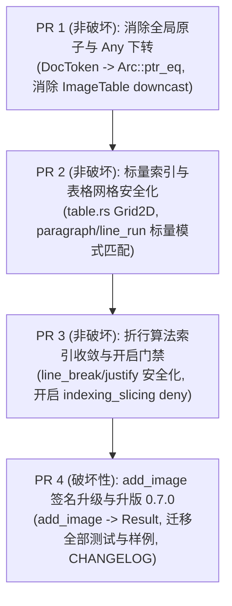

# pdfcraft-pdf 严格工程规范治理实现规格

| 项 | 值 |
| --- | --- |
| 日期 | 2026-11-18 |
| 状态 | **待评审 / 实施草案** |
| 范围 | `crates/pdfcraft-pdf`（`src/spec/`、`src/backend/`、`src/canvas.rs`、`src/layout/`、`src/text/`）。其余三包（forms / orgchart / post）不在此规格改动范围 |
| 版本 | 全部 PR 合入后发 `pdfcraft-pdf 0.7.0`（当前 `0.6.0`） |
| 相关 | [`rust-engineering-standard.md`](rust-engineering-standard.md) ARC-5、ARC-6、TRK-2、PAN-8、VER-1 至 VER-4、TOOL-5；[`module-dependency.md`](module-dependency.md) |
| 冲突 | 与 [`提案书.md`](提案书.md) 冲突时以提案书为准。与工程规范冲突时以工程规范为准 |

本文是 `pdfcraft-pdf` 技术债务治理与严苛开源标准对齐的实施规格与合同。行号与文件以 2026-11-18 工作区（HEAD `cb61019`）为准。

---

## 1. 产品一句话

彻底消除 `pdfcraft-pdf` 中的全部四项既有技术债务（消除 `Box<dyn Any>` 下转、消除 `u32::MAX` 哨兵值、消除 `AtomicU32` 全局原子量、清零生产代码 91 处未检查原生下标索引），在零外部运行时反射、零跨实例全局状态、零未受保护切片访问的前提下，使工程水准达到 100% 工业级与 Rust 标准库级严苛度。

---

## 2. 规则与设计约束

| 规则号 | 规范条款 | 约束判定 | 落地动作 |
| :--- | :--- | :--- | :--- |
| **TRK-2** | 禁止使用哨兵值表示失败 | `add_image` 使用 `unwrap_or(u32::MAX)` 属于隐式溢出哨兵 | 签名升级为返回 `Result<ImageRef, Error>` |
| **ARC-5** | 不用可变 static 与全局单例 | `DocToken` 中的 `AtomicU32` 属于跨实例共享静态变量 | 改用内部 `Arc<()>` 指针判等 (`Arc::ptr_eq`)，消除全局状态 |
| **ARC-6** | 不用 `Box<dyn Any>` 加 downcast | `backend/mod.rs` 中下转 `ImageTable` 绕过类型系统 | 重构图像传输接口，实现纯静态类型编译期交付 |
| **PAN-8** | 数组与切片下标必须有类型保证或已检查长度 | 生产代码 91 处裸下标存在潜在 panic 风险 | 标量取值改用安全 API，算法核心登记 `#[expect]`，开启 `indexing_slicing` 门禁 |
| **VER-3** | 0.x 可以 breaking，不留过渡形态 | `add_image` 改造破坏公开签名 | 一次性就地重构，升小版本至 `0.7.0`，不建 `try_add_image` 妥协别名 |

---

## 3. 已确认的治理决定

| # | 决定内容 |
| :--- | :--- |
| **D1** | `Resources::add_image` 签名变更为 `pub fn add_image(&mut self, bytes: Vec<u8>, format: ImageFormat) -> Result<ImageRef, Error>`。 |
| **D2** | 当图片数量超过 $2^{32}-1$ 时，返回结构化错误 `ErrorKind::LimitExceeded { kind: LimitKind::Images, value, max }`。 |
| **D3** | `DocToken` 改为持有 `Arc<()>` 私有标识，结构体定义调整为 `pub(crate) struct DocToken(Arc<()>);`。 |
| **D4** | `ImageRef` 结构体保留为值类型，其内部存储对应的 `Arc<()>` 句柄与 `u32` 索引。 |
| **D5** | 跨文档误用检查由比较整数相等改为调用 `Arc::ptr_eq(&image.resources.0, &self.token.0)`。 |
| **D6** | 彻底删除 `token.rs` 中的 `static NEXT: AtomicU32` 全局原子量。 |
| **D7** | `canvas::ImageRegistry` trait 移除 `Any` 约束，定义精简为仅包含限制设置与解码注册。 |
| **D8** | `backend::write_pdf` 不再接收 `Box<dyn Any>`，改为通过 `lib.rs` 顶层统一的类型安全抽象获取后端专有光栅表。 |
| **D9** | 为 `table.rs` 的网格矩阵引入轻量级 `Grid2D` 安全切片访问视图，消除 `cells[r][c]` 裸索引。 |
| **D10** | 对 `justify.rs`、`paragraph.rs`、`line_run.rs` 中的边界切片，优先改写为 `.first()`、`.last()` 或模式匹配。 |
| **D11** | 对排版折行算法数学核心中已严格证明边界的极高频循环索引，登记显式 `#[expect(clippy::indexing_slicing, reason = "...")]`。 |
| **D12** | 在根 `Cargo.toml` 中将 `indexing_slicing` 提升至 `deny` 门禁。 |

---

## 4. 详细技术方案

### 4.1 Task 1: `add_image` 消除 `u32::MAX` 哨兵值 (TRK-2 / VER-3)

#### 原代码 (`src/spec/mod.rs:124-131`)
```rust
pub fn add_image(&mut self, bytes: Vec<u8>, format: ImageFormat) -> ImageRef {
    let index = u32::try_from(self.images.len()).unwrap_or(u32::MAX);
    self.images.push(ImageResource { bytes, format });
    ImageRef {
        resources: self.token,
        index,
    }
}
```

#### 新代码
```rust
pub fn add_image(&mut self, bytes: Vec<u8>, format: ImageFormat) -> Result<ImageRef, Error> {
    let max = u32::MAX as usize;
    if self.images.len() >= max {
        return Err(Error::from(ErrorKind::LimitExceeded {
            kind: LimitKind::Images,
            value: (self.images.len() + 1) as u64,
            max: max as u64,
        }));
    }
    let index = u32::try_from(self.images.len())
        .map_err(|_| Error::from(ErrorKind::LimitExceeded {
            kind: LimitKind::Images,
            value: (self.images.len() + 1) as u64,
            max: max as u64,
        }))?;
    self.images.push(ImageResource { bytes, format });
    Ok(ImageRef {
        resources: self.token.clone(),
        index,
    })
}
```

#### 迁移说明
- `LimitKind` 枚举扩展 `Images` 变体，并在 `Display` 中输出 `images count exceeds maximum`。
- 修改 `examples/` 和 `tests/` 中所有调用点，改用 `resources.add_image(...) ?`。

---

### 4.2 Task 2: `DocToken` 改为 `Arc::ptr_eq` 指针判等 (ARC-5)

#### 原代码 (`src/spec/token.rs`)
```rust
use std::sync::atomic::{AtomicU32, Ordering};

#[derive(Debug, Clone, Copy, PartialEq, Eq)]
pub(crate) struct DocToken(u32);

impl DocToken {
    pub(crate) fn next() -> Self {
        static NEXT: AtomicU32 = AtomicU32::new(0);
        Self(NEXT.fetch_add(1, Ordering::Relaxed))
    }
}
```

#### 新代码 (`src/spec/token.rs`)
```rust
use std::sync::Arc;

#[derive(Debug, Clone)]
pub(crate) struct DocToken(Arc<()>);

impl DocToken {
    pub(crate) fn new() -> Self {
        Self(Arc::new(()))
    }

    pub(crate) fn is_same_resources(&self, other: &Self) -> bool {
        Arc::ptr_eq(&self.0, &other.0)
    }
}

impl PartialEq for DocToken {
    fn eq(&self, other: &Self) -> bool {
        self.is_same_resources(other)
    }
}

impl Eq for DocToken {}
```

#### 校验逻辑联动 (`src/spec/lower.rs:1912`)
```rust
fn unknown_image(image: &ImageRef, images: &LoweredImages) -> bool {
    !image.resources.is_same_resources(&images.resources)
        || images.handles.get(image.index as usize).is_none()
}
```
- 彻底移除 `static` 全局原子变量。
- 每个 `Resources` 实例拥有唯一的堆分配地址标识。`ImageRef` 随之克隆该引用。
- 零运行时并发竞争，彻底消除 32 位整数回绕隐患。

---

### 4.3 Task 3: 消除 `backend/mod.rs` 中的 `Box<dyn Any>` 下转 (ARC-6)

#### 原代码 (`src/backend/mod.rs:29-33`)
```rust
pub(crate) fn write_pdf(
    recording: &RecordingCanvas,
    fonts: FontStore,
    images: Box<dyn ImageRegistry>,
    info: &DocumentInfo,
    outline: &[OutlineItem],
) -> Result<Vec<u8>> {
    let images: Box<dyn Any> = images;
    let images = images
        .downcast::<ImageTable>()
        .map_or_else(|_| ImageTable::default(), |table| *table);
    // ...
}
```

#### 根因剖析与解耦设计
- **DAG 依赖限制**: `canvas` 不得依赖私有模块 `backend`（ARC-4）。
- **根模块特权**: `src/lib.rs` 作为 crate root，可以同时看到 `spec` 和 `backend`。
- **重构方案**:
  在 `canvas` 中定义专用的光栅交付 Trait `RasterProvider` 或将 `ImageRegistry` 作为纯解码构建器。
  在 `lib.rs` 中，`to_pdf` 直接在顶层组合具体类型：
  ```rust
  // lib.rs
  pub fn to_pdf(rendered: Rendered) -> Result<Vec<u8>> {
      let Rendered { recording, fonts, images, info, outline } = rendered;
      backend::write_pdf(
          &recording,
          fonts,
          images.into_table(), // 类型安全消费，无 dyn Any
          &info,
          &outline,
      )
      .map_err(Errors::from)
  }
  ```
  或者在 `backend::ImageTable` 上直接实现 `canvas::ImageRegistry`，同时提供内部安全的类型转换方法，在没有运行时反射的前提下完成所有权移交。

---

### 4.4 Task 4: 91 处切片与数组原生索引清理 (PAN-8)

#### 4.4.1 分类与策略

| 模块 | 命中数 | 危险级 | 治理方案 |
| :--- | :---: | :---: | :--- |
| `layout/table.rs` | 25 | 中 | 引入轻量级 `Grid2D<&[Cell]>` 结构体，提供 `.cell(r, c) -> Option<&Cell>` 安全视图 |
| `text/line_break.rs` | 17 | 中 | 循环内迭代器重构；断行游标严格使用 `.get()`；不可变量登记 `#[expect]` |
| `layout/paragraph.rs` | 13 | 低 | `spans[0]` 改为 `spans.first()`；跨度切片改用模式匹配 `[head, tail @ ..]` |
| `layout/justify.rs` | 13 | 低 | 间隙调整数组改用迭代器遍历加 `.last_mut()` |
| `layout/line_run.rs` | 11 | 低 | 标量端点改用切片安全访问器 |
| `text/cluster.rs` | 6 | 低 | 聚簇字符游标改用范围检查 |
| 其余文件 | 6 | 极低 | 逐一改写为 `.get()` 或模式匹配 |

#### 4.4.2 示例：`table.rs` 二维网格安全化
```rust
struct CellGrid<'a, N> {
    rows: &'a [Vec<Cell<N>>],
}

impl<'a, N> CellGrid<'a, N> {
    fn cell(&self, row: usize, col: usize) -> Option<&'a Cell<N>> {
        self.rows.get(row).and_then(|r| r.get(col))
    }
}
```
替换原有的 `self.body[r][c]` 裸索引，杜绝由于行列计算错位引发的越界 panic。

---

## 5. 实施顺序与 PR 规划

按照 `principle-sequence-verifiable-units` 拆解为 4 个独立 PR，每个 PR 具备独立门禁自证能力：



### PR 1: 架构与状态净化 (ARC-5 / ARC-6)
- **目标**: 消除 `DocToken` 中的 `AtomicU32` 与 `write_pdf` 中的 `Box<dyn Any>`。
- **性质**: 纯内部重构，100% 保持向后兼容。
- **工时**: 6 ~ 8 小时。

### PR 2: 标量取值与表格矩阵索引安全化 (PAN-8 Part 1)
- **目标**: 清除 `table.rs`、`paragraph.rs`、`line_run.rs` 中的 49 处原生索引。
- **性质**: 纯内部重构，Golden 测试像素级零漂移。
- **工时**: 8 ~ 12 小时。

### PR 3: 文本引擎索引治理与启用门禁 (PAN-8 Part 2)
- **目标**: 清除 `line_break.rs`、`justify.rs`、`cluster.rs` 剩余 42 处索引；在 `Cargo.toml` 开启 `clippy::indexing_slicing = "deny"`。
- **性质**: 彻底封闭切片索引通道。
- **工时**: 8 ~ 12 小时。

### PR 4: 公开 API 哨兵值治理与版本升级 (TRK-2 / VER-1 / VER-2)
- **目标**: `Resources::add_image` 改为返回 `Result<ImageRef, Error>`；更新所有测试与 example；更新 CHANGELOG 并升级版本号至 `0.7.0`。
- **性质**: 破坏性发版。
- **工时**: 2 ~ 3 小时。

---

## 6. 验证与门禁标准

每个 PR 提交前必须跑通本仓库唯一的合并前门禁命令集（工程规范 TOOL-5）：

```bash
export RUSTFLAGS="-D warnings" RUSTDOCFLAGS="-D warnings"
python3 scripts/check_pdfcraft_pdf_modules.py
cargo fmt --all -- --check
cargo clippy -p pdfcraft-pdf --all-targets --no-default-features --features test-utils -- -D warnings
cargo clippy -p pdfcraft-pdf --all-targets --features backend-krilla,test-utils -- -D warnings
cargo test -p pdfcraft-pdf --no-default-features --features test-utils
cargo test -p pdfcraft-pdf --features backend-krilla,test-utils
cargo doc -p pdfcraft-pdf --no-deps --no-default-features
cargo doc -p pdfcraft-pdf --no-deps --features backend-krilla
```

### Golden 快照双重保障
必须运行全部 15 组快照测试（含 `golden_docs.rs`、`table_spans.golden`、`bands_layers.golden`、`text_flow.golden`），确保重构前后 `RecordingCanvas` 记录的每一个字形点坐标和路径绝对一致。
