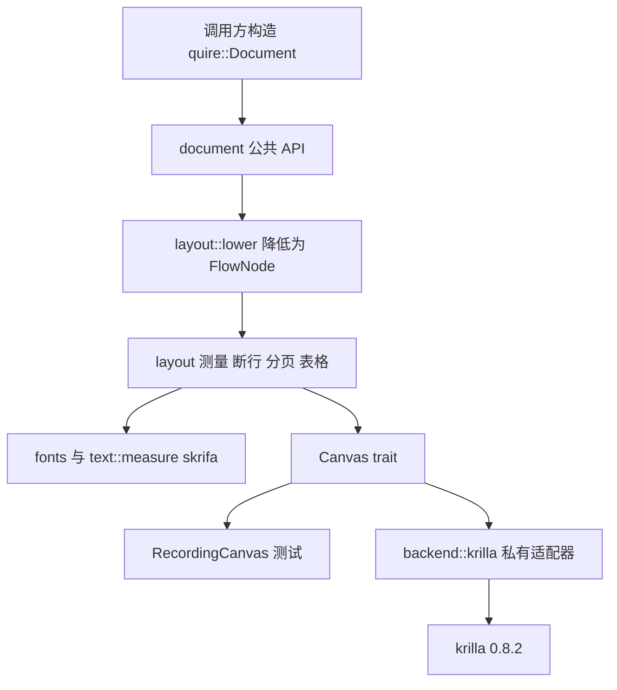
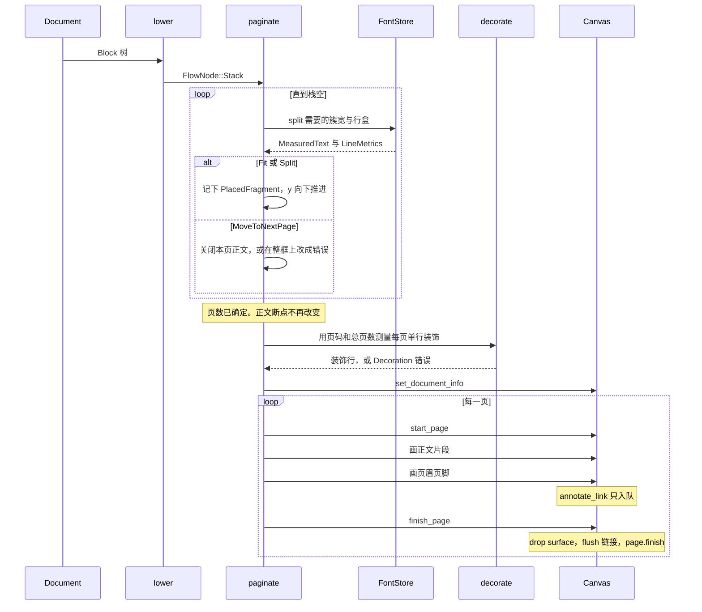

# Quire：基于 krilla 的 PDF 文档排版库

| 项 | 值 |
| --- | --- |
| 文档标题 | Quire：基于 krilla 的 PDF 文档排版库 |
| 作者 | 库作者 |
| 日期 | 2026-09-30 |
| 状态 | Draft |
| 工作 crate 名 | `quire` |
| 发布名 | 0.1 之前可以改，本文档与模块树、PR 计划一律使用 `quire`，不作为开放问题 |

`quire` 是一个全新的库。本文不描述任何已经存在的源码文件；下面的路径都是计划中的模块树。工作区里目前没有实现。

## Overview

调用方给出一份类型化的文档结构（页面、样式、页眉页脚、段落、表格、图片等）。`quire` 负责测量字形、断行、分页、表格切分和页眉页脚，然后把已经定位好的绘制指令交给自有的 `Canvas`。唯一的 PDF 后端是一个私有适配器，它把这些指令翻译成 `krilla` 0.8.2 的页面、路径、字形、图片、链接和文档信息。上层排版代码不出现任何 `krilla` 类型，公共 API 也不重新导出 `krilla`。

文本只有一条管线。测量使用 `skrifa` 0.47.0 的 `Charmap` 和 `GlyphMetrics::advance_width`（名义字形前进宽度，不是 kerning，也不是 shaping）。绘制使用同一批 glyph id 和同一批归一化 advance，通过 `Surface::draw_glyphs` 画到页面上。禁止走 `Surface::draw_text`：那条高阶 API 会在 `krilla` 内部做简单整形，量出来的宽度和画出来的宽度会对不上。

公共 API 采用混合模型：对外是 pdfmake 风格的可序列化文档定义（Rust enum，`serde` 为可选 feature）；对内把定义降低成 `pub(crate)` 的 `FlowNode`。节点协议是消耗自身的 `split` 和只画 `Fragment` 的 `draw`。需要自然高度时，对整框调用一次 `split`：`Fit` 的高度就是自然高度。v1 不向调用方暴露 `Flowable` trait。

## Background & Motivation

作者的原话是：调用方给出文档结构，库负责换行、分页、表格和页眉页脚，然后发出矢量 PDF。作者会用 AI 慢慢打磨这个库，不赶着发布。因此 v1 要小、边界要硬、每个 PR 都要能单独编译和测试，而不是先堆一个大而全的排版器。

精神上的前作，而不是要逐个 API 去克隆：

- JavaScript pdfmake：调用方交一份文档定义，pdfmake 排版，pdfkit 画已经定位的图形。
- Python ReportLab Platypus：`Flowable`（`Paragraph`、`Table`、`Spacer`、`Image`、`KeepTogether`、`PageBreak` 等）流入 `PageTemplate` 上的 `Frame`。底层是 `pdfgen.Canvas`。流式对象的协议是 `wrap(availWidth, availHeight) -> (width, height)`、为跨页准备的 `split`，以及 `drawOn(canvas, x, y)`。页眉页脚是页面装饰，不是流式对象。参见 ReportLab 用户指南第 5 章。

当前没有可复用的上层排版代码。后端和测量库已经选定，本文不重新讨论它们，只把核实过的 API 钉死，并说明适配器如何密封。

### 已核实事实（2026-09-30）

下列内容来自当天的 crates.io、docs.rs 与 0.8.2 / 0.47.0 源码，不是记忆中的旧版本。

**krilla**

- crates.io 最新版是 **0.8.2**（2026-06-04 发布）。crate 页写明 Minimum Rust version **1.92.0**。仓库是 <https://github.com/LaurenzV/krilla>。docs.rs 最新文档与 `https://docs.rs/krilla/0.8.2` 一致。
- 它建立在 `pdf-writer` 之上。本库不调用 `pdf-writer`。
- `krilla::document` 模块说明：PDF 需要全局状态，**不能同时生成多页**。`Document::start_page` / `start_page_with` 返回的 `Page<'_>` 可变借用文档；页面 drop 之后才能开下一页。文档没有写 `!Send` 这三个字。`Page` 与 `Surface` 在实现里经过 `SerializeContext` 持有 `Rc<RefCell<_>>`，因此实践上是 `!Send`。我们依赖的是文档里的「不能并行开页」和 `start_page` 的可变借用，不依赖 rustdoc 上的 `!Send` 字样。
- `Document::finish(self) -> KrillaResult<Vec<u8>>`。`Page::finish` 与 `Surface::finish` 返回 `()`。字节只从 `Document::finish` 来。元数据用 `Document::set_metadata`，并且必须在第一页之前调用。
- `Surface` 文档原句：原点在 **左上角**。`draw_path`、`draw_glyphs`、`draw_image`、`draw_text`、`push_transform` / `pop`、`set_fill` / `set_stroke` 都在这个坐标系里。
- `Page::surface(&mut self)` 返回的 `Surface` 可变借用该页。文档写明：对同一页多次调用会 **清掉之前的绘制**。`Surface::finish` 就是 drop。`Drop` 在 `push` 栈非空时断言失败；`pop` 在空栈上会 panic。适配器每页只取一次 surface，并且 `push` / `pop` 成对。
- `add_annotation` 需要 `&mut Page`，只能在 surface 已经 drop、借用结束后调用。适配器因此不能在 `annotate_link` 里直接 `add_annotation`，见 Canvas 一节的链接队列。
- 0.8.2 的 `interactive/annotation.rs` 在写注释矩形时调用 `page_root_transform`，变换是 `Transform::from_row(1, 0, 0, -1, 0, height)`。`Page::surface` 也把同一矩阵装进内容流的根变换。所以 API 空间里的 `(10, 20)` 不必以 `10 20` 出现在内容流里，链接矩形的 PDF 数字也会和公共矩形不同。这是 krilla 内部的翻转。适配器对着公共 API 做恒等映射，**不预先再翻一次**。
- `Surface::draw_glyphs(start, glyphs, font, text, font_size, outlined)` 是低层 API。文档要求调用方自己处理 bidi、字体回退和排版。`outlined: false` 时走字形嵌入，子集化能看到我们提交的 glyph id。
- `krilla::text::Glyph` 的 `x_advance` / `x_offset` / `y_offset` / `y_advance` 在给定字号下返回用户单位。`KrillaGlyph::new` 的文档要求这四个数是 **除以 units per em 之后的归一化值**；`Glyph for KrillaGlyph` 的实现是 `self.x_advance * size`（`text/glyph/mod.rs`）。`ContentBuilder` 随后 `*cur_x += glyph.x_advance(size)`。offset 与 `y_advance` 为 0 时，`cur_x` 的增量就是 `advance_norm * font_size`。
- 内容流里的 `TJ` 调整量不是这份 advance 的十进制拷贝。`encode_consecutive_glyph_run` 拿绘制 advance 和字体自己的 hmtx 宽度比，只把差值写成 PDF 1000 单位空间里的调整量（`CIDFont` 的 units per em 是 1000，不是字体的 upem）。两边 hmtx 一致时调整量是 0，流里没有 `advance_norm`。glyph id 是二进制 CID / Type3 字节，不是 ASCII 数字。因此「流里出现字母 `Tj`」不能证明宽度被画上。测试见字体一节。
- `content.rs` 里水平排版的 y 约定：`cur_y - glyph.y_offset * font_size`，随后 `cur_y -= y_advance * font_size`。在 y 向下的表面里，正的 `y_offset` 把字形往上挪。v1 水平文字把 offset 和 `y_advance` 都设为 0，`start` 就是该 run 的基线左端。
- 同一文件里 `draw_image` 把 1×1 图像 XObject 变成 `Transform::from_row(width, 0, 0, -height, 0, height)`。算上根变换之后，图像顶边落在当前 surface 原点。适配器只用 `push_transform(translate(x, y))` 把图片左上角放到 `(x, y)`，**不再做第二次 y 翻转**。
- `Surface::draw_path` 按当前 fill / stroke 绘制。两者都没设置时，krilla 会用黑色填充。`fill_path` 与 `stroke_path` 必须先把另一支笔清掉。
- `geom::Size::from_wh(width, height) -> Option<Size>`，任一边不大于 0 则 `None`。`Rect::from_xywh` 同样返回 `Option`。
- `Font::new(data, index) -> Option<Font>`，`Font::new_variable(...)` 另设 variation。`Font::units_per_em() -> f32`。克隆便宜。v1 只用 `Font::new`，即默认实例。
- `krilla::Data` 实现了 `From<Arc<Vec<u8>>>`、`From<Vec<u8>>` 和 `From<&'static [u8]>`，并 `AsRef<[u8]>`。
- `Image::from_png` / `from_jpeg` / `from_gif` / `from_webp` 的签名是 `fn(data: Data, interpolate: bool) -> Result<Image, String>`，位于 `raster-images` 之后。`from_gif` 通过 `read_next_frame` 解码**第一帧**。`Image::size() -> (u32, u32)`。v1 的 `interpolate` 固定为 `false`。
- 未启用 `rayon` 时，图片的 `Deferred` 闭包在 `from_*` 内部立刻执行。编码字节数检查必须发生在 `from_*` 之前，否则像素缓冲已经分配。
- `Page::add_annotation(&mut self, Annotation)`。`LinkAnnotation::new(rect, target)`。外部 URI 是 `Target::Action(Action::Link(LinkAction::new(uri)))`。`Rect` 文档写的是 left / top / right / bottom。矩形先经过上面的 `page_root_transform`，适配器不预翻转。
- `Metadata` 是构建器：`title`、`authors(Vec<String>)`、`description`、`keywords`、`language`（文档称为 RFC 3066 语言标签）、`creator`、`creation_date`、`producer`。空的 title / author / keywords 会被 krilla 丢掉（`if !title.is_empty()` 这一类判断）。映射表见公共 API。
- `SerializeSettings::Default` 把 `enable_tagging`、`xmp_metadata`、`compress_content_streams` 都设为 `true`。只覆盖 `pretty` 和 `compress_content_streams` 时，tagging 仍然开着。当前的 dummy validator 不会因此让 `finish` 失败，但以后若换上 PDF/UA validator，会碰到 `MissingTagging`。实验必须显式 `enable_tagging: false`。
- `krilla::paint::Fill` 是 `{ paint: Paint, opacity: NormalizedF32, rule: FillRule }`。`krilla::paint::Stroke` 是 `{ paint, width, miter_limit, line_cap, line_join, opacity, dash: Option<StrokeDash> }`。`Stroke::default()` 的宽度是 1、miter limit 10、`LineCap::Butt`、`LineJoin::Miter`、opacity `ONE`、dash `None`。`Paint` 不能由 `rgb::Color` 直接充当字段类型；`From<rgb::Color> for Paint` 存在，用 `.into()`。`krilla::num::NormalizedF32::new(f32) -> Option<Self>`。文档注释写 “Panics if the number is not normalized”，**实现并不 panic**：`num.rs` 是 `tiny_skia_path::NormalizedF32::new(num)?`，范围外得到 `None`。`u8 as f32 / 255.0` 落在 `0..=1`，对合法 `Color` 会得到 `Some`。
- 有两个 `TextDirection`。`krilla::text::TextDirection` 只在 `simple-text` 开启时存在。`krilla::metadata::TextDirection`（`LeftToRight` / `RightToLeft`）始终编译。适配器不使用前者。v1 也不设置后者。
- Feature：`simple-text` 是默认 feature，拉入 `rustybuzz`，只为 `draw_text` 服务。`raster-images` 也是默认 feature。`rayon` 的说明是 “Allow for multi-threaded PDF creation”；代码路径是给 `Deferred` 工作派发线程。我们仍不打开它，因为 `start_page` 可变借用 `Document`。`pdf` feature 依赖 `hayro-write`，用于嵌入已有 PDF 的页，v1 不用。0.8.2 的直接依赖包含 `skrifa ^0.42.0`（不是 optional）。这和我们直接依赖的 `skrifa` 0.47.0 是两份拷贝。

**skrifa**

- crates.io 最新版是 **0.47.0**（2026-09-08 发布）。Minimum Rust version **1.85.0**。文档在 <https://docs.rs/skrifa/0.47.0>。它 re-export 的 `FontRef` 来自 `read-fonts` 0.44.0。本库只直接依赖 `skrifa`，不另写 `read-fonts` 依赖。
- `FontRef::new(&[u8]) -> Result<FontRef, ReadError>` 只接受单个字体，集合体会被拒绝。`FontRef::from_index(&[u8], index: u32) -> Result<FontRef, ReadError>` 接受 TTC 或单个字体；单个字体时 index 必须是 0。
- `MetadataProvider` 为 `FontRef` 实现了 `charmap()`、`metrics(size, location)`、`glyph_metrics(size, location)`。
- `Charmap::map(ch) -> Option<GlyphId>` 是码位到 **名义** glyph id。模块文档写明：这是 shaping 之前的一步，对复杂文字和连字不够。0.47.0 的 `CodepointSubtable::map_impl` 使用 `(gid != GlyphId::NOTDEF).then_some(gid)`。**`map` 不会返回 glyph 0**。`None` 同时表示「cmap 没有这项」和「这项指向 `.notdef`」。没有第二条 glyph 0 策略。
- `GlyphMetrics::advance_width(glyph_id) -> Option<f32>`：hmtx 前进宽度；若构造时给了归一化 variation 坐标且存在 `HVAR`，会加上 delta。文档没有把它说成 GPOS kerning 或 shaping。glyph id 越界或字体数据无效时返回 `None`。
- `Metrics` 含 `units_per_em: u16`、`ascent`、`descent`、`leading`。字段文档对 `descent` 的英文是 “Distance from the baseline to the bottom of the alignment box.”，**没有写符号**。`Metrics::new` 原样复制 hhea / typo 的 descender（保留 OpenType 符号），并把 `usWinDescent` **取负**，以便返回的 descent 一致。在 skrifa 视为一致的字体上，descent 为负。测量 PR 用夹具断言 `descent < 0`，`line_metrics` 只有一个公式，不按符号再分一支。
- skrifa 0.47.0 的 crate 根是 `#![forbid(unsafe_code)]`。它**没有**声明「损坏字体不应 panic」。`ReadError` 和 `advance_width` 的 `None` 由我们变成 `Error`。不使用 `catch_unwind`。若上游仍然 panic，原样传播。`read-fonts` 里是否还有 `unsafe` 不在本库的承诺范围内；我们不直接依赖它。
- `Size::unscaled()` 给出字体单位（`linear_scale` 对 unscaled 返回 1.0）。`Size::new(ppem)` 会把度量缩放到该字号。v1 测量用 unscaled，自己乘 `font_size / units_per_em`，以便和 `KrillaGlyph` 的归一化 advance 是同一个数。
- `skrifa::GlyphId` 与 `krilla::text::GlyphId` 是不同类型。两边都有 `new(u32)` / `to_u32()`。适配器只传 `u32`。不把 0.47 的 `GlyphId` 传进 krilla 0.42 那份 skrifa。

**unicode-segmentation**

- crates.io 最新版是 **1.13.3**（2026-06-01），MSRV 1.85.0，实现 UAX #29 字素簇，变更说明写到 Unicode 17.0.0。v1 用它做断行原子，精确版本钉在引入它的那个 PR 的 `Cargo.toml` 里：`unicode-segmentation = "=1.13.3"`。

## Goals & Non-Goals

### Goals

- 调用方用 Rust 值描述一份文档，库完成断行、分页、简单表格、页眉页脚，并输出矢量 PDF 字节。
- 拉丁文与中日韩横排（作者写中文）。CJK 在没有空格的情况下按本文的决策表断行。
- 测量与绘制使用同一条字形管线，宽度一致。
- 排版测试对 `RecordingCanvas` 断言坐标、断行和分页，不断言 krilla 压缩字节。
- 库保持 0.x，直到文档 API 被几份真实文档用过。
- 每个实现 PR 都让 crate 保持可编译、可测试，并且范围小到可以慢慢改。

### Non-Goals

硬性排除，v1 不做，以后单独写设计再加：

- 不做 Apache FOP，不做 XSL-FO，不做 FO 属性集，不做 FO area tree。
- 不做股权架构图、组织结构图，以及任何一般图布局。
- 不更换 PDF 后端。不在生产代码里依赖 `pdf-writer`、`lopdf` 或 `printpdf`。理由见 Alternatives，不是开放问题。
- 不调用 `Surface::draw_text`，不启用 krilla 的 `simple-text` / `rustybuzz`，不引入 `harfrust` 或 `rustybuzz` 做 shaping。
- 不做完整 UAX #14，不做 bidi，不做阿拉伯文 / 印度系文字 shaping，不做竖排，不做 ruby，不做连字与 kerning。
- 不做字体回退链。缺字是 `Error::MissingGlyph`，不画豆腐块，不静默换字体。
- 不做 TOC、二维码、SVG、表单、标签 PDF / 辅助功能树、加密、书签 / outline、多栏页面框（page frame）、单元格 rowspan / colspan。
- 不做两端对齐（`Justify`）。v1 对齐只有 `Start` / `Center` / `End`，且因为没有 bidi，`Start` 就是左对齐。
- 不向调用方暴露 `Flowable` trait。自定义流式对象是 v1 之后的扩展，需要另一次 API 设计。
- 页眉页脚不是任意可回流的 `Block` 树，也不能反过来改变正文框高度。
- 可变字体只使用默认实例，公共 API 没有 variation 轴。
- 不拉取网络，不打开 URI，不按 URL 取图片。
- 不追求并行分页或并行画页。

## Key Decisions

1. **公共 API 是文档定义，内部才是 flow 协议。** 作者要的是「给出结构」，并且会用 AI 改这份结构。enum 可以被构造、diff 和可选地 serde。分页和拆表用消耗自身的 `split` 与只画 `Fragment` 的 `draw`，降低层是 `pub(crate)`。否决了把 Platypus trait 当作公共 API：LLM 和非 Rust 调用方写不出 trait object，而 v1 又没有必须由调用方提供的自定义流式对象。
2. **一条字形管线。** 字素簇 → 簇内每个 Unicode scalar → `Charmap::map` → unscaled `advance_width` → 断行 → `KrillaGlyph`（advance 除以 upem，offset 为 0）→ `draw_glyphs(..., outlined: false)`。不整形。这样子集化嵌入的就是被测量的 glyph。`cur_x` 的增量是 `advance_norm * font_size`。
3. **断行以「上一类 × 下一类」决策表为准，原子是扩展字素簇。** 允许在 `OP` 之前和 `CL` 之后断开，禁止在 `OP` 之后和 `CL` 之前断开。`好（世` 可以在 `（` 前换行，不是三个簇绑成一段不可断文本。溢出时只向左找最近的允许断点；放不下的那个簇进入下一行。放不下的 U+0020 会成为下一行行首，然后被丢掉。扩展 B、兼容表意文字和全角字母数字是 `Other`，不按 `ID` 逐字断。
4. **缺字即错误。** `Charmap::map` 返回 `None` 就是 `MissingGlyph`。0.47.0 不会交出 glyph 0：未映射和指向 `.notdef` 都是 `None`。不另判 glyph 0，不画豆腐块，没有回退字体。
5. **页眉页脚画在页边距带里，不挤占正文框。** “Page X of Y” 在正文分页结束、页数已知之后再测量，不第二次回流。每个槽单独和正文宽度比；左槽贴正文左缘，中槽居中，右槽贴正文右缘。行盒高度用 `line_metrics.line_height`。
6. **坐标系在适配器边界做恒等变换。** krilla 0.8.2 的 `Surface` 已是左上角、y 向下。`page_root_transform` 发生在 krilla 写内容流和注释的时候。转换函数不预翻转。内容流实验记录 krilla 写出的数字。
7. **单 crate，适配器模块私有，`backend-krilla` 默认开启。** 发布物是一个库。关掉该 feature 时排版测试不必编译 krilla；`to_pdf` 在 feature 关闭时不存在。这是为了作者本地慢慢改排版，不是为了支持第二个后端。该 feature 从适配器 PR 起才存在，CI 也从那里开始传 `--features backend-krilla`。
8. **MSRV 钉在 1.92。** 这是 krilla 0.8.2 的 MSRV，高于 skrifa 0.47.0 和 unicode-segmentation 1.13.3 的 1.85。在依赖 krilla 0.8.2 期间不承诺 stable-minus-two。
9. **表格 v1：列宽是 Fixed / Ratio / 至多一列 Auto；行不在行内拆开；可选重复表头；没有单元格合并。** 内容宽度是 `列宽 - 2 * cell_padding - border_width`。`Auto` 只吃剩余宽度，不按内容收缩。
10. **版本策略：保持 0.x。** krilla 或 skrifa 的精确版本只在专用 PR 里改，并且必须重跑坐标测试和字形绘制测试。`publish = false` 保留到限额 PR 和信件夹具都通过之后。
11. **`PageBreak` 用三态，不用一个布尔。** 文档开头的 `PageBreak` 是 no-op。内容之后的第一个 `PageBreak` 结束当前页，并挂起一张未提交的空页。紧接着的第二个 `PageBreak` 才提交一页空白正文；该页仍画页眉页脚，并计入页数。文档结束时丢掉仍未提交的挂起页，所以单独一个尾随 `PageBreak` 不会多出空白页。
12. **段后间距放不下就丢掉，不带到下一页。** 它不是用户写的 `Spacer`。`KeepTogether` 把孩子之间的间距算进组的高度，不把组后面的间距算进组。

## Proposed Design

### 分层



依赖方向只允许向下。`layout` 可以调用 `fonts` 和 `Canvas`。`fonts` 不知道页面。`Canvas` 不知道段落和表格。只有 `backend::krilla` 可以写 `use krilla::...`。`lib.rs` 的公共重导出列表里不准出现 `krilla`。

### 计划中的模块树

```text
quire/
  Cargo.toml
  src/
    lib.rs                 // 只重导出公共类型
    error.rs               // 唯一的 Error 枚举
    geom.rs                // Point Size Rect Color Path Paint Stroke
    limits.rs
    canvas.rs              // Canvas GlyphRun RecordingCanvas
    document.rs            // 公共 Document Block Style；write_to
    fonts.rs               // FontId FontStore 共享字节 度量入口
    text/
      mod.rs
      cluster.rs           // UAX #29 字素簇
      measure.rs           // skrifa Charmap 与 advance
      break_class.rs       // 决策表
      line_break.rs        // 纯函数断行
    layout/
      mod.rs
      flow.rs              // FlowNode split/draw 与 PageCursor
      lower.rs             // Block -> FlowNode
      paragraph.rs
      table.rs
      decorate.rs          // 页眉页脚
      paginate.rs
      dump.rs
    backend/
      mod.rs               // feature backend-krilla 才编译
      convert.rs           // to_krilla_point / rect / size
      krilla_canvas.rs     // Canvas 的 krilla 实现；链接队列；decode_image
  tests/
    letter_layout.rs       // 只依赖公共 API 与 RecordingCanvas
```

`RecordingCanvas`、`Canvas`、`FontId`、`ImageId` 是公共类型。`FontId` 与 `ImageId` 的整数字段是 `pub(crate)`。`FlowNode`、`FontStore` 的方法、krilla 适配器都是 `pub(crate)`。crate 内测试可以直接构造 `FlowNode`。

下面公共类型代码块是 **v1 结束时** 的形状。`Block` 与 `FlowNode` 的变体按 PR 计划增长：降低函数只匹配已经加入的变体，不在 PR 2 就写出一张还没有实现的穷尽枚举。

### 依赖钉扎

下面是 PR 20（serde）合并之后、PR 21（tracing）之前的清单。各个依赖在引入它的那个 PR 里才写进 `Cargo.toml`。PR 1 到 PR 3 没有 `krilla`，也没有 `backend-krilla` 这个 feature。

```toml
[package]
name = "quire"
version = "0.0.0"
edition = "2021"
rust-version = "1.92"
license = "MIT OR Apache-2.0"
publish = false   # 限额 PR 与信件夹具都通过之后再删

[features]
default = ["backend-krilla"]
backend-krilla = ["dep:krilla"]
serde = ["dep:serde"]
# tracing 不写在这里。没有 optional 依赖时，tracing = ["dep:tracing"] 不是合法清单。

[dependencies]
krilla = { version = "=0.8.2", optional = true, default-features = false, features = ["raster-images"] }
skrifa = { version = "=0.47.0" }
unicode-segmentation = { version = "=1.13.3" }
# "1" 是兼容 1.x 的要求，不是精确的 1.0.0。不要写成 version = "=1"。
serde = { version = "1", optional = true, features = ["derive"] }
```

`tracing` 的可选依赖和 feature 行一起在 PR 21 加入，版本当天查 crates.io 后写成 `version = "=x.y.z"`。见该 PR。

`krilla` 关掉默认 feature，从而不启用 `simple-text`（不会拉入 `rustybuzz`），也不启用 `rayon`、`pdf`、`comemo`。`raster-images` 必须显式打开，否则没有 `Image::from_png` 这一族函数。

`edition = "2021"` 是为了少引入 2024 edition 的新 lint，而不是技术限制。1.92 已经支持 edition 2024；若以后要改，单独一个 PR。

### 几何与页面

公共坐标：原点在页面左上角，x 向右，y 向下，单位是 PDF point（1/72 inch）。`Canvas` 使用同一套坐标。

```rust
pub struct Point { pub x: f32, pub y: f32 }
pub struct Size { pub width: f32, pub height: f32 }

pub struct Rect {
    pub x: f32,
    pub y: f32,
    pub width: f32,
    pub height: f32,
}

pub struct Color { pub r: u8, pub g: u8, pub b: u8, pub a: u8 }

pub enum PathVerb {
    MoveTo(Point),
    LineTo(Point),
    Close,
}

pub struct Path { pub verbs: Vec<PathVerb> }

/// 纯色。v1 没有渐变。适配器把 color 转成 krilla::paint::Paint。
pub struct Paint { pub color: Color }

/// v1 只用宽度。线帽、连接、虚线留 krilla Stroke::default()。
pub struct Stroke { pub width: f32 }

pub const MM_TO_PT: f32 = 72.0 / 25.4;

/// 210mm × 297mm，f32 常量。
pub const A4: Size = Size { width: 595.2756, height: 841.8898 };
/// 8.5in × 11in。
pub const LETTER: Size = Size { width: 612.0, height: 792.0 };
```

`A4` 的真值是 `210 * 72 / 25.4 = 595.275590…` 与 `297 * 72 / 25.4 = 841.889763…`。测试断言常量与这个 f64 计算的绝对误差小于 `1e-3` pt。不要再用「595.28 × 841.89」这类四舍五入口算值做第二个来源。

默认页边距是四边 **72 pt**（1 inch）。调用方可以改 `Margins`。边距必须 `>= 0`，且左右之和小于页宽、上下之和小于页高，否则 `Error::InvalidPageGeometry`。宽或高不是有限数，同样是 `InvalidPageGeometry`。

**页眉和页脚占用页边距带，不缩小正文框。** 正文框就是页面减去边距。装饰的行盒高度是 `line_metrics.line_height`。它高于对应边距时返回 `Error::DecorationTallerThanMargin { height, margin }`，而不是把正文往下推。

A4、边距 72 的数字：

| 区域 | x | y | width | height |
| --- | ---: | ---: | ---: | ---: |
| 页面 | 0 | 0 | 595.2756 | 841.8898 |
| 正文框 | 72 | 72 | 451.2756 | 697.8898 |
| 页眉带 | 72 | 0 | 451.2756 | 72 |
| 页脚带 | 72 | 769.8898 | 451.2756 | 72 |

页脚带的 y 是 `841.8898 - 72`。左右装饰与正文共用左右边距，不伸进左右页边空白。垂直位置：

```text
line_box_height = line_metrics.line_height    // 不是字号，也不是 ascent - descent 的另一套数
line_top        = band.y + (band.height - line_box_height) / 2
baseline_y      = line_top + line_metrics.baseline
```

`DecorationTallerThanMargin` 比较的就是这个 `line_box_height` 和边距（带高）。水平位置见页眉页脚一节。

v1 没有 crop box、bleed box、旋转页面。适配器调用 `PageSettings::from_wh(width, height)`。两边都必须 `> 0`，否则 `None`，映射为 `Error::InvalidPageGeometry`。不设置 media box 覆盖。

### 坐标转换

krilla 0.8.2 `Surface` 的公共坐标原点在左上角，y 向下，与公共坐标相同。映射是恒等函数。它仍然只存在于适配器中。PDF 文件里的数字经过 krilla 的 `page_root_transform`（`Transform::from_row(1, 0, 0, -1, 0, height)`），那不是这个函数的工作。

```rust
// backend/convert.rs
// 已核实：krilla 0.8.2 Surface 的原点在左上角，y 向下。
// 已核实：内容流根变换与注释矩形都由 krilla 自己做 page_root_transform。
// 本函数对着 krilla 的公共几何类型，不预翻转。

pub(crate) fn to_krilla_point(p: crate::geom::Point) -> krilla::geom::Point {
    krilla::geom::Point::from_xy(p.x, p.y)
}

pub(crate) fn to_krilla_rect(r: crate::geom::Rect) -> Option<krilla::geom::Rect> {
    krilla::geom::Rect::from_xywh(r.x, r.y, r.width, r.height)
}

/// Size::from_wh 在任一边不大于 0 时返回 None。调用方把 None 变成 Error::InvalidGeometry。
pub(crate) fn to_krilla_size(s: crate::geom::Size) -> Option<krilla::geom::Size> {
    krilla::geom::Size::from_wh(s.width, s.height)
}
```

`to_krilla_rect` 或 `to_krilla_size` 得到 `None` 时，适配器返回 `Error::InvalidGeometry`，不 panic。页面尺寸的 `None` 用 `Error::InvalidPageGeometry`，因为那是 `PageSettings` 而不是一条路径。

第一个适配器 PR 必须做的实验，用来钉内容流而不是用来发明公式：

1. 用下面的设置建文档。`..Default::default()` 会把 `enable_tagging` 留在 `true`，所以这里显式关掉。`xmp_metadata` 保持默认值，实验不依赖它。

```rust
krilla::SerializeSettings {
    pretty: true,
    compress_content_streams: false,
    enable_tagging: false,
    ..Default::default()
}
```

2. 页面 `PageSettings::from_wh(200.0, 200.0)`。`None` 就失败，不继续。
3. 画一条路径 `(10, 20) -> (40, 20) -> (40, 50)`，只描边：`set_fill(None)`，再设置 stroke。
4. `Document::finish` 的字节以 `%PDF` 开头，内容流未压缩。
5. 记录路径算子里实际出现的数字，测试断言这些观察到的数字。注释写明：这些数字是 krilla 套上根变换之后的结果；若与 `(10, 20)` 不同，不要改 `to_krilla_point`。
6. 另测一个链接矩形，公共矩形是 `(10, 30, 80, 44)`。链接在 surface drop 之后经 `add_annotation` 写入。断言实验里看见的 Annot 矩形。那个矩形已经过 `page_root_transform`。不要把 y 翻转写进 `to_krilla_rect`。

图片不额外翻转：

```rust
fn draw_image_at(&mut self, image: krilla::image::Image, rect: crate::geom::Rect) -> Result<(), Error> {
    let size = to_krilla_size(rect.size()).ok_or(Error::InvalidGeometry)?;
    let transform = krilla::geom::Transform::from_translate(rect.x, rect.y);
    self.surface.push_transform(&transform);
    self.surface.draw_image(image, size);
    self.surface.pop();
    Ok(())
}
```

`push` 与 `pop` 必须成对。不平衡时 krilla 会 panic。适配器不把这个 panic 当成 `Error`。路径只在这个函数里成对出现。

### Canvas

`Canvas` 只画已经定位的输出。它不换行、不分页、不知道表格。

```rust
pub trait Canvas {
    fn set_document_info(&mut self, info: &DocumentInfo) -> Result<(), Error>;
    fn start_page(&mut self, size: Size) -> Result<(), Error>;
    fn finish_page(&mut self) -> Result<(), Error>;
    fn fill_path(&mut self, path: &Path, paint: &Paint) -> Result<(), Error>;
    fn stroke_path(&mut self, path: &Path, paint: &Paint, stroke: &Stroke) -> Result<(), Error>;
    fn draw_image(&mut self, image: &DecodedImage, rect: Rect) -> Result<(), Error>;
    fn draw_glyph_run(&mut self, run: &GlyphRun) -> Result<(), Error>;
    fn annotate_link(&mut self, rect: Rect, uri: &str) -> Result<(), Error>;
}

pub struct GlyphRun {
    pub font: FontId,
    pub font_size: f32,
    pub color: Color,
    /// 该 run 第一个字形的基线左端。y 向下。
    pub origin: Point,
    pub glyphs: Vec<GlyphPlacement>,
    /// glyphs[i].byte_range 相对 text，交给 krilla 做 ToUnicode。位置不依赖这个范围。
    pub text: String,
}

pub struct GlyphPlacement {
    pub glyph_id: u32,
    /// 字体单位 advance / units_per_em。与 KrillaGlyph 的要求一致。
    pub advance_norm: f32,
    pub byte_range: std::ops::Range<usize>,
}

pub struct ImageId(pub(crate) u32);

pub struct DecodedImage {
    pub id: ImageId,
    pub pixel_width: u32,
    pub pixel_height: u32,
}
```

`RecordingCanvas` 把上述调用按顺序存进 `Vec<PaintCommand>`，包括 `set_document_info` 和 `annotate_link`。测试用绝对误差 `0.01` pt 比较坐标。它不产生 PDF。trait 上没有「结束文档」方法，因为 `RecordingCanvas` 没有字节可返回。

`DecodedImage` 在没有 `backend-krilla` 时只携带调用方已经给出的像素尺寸。有该 feature 时，适配器内部另有 `FontId -> krilla::text::Font` 和 `ImageId -> krilla::image::Image`。trait 方法不接收 krilla 类型。

颜色转换，只在适配器里：

```rust
fn to_fill(paint: &crate::geom::Paint) -> Result<krilla::paint::Fill, Error> {
    let opacity = krilla::num::NormalizedF32::new(paint.color.a as f32 / 255.0)
        .ok_or(Error::InvalidGeometry)?;
    let paint = krilla::color::rgb::Color::new(paint.color.r, paint.color.g, paint.color.b).into();
    Ok(krilla::paint::Fill {
        paint,
        opacity,
        rule: krilla::paint::FillRule::NonZero,
    })
}
```

`a == 0` 仍然画，opacity 为 0。`NormalizedF32::new` 对 `u8 / 255` 返回 `Some`；`None` 只当成 `InvalidGeometry`，不当成 panic。v1 不做 CMYK 或专色。

描边用 `Stroke { paint, width: stroke.width, opacity, ..krilla::paint::Stroke::default() }`，从而 miter、cap、join、dash 留在 krilla 默认值。`stroke.width <= 0` 或非有限数是 `InvalidGeometry`，调用方不该用 0 宽度去「不画」；不画边框是表格自己跳过 `stroke_path`。

适配器的笔：

- `fill_path`：`set_fill(Some(fill))`，`set_stroke(None)`，然后 `draw_path`。
- `stroke_path`：`set_fill(None)`，`set_stroke(Some(stroke))`，然后 `draw_path`。
- 字形：同样先 `set_fill(Some(...))` 和 `set_stroke(None)`，再 `draw_glyphs`。不让上一次表格描边的 stroke 留在字形上，也不让填充去填表格线。

路径用 krilla `PathBuilder::{move_to, line_to, close, finish}` 把 `Path` 建出来。空路径是 `InvalidGeometry`。

生命周期与链接队列：

```rust
// 私有。不放进 Canvas trait。
impl KrillaCanvas {
    pub(crate) fn finish(self) -> Result<Vec<u8>, Error>;
}
```

- `KrillaCanvas` 拥有 `krilla::Document`。`Drop` 不调用 `finish`。失败路径只 drop，调用方得到 `Err`，没有半份 PDF 字节。
- `set_document_info` 只保存 `DocumentInfo`。第一次 `start_page` 之前，适配器按映射表调用 `set_metadata`。`write_to` 保证在页循环之前调用 `set_document_info`。
- 每页：`start_page_with`；`surface()` **只调用一次**；绘制期间 `annotate_link` 把 `(Rect, String)` 推进 `pending_links: Vec<(Rect, String)>`，不调用 `add_annotation`。
- `finish_page`：drop surface（结束对 `Page` 的借用）；对队列里每个矩形 `page.add_annotation`，矩形用 `to_krilla_rect` 的恒等结果；清空队列；`page.finish()`。空 URI 在入队前就是 `Error::EmptyLink`。`to_krilla_rect` 为 `None` 则 `InvalidGeometry`。
- 字形：`draw_glyphs(to_krilla_point(run.origin), &krilla_glyphs, font, &run.text, run.font_size, false)`。
- `KrillaGlyph::new(krilla::text::GlyphId::new(id), advance_norm, 0.0, 0.0, 0.0, byte_range, None)`。这里的 `advance_norm` 就是测量得到的 `font_units / units_per_em`，适配器不再乘字号、不再除 upem。
- 不调用 `draw_text`。不引用 `krilla::text::TextDirection`（那个类型随 `simple-text` 关掉）。`krilla::metadata::TextDirection` 始终存在，v1 不设置它。
- `Document::finish` 的 `KrillaResult` 用 `KrillaError` 的 `Display` 文本变成 `Error::Backend(String)`。不 `unwrap`。公共错误类型里不出现 krilla 的错误类型名。

`to_pdf` 在全部 `finish_page` 成功之后才调用 `KrillaCanvas::finish(self)`。这个方法不在 `Canvas` 上。

### 字体与测量

一份字体字节只加载一次，两家库共用 `Arc<Vec<u8>>`：

```rust
pub struct FontId(pub(crate) u32);

pub struct FontSource {
    pub bytes: std::sync::Arc<Vec<u8>>,
    pub index: u32, // 单字体文件必须是 0；TTC 用面索引
}

pub(crate) struct FaceMetrics {
    pub units_per_em: f32,
    pub ascent: f32,   // 字体单位，符号按 skrifa 原样保存
    pub descent: f32,  // 夹具上为负
    pub leading: f32,
}

pub(crate) struct FontFace {
    id: FontId,
    bytes: std::sync::Arc<Vec<u8>>,
    index: u32,
    metrics: FaceMetrics,
    advances: std::collections::HashMap<u32, f32>, // glyph id -> 字体单位 advance
}

impl FontStore {
    pub(crate) fn register(&mut self, source: FontSource) -> Result<FontId, Error>;
    pub(crate) fn metrics(&self, id: FontId) -> Result<FaceMetrics, Error>;
    pub(crate) fn measure_text(
        &mut self,
        id: FontId,
        text: &str,
        font_size: f32,
    ) -> Result<MeasuredText, Error>;
}
```

`FontId` 的字段不是 `pub`。调用方只能从 `FontTable::insert` 得到它，不能在 crate 外写 `FontId(1)`。另一张表里的 `FontId` 在 `write_to` 时是 `Error::UnknownFont { id }`。

注册发生在 `write_to` 的准备阶段，不发生在 `FontTable::insert`：

1. 拒绝空字节、超过 `Limits::max_font_bytes`（默认 32 MiB）的字节。
2. `skrifa::FontRef::from_index(bytes.as_slice(), index)`。`ReadError` 变成 `Error::Font { index, message }`，`message` 用 `ReadError` 的 `Display`。返回 `Err`，不 panic。
3. `MetadataProvider::metrics(Size::unscaled(), LocationRef::default())` 抄出 `units_per_em`、`ascent`、`descent`、`leading`。`units_per_em == 0` 是 `Error::Font`。
4. `backend-krilla` 打开时，再用 `krilla::text::Font::new(krilla::Data::from(Arc::clone(&bytes)), index)`。`None` 是 `Error::Font { index, message: "krilla Font::new returned None" }`。`|krilla_font.units_per_em() - face.units_per_em| >= 0.01` 则 `Error::FontMetricsMismatch { skrifa_upem, krilla_upem }`。这是同一份字节的第二次解析，不是从另一条路径再读文件。
5. v1 不调用 `Font::new_variable`。skrifa 侧始终 `LocationRef::default()`，不应用调用方坐标下的 HVAR。两边仍一致。

测量：

```rust
pub(crate) struct MeasuredGlyph {
    pub scalar: char,
    pub glyph_id: u32,
    pub advance_font_units: f32,
    pub byte_range_in_cluster: std::ops::Range<usize>,
}

pub(crate) struct MeasuredCluster {
    pub text: String,
    pub glyphs: Vec<MeasuredGlyph>,
    pub advance_font_units: f32,
    pub break_class: BreakClass,
}

pub(crate) struct MeasuredText {
    pub clusters: Vec<MeasuredCluster>,
    pub font_size: f32,
    pub units_per_em: f32,
}
```

对每个扩展字素簇（`unicode_segmentation::UnicodeSegmentation::graphemes(text, true)`）：

- 对簇内每个 `char`：`Charmap::map(ch as u32)`。`None` 即 `Error::MissingGlyph { font, scalar }`。这覆盖未映射和 cmap 指向 `.notdef`。不要写 `Some(0)` 分支，这个 pin 不会返回 glyph 0。
- `GlyphMetrics::new(font_ref, Size::unscaled(), LocationRef::default()).advance_width(gid)`。`None` 是 `Error::Font { index, message }`，不是缺字。
- advance 写入 `FontFace::advances`，键是 `u32` glyph id。`measure_text` 要 `&mut self`。
- 簇宽是簇内 advance 之和。没有 x-offset，没有 kerning。`break_class` 只看簇的第一个 scalar。

点值：`points = font_units * font_size / units_per_em`。交给 krilla 的 `advance_norm = font_units / units_per_em`。两个式子共用同一个商。适配器禁止再乘一次或再除一次。

绘制不变量：offset 与 `y_advance` 为 0 时，krilla 的 `cur_x` 增加 `advance_norm * font_size`。这就是 `Glyph::x_advance` 乘字号。内容流不保存这个十进制数。`TJ` 里出现的数字只是该 advance 与字体 hmtx 的差，单位是 PDF 的 1000 units per em。hmtx 一致时差是 0，流里没有 `advance_norm`。glyph id 也不是 ASCII。

PR 6 的测试因此分两截，不接受「流里有 `Tj` 或 `TJ`」：

1. `RecordingCanvas` 上画两个字形。第二个字形的基线 x 等于第一个的 `origin.x + advance_norm * font_size`。这锁住传给适配器之前的数。
2. 适配器故意提交一个不等于 `hmtx / upem` 的 `advance_norm`（例如 `hmtx / upem + 0.25`）。`SerializeSettings` 用坐标一节那一份（`pretty`、不压缩、`enable_tagging: false`）。第一次跑出未压缩内容流后，把实际出现的 `TJ` 调整量数字写进断言。注释说明它是 hmtx 差值的 1000 单位形式，不是 `advance_norm` 本身。若第一次看到的比例不是 `(painted_user_advance - hmtx_user_advance) * 1000 / font_size`，以流里的数字为准改注释。不要为了让流里出现 `advance_norm` 而在适配器里再缩放。把 advance 再乘字号或再除 upem 的实现必须让这条断言失败。
3. upem 交叉检查仍然做，但它代替不了第 2 条。
4. `outlined: false`。不调用 `draw_text`。

行盒，唯一实现放在 `text::measure::line_metrics`：

```rust
pub(crate) struct LineMetrics {
    pub ascent: f32,
    pub descent: f32,
    pub leading: f32,
    pub line_height: f32,
    pub baseline: f32, // 行盒顶到基线
}

pub(crate) fn line_metrics(face: &FaceMetrics, font_size: f32, factor: f32) -> LineMetrics {
    let scale = font_size / face.units_per_em;
    let ascent = face.ascent * scale;
    let descent = face.descent * scale; // 夹具上 face.descent < 0，乘正 scale 后仍为负
    let leading = face.leading * scale;
    // 唯一公式。descent 为负时，ascent - descent 是上下跨度。
    // 不因为夹具为负就再写一个分支。
    let natural = ascent - descent + leading;
    let line_height = natural.max(font_size * factor);
    LineMetrics {
        ascent,
        descent,
        leading,
        line_height,
        baseline: ascent,
    }
}
```

默认 `factor` 是 `1.2`，必须 `> 0`，否则 `InvalidGeometry`。测量 PR 对夹具断言 `FaceMetrics.descent < 0`，并断言一个已知 ASCII advance、一个已知汉字 advance。若夹具的 ascent 为负，只改这个函数，段落代码不另写行高。skrifa 对一致字体给出的 descent 为负，来自 hhea/typo 原符号和取负后的 `usWinDescent`；夹具用来锁住我们抄下来的数，不是用来挑选第二套公式。

明确不做的事：不读 `GPOS`，不应用 `kern` 表，不调用轮廓光栅化来量宽度。`GlyphMetrics::bounds` v1 不用。

### 断行

v1 脚本范围写进 crate 级 rustdoc：横排拉丁文和 CJK。断行是下面这张决策表，不是 UAX #14 的实现，也不是「类表再加一段口头规则」。编号算法只查这张表。

`BreakClass` 只看扩展字素簇的第一个 scalar。簇本身不可分割。

| 类 | 第一个 scalar 属于 |
| --- | --- |
| `BK` | `\n`。`\r\n` 与单独的 `\r` 在分簇之前规范成一个 `\n`，因此是一个 `BK`，不是两个 |
| `SP` | 只有 U+0020 |
| `ID` | U+3400–U+4DBF、U+4E00–U+9FFF、U+3040–U+309F、U+30A0–U+30FF、U+FF66–U+FF9D、U+AC00–U+D7AF，以及 U+3000 |
| `AL` | ASCII `0-9`、`A-Z`、`a-z`；以及 U+00C0–U+00D6、U+00D8–U+00F6、U+00F8–U+00FF。U+00D7（×）与 U+00F7（÷）不在内 |
| `OP` | ASCII `( [ {`，以及 `（【《「『〈〔｛` |
| `CL` | ASCII `) ] }`，以及 `），。、；：！？】》」』〉〕｝` 和全角 `，．！？；：、）` |
| `Other` | 其余标量。包括 U+0009、U+00A0、弯引号 `“”‘’`、emoji、CJK 扩展 B（U+20000 起）、兼容表意文字 U+F900–U+FAFF、全角字母数字（例如 U+FF21 `Ａ`）。它们不是 `ID` |

U+3000 是 `ID`：占自己的 advance，不按 U+0020 丢弃。Tab 不展开成停止位，宽度就是字体 advance；没有字形则 `MissingGlyph`。

断点在 **next 之前**。下表的「允许」表示可以在这两簇之间断开。`BK` 不进表：遇到 `BK` 一律结束当前行，而且不绘制它。

| 上一类 \ 下一类 | ID | AL | Other | SP | OP | CL |
| --- | --- | --- | --- | --- | --- | --- |
| ID | 允许 | 允许 | 允许 | 允许 | 允许 | 禁止 |
| AL | 允许 | 禁止 | 禁止 | 允许 | 允许 | 禁止 |
| Other | 允许 | 禁止 | 禁止 | 允许 | 允许 | 禁止 |
| SP | 允许 | 允许 | 允许 | 允许 | 允许 | 禁止 |
| OP | 禁止 | 禁止 | 禁止 | 禁止 | 禁止 | 禁止 |
| CL | 允许 | 允许 | 允许 | 允许 | 允许 | 禁止 |

读法：

- `好（世`：`ID|OP` 允许，所以可以在 `（` 前断开；`OP|ID` 禁止，所以 `（世` 粘在一起。普通中文里的 `（` 能够换行。粘住的是开口括号和它后面第一个不允许断开的簇，不是 `字（字` 整段。
- `（世界`：`世|界` 是 `ID|ID`，允许。向左找到的最近断点在 `世` 与 `界` 之间，而不是退回到 `（` 之前。
- `字。`：`ID|CL` 禁止，句号留在字后面。`CL|ID` 允许，句号后面可以断。
- `AL` 与 `Other` 互相禁止，`Other` 与 `Other` 也禁止。全角 `ＡＢ`、扩展 B 的连续字、兼容区的连续字，都是不可断运行。它们和 `ID` 之间可以断。
- 不实现、也不要在代码里顺便补上的 UAX #14 类：`WJ`、`GL`、`NS`、`BA`、`BB`、`HY`、`QU`（弯引号是 `Other`）、`RI`、`EB`/`EM`、数字与百分号粘连、西文斜杠。emoji ZWJ 序列被 UAX #29 收成一个簇，整个簇要么放得下，要么报错。

算法，对已经测量好的簇序列，可用宽度 `W`（有限且 `> 0`，否则 `InvalidGeometry`）：

1. 分簇之前把 `\r\n` 和单独的 `\r` 换成 `\n`。
2. 从左到右处理簇 `c`。
3. 若 `c` 是 `BK`：输出当前行，不绘制 `BK`，清空当前行。
4. 若当前行为空且 `c` 是 `SP`：丢掉 `c`。不丢 `ID`（含 U+3000），不丢 `OP`。
5. 若当前行加上 `c` 的宽度 `<= W`：把 `c` 放进当前行。
6. 否则 `c` 放不下。只向左找断点，取离 `c` 最近的一个允许断点。候选位置是当前行内部相邻两簇之间，以及当前行最后一个簇和 `c` 之间。查上表。没有「两边一样近」：向左遇到的第一个允许断点就是最近的。
7. 找到断点时：断点左侧是本行；断点右侧的簇，**包括放不下的 `c`**，按原顺序成为下一行的输入。下一行开始时再执行第 4 步，所以行首的 U+0020 被丢掉。已经放进本行的 U+0020（它当时放得下）留在本行并绘制。
8. 一个断点都没有：返回 `Error::UnbreakableWiderThanFrame { width, avail: W }`。`width` 是从当前行起点到 `c`（含 `c`）的宽度。不裁剪、不溢出绘制、不连字符。这覆盖「一个簇宽于 `W`」和「`AL` / `Other` / 被 `OP` 粘住的前缀宽于 `W`」。
9. 空段落产生一个空行，高度仍是一行，这样段后间距有稳定的行盒。空行宽度是 0。

例子：`"hello "` 的空格自己放不下，且单词内部没有断点。`AL|SP` 允许，断点就在空格前。本行是 `hello`。下一行以这个 `SP` 开始，第 4 步把它丢掉。

对齐在行组装之后施加，不改变断点：

- `Start`：x = 行框左缘。
- `Center`：x = 左缘 + (W - 行宽) / 2。行宽不含被丢掉的行首空格，含仍留在行尾的空格。
- `End`：x = 左缘 + (W - 行宽)。

`Justify` 不在 v1。不在字符之间插入额外 advance。

### 内部 flow 协议

公共 `Block` 在 `layout::lower` 里变成 `FlowNode`。协议是 enum 上的方法，不是 trait object。

```rust
pub(crate) struct LayoutCtx<'a> {
    pub fonts: &'a mut FontStore,
    pub styles: &'a ResolvedStyles,
    pub images: &'a ImageTable, // 只有像素尺寸和 ImageId，没有 krilla 类型
}

pub(crate) struct ResolvedStyles {
    pub default_style: Style,
    pub named: std::collections::BTreeMap<String, Style>,
}

pub(crate) struct Frame {
    pub size: Size, // 当前剩余区域。正文框的整高由调用方另传
}

pub(crate) struct Fragment {
    /// 内容高度，不含 spacing_after。
    pub height: f32,
    /// 段后间距。不是用户 Spacer。0 表示没有。
    pub spacing_after: f32,
    pub commands: Vec<FragmentCommand>,
}

pub(crate) enum FragmentCommand {
    Glyphs(GlyphRun),
    Fill { path: Path, paint: Paint },
    Stroke { path: Path, paint: Paint, stroke: Stroke },
    Image { image: DecodedImage, rect: Rect },
    Link { rect: Rect, uri: String },
}

pub(crate) enum Split {
    /// self 已消耗。只能画 fragment，没有剩余节点。
    Fit { height: f32, fragment: Fragment },
    /// 只画 head。之后只继续 tail。tail 不是 self 的拷贝。
    Split { head_height: f32, head: Fragment, tail: FlowNode },
    /// node 还没画。调用方若发现剩余高度已经等于整框高度，改成 UnsplittableTallerThanFrame。
    MoveToNextPage(FlowNode),
}

pub(crate) enum FlowNode {
    Paragraph(ParagraphNode),
    Table(TableNode),
    Image(ImageNode),
    Spacer(SpacerNode),
    PageBreak,
    KeepTogether(Vec<FlowNode>),
    Columns(ColumnsNode),
    List(ListNode),
    /// 分页器的根列表，也是单元格和 KeepTogether 内部的孩子列表。不是公共 Block。
    Stack(Vec<FlowNode>),
}

impl FlowNode {
    /// 消耗 self。分页器不得在返回后再画原来的节点。
    pub(crate) fn split(self, ctx: &mut LayoutCtx<'_>, avail: Frame) -> Result<Split, Error>;
}

pub(crate) fn draw_fragment(
    fragment: &Fragment,
    canvas: &mut dyn Canvas,
    origin: Point,
) -> Result<(), Error>;

/// 对整框调用 split。Fit 的高度是自然高度。Split 或 MoveToNextPage 表示在空框上仍不可拆。
pub(crate) fn natural_height(
    node: FlowNode,
    ctx: &mut LayoutCtx<'_>,
    full: Frame,
) -> Result<(f32, Fragment), Error> {
    match node.split(ctx, full)? {
        Split::Fit { height, fragment } => Ok((height, fragment)),
        Split::Split { .. } | Split::MoveToNextPage(_) => Err(Error::UnsplittableTallerThanFrame),
    }
}
```

`Fragment` 里的坐标相对该片段的原点。`draw_fragment` 加上页面原点。分页器不在绘制时测量。

`split` 的契约：

- `Fit`：`fragment` 是唯一要画的东西。`self` 已经没了。
- `Split`：画 `head`，下一页只处理 `tail`。禁止再画一份「原来的节点」。
- `MoveToNextPage(node)`：`node` 是移走的未画节点。剩余高度已经等于整框高度时，分页器返回 `Error::UnsplittableTallerThanFrame`，不再次 `split`。
- `PageBreak` 不走 `split`。分页器先匹配它。若误调用 `split`，返回 `Error::InvalidGeometry`，避免用另一个规则造出空白页。

`Stack::split` 在 `avail` 里从左到右放置孩子：

- 孩子 `Fit`：并进本页头部，剩余高度减去 `height`，再按下面的间距规则处理 `spacing_after`。还有孩子就继续。
- 孩子 `MoveToNextPage`：若头部还是空的，返回 `MoveToNextPage(Stack(剩余孩子))`。若头部已有内容，返回 `Split`，`tail` 是这个孩子加上还没看的孩子。
- 孩子 `Split`：孩子的 `head` 并进本页，`tail` 加上还没看的孩子成为 `Stack` 尾。本页到此结束。
- 没有孩子：`Fit`，高度 0，空 `Fragment`。

段后间距：

- 只有段落片段带非零 `spacing_after`（来自解析后的 `paragraph_spacing`）。用户的 `Block::Spacer` 是内容，走 `Spacer` 节点，可以单独占一页，也可以按高度拆开。
- 放置段落之后，若剩余高度 `>= spacing_after`，本页消耗这段高度，不绘制。若剩余高度更小，**丢掉整段间距**，不把余数带到下一页，也不为了间距去开一页。
- `KeepTogether` 的自然高度包含孩子之间的 `spacing_after`，不包含最后一个孩子的 `spacing_after`。组作为整体 `Fit` 时，把最后一个孩子的 `spacing_after` 挪到组片段上，由分页器在组之后按同一条丢掉规则处理。
- 单元格内部同样：块与块之间的间距算进单元格内容高度，最后一个块的 `spacing_after` 不算进行高，避免单元格底部多出一段空白。

`Spacer`：高度 0 是 `Fit`。负高度或非有限数在 `lower` 时是 `Error::InvalidGeometry`。放得下多少就消耗多少，余下是更矮的 `Spacer` 作为 `tail`。余数可以出现在下一页，包括它是该页唯一内容的情况。这和段后间距不同。

`KeepTogether`：用整框高度走 `natural_height`。若得到 `Fit` 且高度小于等于当前剩余高度，返回这个 `Fit`。若高度小于等于整框但大于当前剩余高度，返回 `MoveToNextPage`。`natural_height` 失败则 `UnsplittableTallerThanFrame`。

`PageBreak` 的游标：

```rust
pub(crate) enum PageCursor {
    /// 还没有任何正文页。开头的 PageBreak 停在这里。
    Fresh,
    /// 当前页已经放下至少一个正文片段。
    HasBody,
    /// PageBreak 已经结束上一页，下一页尚未提交，正文仍为空。
    PendingBlank,
}
```

| 当前状态 | 输入 | 结果 |
| --- | --- | --- |
| `Fresh` | 内容 | 打开第 1 页并放置，进入 `HasBody` |
| `Fresh` | `PageBreak` | no-op，保持 `Fresh` |
| `Fresh` | 流结束 | 输出一页空正文。空 `content` 走这条。页眉页脚照画 |
| `HasBody` | `PageBreak` | 提交当前页。进入 `PendingBlank`，不立刻再输出一页 |
| `HasBody` | 流结束 | 提交当前页。没有额外空白页 |
| `PendingBlank` | 内容 | 内容落在这张挂起的页上，进入 `HasBody`。这不是空白页 |
| `PendingBlank` | `PageBreak` | 提交一页空白正文，状态保持 `PendingBlank`（又挂起一张新的） |
| `PendingBlank` | 流结束 | **丢掉**挂起页，不输出它 |

空白正文页仍然调用页眉页脚。它计入页数，也计入 `PageNumber` / `PageCount`。

四条必须有测试的轨迹：

| 输入 | 页 |
| --- | --- |
| 只有开头的 `PageBreak` | 1 页，空正文，有页眉页脚 |
| 开头连续两个 `PageBreak` | 仍是 1 页。两个都是 `Fresh` 上的 no-op |
| 内容，然后一个 `PageBreak` | 1 页有内容。挂起页在结束时丢掉 |
| 内容，然后两个 `PageBreak` | 第 1 页有内容，第 2 页空白正文且有页眉页脚。新的挂起页在结束时丢掉 |

`内容 + PageBreak + 内容` 是两页内容、没有空白页。`内容 + PageBreak + PageBreak + 内容` 是内容页、空白页、内容页，三页都有页眉页脚。

### 分页



```rust
pub(crate) struct PlacedFragment {
    pub origin: Point, // 页面坐标
    pub fragment: Fragment,
}

pub(crate) struct PageBody {
    pub fragments: Vec<PlacedFragment>,
    /// 页眉页脚在正文分页之后填入。失败时 pages 不会拿去画。
    pub header: Option<Fragment>,
    pub footer: Option<Fragment>,
}
```

分页是单线程的。排版 v1 不并行；`krilla::Document::start_page` 也可变借用整个文档，画页不能并行。不打开 krilla 的 `rayon` feature。

正文先全部排成 `Vec<PageBody>`，此时页数已知，然后才测量装饰，然后才创建 `krilla::Document`。布局失败不会调用 `Document::finish`。绘制中途失败则 drop 掉 `KrillaCanvas`，同样不调用 `finish`。

“Page X of Y” 的第二次遍历只替换装饰里的页码并测量那一行。它不调用段落或表格的 `split`。测试要覆盖：两页正文的断点在加上 `PageCount` 前后完全相同。

空 `content` 仍然输出 **一页**，带页眉页脚。不返回空 PDF。这和 krilla 自己在空文档 `finish` 时补一页是同一结果，但页是 `quire` 打开的，不依赖 krilla 的补页。

### 页眉页脚

```rust
pub enum PageDecoration {
    /// 单行三槽。某一槽的 Vec 为空表示该槽没有字。带本身仍是边距。
    Line {
        left: Vec<Inline>,
        center: Vec<Inline>,
        right: Vec<Inline>,
    },
}

pub enum Inline {
    Text(String),
    /// 1-based，十进制，无前导零。
    PageNumber,
    /// 正文分页完成后的总页数，十进制，无前导零。
    PageCount,
}
```

没有回调。v1 用原子覆盖 “第 3 页 / 共 12 页” 和 “Page 3 of 12”。

每个槽先把 `PageNumber` 和 `PageCount` 替换成十进制字符串，再用 `default_style` 按断行算法测量。槽里出现 `BK`（换行）是 `Error::InvalidGeometry`。测量结果必须是一行：若算法产出第二行，或该槽宽度大于正文宽度，返回 `Error::DecorationWiderThanFrame { width, avail }`。`avail` 是正文宽度。三个槽**各自**和正文宽度比，不把三槽宽度相加再比。

水平位置，页面坐标，`body` 是正文框：

```text
left_x   = body.x
center_x = body.x + (body.width - center_slot_width) / 2
right_x  = body.x + body.width - right_slot_width
```

`slot_width` 是该槽这一行的 advance，规则与段落行宽相同。基线 y 用几何一节的 `baseline_y`。v1 **不检测**三槽互相重叠。调用方把长标题和居中页码放在一起时可能重叠。

装饰只用 `default_style`，不用段落的 `StyleOverride`。分页结束后用真实页码字符串测一次，不事先估计位数。

夹具字体必须覆盖页脚会用到的字：`第`、`页`、`共`、ASCII 数字 `0-9`，以及无序列表的 U+2022。不要把完整 Noto CJK 放进仓库。

### 样式

```rust
pub struct Style {
    pub font: FontId,
    pub font_size: f32,          // pt，必须 > 0
    pub line_height_factor: f32, // 默认 1.2，必须 > 0
    pub color: Color,            // 默认不透明黑
    pub paragraph_spacing: f32,  // 段后间距，默认 6 pt，必须 >= 0
    pub align: TextAlign,        // 默认 Start
}

pub struct StyleOverride {
    pub font: Option<FontId>,
    pub font_size: Option<f32>,
    pub line_height_factor: Option<f32>,
    pub color: Option<Color>,
    pub paragraph_spacing: Option<f32>,
    pub align: Option<TextAlign>,
}

impl Default for StyleOverride {
    fn default() -> Self {
        Self {
            font: None,
            font_size: None,
            line_height_factor: None,
            color: None,
            paragraph_spacing: None,
            align: None,
        }
    }
}

pub enum TextAlign { Start, Center, End }
```

解析是逐字段的，`None` 不算设置过：

1. `StyleOverride` 该字段为 `Some` 则用它。
2. 否则若段落给出了样式名，用这张具名 `Style` 的对应字段。名字不在 map 里是 `Error::UnknownStyle { name }`，不退回默认样式。
3. 否则用 `default_style` 的对应字段。

`font_size` 或 `line_height_factor` 不是有限数或不大于 0，`paragraph_spacing` 为负，都是 `Error::InvalidGeometry`。未知 `FontId` 是 `Error::UnknownFont { id }`。

```rust
pub fn resolve_style(
    default_style: &Style,
    styles: &std::collections::BTreeMap<String, Style>,
    name: Option<&str>,
    override_style: &StyleOverride,
) -> Result<Style, Error>;
```

这个函数在 PR 2 就能测，不需要 `write_to`。

## API / Interface Changes

这是新库，没有旧接口。下面是 v1 结束时调用方要写的类型。PR 2 只放入 `Block::Paragraph` 以及样式、页面、字体表、页眉页脚这些当时就有测试的类型；其余 `Block` 变体在对应 PR 加入。

### 公共文档类型

```rust
pub struct Document {
    pub info: DocumentInfo,
    pub page: PageSetup,
    pub fonts: FontTable,
    pub default_style: Style,
    pub styles: std::collections::BTreeMap<String, Style>,
    pub header: Option<PageDecoration>,
    pub footer: Option<PageDecoration>,
    pub content: Vec<Block>,
    pub limits: Limits,
}

pub struct DocumentInfo {
    pub title: Option<String>,
    pub author: Option<String>,
    pub subject: Option<String>,
    pub keywords: Vec<String>,
    /// 非空时原样写入 Metadata::language。v1 不校验 RFC 3066。
    pub language: Option<String>,
}

pub struct PageSetup {
    pub size: PageSize,
    pub margins: Margins,
}

pub enum PageSize { A4, Letter, Custom(Size) }

pub struct Margins {
    pub top: f32,
    pub right: f32,
    pub bottom: f32,
    pub left: f32,
}

pub enum Block {
    Paragraph(Paragraph),
    Table(Table),
    Image(ImageBlock),
    Spacer(Spacer),
    PageBreak,
    KeepTogether(Vec<Block>),
    Columns(Columns),
    List(List),
}

pub struct Paragraph {
    pub spans: Vec<Span>,
    pub style: Option<String>,
    pub override_style: StyleOverride,
}

pub enum Span {
    Text(String),
    Link { text: String, uri: String },
}

pub struct Table {
    pub columns: Vec<ColumnWidth>,
    pub rows: Vec<Row>,
    /// 为 true 时，第 0 行是表头，跨页重复。没有行则忽略。
    pub repeat_header: bool,
    pub cell_padding: f32, // 默认 4，必须 >= 0
    pub border_width: f32, // 默认 0.5；0 表示不调用 stroke_path
    pub border_color: Color,
}

pub enum ColumnWidth {
    Fixed(f32),
    Ratio(f32), // 权重必须 > 0，不必事先归一
    Auto,       // 至多一列
}

pub struct Row { pub cells: Vec<Cell> }

pub struct Cell {
    /// v1 允许 Paragraph、Image、Spacer、List。
    /// Table、PageBreak、Columns、KeepTogether 是 Error::InvalidCellContent。
    pub content: Vec<Block>,
}

pub struct ImageBlock {
    pub bytes: std::sync::Arc<Vec<u8>>,
    pub format: ImageFormat,
    pub width: Option<f32>,
    pub height: Option<f32>,
    pub link: Option<String>,
}

pub enum ImageFormat { Png, Jpeg, Gif, Webp }

pub struct Spacer { pub height: f32 }

pub struct Columns {
    pub widths: Vec<ColumnWidth>,
    pub gap: f32, // 默认 12
    pub children: Vec<Vec<Block>>,
}

pub struct List {
    pub ordered: bool,
    pub marker_width: f32, // 默认 18，必须 > 0
    pub items: Vec<Vec<Block>>,
}

impl Document {
    /// dump 为 false 时返回 Ok(None)，不保留正文。
    /// dump 为 true 时返回 Ok(Some(dump))，其中含每行文本。
    pub fn write_to(
        &self,
        canvas: &mut dyn Canvas,
        options: &WriteOptions,
    ) -> Result<Option<LayoutDump>, Error>;

    /// 构造私有 KrillaCanvas，write_to，成功后再 KrillaCanvas::finish。
    /// 仅 backend-krilla。失败时不调用 Document::finish。
    #[cfg(feature = "backend-krilla")]
    pub fn to_pdf(&self) -> Result<Vec<u8>, Error>;
}

pub struct WriteOptions {
    pub dump: bool, // 默认 false
}
```

`FontTable`：

```rust
impl FontTable {
    pub fn new() -> Self;
    /// 只检查非空与限额，并分配 FontId。不解析字体。
    /// FontId 从 1 起，0 不分配。
    pub fn insert(&mut self, source: FontSource) -> Result<FontId, Error>;
}
```

真正的 `FontRef::from_index` 发生在 `write_to`。同一次 `write_to` 按插入顺序使用这些 id。失败的 `write_to` 不修改 `Document`，可以再调用。

元数据映射。空字符串不设置，和 krilla 丢掉空 title / author / keywords 的行为一致，不把空字符串当成「设置过」：

| `DocumentInfo` | krilla `Metadata` | 规则 |
| --- | --- | --- |
| `title` | `title` | `Some` 且非空才设置 |
| `author` | `authors` | 非空则 `vec![author]`，否则不设置 |
| `subject` | `description` | 非空才设置 |
| `keywords` | `keywords` | 去掉空字符串；结果为空则不设置 |
| `language` | `language` | 非空才设置，不校验 RFC 3066 |
| 无字段 | `creator` | 固定 `"quire"` |
| 无字段 | `creation_date` | 不设置，输出不随时间变化 |
| 无字段 | `producer` | 不设置 |

`serde` feature 下为文档数据 derive `Serialize` + `Deserialize`。`FontId` 按插入索引往返，字段仍是 `pub(crate)`，serde 实现写在 crate 内。`Arc<Vec<u8>>` 用 `serde` 的 `Vec<u8>`，反序列化后再包进 `Arc`。不引入 `serde_bytes`。0.x 期间这不是稳定文件格式。

### 错误

全 crate 只有这一个枚举，定义在 `error.rs`。字段就是测试要匹配的字段。

```rust
pub enum Error {
    UnknownFont { id: u32 },
    UnknownStyle { name: String },
    Font { index: u32, message: String },
    FontMetricsMismatch { skrifa_upem: f32, krilla_upem: f32 },
    MissingGlyph { font: FontId, scalar: char },
    Image { message: String },
    ImageTooLarge { width: u32, height: u32 },
    UnbreakableWiderThanFrame { width: f32, avail: f32 },
    UnsplittableTallerThanFrame,
    DecorationTallerThanMargin { height: f32, margin: f32 },
    DecorationWiderThanFrame { width: f32, avail: f32 },
    LimitExceeded { kind: LimitKind, value: u64, max: u64 },
    EmptyLink,
    InvalidCellContent { kind: &'static str },
    InvalidPageGeometry,
    InvalidGeometry,
    ColumnWidths { reason: &'static str },
    BackendRequired,
    Backend(String),
}

pub enum LimitKind {
    FontBytes,
    ImageBytes,
    ImagePixels,
    Blocks,
    TableCells,
    ParagraphBytes,
    Pages,
}
```

`InvalidCellContent::kind` 用 `"table"`、`"page-break"`、`"columns"`、`"keep-together"`。在图片 PR 之前，单元格里的 `"image"` 也返回这个错误；在列表 PR 之前，`"list"` 同样返回它。这两个 PR 之后，图片和列表成为合法单元格内容。不另设 `NestedTable`。

`ColumnWidths::reason` 用下面这些静态串，测试按串匹配：`"non-positive-fixed"`、`"non-positive-ratio"`、`"non-finite"`、`"more-than-one-auto"`、`"fixed-sum-exceeds"`、`"no-remaining-width"`、`"content-width"`、`"column-count"`、`"gap"`。

`Error::Image { message }` 保存 krilla `from_*` 返回的 `String`。不把 krilla 的类型放进公共 API。

### 调用示例

两段文字、一张表、页脚页码、一张图。尺寸都显式给出，因此布局测试可以只跑 `RecordingCanvas`。这是 v1 结束时的调用形状，不是 PR 2 的形状。

```rust
use std::sync::Arc;
use quire::*;

fn letter(font: Arc<Vec<u8>>, png: Arc<Vec<u8>>) -> Result<Document, Error> {
    let mut fonts = FontTable::new();
    let body = fonts.insert(FontSource { bytes: font, index: 0 })?;
    let mut styles = std::collections::BTreeMap::new();
    styles.insert("title".into(), Style {
        font: body,
        font_size: 16.0,
        line_height_factor: 1.2,
        color: Color { r: 0, g: 0, b: 0, a: 255 },
        paragraph_spacing: 10.0,
        align: TextAlign::Start,
    });

    Ok(Document {
        info: DocumentInfo {
            title: Some("询证函".into()),
            author: Some("quire".into()),
            subject: None,
            keywords: vec![],
            language: Some("zh-CN".into()),
        },
        page: PageSetup {
            size: PageSize::A4,
            margins: Margins { top: 72.0, right: 72.0, bottom: 72.0, left: 72.0 },
        },
        fonts,
        default_style: Style {
            font: body,
            font_size: 11.0,
            line_height_factor: 1.2,
            color: Color { r: 0, g: 0, b: 0, a: 255 },
            paragraph_spacing: 6.0,
            align: TextAlign::Start,
        },
        styles,
        header: None,
        footer: Some(PageDecoration::Line {
            left: vec![],
            center: vec![
                Inline::Text("第 ".into()),
                Inline::PageNumber,
                Inline::Text(" 页 / 共 ".into()),
                Inline::PageCount,
                Inline::Text(" 页".into()),
            ],
            right: vec![],
        }),
        content: vec![
            Block::Paragraph(Paragraph {
                spans: vec![Span::Text("询证函".into())],
                style: Some("title".into()),
                override_style: StyleOverride::default(),
            }),
            Block::Paragraph(Paragraph {
                spans: vec![Span::Text(
                    "致：示例公司。下列余额请予确认，并在回函联盖章。".into(),
                )],
                style: None,
                override_style: StyleOverride::default(),
            }),
            Block::Table(Table {
                columns: vec![
                    ColumnWidth::Ratio(2.0),
                    ColumnWidth::Ratio(1.0),
                    ColumnWidth::Fixed(80.0),
                ],
                repeat_header: true,
                cell_padding: 4.0,
                border_width: 0.5,
                border_color: Color { r: 0, g: 0, b: 0, a: 255 },
                rows: vec![
                    Row { cells: vec![
                        cell("科目"), cell("余额"), cell("备注"),
                    ]},
                    Row { cells: vec![
                        cell("应收账款"), cell("1,200.00"), cell("截至 9 月"),
                    ]},
                ],
            }),
            Block::Image(ImageBlock {
                bytes: png,
                format: ImageFormat::Png,
                width: Some(120.0),
                height: Some(48.0),
                link: Some("https://example.com/seal".into()),
            }),
        ],
        limits: Limits::default(),
    })
}
```

`cell` 只是构造 `Cell { content: vec![Block::Paragraph(...)] }` 的示例辅助函数，不是库 API。

### 图片尺寸

解析顺序：

1. `width` 与 `height` 都有：用它们，不保持像素宽高比。布局不需要解码。任一边不大于 0 是 `InvalidGeometry`。
2. 只有一边：另一边按像素宽高比缩放。必须先解码。
3. 两边都没有：宽 = 像素宽度 pt，高 = 像素高度 pt，即 72 dpi 下 1 px = 1 pt。必须先解码。

解码函数放在适配器里，PR 13 就能单测，不必等 `write_to`：

```rust
#[cfg(feature = "backend-krilla")]
pub(crate) fn decode_image(
    bytes: &[u8],
    format: ImageFormat,
    limits: &Limits,
) -> Result<DecodedRaster, Error>;
```

步骤：字节长度先和 `max_image_bytes` 比；然后 `Image::from_png` / `from_jpeg` / `from_gif` / `from_webp`，第二个参数恒为 `false`；然后用 `u64` 检查像素数（见安全一节）。`from_*` 的 `Err(String)` 变成 `Error::Image { message }`。句柄留在适配器的表里，布局只看见 `ImageId` 和 pt 尺寸。

`write_to` 在 feature 关闭且仍需要像素尺寸时返回 `Error::BackendRequired`。显式宽高的图片可以画到 `RecordingCanvas` 上，命令是矩形，不包含像素。

GIF 的 `from_gif` 只解码第一帧（`read_next_frame`）。v1 把这一帧当成静止图，不承诺动画。WebP 同样只取 `from_webp` 返回的那一张。

图片是不可拆节点。对整框调用 `natural_height`：高度大于正文框是 `Error::UnsplittableTallerThanFrame`。宽度大于正文框是 `Error::UnbreakableWiderThanFrame`。高度小于等于整框但大于当前剩余高度时 `MoveToNextPage`。不自动缩小。

### 表格

列宽函数的输入已经是扣除栏间隙之后的可用宽度 `W`：

```rust
pub(crate) fn resolve_column_widths(columns: &[ColumnWidth], width: f32) -> Result<Vec<f32>, Error>;
```

1. 非有限数：`ColumnWidths { reason: "non-finite" }`。`Fixed <= 0`：`"non-positive-fixed"`。`Ratio <= 0`：`"non-positive-ratio"`。
2. `Auto` 多于一列：`"more-than-one-auto"`。
3. `fixed` 为所有 `Fixed` 之和。`fixed > W`：`"fixed-sum-exceeds"`。
4. `rest = W - fixed`。存在 `Ratio` 或 `Auto` 且 `rest <= 0`：`"no-remaining-width"`。
5. 有 `Auto` 且没有 `Ratio`：`Auto` 得到 `rest`。
6. 有 `Ratio` 也有 `Auto`：`Auto` 先取 `rest / 2`，另一半按权重分给 `Ratio`。这个一半是武断的但确定的，避免 v1 按内容测量 Auto。没有 `Auto` 时，全部 `rest` 按权重分配，权重不需要加总为 1。
7. 只有 `Fixed` 且 `fixed < W`：多余宽度留在右侧，不拉伸。表左对齐。
8. 任一列解出来的宽度 `<= 0`：`"no-remaining-width"`。

`Auto` **不**按单元格内容收缩。rustdoc 要写明它不是 HTML `auto`。

`Columns` 先算间隙，再调用同一个函数：

```text
inner = outer - (n - 1) * gap
```

`gap < 0` 或非有限数是 `InvalidGeometry`。`n < 2`、`widths.len() != children.len()`、或 `inner <= 0` 是 `ColumnWidths`。`n < 2` 与长度不相等用 `"column-count"`，`inner <= 0` 用 `"gap"`。然后 `resolve_column_widths(widths, inner)`。间隙是加在列与列之间的空白，不参与 Fixed 求和。

单元格：

- v1 结束时允许 `Paragraph`、`Image`、`Spacer`、`List`。`Table`、`PageBreak`、`Columns`、`KeepTogether` 在 `lower` 时是 `InvalidCellContent`。
- 内容宽度 `content_width = column_width - 2 * cell_padding - border_width`。描边以单元格边为中心，左右各有 `border_width / 2` 落在格内，所以水平方向只扣 **一个** `border_width`，不是两个。`content_width <= 0` 是 `ColumnWidths { reason: "content-width" }`。
- 行高 = 该行单元格内容高度的最大值 + `2 * cell_padding + border_width`。垂直方向同样只扣一个 `border_width`（上半格、下半格）。
- 内容高度用 `natural_height`，帧的宽是 `content_width`，高是**整页正文框**的高，不是本页剩余高度，也不是无限高。`Fit` 的高度才是内容高度。返回 `Split` 或 `MoveToNextPage` 时，这一行是 `UnsplittableTallerThanFrame`。段落在单元格里可以有多行，只要整段放得进空的正文框。
- 行是原子，只在行与行之间跨页。`repeat_header` 为真时，后续页先放第 0 行，再继续正文行。表头行高加一行正文行高若已经大于整框，同样是 `UnsplittableTallerThanFrame`，避免死循环。
- 列宽每页相同。单元格顶对齐、左对齐。没有背景色。

边框是整张表统一的描边。相邻边各画一次，各有一半落在格内。v1 接受双边框重叠，不做共享边。`border_width == 0` 时不调用 `stroke_path`。`border_width < 0` 是 `InvalidGeometry`。

表格 PR 的单元格测试只用段落和 `Spacer`。图片单元格在图片 PR 打开，列表单元格在列表 PR 打开。在那之前，这两种 `Block` 走 `InvalidCellContent`。

### 列表与并排栏

`List` 的每一项是一列块。标记只画在该项的第一片片段上。有序标记是 ASCII `1.`、`2.`、`10.`，从 1 起，用该项正文的字体和字号。无序标记是 `•`（U+2022），缺字形则 `MissingGlyph`。

`marker_width` 必须 `> 0` 且小于正文框宽度，否则 `InvalidGeometry`。标记这一行的 advance 大于 `marker_width` 时返回 `Error::UnbreakableWiderThanFrame { width: marker_advance, avail: marker_width }`，不裁剪。正文从标记右边开始，宽度是框宽减去 `marker_width`。项可以跨页，后续页不重复标记，左边仍留出同样的 `marker_width`。

`Columns` 是不可拆的一组并列，不是多栏页面框。高度是各栏 `natural_height` 的最大值。任一栏在整框上不能 `Fit`，整组是 `UnsplittableTallerThanFrame`。整组高于当前剩余高度则 `MoveToNextPage`。栏内内容从栏顶开始，栏与栏之间不对齐基线。

### 链接

`Span::Link` 在断行后为每一行上的那一段各产生一个矩形：行盒高度，宽度是该段在该行上的 advance。这些矩形放进 `FragmentCommand::Link`，绘制时调用 `annotate_link`。适配器只入队，在 `finish_page` 里于 surface drop 之后写入。URI 原样传入 `LinkAction::new`。库不检查 scheme、不解析、不请求。空 URI 是 `Error::EmptyLink`。

图片的 `link` 是图片矩形上的一个链接，走同一条队列。

v1 没有文档内部跳转，不使用 `Target::Destination`，也不调用 `Document::set_outline`。

### 布局调试转储

```rust
pub struct LayoutDump {
    pub pages: Vec<PageDump>,
}

pub struct PageDump {
    pub size: Size,
    pub body: Rect,
    pub lines: Vec<LineBox>,
}

pub struct LineBox {
    pub rect: Rect,
    pub baseline_y: f32,
    pub text: String,
    pub font: FontId,
    pub font_size: f32,
}
```

`write_to` 在 `options.dump == false` 时返回 `Ok(None)`。这条路径不保留段落文本。`dump == true` 时返回 `Ok(Some(LayoutDump))`，表的每个单元格里的每一行也是页面坐标上的 `LineBox`。默认关闭，因为转储里有正文。

`tracing` feature 打开时，只在 `quire::write`、`quire::paginate`、`quire::paint_page` 上打 span。字段允许 `page`、`block_index`、`byte_len`，不允许把 `text` 放进 span。

## Data Model Changes

没有外部持久化格式需要迁移。内存模型就是上一节的 `Document`。`serde` 是可选的调试和交换格式，不是 v1 必须稳定的文件格式。0.x 期间 serde 字段可以改，只要 major 仍是 0。

字体和图片字节由调用方拥有，库只持有 `Arc`。`write_to` 期间的 `FontFace` 和 krilla 句柄是临时的，不放进 `Document`。`Document` 在一次失败的 `write_to` 之后仍可再次使用。

`LayoutDump` 不是 `Document` 的一部分。`dump: false` 的成功结果是 `None`，不在 `Document` 里留一份正文拷贝。

## Alternatives Considered

### 公共 API：文档定义、Flowable trait，或混合

| 方案 | 优点 | 缺点 |
| --- | --- | --- |
| A. 纯文档定义 | 能 diff、能让 AI 改、能 serde。符合「给出结构」 | 动态页眉若做成闭包就不再是数据。分页实现最后仍会发明一套内部节点 |
| B. 公共 `Flowable` trait | 自定义元素最强，和 Platypus 一样 | 调用方要写行为对象。非 Rust 生产者还得再做一套数据格式。v1 没有必须外露的自定义节点 |
| 混合（采用） | 公共面是 A，内部协议是消耗自身的 `split` 与 `draw_fragment`，边界在 `lower` | 多一层降低代码。以后若要公共 trait，要保证它降低进同一个 `FlowNode`，不能另起一套分页器 |

不采用 B 作为 v1 公共 API。

### PDF 后端

| 方案 | 决定 |
| --- | --- |
| `krilla` 0.8.2 | 采用。角色等同于 pdfmake 下面的 pdfkit：页、路径、图片、已经定位的字形、子集化、链接、文档信息 |
| 直接使用 `pdf-writer` | 拒绝。krilla 已经包住它。本库再调用会绕过适配器，并重新承担内容流和字体嵌入 |
| `lopdf` | 拒绝作为生产依赖。它编辑已有 PDF，不是这块版面的绘制器。测试也不使用它；坐标实验靠未压缩内容流的字节断言 |
| `printpdf` | 拒绝。它自己分页，会抢走上层的工作 |

这些不是开放问题。

### 文本管线

| 方案 | 决定 |
| --- | --- |
| skrifa 名义 advance + `draw_glyphs` | 采用。测量和绘制一致，CJK 与拉丁 v1 够用 |
| `Surface::draw_text` | 拒绝。krilla 会做单字体、单脚本的简单整形（`simple-text` 依赖 `rustybuzz`）。我们的宽度没有 kerning 和连字，两边会分叉。feature 直接关掉 |
| 现在就上 `harfrust` 或 `rustybuzz` | 拒绝。shaping 是另一条管线，要同时改测量和 `GlyphPlacement` 的 offset。拉丁连字和阿拉伯文不在 v1 目标里。以后若加，必须由 shaper 输出 glyph id 与 advance，再原样送进 `draw_glyphs`，仍然不能退回 `draw_text` |
| 用绘制结果反推行宽 | 拒绝。上层不准靠 krilla 量宽度。内容流里的 `TJ` 差值也不是行宽的来源 |

### 断行原子与断行类

按字素簇而不是按 scalar。scalar 会把组合字符拆开。字素簇对 CJK 表意文字（基本区与扩展 A）是 1:1。代价是簇内多个 scalar 只是名义 advance 相加，附加符号不会被 GPOS 叠到基字上。

| 方案 | 决定 |
| --- | --- |
| 本文的类表 | 采用。规则少，等宽替身就能测完。`OP` 前可断、`CL` 后可断 |
| `unicode-linebreak` 或等价的 UAX #14 迭代器，宽度仍用名义 advance | 拒绝作为 v1。它不带来 shaping，但会引入 `WJ`、`GL`、`NS`、`BA`、`HY`、`RI`、emoji 修饰等类。作者要先把拉丁文和常用 CJK 的断点测清楚。代价写进 rustdoc：扩展 B、兼容表意文字、全角字母数字是 `Other`，运行内部不断开，过宽时直接 `UnbreakableWiderThanFrame`。若真实文档卡在这些区间，再单独评估换迭代器，测量与 `draw_glyphs` 仍不改 |

### 缺字

| 方案 | 决定 |
| --- | --- |
| `Charmap::map` 的 `None` → `Error::MissingGlyph` | 采用。`None` 已经包含 `.notdef` |
| 再判一次 glyph 0 或画豆腐块 | 拒绝。这个 pin 不返回 glyph 0。画 `.notdef` 会让中文缺字看起来像成功 |
| 字体回退链 | 拒绝作为 v1 |

### 页眉几何

| 方案 | 决定 |
| --- | --- |
| 装饰占用边距带，正文框固定；三槽各自定位 | 采用。页码不回流 |
| 装饰在边距之内再吃掉正文 | 拒绝。页眉高度依赖页码字符串时，两位数到三位数可能改变正文断点 |
| 三槽宽度相加后与正文宽度比 | 拒绝。那会把「左标题 + 居中页码」误报成超宽，或反过来漏掉单个超宽槽。重叠仍不检测 |

### 单 crate 还是 workspace

单 crate。发布故事是一个包，适配器不是给别人用的库。workspace 会让 `quire-layout` 和 `quire-krilla` 两个版本号一起走，作者现在没有这种需要。`backend-krilla` feature 已经把编译隔开。

### 表格 Auto 列

内容测量式 Auto（类似 HTML）会把「这一列最宽的不换行串」引进列宽，和「先定宽再断行」的段落互相递归。v1 的 Auto 只吃剩余宽度；和 `Ratio` 并存时先取剩余的一半。真正的内容自适应列宽以后再设计。

## Security & Privacy Considerations

这是库，不是服务。没有网络，没有身份认证，没有账号。信任边界是调用方传入的字体字节、图片字节和文档树。URI 只被写进 PDF 动作，库不解析后去访问。

| 威胁 | 严重性 | v1 行为 |
| --- | --- | --- |
| 损坏字体导致 panic | 中 | `FontRef::from_index` 的 `ReadError` 和 `advance_width` 的 `None` 变成 `Error::Font`。skrifa 0.47.0 禁止 `unsafe`，但没有承诺损坏字体不 panic。本库不包 `catch_unwind`。若仍然 panic，视为上游缺陷，原样传播 |
| 损坏或解压炸弹图片 | 中 | 先拒绝超过 `max_image_bytes`（默认 32 MiB）的编码，这一步在 `Image::from_*` 之前。未开 `rayon` 时解码在 `from_*` 里同步发生，晚于这次检查的像素上限拦不住分配。解码成功后若 `(width as u64).saturating_mul(height as u64) > max_image_pixels as u64`（默认 4,000 万）或任一边大于 8192，返回 `Error::ImageTooLarge { width, height }` 并丢掉句柄。`u32` 相乘会在接近 `u32::MAX` 时回绕，所以用 `u64` 与 `saturating_mul`。解码过程中的过量分配仍是残余风险 |
| 巨大的文档树 | 中 | 默认 `max_blocks` 100_000、`max_table_cells` 50_000、`max_paragraph_bytes` 1_000_000、`max_pages` 10_000。超过即 `Error::LimitExceeded`。块、单元格、段落字节、字体字节、图片字节在分页之前检查。页数在分页循环里检查。调用方可以降低限额。提高到默认值 4 倍以上也被拒绝 |
| 超长不可断字符串 | 低 | 不循环尝试。`UnbreakableWiderThanFrame` |
| 恶意 URI | 低 | 不获取。打开 PDF 的是用户的阅读器 |
| 日志泄露正文 | 中 | 默认没有日志。`tracing` 不准记录文本。`LayoutDump` 含文本，只在 `dump: true` 时出现在 `Some` 里 |
| 文档里的个人信息 | 调用方责任 | 库不上传、不缓存到磁盘。`to_pdf` 的 `Vec<u8>` 由调用方处理 |

不设「限额完全由调用方负责」。默认限额是库的行为，而且在去掉 `publish = false` 之前就要有测试。残余的图片解码内存风险在 rustdoc 里写一句。

## Observability

没有指标服务，没有默认日志。

- `tracing` 是可选 feature，span 名称见上，不包含正文。feature 与 optional 依赖在同一个 PR 加入。
- `LayoutDump` 是主要的调试界面，而且只有 `write_to` 返回 `Some` 时才存在。测试比较 `LineBox`，不比较 PDF 压缩流。
- 适配器测试：字节以 `%PDF` 开头；`to_krilla_point(Point { x: 3.0, y: 4.0 })` 的分量仍是 3 和 4；`to_krilla_size` 对非正边返回 `None`；实验钉住的未压缩路径出现在内容流里；故意错开的 advance 产生预期的 `TJ` 差值。不快照整份 PDF。

## Rollout Plan

这是新 crate，不是迁移。里程碑与 PR 号对齐：

1. 几何、错误、限额类型、`Path` / `Paint` / `Stroke`。没有 krilla feature。
2. 段落文档类型、`StyleOverride`、`resolve_style`。
3. `Canvas` 与 `RecordingCanvas`。CI 仍不传 `backend-krilla`。
4. krilla 适配器、坐标实验、链接队列。从此 CI 跑 `--features backend-krilla`，作者本地改排版可以 `--no-default-features`。
5. skrifa 测量。夹具断言 descent 为负，缺字是 `map` 的 `None`。
6. `draw_glyph_run` 与 `TJ` 差值测试。
7. 决策表断行。
8. 段落 flow。
9. 分页、`PageBreak` 三态、段后间距、`KeepTogether`。
10. 页眉页脚的水平位置与行盒。
11. 列宽函数。
12. 表格，单元格只有段落和 `Spacer`。
13. 图片、`decode_image`、图片单元格。
14. 列表与列表单元格。
15. 并排栏。
16. 行内链接。
17. `write_to` 与 `to_pdf`。
18. **限额执行。** 在此之前不删 `publish = false`。
19. 信件夹具。通过之后才可以删 `publish = false`，版本仍是 `0.0.x`。
20. 可选 `serde`。
21. 布局转储与可选 `tracing`。
22. rustdoc 限制说明。
23. 以后的 pin 升级模板，不是 v1 功能。

发布后的版本留在 0.x。API 在几份真实文档（至少这封信，外加一张会跨页的表）用过之前不升到 0.1。回滚就是不发布该版本；若已经发布，yank 该版本，不提供运行时开关。

krilla 或 skrifa 升级必须是单独 PR：改 `=` 版本、按 crates.io 核对 MSRV、重跑坐标内容流测试和字形 `TJ` 测试。失败则不合并。不在功能 PR 里顺便升级。

没有面向用户的 feature flag 来「灰度分页」。`backend-krilla`、`serde`、`tracing` 只是编译开关。

## 测试策略

- 排版测试使用 `RecordingCanvas`，断言行的 `rect`、`baseline_y`、文本、页数、表头是否在第二页重复。
- 断行测试用等宽替身：每个 BMP 标量 advance 固定为 10 字体单位，upem 1000。分类看码位，不读字体文件。真实 skrifa 路径另用一份小 OFL 夹具。夹具覆盖 ASCII、`0-9`、U+2022、`第`、`页`、`共`。
- 断行测试至少包括：ASCII 在空格处断；超宽 `AL` 运行报错；`ID` 之间可断；`好（` 在 `（` 前可断；`（世` 不在括号后断；`字。` 不在句号前断；句号后可断；`\r\n` 只有一个 `BK`；行首 U+0020 丢弃；放不下的 U+0020 被丢掉而单词留下；U+3000 保留；组合字符作为一个簇；两个 `Other`（用 U+FF21、U+FF22 或 U+F900）之间不断；`ID` 与 `Other` 之间可断。
- 夹具测试断言 `descent < 0`、一个已知 ASCII advance、一个已知汉字 advance、一个未映射标量是 `MissingGlyph`。不写 glyph 0 分支。
- 两个字形的 `RecordingCanvas` 测试锁住 `advance_norm * font_size`。适配器测试锁住故意错开的 advance 所产生的 `TJ` 数字，不搜索字母 `Tj`。
- `PageBreak` 的四条轨迹各有一个测试。段后间距放不下时，下一页的第一个片段不是间距，正文 y 从正文框顶开始。
- 页眉测试断言中槽字符串 `第 1 页 / 共 2 页`，以及 `center_x = 72 + (451.2756 - slot_width) / 2`。左槽 x 是 72，右槽右缘是 `72 + 451.2756`。
- 适配器测试数量少，放在 `backend` 的 `#[cfg(test)]`。不断言压缩字节快照。不加入 `lopdf`。
- 缺字、超宽词、超高图片、超高表行、装饰高于边距、装饰槽宽于正文、列宽不合法、标记宽于 `marker_width`、限额，各有一个 `Err` 测试。
- “Page X of Y”：两页正文的最后一行在加上页脚后不变，第 1 页装饰是 `第 1 页 / 共 2 页`，第 2 页是 `第 2 页 / 共 2 页`。

## 性能

不给吞吐数字。可以确定的只有：

- 画页是单线程的，因为 `start_page` 可变借用 `Document`。这一点已在 krilla 0.8.2 文档中核实。`rayon` 不打开。
- 正文分页在画第一页之前完成，结果是内存里的 `Vec<PageBody>`。一页的测量不需要 krilla。
- “Page X of Y” 不第二次断行。额外成本是每页三个槽的一次单行测量。
- advance 按 glyph id 缓存在 `FontFace` 里。字素簇迭代是 O(文本字节数)。断行向左找断点，每个簇出列一次，不回溯整个段落。
- 表的 Auto 列不做内容探测。
- 段后间距放不下就丢，不因此再跑一遍 `split`。

页数上限默认 10_000，是限额而不是性能目标。

## 风险

| 风险 | 严重性 | 缓解 |
| --- | --- | --- |
| 有人调用 `draw_text` 导致宽度分叉 | 高 | 适配器没有这个方法；`simple-text` 关闭；代码评审拒绝 `rustybuzz` |
| 适配器把 `advance_norm` 再缩放一次，而 `Tj` 子串测试仍通过 | 高 | PR 6 断言故意错开的 `TJ` 差值，并在 `RecordingCanvas` 上断言第二个字形的 x |
| `descent` 被实现成第二套公式 | 中 | 夹具断言 `descent < 0`；`line_metrics` 只有 `ascent - descent + leading` |
| krilla 0.x 改坐标或 `KrillaGlyph` 归一化 | 高 | `=` 钉死 0.8.2；升级 PR 重跑实验 |
| `Page::surface` 被调用两次清掉内容 | 高 | 每页只取一次 |
| `annotate_link` 在 surface 还活着时调用 `add_annotation` | 高 | 链接只入队，`finish_page` 在 drop surface 之后写入 |
| `fill_path` 留下 stroke，表格线被填充 | 中 | 每次绘制都把另一支笔设为 `None` |
| `push` / `pop` 不平衡 panic | 中 | 只在 `draw_image_at` 成对出现 |
| 看到内容流数字不同就给 `to_krilla_point` 加翻转 | 中 | 根变换是 krilla 的 `page_root_transform`；转换函数保持恒等 |
| PNG 解码在像素上限之前分配 | 中 | 先卡编码字节数；像素数用 `u64` 在解码后拒绝；残余风险写入文档 |
| 两个 skrifa 版本的 `GlyphId` 被混用 | 中 | 只传 `u32`。krilla 0.8.2 直接依赖 `skrifa ^0.42.0` |
| 页眉三槽重叠 | 低 | 各槽单独限宽；v1 不检测重叠 |
| 表的 Auto 被当成内容自适应 | 中 | rustdoc 写明它只分配剩余宽度 |
| `PageBreak` 的布尔标志同时被读成 no-op 和空白页 | 高 | 三态游标和四条轨迹测试 |

## Open Questions

没有阻塞实现的开放问题。后端、测量库、坐标系、公共 API 是文档定义还是 Flowable、CJK 的 v1 范围、缺字策略、表格合并、断行决策表、`PageBreak` 的空白页，都已经在上面决定。

`Metrics::descent` 在这个 pin 上对 skrifa 视为一致的字体为负。夹具测试断言 `descent < 0`，公式不分支。这不是要作者先选边的问题。

## 公共文档计划

crate 级 rustdoc 必须包含，而且要短：

- v1 文字是名义 glyph advance 的横排拉丁文和 CJK。没有 bidi，没有阿拉伯文和印度系 shaping，没有 kerning 和连字。
- 断行是设计文档里的决策表，不是完整 UAX #14。扩展 B、兼容表意文字 U+F900–U+FAFF、全角字母数字是 `Other`：运行内部不断开，和 `AL` 之间也不断开。
- 缺字返回 `Error::MissingGlyph`。`Charmap::map` 的 `None` 已经包含 `.notdef`。不画豆腐块，没有回退字体。
- 页眉页脚在边距带里。每个槽单独限宽。“第 X 页 / 共 Y 页” 不改变正文断点。三槽可能重叠。
- 图片未指定尺寸时按 1 px = 1 pt。`interpolate` 为 false。GIF 只用第一帧。
- 表的 `ColumnWidth::Auto` 不是按内容收缩。
- 开头的 `PageBreak` 不产生空白页。内容之后连续两个 `PageBreak` 产生一页空白正文，该页仍有页眉页脚。
- 库不访问网络。图片解码仍可能在字节上限之内分配大量内存。

## References

- krilla 0.8.2 文档：<https://docs.rs/krilla/0.8.2> ，crate：<https://docs.rs/crate/krilla/0.8.2> ，仓库：<https://github.com/LaurenzV/krilla>
- crates.io krilla 0.8.2（MSRV 1.92.0）：<https://crates.io/crates/krilla/0.8.2>
- 核实过的类型：`Document`、`Surface`、`Page`、`PageSettings`、`geom::Size::from_wh`、`text::Font`、`text::Glyph`、`text::KrillaGlyph`、`text::GlyphId`、`image::Image::from_png`（含 `interpolate: bool`）、`metadata::Metadata`、`metadata::TextDirection`、`annotation` 的 `page_root_transform`、`SerializeSettings`、`paint::Fill`、`paint::Stroke`、`num::NormalizedF32`、`color::rgb::Color`
- krilla 0.8.2 源码：`num.rs` 的 `NormalizedF32::new` 返回 `Option`；`graphics/paint.rs` 的 `From<rgb::Color> for Paint`；`content.rs` 的 glyph `cur_x` / `cur_y` 与 `draw_image` 的 `from_row(width, 0, 0, -height, 0, height)`；`interactive/annotation.rs` 的 `page_root_transform`
- skrifa 0.47.0：<https://docs.rs/skrifa/0.47.0> 。`Charmap::map` 过滤 glyph 0；`Metrics::new` 保留 hhea/typo 符号并取负 `usWinDescent`
- unicode-segmentation 1.13.3：<https://crates.io/crates/unicode-segmentation/1.13.3>
- ReportLab Platypus 第 5 章：<https://docs.reportlab.com/reportlab/userguide/ch5_platypus/>
- Unicode 标准附件 #29（字素簇）与 #14（行断行）。v1 实现前者的 crate，只使用后者的一小部分思想，不声称兼容

## PR Plan

每个 PR 都让 `cargo test` 在该 PR 已经存在的 feature 组合下通过。PR 1 到 PR 3 没有 `backend-krilla`，CI 不传这个 flag。从 PR 4 起，CI 跑 `--features backend-krilla`；作者本地改排版可以 `--no-default-features`。

`Block` 与 `FlowNode` 按变体增长。降低函数只匹配已经合并的变体。不要在 PR 2 放入 `Table`、`Image`、`List`、`Columns` 后再用 `unimplemented!` 撑过编译。

### PR 1 — 几何、错误与限额类型

- 标题：`Add geom, error, and limit types`
- 影响：`Cargo.toml`、`src/lib.rs`、`src/geom.rs`、`src/error.rs`、`src/limits.rs`
- 依赖：无
- 说明：建立 `quire` 包，`edition = "2021"`，`rust-version = "1.92"`，`publish = false`。还不加入 `krilla`、`skrifa`、`unicode-segmentation`。实现 `Point`、`Size`、`Rect`、`Color`、`Path`、`Paint`、`Stroke`、`A4`、`LETTER`、`Margins`，以及完整 `Error` / `LimitKind` 枚举和 `Limits::default`。测试 A4 与毫米换算、负矩形、限额 4 倍上限的判定函数。不依赖 krilla。

### PR 2 — 段落文档数据与样式解析

- 标题：`Add paragraph document types and resolve_style`
- 影响：`src/document.rs`、`src/lib.rs`
- 依赖：PR 1
- 说明：`Block` 只有 `Paragraph`。加入 `Document`、`DocumentInfo`、`PageSetup`、`Style`、`StyleOverride`、`PageDecoration`、`Inline`、`FontTable`、`FontId(pub(crate) u32)`。没有 `write_to`。`FontTable::insert` 只分配 id。测试 `resolve_style`：覆盖字段为 `Some` 时胜出，`None` 落到具名样式，再落到 `default_style`；未知样式名是 `UnknownStyle`。

### PR 3 — Canvas 与记录画布

- 标题：`Add the Canvas trait and RecordingCanvas`
- 影响：`src/canvas.rs`、`src/lib.rs`
- 依赖：PR 1
- 说明：定义 `Canvas`、`GlyphRun`、`ImageId`、`DecodedImage`、`RecordingCanvas`。测试按顺序记录 `set_document_info`、`start_page`、`draw_glyph_run`、`annotate_link`、`finish_page`。不排版。CI 不传 `backend-krilla`，因为 feature 还不存在。

### PR 4 — krilla 适配器与坐标钉扎

- 标题：`Add the private krilla canvas adapter`
- 影响：`Cargo.toml`、`src/backend/mod.rs`、`src/backend/convert.rs`、`src/backend/krilla_canvas.rs`
- 依赖：PR 3
- 说明：加入 `krilla = "=0.8.2"`，`default-features = false`，只开 `raster-images`。feature `backend-krilla` 默认开启。从此 CI 跑 `--features backend-krilla`。实现空页、路径、`set_metadata`、链接队列。`fill_path` / `stroke_path` 清掉另一支笔。`to_krilla_size` 返回 `Option`。`SerializeSettings` 显式 `enable_tagging: false`。内容流实验按坐标一节钉住观察到的数字，不预翻转。`KrillaCanvas::finish(self)` 只在成功时调用。确认文件以 `%PDF` 开头。不实现字形。不加入 `lopdf`。

### PR 5 — 字体注册与 skrifa 测量

- 标题：`Measure nominal glyph advances with skrifa`
- 影响：`Cargo.toml`（`skrifa = "=0.47.0"`）、`src/fonts.rs`、`src/text/measure.rs`、`tests/fixtures/` 下一份小 OFL 字体
- 依赖：PR 1
- 说明：`FontStore` 方法是 `pub(crate)`。`FontRef::from_index`、`Charmap`、unscaled `advance_width`、advance 缓存、`line_metrics`。夹具断言 `descent < 0`，不写第二套行高。缺字只断言 `Charmap::map` 为 `None`。损坏字节是 `Error::Font { index, message }`。不画 PDF。夹具覆盖 ASCII、数字、`第`、`页`、`共`、U+2022。

### PR 6 — 适配器绘制字形

- 标题：`Draw measured glyphs through krilla`
- 影响：`src/backend/krilla_canvas.rs`、`src/fonts.rs`
- 依赖：PR 4、PR 5
- 说明：`draw_glyph_run` 构造 `KrillaGlyph`（归一化 advance，offset 为 0，`outlined: false`），不再缩放。注册时比较两边的 upem。测试见字体一节：`RecordingCanvas` 上第二个字形的 x，加上故意错开的 advance 在未压缩流里的 `TJ` 差值。不搜索字母 `Tj`。不调用 `draw_text`。

### PR 7 — 字素簇与断行决策表

- 标题：`Break lines with the class pair table`
- 影响：`Cargo.toml`（`unicode-segmentation = "=1.13.3"`）、`src/text/cluster.rs`、`src/text/break_class.rs`、`src/text/line_break.rs`
- 依赖：PR 1
- 说明：纯函数。等宽替身。测试策略里列出的断点都要有断言，包括 `好（世` 在 `（` 前断开、`OP` 之后不断、`CL` 之前不断、放不下的 U+0020 被丢、`Other` 运行不断。

### PR 8 — 段落 flow

- 标题：`Lay out paragraphs onto a recording canvas`
- 影响：`src/layout/flow.rs`、`src/layout/paragraph.rs`、`src/layout/lower.rs`
- 依赖：PR 2、PR 3、PR 5、PR 7
- 说明：`FlowNode` 只有 `Paragraph`。`lower` 只匹配 `Block::Paragraph`。`split` 消耗 `self`。测试基线 y = 行顶 + `line_metrics.baseline`，以及 `Start` / `Center` / `End` 的 x。还不分页。

### PR 9 — 分页、间距、PageBreak、KeepTogether

- 标题：`Paginate a vertical flow`
- 影响：`src/layout/paginate.rs`、`src/layout/flow.rs`、`src/document.rs`
- 依赖：PR 8
- 说明：加入 `Block::{Spacer, PageBreak, KeepTogether}` 和对应的 `FlowNode`，以及 `FlowNode::Stack`。实现 `PageCursor` 的四条轨迹。段后间距放不下就丢。用户 `Spacer` 可以拆到下一页。`KeepTogether` 放不下则整块到下一页。画到 `RecordingCanvas`。仍然没有页眉。

### PR 10 — 页眉页脚与页码

- 标题：`Paint header and footer bands without reflow`
- 影响：`src/layout/decorate.rs`、`src/layout/paginate.rs`
- 依赖：PR 9
- 说明：`line_box_height` 用 `line_metrics.line_height`，基线用 `line_top + baseline`。断言左、中、右槽的 x。`PageNumber` 与 `PageCount` 在正文分页之后替换。两页正文的最后一行不因页脚改变。装饰字符串是 `第 1 页 / 共 2 页`。单槽宽于正文框，或行盒高于 72 pt，返回对应错误。

### PR 11 — 表格列宽

- 标题：`Resolve fixed, ratio, and auto column widths`
- 影响：`src/layout/table.rs`
- 依赖：PR 1
- 说明：只做 `resolve_column_widths`。测试权重分配、两个 Auto、`Fixed <= 0`、Fixed 之和超过 `W`、`rest <= 0`、非有限数、无 Auto 时 Fixed 不拉伸。不画。间隙由 PR 15 在调用前扣除。

### PR 12 — 表格分页与重复表头

- 标题：`Split tables between rows and repeat the header`
- 影响：`src/layout/table.rs`、`src/layout/lower.rs`、`src/document.rs`
- 依赖：PR 8、PR 9、PR 11
- 说明：加入 `Block::Table` 与 `FlowNode::Table`。单元格只接受段落和 `Spacer`。`Image`、`List`、嵌套表、`PageBreak`、`Columns`、`KeepTogether` 是 `InvalidCellContent`。行用 `natural_height` 对整框测量，行内不拆。`content_width` 按 `列宽 - 2 * padding - border_width`。`repeat_header` 在第二页重画第 0 行。边框用 `stroke_path`。不依赖图片 PR 或列表 PR。

### PR 13 — 图片与图片单元格

- 标题：`Decode and place images, including table cells`
- 影响：`src/document.rs`、`src/layout/flow.rs`、`src/layout/table.rs`、`src/backend/krilla_canvas.rs`
- 依赖：PR 4、PR 9、PR 12
- 说明：加入 `Block::Image`。显式宽高的图片在 `RecordingCanvas` 上是矩形。`decode_image` 是 `pub(crate)`，调用 `Image::from_*(data, false)`，像素数用 `u64`。测试 1×1 PNG、超大编码字节、高于正文框的错误，以及 translate 之后不再翻转。把单元格对 `"image"` 的拒绝去掉，并测一个图片单元格。GIF/WebP 只测错误字符串映射为 `Error::Image`。

### PR 14 — 列表与列表单元格

- 标题：`Add ordered and unordered lists`
- 影响：`src/layout/flow.rs`、`src/layout/table.rs`、`src/document.rs`
- 依赖：PR 9、PR 12
- 说明：加入 `Block::List`。标记与 `marker_width`。标记宽于 `marker_width` 是 `UnbreakableWiderThanFrame`，不裁剪。项跨页时第二页不重复标记。缺 U+2022 时错误来自测量。测试 `1.` 与 `2.`。单元格允许 `List`，并有一个单元格测试。

### PR 15 — 并排栏

- 标题：`Add unsplittable side-by-side columns`
- 影响：`src/layout/flow.rs`、`src/document.rs`
- 依赖：PR 9、PR 11
- 说明：加入 `Block::Columns`。先减 `(n - 1) * gap`，再调用 `resolve_column_widths`。`n < 2` 或孩子数量不匹配是 `ColumnWidths`。整组移到下一页。测试两栏的 x 原点。这不是多栏页面框。

### PR 16 — 行内链接

- 标题：`Annotate link rectangles per line fragment`
- 影响：`src/layout/paragraph.rs`、`src/canvas.rs`、`src/backend/krilla_canvas.rs`
- 依赖：PR 8、PR 4
- 说明：一个链接跨两行时有两个 `annotate_link`。空 URI 报错。`RecordingCanvas` 断言矩形。适配器测试断言链接在 surface drop 之后才 `add_annotation`，并且 `finish` 的字节以 `%PDF` 开头。这一 PR 可以只覆盖单帧段落，不依赖分页。

### PR 17 — write_to 与 to_pdf

- 标题：`Wire Document::write_to and Document::to_pdf`
- 影响：`src/document.rs`、`src/layout/mod.rs`、`src/lib.rs`
- 依赖：PR 6、PR 10、PR 13、PR 14、PR 15、PR 16
- 说明：准备字体和需要解码的图片，分页，再绘制。`write_to` 在 `dump: false` 时返回 `Ok(None)`。失败不调用 `KrillaCanvas::finish`。`to_pdf` 仅在 feature 开启时编译，成功路径才 `finish(self)`。空文档产出一页。`publish` 仍是 `false`。

### PR 18 — 限额执行

- 标题：`Enforce document limits before pagination`
- 影响：`src/limits.rs`、`src/layout/paginate.rs`、`src/document.rs`
- 依赖：PR 9、PR 12、PR 13
- 说明：块数、单元格数、段落字节、页数、字体字节、图片字节、像素数。每个限额一个测试。页数在分页循环里检查。图片像素用 `u64`。这一 PR 通过之前，不允许删除 `publish = false`。

### PR 19 — 信件夹具

- 标题：`Add the two-paragraph letter fixture`
- 影响：`tests/letter_layout.rs`、`tests/fixtures/`
- 依赖：PR 17、PR 18
- 说明：本文的调用示例。`RecordingCanvas` 断言至少一段中文、表头三列、图片矩形 120×48、页脚页码和中槽 x。另有一个 `to_pdf` 测试只断言 `%PDF`。通过之后可以去掉 `publish = false`，版本仍是 `0.0.x`。人工阅读不自动化。

### PR 20 — serde

- 标题：`Add an optional serde feature for the document model`
- 影响：`Cargo.toml`、`src/document.rs`
- 依赖：PR 2，并且在 PR 17 之后合并，以免字段再变
- 说明：feature 默认关闭。依赖写成 `serde = { version = "1", optional = true, features = ["derive"] }`，或当天查到的 `=1.0.z`。不要写 `version = "=1"`。`FontId` 按插入索引往返。图片字节用 `Vec<u8>`。测试一份小文档的 JSON 往返。

### PR 21 — 转储与 tracing

- 标题：`Add layout dump and optional tracing spans`
- 影响：`src/layout/dump.rs`、`Cargo.toml`、`src/document.rs`
- 依赖：PR 17
- 说明：`dump: true` 返回 `Some(LayoutDump)`，`dump: false` 返回 `None`。先在 crates.io 查 `tracing` 的版本，然后同时加入 optional 依赖和 `tracing = ["dep:tracing"]`。不单独加 feature 行。span 字段没有正文。

### PR 22 — rustdoc 限制说明

- 标题：`Document v1 script and layout limitations`
- 影响：`src/lib.rs`、`src/document.rs`、`src/text/line_break.rs`
- 依赖：PR 19
- 说明：只写公共文档计划里的那些限制，包括 `Other` 的区间、缺字、Auto 列、`PageBreak` 空白页和网络。不新增行为。测试是 `cargo test` 仍通过，以及 rustdoc 的公共路径不出现 `krilla`。

### PR 23 — 以后的版本升级模板

- 标题：`Bump krilla/skrifa pin`
- 影响：仅 `Cargo.toml` 与因此失败的测试断言
- 依赖：PR 4、PR 6 已经存在
- 说明：不是 v1 功能。以后每次升级单独开。必须重跑坐标内容流测试和故意错开的 `TJ` 字形测试。若 MSRV 变化，同时改 `rust-version`。不在这个 PR 里改断行或公共类型。
